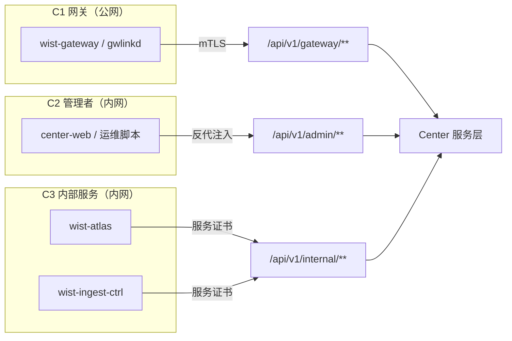
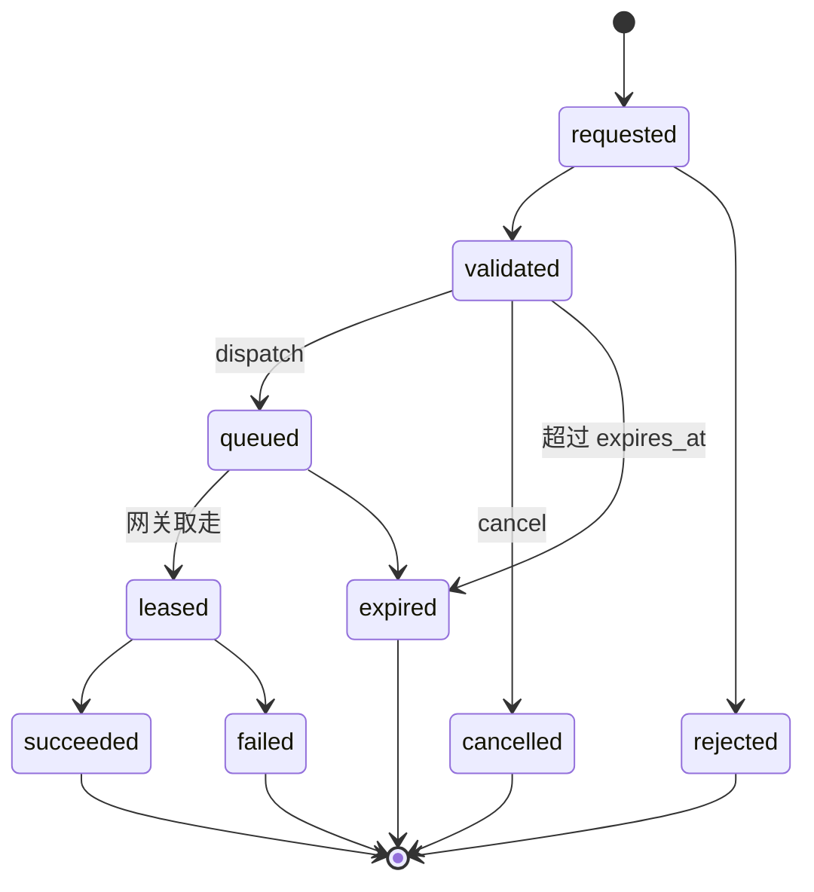

# Center 对外 API 设计（三类调用方与指令创建 / 下发）

## 1. 文档目的

Center（`wist-center`）已经有两条 HTTP 面：公网网关面 `/api/v1/gateway/**`（mTLS）与内网管理面
`/api/v1/admin/**`（反代注入）。但**谁算调用方、从哪个面进、能调到什么、指令怎么创建和下发的**，
目前分散在代码路由、README 表格和各篇设计稿里，没有一份把边界钉死的文档。

本文回答四个问题：

- Center 对外有几类调用方，每类的身份锚点是什么
- 每类的路由前缀、监听面、权限边界与失败语义
- 「创建指令 / 下发指令」的统一资源模型、状态机与 wire 契约
- 新契约怎么进模型、怎么做版本与分阶段上线

明确不在本文：

- 网关 / agent 的南向协议细节 → [`agent-gateway-protocol.md`](agent-gateway-protocol.md)
- 数据面上送（telemetry / discovery 走 wparse）→ [`discovery-sync-protocol.md`](discovery-sync-protocol.md)
- 每种 `kind` 的执行语义 → [`../execution/action-plan-ir.md`](../execution/action-plan-ir.md)

---

## 2. 结论（先看这十条）

| 编号 | 决定 | 为什么 |
|---|---|---|
| **D1** | **三类调用方，三套凭据，不共用**：网关 = CA-G 客户端证书，管理者 = 反代注入头，内部服务 = CA-I 服务证书 + scope；脚本例外用 C 签发的 token | 三类的失效方式不同：证书可按网关吊销、会话可按人失效、服务证书要能按服务收窄；这三种失效机制没法压成一个 token |
| **D2** | **前缀表达「谁在调」，不表达「改的是谁」** | 面 = 攻击面，权限 = 身份，审计 = 面 + 身份；三者必须同源 |
| **D3** | 内部服务面独立成第三面 `/api/v1/internal/**`，**默认只读 + 两条具名写能力**（调查、封堵） | 只读消费方不该持有能写机队的凭据；真正需要的写按能力具名授予，不走 admin token |
| **D4** | **指令是资源，不是动词**：`create` 与 `dispatch` 分离 | 中间要能审批、取消、过期、补下发，RPC 动词扛不住 |
| **D5** | **两层 id**：`command_id`（调用方看）/ `target_command_id`（网关看） | 一个语义指令 → N 个目标投递，不能让两层 id 混用 |
| **D6** | **`selector` 与大批量不进命令**：目标 > 50 或需灰度 / 健康门 → 走 `rollout-plans` | 一条「全机队」指令点错的代价，不该由幂等和审计来兜 |
| **D7** | **授权只认身份给的事实**：body 里的 `requested_by` / `tenant_id` 只做对账 | 现模型 `OperatorRequest.requested_by` 是报文字段，不能变成授权输入 |
| **D8** | **契约由模型生成，OpenAPI 是产物** | 见 [`../foundation/api-seam-inventory.md`](../foundation/api-seam-inventory.md) §5「模型是 seam 的唯一源」 |
| **D9** | **公网面永不含管理路由，由 CI 断言** | 不靠人记得；前缀闸已经有默认拒绝，缺的是「路由归类」的测试 |
| **D10** | **有生效期的处置是资源（`Containment`），一次性动作才是 `Command`** | 封堵有 TTL、验证、引用计数、解封 —— 这些都不是「一次命令的终态」能表达的 |

一句话说：

> **网关只证明「我是 gw-001」，管理者证明「我是谁」，内部服务证明「我是哪个服务、能读什么」；
> 三者走三个前缀，指令统一成一个可审批、可对账、可取消的资源。**

---

## 3. 三类调用方

### 3.1 定义

| 类别 | 代号 | 是谁 | 它来 Center 做什么 | 它不做什么 |
|---|---|---|---|---|
| 网关 | **C1** | `wist-gateway` / `wist-gwlinkd`（系统 actor `WistGateway`） | 注册与换证、`link-upstream`、状态与升级回执、**取指令与回执** | 不创建指令、不读别家网关、不碰管理面 |
| 管理者 | **C2** | 管理控制台 `wist-center-web`、运维脚本、模型里的四个人类 actor | 机队读、**指令创建 / 下发 / 取消**、发布与升级计划、网关置备 | 不直连网关内网端口、不拿网关证书 |
| 平台内部服务 | **C3** | `wist-atlas`、`wist-ingest-ctrl`、后续分析 / AI 服务 | 读事实与运行态、读指令与审计 | 默认不写；写只按具体 `kind` 逐个授予 |

两个词先钉住：

- **「管理者」不等于「内部服务」**。自然人操作与后台服务操作，在审计（谁）、限流（多狠）、失效（怎么撤）上必须能分开。
- **「网关」不是「受管机器上的 agent」**。网关是 Center 的南向代理，agentd 只跟网关说话。

### 3.2 身份锚点

| 类别 | 身份锚点 | 凭据 | 现状落点 | 失败语义 |
|---|---|---|---|---|
| C1 | `gateway_id` | 客户端证书（CA-G 签发），报文里的 `gateway_id` **只做对账** | `VerifiedGatewayIdentity` + `authorize_gateway_certificate`（已按报文与证书比对） | `certificate_required` / `certificate_expired` / `certificate_mismatch` / `certificate_not_registered` |
| C2 | `subject`（人） | **反代注入**（`x-wist-operator` + `x-wist-roles`）；脚本例外，用 C 签发的 token | `require_admin_bearer`（单 token，sha256 常数时间比较，空 token = dev 不鉴权）—— **这是现状，要换掉** | `untrusted_ingress_peer` / `missing_operator` / `invalid_token` / `rate_limited` |
| C3 | `service`（服务名） | 服务客户端证书（独立 CA-I 签发）+ scope | **尚无** | `service_certificate_required` / `service_not_registered` / `service_scope_denied`（新增码） |

> C1 的现有做法是对的，本文只是把它写成规则：**报文里的身份字段永远不是授权输入**，
> 服务端拿证书里的 `gateway_id` 去比对，不一致就拒。

### 3.3 三个面



| 面 | 监听配置 | 默认暴露 | 允许前缀 | 身份 |
|---|---|---|---|---|
| 网关面 | `server.listen_addr` | 公网 / 反代 | `/api/v1/gateway/**`、`/api/v1/releases/artifact/**`、`/api/v1/version` | C1 证书 |
| 管理面 | `server.admin_addr` | 内网 only（**反代后**） | `/api/v1/admin/**`、`/api/v1/version` | C2 反代注入 |
| 内部服务面 | `server.internal_addr`（**新增**） | 内网 only | `/api/v1/internal/**`、`/api/v1/version` | C3 服务证书 |

三条硬规矩：

1. **默认拒绝**：新增路由不会自动出现在任何一面，必须显式进前缀白名单（沿用 `ListenerScope` 的做法）。
2. **面不混身份**：同一面只接受一种凭据类型。过渡期如果暂时同端口，也按「前缀 + 凭据类型」双判，不能退化成「谁带 token 谁进」。
3. **`/api/v1/version` 三面都放**（页面左下角版本号，未登录也要答）。

### 3.4 权限矩阵

| 能力 | C1 网关 | C2 管理者 | C3 内部服务 |
|---|---|---|---|
| 上报自身状态 / 结果 | 仅自身 | 禁止 | 禁止 |
| 读自身配置 / 升级计划 | 仅自身 | 允许 | 允许（脱敏，scope 内） |
| 读机队（agent / gateway 列表） | 仅自身下的 agent | 允许 | 允许（scope 内） |
| **创建指令** | 禁止 | 允许 | 允许（**仅 `investigation.run`**，scope `write:investigation`） |
| **下发指令** | 禁止 | 允许 | 同上 |
| **封堵 / 解封** | 禁止 | 允许 | 允许（scope `write:containment`，**需双人 + 时限**） |
| 取 / 回执指令 | 仅自己队列 | 禁止（看状态走 admin 查询） | 只读 |
| 发布 / 升级计划 | 读计划 + 回执 | 允许 | 只读 |
| 审计查询 | 禁止 | 允许 | 允许（scope 内） |
| 写租户 / 绑定 / 吊销 | 禁止 | 允许 | 禁止 |

> 这张表是**判据**，不是文案：任何一个新 entry 落地时，都要能在这张表里找到唯一一格。

---

## 4. 现状盘点（as-is）与缺口

### 4.1 现状

**监听与闸门**：两个 listener + 前缀白名单（`ListenerScope::{Gateway, Admin}`），未命中白名单直接 `404`；
未配置 `admin_addr` 时退回单 listener。这是对的做法，本文沿用。

**鉴权**：网关面 = mTLS 客户端证书；管理面 = 单个 admin token（dev 允许为空）；失败按客户端 IP 限流。

**指令通路现在是四条，各走各的**：

| 通路 | 存储 | 消费者 | 语义 | 回执 |
|---|---|---|---|---|
| 网关本机指令 | `gateway_commands`（`kind`：`proxy` / `diagnose` / `restart-gateway` / `restart-gwlinkd` / `bind-tenant`） | gwlinkd 1–2s 短轮询 `GET /api/v1/gateway/commands` | 本机执行 | `POST /api/v1/gateway/commands/{id}/result` |
| Agent 指令 | 网关回执里的 `commands[]` | agentd 3s 心跳 | 提示类（刷新策略 / 轮换身份） | 下一次上报的 `command_acks` |
| 灰度 / 升级 | `rollout-plans` | PollWork / 升级计划 | 分批 + 健康门 | 条目回填 |
| 机队指令 | **无** | **无** | `DispatchAgentFleetCommand` 只回一个壳回执 | 无 |

队列参数（现状，本文不改）：租约 30s（控制类 360s）、最多 2 次尝试、pending 60s 过期、每网关 32 条上限、
同 `(gateway_id, kind, body)` 去重。

### 4.2 缺口

| 编号 | 缺口 | 证据 | 后果 |
|---|---|---|---|
| **G1** | 管理动作长在公网面上 | `POST /api/v1/gateway/agents/dispatch` 需要 admin token，但前缀属于网关面，admin listener 不服务它；README 里为此专门写了一句「sits under the `/gateway/` prefix but is an admin-side command」 | 管理写操作被推到公网 listener；前缀与权限语义相反，闸门推理失效 |
| **G2** | 没有服务身份 | 内部服务只能借 admin token | 一个只读需求要换一张全量写凭据 |
| **G3** | 单 token 无主体 | 目标模型写 `actor_identity AdminOperator.id from ingress.operator`，代码只有一个 `admin_token_hash` | 审计只能记「admin」，四个人类 actor 在代码里不存在 |
| **G4** | 指令语义分裂 | 四条通路、四套状态、无统一对账键 | 「这条指令到底发到哪台机器、成了没有」要拼三张表 |
| **G5** | 缺幂等与状态契约 | `DispatchAgentFleetCommand { command_kind, agent_ids }`：无 payload、无幂等键、无状态查询、无结果 | 页面重试 = 重复下发；`kind` 是开放字符串，拼错不报错 |
| **G6** | 契约无单一真源 | README 手写路由表；模型 `binding.mju` 与代码已有漂移（见 api-seam-inventory §4 G3） | 三方各记一份，升级时才发现对不上 |

### 4.3 归属判据

> **一个 handler 属于哪个面，只看「谁在调」，不看「它改的是谁的对象」。**

反例就是 G1：`/gateway/agents/dispatch` 改的是 agent，但调用方是管理者 —— 它应该长在管理面。
按「改谁」归面，会让公网面承载管理权限；按「谁调」归面，攻击面、凭据、审计三者才自洽。

---

## 5. 路由与命名法

### 5.1 三条规则

- **R1 前缀 = 调用方类别**：`/api/v1/gateway/**` → C1，`/api/v1/admin/**` → C2，`/api/v1/internal/**` → C3。
- **R2 动作 = 子路径 `/verb`**（无路径参数时可用 `resource:verb`，如 `credentials:renew`）：
  axum 0.8 的路由不允许 `{id}:verb` 同段（"Only one parameter is allowed per path segment"），
  所以 `commands/{id}/dispatch` 而不是 `commands/{id}:dispatch`。
- **R3 资源 id 在路径，幂等键在 header**：`POST /admin/commands/{command_id}/dispatch` + `Idempotency-Key`。

### 5.2 迁移映射

| 旧 | 新 | 处理 |
|---|---|---|
| `POST /api/v1/gateway/agents/dispatch` | `POST /api/v1/admin/commands`（`target.type=agent`） | P0 改归属；旧路由保留一个发布周期，回 `410 gone` + `Location` 指向新端点 |
| `GET /api/v1/gateway/commands?gateway_id=` | 不变（仍是 C1 取指令） | 报文加 `parent_command_id` / `request_id`（加性） |
| `POST /api/v1/gateway/commands/{id}/result` | 不变 | 路径里的 id 明确为 `target_command_id`（语义收紧，不改形状） |
| `POST /api/v1/admin/policies/global` | `POST /api/v1/admin/commands`（`kind=gateway.refresh-policy`） | 后续统一；先并存 |

### 5.3 版本

沿用 [`../foundation/api-seam-inventory.md`](../foundation/api-seam-inventory.md) §7：

- **路由版本是线上版本的真源**；报文里的 `api_version` 只做断言与日志。
- **非加性变更走新前缀版本**（`/api/v1/internal/v2/...`），旧版本冻结并存，不要求原子升级。
- **纯加字段才在同路由演进**，且接收端先升。接收端是 strict（`deny_unknown_fields`）时，一律当作非加性。

---

## 6. 指令（Command）：创建与下发

### 6.1 为什么做成资源

| 需求 | RPC 动词（`POST .../dispatch`） | Command 资源 |
|---|---|---|
| 高危指令等审批 | 做不到（请求已发） | `validated` 停住，审批后再 `dispatch` |
| 页面重复点击 | 重复下发 | 幂等键复用同一条 |
| 部分失败对账 | 只有一个整体回执 | 每目标一条 `target_command` + 结果 |
| 撤销 / 过期 | 做不到 | `cancel` / `expires_at` |
| 事后追责 | 只有请求日志 | 状态迁移逐条进审计 |

**结论：`create` 负责「受理与冻结」，`dispatch` 负责「投递与展开」。**

### 6.2 两条投递路径（不能混）

| | gateway-scoped | agent-scoped |
|---|---|---|
| `target.type` | `gateway` | `agent` |
| Center 写入 | `gateway_commands` 行（`target_command_id`） | 网关的 agent 指令表 |
| 消费者 | gwlinkd（1–2s 短轮询） | agentd（3s 心跳搭车） |
| 执行位置 | 网关主机（容器 / 常驻进程） | 业务服务器上的 agentd |
| 回执 | `POST /gateway/commands/{id}/result` | `AgentStatusReport.command_acks` |
| 示例 kind | `gateway.diagnose` / `gateway.restart-process` / `gateway.bind-tenant` | `agent.refresh-facts` / `agent.rotate-identity` |

一条 command 只允许一种 `target.type`。混在一起会让「部分成功」的语义变成两套，对账时谁也说不清。

### 6.3 对象

**Command（调用方视角）**

| 字段 | 说明 |
|---|---|
| `command_id` | 服务端生成（`cmd_` 前缀），语义层主键 |
| `request_id` | 调用方给的幂等键（= `Idempotency-Key`），回显 |
| `kind` | 词表内的指令种类（见 §6.9），未知即拒 |
| `target` | `{ "type": "gateway" \| "agent", "ids": [...] }`（首版只收显式 id） |
| `payload` | 按 `kind` 的强 schema 校验；≤ 16 KiB；**不允许透传 shell / 路径** |
| `reason` | 人写的原因（客户报障 / 变更单号），进审计 |
| `origin` | **仅 C3**：`服务名/事件 id`，进审计；C2 不需要（见 §7.6） |
| `state` | 聚合状态（见 §6.4） |
| `created_by` / `created_at` | 来自身份，不信 body |
| `expires_at` | 到期未投递则 `expired`；默认 24h |
| `dispatch_at` | 计划投递时刻（由 `dispatch` 设置）；`null` = 立即 |
| `target_count` | 冻结的目标台数 |
| `targets[]` | **下发后才有**：每个目标的 `{ target_id, target_command_id, state, attempts, result_ref }`；未下发时为空数组 |

**TargetCommand（投递视角）**

| 字段 | 说明 |
|---|---|
| `target_command_id` | 投递层主键，网关看到的 id |
| `parent_command_id` | 指回语义层 |
| `request_id` | 从父指令继承，便于网关侧日志对账 |
| `state` | `queued → leased → succeeded / failed / expired / cancelled / rejected` |
| `attempts` | 复用现有「最多 2 次」 |
| `result` | 状态码 / 摘要 / 结果体引用（≤ 1 MiB，沿用 `MAX_RESULT_BODY_BYTES`） |

### 6.4 状态机



聚合规则（由 `targets[]` 派生，不单独存可变状态）：

| 条件 | 聚合 `state` |
|---|---|
| 全部 `succeeded` | `succeeded` |
| 有终态且有 `failed`，其余成功 | `partial` |
| 全部失败 / 拒绝 | `failed` / `rejected` |
| 有任一未终态 | `queued` / `leased` |
| 未下发且被取消 | `cancelled` |
| 未下发且过期 | `expired` |

**不做 `running`**：网关回执只有「成 / 败」，凭空造一个 running 会让状态机永远停在中间。

两个边界说法：

- `requested` 是同步受理中的瞬态：校验通过立即进 `validated`，不通过直接 `rejected`，调用方一般看不到它。
- `partial` **只存在于聚合状态**，不是任何一个 `target_command` 的状态。

### 6.5 创建

```http
POST /api/v1/admin/commands
# 下面两个头由反代写入，客户端不自己填（外部传来的同名头一律丢弃）
x-wist-operator: alice
x-wist-roles: operator
Idempotency-Key: 3f0c9a6e-...
Content-Type: application/json
```

```json
{
  "kind": "gateway.diagnose",
  "target": { "type": "gateway", "ids": ["gw-001", "gw-002"] },
  "payload": { "profile": "full" },
  "reason": "客户报障：数据面不出数",
  "dispatch_now": false,
  "expires_at": "2026-11-02T10:00:00Z"
}
```

`201 Created`

```json
{
  "command_id": "cmd_01J9Z6K3",
  "request_id": "3f0c9a6e-...",
  "kind": "gateway.diagnose",
  "state": "validated",
  "target": { "type": "gateway", "ids": ["gw-001", "gw-002"] },
  "target_count": 2,
  "created_by": "AdminOperator:zhangsan",
  "created_at": "2026-11-01T09:41:00Z",
  "expires_at": "2026-11-02T10:00:00Z",
  "targets": []
}
```

`dispatch_now: true` 时返回 `state: "queued"`，且 `targets[]` 里已有每目标的 `target_command_id`。

`Idempotency-Key` **必填**（≤ 128 字符）：缺失 → `400 idempotency_key_required`。

创建阶段的校验清单（全部通过才落库）：

1. `Idempotency-Key` 存在且 ≤ 128 字符
2. `kind` 在词表内，且调用方 actor 对该 `kind` 有权限
3. `target.ids` 非空、去重后 ≤ 50
4. 每个 `target_id` 存在、属于调用方可见租户、`agent` 目标在线
5. `payload` 符合该 `kind` 的 schema，且 ≤ 16 KiB
6. `expires_at` 在未来且 ≤ 7 天
7. 高危 `kind` 在审批链落地前**不允许 `dispatch_now=true`**：必须先 `create`，再由另一人 `dispatch`
8. 同 `(kind, target.ids)` 在飞指令数未超上限（默认 4）
9. `requested_by`（若带）必须与身份一致，否则 `400`
10. **C3 调用必须带 `origin` 与 `reason`**（`400 origin_required`）
11. 目标网关当前队列未满（32 条，沿用现状）
12. 幂等键未被不同 body 占用

失败语义：`400 command_kind_unknown` / `422 command_payload_invalid` / `400 command_target_limit_exceeded` /
`409 command_idempotency_conflict` / `403 command_kind_not_allowed`。

### 6.6 下发

```http
POST /api/v1/admin/commands/{command_id}/dispatch
Idempotency-Key: 7b21...
```

```json
{ "target_ids": ["gw-001"], "dispatch_at": null }
```

`Idempotency-Key` 在下发时**可选**：状态机已经挡住重复下发的副作用，该值只用于「同一次点击重试」的对账。

语义：

- 只允许 `validated` 状态；其它状态 `409 command_state_conflict`。
- `targets` **只能收窄，不能扩大**（创建时冻结的目标集合是上限），防止「审批两个、下发两百个」。
- `dispatch_now=true` 的创建等价于 `create + dispatch`（一步到位，返回 `state=queued`）。
- 目标数 > 50 → `400 command_target_limit_exceeded`，body 里带 `hint: "use /api/v1/admin/rollout-plans"`。
- 下发是**按目标独立**的：一个目标入队失败不影响其它目标，结果为 `partial`，失败项带原因。

### 6.7 取消 / 重试 / 过期

| 操作 | 端点 | 规则 |
|---|---|---|
| 取消 | `POST /api/v1/admin/commands/{id}/cancel` | **本期只允许 `validated`**（未投递）；已入队行在 `gateway_commands` 里，队列没有撤回 API。`retry` 尚未实现。 |
| 重试 | `POST /api/v1/admin/commands/{id}/retry`（未实现） | 只对 `failed` / `expired` 的 target 生成**新的** `target_command_id`；`attempts` 计数继承，超上限拒绝 |
| 过期 | 无端点 | `expires_at` 到点后由清理任务置 `expired`；已下发目标不受影响 |

### 6.8 查询

| 端点 | 用途 |
|---|---|
| `GET /api/v1/admin/commands?kind=&state=&target_id=&since=&limit=&cursor=` | 列表（默认 20，上限 200） |
| `GET /api/v1/admin/commands/{command_id}` | 详情（含 `targets[]` 摘要） |
| `GET /api/v1/admin/commands/{command_id}/targets/{target_id}` | 单目标结果体 |

读接口遵守 §8.4：`limit` 有上限、时间一律 RFC3339 UTC、不提供「全量导出」。

### 6.9 首批 `kind` 词表

| kind | target | 投递 wire kind | 风险 | 审批 | 现状 | 说明 |
|---|---|---|---|---|---|---|
| `gateway.diagnose` | gateway | `diagnose` | R0 | 否 | 已有 | 体检，报告留网关 |
| `gateway.report-agents` | gateway | `report-agents` | R0 | 否 | 已落地 | 立即做一次 Agent 明细 / 数据清单上报（环回拉网关机队 → 转报中心）；60s 周期仍是兜底 |
| `gateway.refresh-policy` | gateway | `proxy` | R1 | 否 | **仅壳** | 现 `POST /admin/policies/global` 只回回执，不投递；P1 才真正入队 |
| `gateway.restart-process` | gateway | `restart-gateway` / `restart-gwlinkd` | R2 | **是** | 已有 | payload 只允许 `{ "process": "gateway" \| "gwlinkd" }` |
| `gateway.bind-tenant` | gateway | `bind-tenant` | R2 | **是** | 已有 | 收敛到本入口 |
| `gateway.publish-rules` | gateway | `proxy` | R2 | **是** | 已有 | 沿用 `wparse-proxy` 命令通道 |
| `agent.refresh-facts` | agent | 控制指令 | R0 | 否 | 部分 | 控制指令通道已有，缺下发入口 |
| `agent.rotate-identity` | agent | `RotateIdentityHint` | R2 | **是** | 部分 | 模型已有对象，缺下发入口 |
| `investigation.run` | agent | `investigate`（经网关转投） | R1 | 否 | 已有（网关侧） | 只读证据；三道闸 G1/G2/G3 在网关判，见 §7.6.2 |

> 「仅壳」必须显式标出来：`DispatchAgentFleetCommand` 和 `AdminDispatchGlobalPolicy` 今天都只生成回执、
> 不产生任何投递。把它们归入同一个 `Command` 入口后，壳才变成真实现。

词表纪律：

- **新增 kind 是加性变更**（老调用方不受影响）；**删除 / 改名是破坏性变更**（走新版本）。
- 未知 kind 一律 `400`，不做「尽力执行」。
- `kind` 与 wire kind 分开：前者是调用方词表，后者是网关 / agent 的传输词表，映射在服务端固定，不给调用方透传。

### 6.10 与 `rollout-plans` 的分界

| 判据 | Command | RolloutPlan |
|---|---|---|
| 目标规模 | ≤ 50 且显式 id | 大批量 / selector |
| 落点 | 一次投递 | 分阶段、可暂停、可回退 |
| 审批 | 单条（高危 kind） | 计划级 |
| 健康门 | 无 | 有 |
| 典型 | 单网关体检、单机重启 | 升级、规则全量下发 |

> 判据是「**错了会不会连累一片**」。会，就走 rollout。

### 6.11 网关侧（C1）契约

**取指令（形状不变，字段加性）**

```http
GET /api/v1/gateway/commands?gateway_id=gw-001
```

```json
{
  "command_id": "tcmd_01J9Z7A1",
  "parent_command_id": "cmd_01J9Z6K3",
  "request_id": "3f0c9a6e-...",
  "kind": "diagnose",
  "method": null,
  "path": null,
  "body": null,
  "lease_expires_at": "2026-11-01T09:41:30Z"
}
```

**回执（`target_command_id` 在路径，结果体加性）**

```http
POST /api/v1/gateway/commands/tcmd_01J9Z7A1/result
```

```json
{
  "state": "done",
  "status": 0,
  "detail": "diagnose report written",
  "parent_command_id": "cmd_01J9Z6K3"
}
```

不变的部分（有意保留）：

- 网关只看 **wire kind**，不需要理解 `gateway.diagnose` 这类调用方词表。
- **报文字段名仍是 `command_id`**（不改形状，避免打断已上线的 gwlinkd）；它的语义是
  `target_command_id`，与语义层 `command_id` 靠 `parent_command_id` 关联。
- 租约 / 重试 / 上限 / 去重全部沿用现有队列，不新建第二套队列表。

### 6.12 幂等矩阵

| 层 | 键 | 范围 | 重复时 |
|---|---|---|---|
| 调用方语义 | `Idempotency-Key` | 调用方 + 面 + 路径 | 同 key 同 body → 返回原 `command_id`（`200`）；同 key 异 body → `409` |
| 目标投递 | `(parent_command_id, target_id)` | 指令内 | 复用同一 `target_command_id`，不重复入队 |
| 网关执行 | `target_command_id` | 单网关 | 已 `succeeded` 的重投直接回执，不再执行 |
| 结果回传 | `target_command_id` + `state` | 单目标 | 可重复到达，按最后终态收敛 |

---

## 7. 内部服务面（C3）

### 7.1 暴露什么，不暴露什么

| 暴露 | 不暴露 |
|---|---|
| 机队与网关的**读模型**（列表 / 详情 / 绑定 / 生命周期） | 绑定 / 解绑、发布、吊销、改安装包、改策略上限 |
| 审计与指令的**只读**查询（便于外部系统关联排障） | 原始凭据、证书私钥、token 哈希 |
| 稳定主键与版本化 DTO（`agent_id` / `gateway_id` / `host_id`） | 「全量 dump」「无 limit 导出」 |
| 事件增量（P2 拉模式） | 内部表结构、跨域 Domain 实体 |
| **两条具名写能力**：调查（§7.6.1）、封堵（§7.6.2） | 其余任何写 |

> **内部服务面不是「半个管理面」。** 写只给两个具名能力，各自有独立 scope、闸门与上限（§7.6），
> 而不是复用 admin token。

### 7.2 scope

| scope | 覆盖 |
|---|---|
| `read:agents` | agent 列表 / 详情 / 能力索引 |
| `read:gateway` | 网关列表 / 状态 / 绑定 / 生命周期 / 初始配置（脱敏） |
| `read:inventory` | 主机库存与运行态（随 `Observed.*` 落地） |
| `read:topology` | 网络 / 服务拓扑摘要（随 atlas 落地） |
| `read:security` | 软件与漏洞结果（只出证据，不出判断） |
| `read:audit` | 审计查询 |
| `read:command` | 指令与结果只读 |
| `write:investigation` | 发起调查（仅 `investigation.run`，只读面） |
| `write:containment` | 创建 / 下发 / 解封封堵项（见 §7.6.2） |

### 7.3 首批端点

```
GET /api/v1/internal/agents?gateway_id=&state=&limit=&cursor=
GET /api/v1/internal/agents/{agent_id}
GET /api/v1/internal/gateways?limit=&cursor=
GET /api/v1/internal/gateways/{gateway_id}/binding
GET /api/v1/internal/gateways/{gateway_id}/lifecycle
GET /api/v1/internal/commands/{command_id}
GET /api/v1/internal/audit?command_id=&agent_id=&gateway_id=&since=&limit=&cursor=

POST /api/v1/internal/commands                      # 仅 investigation.run（§7.6.1）
POST /api/v1/internal/containments                  # 创建 / 演练（§7.6.2）
POST /api/v1/internal/containments/{id}/dispatch
POST /api/v1/internal/containments/{id}/release
GET  /api/v1/internal/containments/{id}
```

约定（**读**端点）：

- **只读、幂等、可缓存**（`GET` 带 `ETag` / `Last-Modified`，读接口允许条件请求）。
- 未知 id → `404` 统一信封；**没有权限与不存在返回同一个 404**，不泄露对象是否存在。
- `atlas` 需要的 discovery 原文**不走这里**（走数据面 `DSNAP` + 适配器，见
  [`discovery-sync-protocol.md`](discovery-sync-protocol.md)），这里只提供「归并后的中心视图」。
- 写端点（`POST`）不走缓存，也不需要 `ETag`；它们的幂等键与双人规则见 §7.6。

### 7.4 事件：先拉后推

P2 只做**拉**：

```
GET /api/v1/internal/events?since=<cursor>&limit=
```

- 游标是单调递增的 `event_seq`（中心侧 outbox 序号），不是时间戳（同一秒内多事件不会漏）。
- 事件类型：`agent.registered` / `agent.offline` / `gateway.bound` / `command.settled` /
  `containment.active` / `containment.degraded` / `containment.released` / `release.published`。
- 推送（webhook / SSE）留到 P3，且必须先有「重放 + 幂等」两个机制，否则不做。

### 7.5 服务注册与吊销

- 独立 **CA-I**（内部服务 CA）签发，subject = 服务名；不复用网关 CA-G。
- 中心维护服务登记表：`service` → `scopes[]` / `enabled` / `revoked_at`。
- 吊销是**登记表拒绝**（与 agent 的 deny-list 同口径），不依赖证书是否过期。

### 7.6 内部服务的写能力（只有两条）

| 能力 | 形态 | 风险 | scope | 说明 |
|---|---|---|---|---|
| 调查指令 | `Command`（`investigation.run`） | R1（只读） | `write:investigation` | 一次性证据，不改机器 |
| 封堵 / 解封 | `Containment` 资源 | R3 | `write:containment` | 有 TTL、验证、回滚；**只由网关暴露的封闭能力执行** |

为什么不能只给读：分析 / 响应服务是闭环的一半 —— 它得出结论却不能让平台把证据取回来、
把边界封住，闭环就只能断在人手上。但只给这两条，且都是**具名 + 可审计 + 有上限**。

三条 C3 写请求的额外闸门（与 C2 共用其余校验）：

1. **scope 闸**：`write:investigation` / `write:containment` 单独授予，**不随 `read:*` 自动获得**。
2. **来源闸**：必须带 `origin`（`服务名/事件 id`）与 `reason`，两者都进审计。没有来源的写 = 自动探测，拒绝。
3. **配额闸**：按 `service` + 按目标（agent / device）双桶（值见 §8.3），超限 `429`。

C3 **永远不能**做 C2 的事：绑定 / 解绑、发布、吊销、改安装包、改策略上限。

#### 7.6.1 调查指令 `investigation.run`

**现状**：调查下发今天长在**网关**（`POST /api/v1/admin/agents/{agent_id}/investigations`），
center 没有代理面。C3 要调 center，center 必须转投 —— 不能要求内部服务直接连每台网关。

**投递链路**（复用现有两条通道，不新开入站面；wire 契约见
[`gateway-capability-contract.md`](gateway-capability-contract.md)）：

```text
C3 ──Command(investigation.run)──▶ Center
                                    │ 按 agent 找到其网关
                                    ▼
                       gateway_commands 队列（kind=investigate）
                                    │ gwlinkd 1–2s 短轮询
                                    ▼
                       网关 admin API（三道闸 G1/G2/G3）
                                    │ agentd 3s 心跳
                                    ▼
                                  agentd
                                    │ 报告走数据面 IVSREP
                                    ▼
                              wparse → sink
```

```json
POST /api/v1/internal/commands
{
  "kind": "investigation.run",
  "target": { "type": "agent", "ids": ["agent-7f3"] },
  "payload": { "topic": "disk", "params": { "path": "/var", "top": 20 } },
  "reason": "INC-2026-1101-07 盘满",
  "origin": "wist-ai-triage/INC-2026-1101-07",
  "dispatch_now": true,
  "expires_at": "2026-11-01T18:00:00Z"
}
```

目标结果（关键字段）：

```json
{
  "target_id": "agent-7f3",
  "state": "succeeded",
  "agent_command_id": "iv_01J9Z8...",
  "judged": "（≤ 600 字结论，来自 ack）",
  "evidence_ref": {
    "kind": "investigation_report",
    "artifact_id": "art_01J9ZB7",
    "gateway_id": "gw-001",
    "agent_id": "agent-7f3",
    "agent_command_id": "cmd_agent-7f3_investigate_...",
    "schema_id": "wist.investigation.disk/v1",
    "sensitivity": "paths"
  }
}
```

四条规矩：

- **center 不转存报告**：正文走数据面 `IVSREP`，落到**计算区的证据服务 + COS**（见
  [`evidence-service.md`](evidence-service.md)），center 只留 `evidence_ref` 与 ack 摘要。
  谁能读全文，由 `sensitivity` + 证据服务的 scope 决定（`paths` / `commandlines` 默认只回摘要）。
- **两层 id 要分清**：`target_command_id`（center 投递；gwlinkd 的 wire 字段仍叫 `command_id`）、
  `agent_command_id`（网关为 agentd 生成，报告按它 join）。响应里两个都要能对上，
  否则拿到报告时对不回是哪次调查。
- **三道闸的错误原样透出**：`investigation_not_allowed`（上界不允）/ `investigation_not_granted`
  （按机器未授权）/ `investigation_unsupported`（能力不足）/ `investigation_quota_exceeded`（配额）。
  center 不改写成泛化错误 —— 否则调用方分不清「没授权」和「机器不支持」。
- **只读不可绕过**：`topic` 是闭集，`params` 按面的 schema 校验，**没有** `exec` / `shell` / `script` 字段。
  需要改机器请走 `ActionPlan`，不走调查。

#### 7.6.2 封堵 / 解封（`Containment`）

一句话：**不要用 `Command` 表达封堵**。封堵是一个**有生效期、可验证、可解封、按引用计数**的状态对象；
命令的「成 / 败」终态表达不了「现在还在封着」。

| 端点 | 面 | 用途 |
|---|---|---|
| `POST /api/v1/internal/containments` | C3 | 创建（**默认 `dry_run=true`**） |
| `POST /api/v1/internal/containments/{id}/dispatch` | C3 | 真正下发（**双人**） |
| `POST /api/v1/internal/containments/{id}/release` | C3 | 提前解封（必带 `reason`） |
| `GET /api/v1/internal/containments/{id}` / `?state=active` | C3 | 查当前封堵项 |

细节（指示器白名单、网关能力、TTL、引用计数、自锁保护、生效验证、失败语义）见
[`security-containment-actions.md`](security-containment-actions.md)；指令信封 / 能力广告 / relay 面见
[`gateway-capability-contract.md`](gateway-capability-contract.md)。这里只钉 C3 侧四条规矩：

1. **默认演练**：`dry_run=true` 只返回「会打到哪些能力、展开成什么规则」，不碰设备；`dispatch` 才执行。
2. **双人**：`created_by` 与 `dispatched_by` 必须是不同 subject；同一主体不能既创建又下发。
3. **不可永久**：`expires_at` 必填，上限 7 天。「永久封堵」只能转成设备侧策略配置（另一个变更流程），
   API 不提供 —— 否则一次误操作就是永久性的客户断网。
4. **不开放、不自由**：执行方是**网关暴露的封闭能力清单**（`capability_id` 枚举 + `apply` / `readback` / `remove`
   三个动作）。Center 不连设备、不加载插件、不转发任意 URL / CLI / 请求体；旧网关没上报能力就
   直接 `409 containment_unsupported`。

---

## 8. 横切契约

### 8.1 actor 的落点

| 面 | actor 来源 | 模型表达（目标） |
|---|---|---|
| C1 | 证书 subject 里的 `gateway_id` | `actor_identity WistGateway.id from credential.gateway_id` |
| C2 | 注入头 → subject 映射 | `actor_identity AdminOperator.id from ingress.operator` |
| C3 | 证书 subject 里的服务名 | `actor_identity WistAtlas.id from credential.service` |

> **口径修正（2026-11-02）**：C2 的人的 `subject` **不来自 token**，来自反代注入的
> `x-wist-operator` 头（`wist-console` 已经在用 `auth.mode = "ingress"`，center-web 照抄）；
> 脚本 / break-glass 例外，那时 `source = token`、`id = credential_id`（不是人）。
>
> 现状差距（G3）：C2 只有一个 token hash，没有 subject。**这是 P0 要补的最小项** ——
> 否则「谁下的这条指令」永远只能答「admin」。
>
> 验证侧的完整口径（三种凭据来源、`Subject` 形状、token 摘要的 register/revoke 推送、
> X 的四层信任与本地裁剪、有效期与作用范围）见
> [`../foundation/auth-token-verification.md`](../foundation/auth-token-verification.md)。

### 8.2 错误信封与码

沿用现有 `{ "error": { "code": "...", "message": "..." } }`（`ApiError`），`code` 是稳定契约、`snake_case`、按域加前缀。

新增码（不复用同名旧码）：

| 码 | 语义 |
|---|---|
| `command_kind_unknown` | 词表里没有这个 kind |
| `command_kind_not_allowed` | 有这个 kind，但调用方无权 |
| `command_payload_invalid` | payload 不符合 kind schema |
| `command_target_limit_exceeded` | 目标数超上限 |
| `command_target_not_found` | 目标不存在 / 不在可见范围 |
| `command_state_conflict` | 状态不允许该操作 |
| `command_idempotency_conflict` | 同 key 不同 body |
| `idempotency_key_required` | 缺 `Idempotency-Key` |
| `service_certificate_required` / `service_not_registered` | C3 身份失败 |
| `service_scope_denied` | scope 不足 |

已有可复用的：`command_not_found`、`route_not_found`、`rate_limited`、`missing_admin_bearer_token`、`invalid_admin_bearer_token`。

### 8.3 限流与配额

| 面 | 桶键 | 建议值 |
|---|---|---|
| C1 取指令 | `gateway_id` | 1 req/s（现状 1–2s 轮询） |
| C1 其它上报 | `gateway_id` | 沿用现状 |
| C2 | `subject` + 路径 | 读 20 rps / 写 2 rps |
| C2 指令 | `subject` | 在飞指令 ≤ 4，单指令目标 ≤ 50 |
| C3 读 | `service` | 读 20 rps，分页上限 200 |
| C3 调查写 | `service` + `agent_id` | 每服务 30/min；每 agent 每小时 12（网关侧口径，不得放宽） |
| C3 封堵写 | `service` + `device_id` | 每服务 10/min；在飞封堵项 ≤ 50；单次指标 ≤ 100 |

- 桶键**用身份，不用 IP**：IP 只用于鉴权失败的暴力尝试计数（现状做法保留）。
- 超限返回 `429 rate_limited` + `Retry-After`，不返回「你还剩多少」。

### 8.4 通用形状

- 时间：RFC3339 UTC，字段名 `*_at`。
- 分页：`limit` + `cursor`（不透明字符串），**不用 offset**（数据在动）。
- 体积：请求体默认 4 KiB（沿 `MAX_BODY_BYTES`），指令 payload ≤ 16 KiB，结果体 ≤ 1 MiB（沿 `MAX_RESULT_BODY_BYTES`）。
- `null` 与缺字段语义不同：`null` = 显式清空 / 不适用；缺字段 = 用默认值。

### 8.5 审计

每条指令的**每一次状态迁移**都落一条（沿用控制平面 `AuditRecord`）：

| 字段 | 例 |
|---|---|
| `actor` | `AdminOperator:zhangsan` |
| `face` | `admin` |
| `command_id` / `target_command_id` | `cmd_…` / `tcmd_…` |
| `from_state` → `to_state` | `validated → queued` |
| `reason` | 变更单号 / 报障描述 |
| `at` | RFC3339 UTC |

谁（actor）、从哪个面（face）、对什么（kind + 目标摘要）做了什么 —— 三问都要能直接答出来。

### 8.6 多租户

- `tenant_id` **由身份给出**：C1 由网关绑定推导，C2 由 subject 的租户归属，C3 由服务登记表的租户范围。
- body 里出现 `tenant_id` 时只做**一致性对账**，不一致直接 `403`，不做「以 body 为准」。
- 现状是「一部署一客户」（见 `warpstation-rule-publishing.md` R15）；单 Center 多租户未开，
  本面按「过滤 + 越权即 404」预留，不做跨租户聚合。

---

## 9. 安全边界与威胁

| 威胁 | 最大影响面（设计目标） | 靠什么兜 |
|---|---|---|
| 单个网关被控 | 只能读自己配置、回执自己队列、上报自己状态 | 证书绑定 + 报文身份对账 + 面隔离 |
| admin token 泄露 | 全量写（**已知最大风险**） | 内网面 + 限流 + 审计；**P0 把人身份换成反代注入 + 多 subject token**；远期接 SSO 只改反代 |
| 浏览器持凭据 | 任何人开 devtools 就能拿到全量写 | center-web 不再存 token；所有请求同源过反代（反代注入只在内网私有 listener 生效） |
| 内部服务被控 | 只读中心视图（scope 内），不能下发 | 默认只读 + 独立 CA-I + scope 收窄 |
| 指令注入 | 不能执行任意命令 | kind 白名单 + payload schema + 禁 shell / 路径 / URL |
| 越权下发 | 不能把指令发到别家网关 | 目标校验：存在 + 可见租户 + 在线 |
| 重放 | 不能重复执行 | 幂等键 + `target_command_id` 去重 + `expires_at` |

> 凭据方案本身的取舍（三种来源 vs JWT/JWKS 的成本与安全性、12 项威胁矩阵、「X 裁剪 C」为何能把
> 爆炸半径从无界压成有界）见
> [`../foundation/auth-token-verification.md`](../foundation/auth-token-verification.md) §14。

一条红线段：

> **公网面（C1）只允许「自证身份 + 只写自己」。** 任何需要判断「调用方是否有权管别人」的端点，
> 一律不在 C1 面上 —— 包括看起来无害的「列出全部网关」。

---

## 10. 契约真源与模型落地

### 10.1 模型片段（提案，待 `jumo` 校验）

```mju
// 指令资源：语义层
message<command> CreateCommand = OperatorRequest {
  kind: String
  target_type: String
  target_ids: List<String>
  payload: String
  reason: String?
  dispatch_now: Bool
  expires_at: DateTime?
}

struct Command {
  unique command_id: String
  request_id: String
  kind: String
  state: String
  target_type: String
  target_count: Int
  created_by: String
  created_at: DateTime
  expires_at: DateTime?
}

struct TargetCommand {
  unique target_command_id: String
  parent_command_id: String
  target_id: String
  state: String
  attempts: Int
  result_ref: String?
}

interface CommandInterface {
  entry CreateCommand { actor AdminOperator output Command }
  entry DispatchCommand { actor AdminOperator output Command }
  entry CancelCommand { actor AdminOperator output Command }
  entry ViewCommand { actor AdminOperator output Command }
  entry ListCommands { actor AdminOperator output List<Command> }
}
```

```mju
// 内部服务面：每个服务一个 actor（审计要落到具体服务，不要一个笼统 InternalService）
actor<system> WistAtlas {
  access protocol<http>
  can InternalListAgents
  can InternalViewGatewayBinding
}

interface InternalReadInterface {
  entry InternalListAgents { actor WistAtlas output List<AgentRuntimeStatus> }
  entry InternalViewGatewayBinding { actor WistAtlas output GatewayCustomerBinding }
}

bind InternalReadInterface {
  entry InternalListAgents {
    route GET "/api/v1/internal/agents"
    auth mtls
    actor_identity WistAtlas.id from credential.service
    status List<AgentRuntimeStatus> 200
  }
}
```

两处需要先补的模型能力：

1. `auth` 词表补 `mtls`（现只有 `bearer` / `none`，与代码不一致，见 api-seam-inventory §4 G3）。
2. `credential.*` 的身份来源补 `service`（与 `gateway_id` / `agent_id` 并列）。

### 10.2 报文归属

| 报文 | 放哪 | 理由 |
|---|---|---|
| `CreateCommand` / `Command` / `TargetCommand` | `Control` 域（生成） | 内嵌域状态，属控制面实体，不进 `wist-api` |
| 网关取指令 / 回执 | 现有 `wist_control`（生成） + `wist-api`（可选） | 只在 center ↔ gwlinkd 之间流动，无第三方 |
| 内部服务 DTO | `Observed.*` 的读投影 | 内部服务只消费中心视图，不该看到 Control 域实体 |

判据（沿用 api-seam-inventory）：**同一条 seam 的报文只允许一份定义**；出现第二份，就有漂移。

### 10.3 OpenAPI

- 由模型生成，构建期产物；**公网面不暴露 `/openapi.json`**（避免把管理面形状送到公网上）。
- 管理面 / 内部面各自一份（`openapi.admin.json` / `openapi.internal.json`）。
- CI 断言：生成物与提交物一致（防止「改了模型忘了生成」）。

---

## 11. 分阶段落地

### P0 契约归位（不新增能力，只把归属改对）

- ✅ **已落地（`Unreleased`）**：`POST /api/v1/gateway/agents/dispatch` → `410` + `Location: /api/v1/admin/commands`。
- ✅ 路由表 CI 断言已有（`router_for` 里每一条 `/api/...` 必须落在某个面的白名单里）。
- ⏳ **未落地（下一步）**：管理面的人身份从「单 admin token」改为**反代注入**
  （`x-wist-operator` + `x-wist-roles`，`wist-console` 已有 `auth.mode = "ingress"` 先例），
  center-web 不再把 token 存浏览器；token 路径只保留给脚本与 break-glass。
  当前 `created_by` 固定为 `admin`，审计主体还分辨不出具体的人。
  凭据来源与验证口径见 [`../foundation/auth-token-verification.md`](../foundation/auth-token-verification.md)。

**验收**：公网 listener 上不存在任何**需要 admin / 服务凭据**的 handler（当前测试是前缀级；
按 handler 归类的断言待补）；`DispatchAgentFleetCommand` 的旧路径返回 `410` 且带 `Location`（已测）。

### P1 Command 资源

- ✅ **已落地（`Unreleased`）**：`commands` + `target_commands` 两张表；
  `create` / `dispatch` / `cancel` / 列表 / 详情 / 单目标；`Idempotency-Key` 必填；
  投递复用 `gateway_commands`（不新建队列）；回执回填并重算聚合状态。
- ✅ 本期开放 `gateway.diagnose` 与 `gateway.restart-process`（后者必须两段式：
  `dispatch_now=false` 后显式 `dispatch`）。
- ⏳ **未落地**：`retry`；`parent_command_id` / `request_id` 写入网关 wire（需 gwlinkd 配合）。
- 实现注：动作路径用 `/commands/{id}/dispatch`，不是 `{id}:dispatch` ——
  axum 0.8 的路由不允许同一段里既有参数又有字面量（`Only one parameter is allowed per path segment`）。

**验收**（已测）：同 `Idempotency-Key` 双发只产生一条 command（`200` 复返原 `command_id`）、
异 body `409`；未知 / 未启用 kind 被拒；重启必须两段式；`> 50` 目标被拒；旧路由 `410`；
无队列时 dispatch 回 `503`。**待补**：入队部分失败（`partial`）的集成用例需要本地 PostgreSQL。

### P2 内部服务面

- 第三个 listener + CA-I + 服务登记表 + scope。
- 只读端点：agents / gateways / binding / lifecycle / commands / audit。
- 拉模式事件 `GET /internal/events?since=`。
- **写能力之一：调查指令**（`write:investigation`）—— center 转投到网关队列，
  三道闸由网关判、错误原样透出（§7.6.1）。

**验收**：无 scope 的读端点返回 404（不泄露存在性）；同一服务名换证书后旧证书立刻不可用；
`atlas` 能在无 admin 凭据的前提下拉到它需要的全部只读数据；
`wist-ai-triage` 能仅凭 `write:investigation` 拿到一张 `disk` 报告（无 admin token）。

### P3 封堵能力（`Containment`）

- **网关先发**：首套封闭能力（含 readback）并在状态上报里带 `containment_capabilities`。
- Center 侧：能力清单读取 + `dry_run` 影响预览 + 双人 + TTL + 解封 + 验证收敛。
- 指示器白名单与自锁保护（禁止封掉中心 / 网关 / 数据面自己的地址）。

**验收**：`dry_run` 不产生任何设备副作用；同一主体创建并下发被拒；
旧网关（未上报能力）被拒（409）；TTL 到期后设备侧规则消失且证据可查；
中心 IP 在受保护集合里时不命中封堵（409 且带原因）。

### P4 治理增强

- 高危 kind 的审批链（`approval_ref` 落到控制平面 `ApprovalRecord`），封堵的双人规则升级为审批单。
- 配额与在飞上限可配；指令 / 封堵保留期与清理。
- 推模式事件（webhook / SSE），前提是重放与幂等先就位。

---

## 12. 开放问题

1. **第三方管理平台怎么接入**：反代注入解决「自家前端」，解决不了「外部 SaaS 平台调我们」。
   对方不可能走我们的反代，只能走**服务证书（C3）或 C 签发的 token**；二者都已就位，
   差别在配额与审计归属。SaaS 化前要确定发哪一种。
2. **`commands` 表是两张还是一张**：两张表语义干净，一张表（`parent_command_id` 自引用）迁移少。倾向两张，等 P1 压测再定。
3. **`kind` 词表进模型还是留代码**：进模型能做「kind → scope → 审批」的静态校验，但每次新增都要生成；留代码快但容易漂。倾向进模型，按 `enum` 表达。
4. **内部服务的写边界**：本文已定两条（调查、封堵）。若 atlas 还要回写「归属 / 责任」，应走 atlas 自己的写入口，还是 Center 再开 `write:ownership` —— 需产品侧确认。
5. **事件推送与数据面重叠**：`command.settled` 这类事件，wist-atlas 也可以从数据面拿到一部分。要划清「控制面事件」与「观测数据」的边界。
6. **指令保留期**：审计要长（合规），结果体要短（体积）。两者的保留期应该分开定。
7. **`selector` 何时放开**：本文首版只收显式 id。放开 selector 等于把「批量」偷渡回命令，必须与 rollout 的分界一起重新评估。
8. **调查报告要不要经 center 代理**：本文定为「center 不转存、只给 `evidence_ref`」。如果 C3 服务拿不到数据面 sink，就得开一个代理读接口（那就等于 center 开始存敏感证据，需重新定保留期）。
9. **封堵是否迁到 ActionPlan**：本文用 `Containment` 自建状态机（因为 ActionPlan 尚未落地）。ActionPlan 上线后，封堵很可能应该编译成 `ActionPlan`（审批 / 签名 / 回滚天然复用），届时 `Containment` 降为它的读投影。

---

## 13. 相关文档

- [`control-center-architecture.md`](control-center-architecture.md)：北向 API / Dispatch Service / Control Query API 的职责划分
- [`control-plane.md`](control-plane.md)：`request → approval → compile → dispatch → execute → report → audit` 闭环
- [`agent-gateway-protocol.md`](agent-gateway-protocol.md)：南向协议与「中心内部服务间可用 gRPC」的取舍
- [`../foundation/api-seam-inventory.md`](../foundation/api-seam-inventory.md)：seam 定义、版本策略、模型作为唯一源
- [`warpstation-rule-publishing.md`](warpstation-rule-publishing.md)：命令队列的现状参数与多租户风险（R15）
- [`investigation-surfaces.md`](investigation-surfaces.md)：调查面闭集、三道闸 G1/G2/G3、报告走数据面 `IVSREP`
- [`investigation-security-surfaces.md`](investigation-security-surfaces.md)：安全向调查面与敏感度档
- [`security-containment-actions.md`](security-containment-actions.md)：**平台内部服务调 Center 的封堵指令** —— 指示器白名单、网关封闭能力的执行链路、TTL、引用计数、自锁保护、生效验证与解封
- [`../edge/gateway-business-identity.md`](../edge/gateway-business-identity.md)：`customer_id → tenant_id` 映射与三个边界校验
- `wist-atlas/doc/external-integration/warp-insight-adapter-spec.md`（仓外路径）：C3 中 atlas 的数据来源边界
- [`evidence-service.md`](evidence-service.md)：证据服务（调查 / 体检 / 命令日志 / 原始输出等产物的落点、索引、授权、保留与删除）
