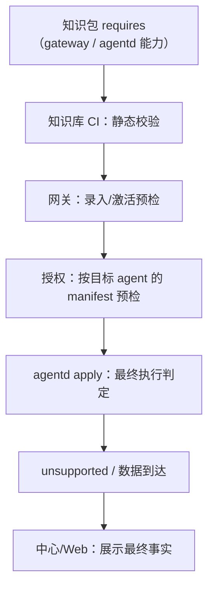

# 采集面与采集能力契约

> 本文把「采集面（`CollectionFamily`）如何定义、如何新增、如何发布、如何验证、如何回退」收敛成一套跨端契约。
> 范围覆盖：模型、知识库（`wist-knowledge`）、网关、agentd、中心与 Web。
>
> **现状 vs 目标态**：文中标注「目标态」的部分是本文建议的落地方向；当前代码尚未全部实现，
> 落地清单见 §12。不要把它当成已实现能力来依赖。

---

## 1. 一句话结论

> **采集面是内容，不是代码。** 面的 ID 是协议闭集（只增不改名）；面的一切内容——语义、平台、展示文案、采集单元、就绪度——都应是知识库数据；采集能力由 agentd 定义并上报；网关只做控制面预检与策略审计；agentd 在 apply 时做最终判定；Web 只消费 API。
>
> 由此得到一个可验收的指标：**新增一个采集面 = 1 个知识库 PR + 一次词表评审**，不发网关、不发 Web、不发 agentd。只有当新面需要一种**当前不存在**的采集方式时，才升级为 agentd 的能力项目（§13.2）。

---

## 2. 问题背景

当前新增一个采集面，实际会演变成四个仓一起改：

1. 模型 `families.mju` 加枚举值；
2. 网关 `FAMILIES`（以及 `MACOS_ONLY_FAMILIES` / `LINUX_ONLY_FAMILIES`）加常量；
3. 前端 `collectionFamilyText.ts` 加中英文展示文案；
4. 知识库加单元 / 包 / 模板。

这四处里，**只有第 4 处是领域本身要求的**：

- 第 2、3 处是硬编码造成的债——它们做的事（字符串成员判断、渲染文案）本来都不需要发版；
- **agentd 不在列表里**：面对 agentd 是不透明标签，只透传进记录、审计行与落盘文件名；代码里仅有的 `match family` 出现在 `discovery/` 的 IP 地址族判断，与采集面无关。

更根本的问题是：

- 「采集能力」没有一份精准、稳定、可机器校验的定义；
- 知识库与后端能力之间没有显式依赖声明；
- 发布后不知道哪些网关/Agent 能生效，出问题也不知道回退到哪一版。

本文的目标是把这些边界固定下来。

---

## 3. 分层与责任边界

| 层 | 负责 | 不负责 |
|---|---|---|
| **模型** `wist-design` | 定义采集面闭集与语义（设计侧）、类型结构 | 运行期装载、展示文案 |
| **知识库** `wist-knowledge` | 面词表（含平台与中英文文案）、采集单元、包、模板、用途规则、发现策略 | 执行采集、判断后端能力 |
| **网关** | 装载/校验知识包、展开工作 spec、授权预检、下发快照、展示兼容性 | 真正采集；不替代 agentd 的执行判定 |
| **agentd** | 执行采集、判断来源是否真能采、回报 `unsupported` | 定义面闭集、决定授权 |
| **中心** | 知识包/升级计划编排、机队兼容性汇总 | 替代网关/agentd 做本地判定 |
| **Web** | 渲染 API、提供操作入口 | 维护面 ID 闭集、硬编码展示文案 |

---

## 4. 核心概念

| 概念 | 说明 |
|---|---|
| **采集面** `CollectionFamily` | 要看见哪一类事件（需求），平台无关。闭集，只增不改名 |
| **采集单元** `CollectionUnit` | 某个面上的具体内容：来源 + 解析规则 + 就绪度 |
| **内容包** `ContentPack` | 可复用的单元组合（基线包 / 特性包） |
| **工作模板** `WorkTemplate` | 某类机器该采哪些面（包组合，不是继承） |
| **常驻工作** `StandingWork` | 某台机器上「一个面一份」的授权，带 `spec` 与 `plan_version` |
| **采集能力** `Capability` | agentd 在指定平台/契约版本下能执行的具体操作集合（见 §6） |

---

## 5. 采集面：词表、不变量与护栏

### 5.1 不变量：什么不能变，什么能变

面的各部分**可变性不同**。把它们笼统当成「都不能变」或「都能变」，都会导致错误决策。

| 层 | 内容 | 可变性 | 改动落点 |
|---|---|---|---|
| L0 | 面 ID | **不可变**：只增、不改名、不复用 | 词表 |
| L1 | ID 的语义所指（要看见什么） | 澄清可原地改；**改变历史数据的所指**必须出新面 | 文档 / 词表 |
| L2 | 平台归属（macOS-only / Linux-only / 跨平台） | **可演进**，主要方向是收窄→放宽 | 词表 |
| L3 | 展示文案（中英名、说明、排序） | **自由变** | 知识库，热生效 |
| L4 | 载体（路径、exporter、格式、轮转） | **自由变** | 知识库，热生效 |

判断规则只有两条：

1. **历史记录里那个 `family` 值，还能用新定义解释吗？** 能 → 原地改；不能 → 出新面。
2. **变的是「要看见什么」，还是「从哪拿」？** 需求变了 → 新面（罕见）；载体变了 → 知识库（常态）。

为什么只锁 ID：ID 是唯一**被写进数据里**的东西——它出现在遥测帧、工作 `spec`、审计行、agentd 落盘文件名与网关统计口径里，改名没有迁移手段。L2/L3/L4 要么可推导，要么可替换，因此不必冻结。

> 「闭集」封闭的是**名字集合**，不是**语义与内容**。

### 5.2 面是内容，不是代码

面描述的是「要看见什么」（需求），不是「从哪拿」（载体）。这决定了它在生命周期上**属于内容**，应当和采集单元一样走知识库发布，而不是走代码发版。

今天加面要发版，唯一原因是面名被写成了 `const`。这与「面的语义要求发版」是两件事。

**可验收指标**：新增一个面 = 1 个知识库 PR + 一次词表评审；网关 / Web / agentd 均不发版。

**唯一例外**：新面需要一种当前不存在的采集方式（新 `source_kind`、新 exporter ID、新权限模型）。这时它是一个**能力项目**，面只是它的第一个用户——判定见 §13。

### 5.3 闭集规则

来源：`jumo/model/static/control/module/agent/content/families.mju`。

1. **只增不改名**：面名进入数据帧、接口和历史数据，改名就是破坏性变更；
2. **要改语义就出新面**：旧面保留并标 `deprecated`（退场机制尚未实现，靠评审守住）；
3. **加面只动词表**：目标态下词表是知识库数据（§5.5），模型由词表生成或由 CI 双向比对；现状是「模型 + 网关常量各改一处」，收敛路径见 §12.1。

### 5.4 护栏分层

「白名单」（今天指 `FAMILIES` 常量，目标态指知识库词表）只是其中一层。把五层混成一层，会出现两种误判：以为词表能挡住「采不了的内容」，或以为有了能力校验就不需要词表。

| 闸门 | 位置 | 键 | 回答 | 失败语义 |
|---|---|---|---|---|
| 词表 | 装载知识库 / 授权前 | 面 ID | 这个词合法吗 | 配置错误（拼写 / 未评审） |
| 能力 | 录入 / 激活 / 授权 | 单元执行词汇 × agentd 上报 | 这种采法有人做得到吗 | 兼容性问题（`missing`） |
| 就绪 | 授权前 | 面 × 平台 × 单元 `status` | 现在采得动吗 | 进度问题（`collect_not_ready`） |
| 授权 | `grant` | work_id × agent × 面 | 这台机器**该**采吗 | 决策问题（可审计） |
| 执行 | `apply` | 单元 | 这台机器**实际**能采吗 | `unsupported`（最终仲裁） |

**真实护栏**不是「模型生成了闭集」，而是下面六条：

1. 词表**追加式**评审：只增不改名，且由机器校验，不靠人眼；
2. 内容范围经评审：面的语义与典型来源有据可查；
3. agentd 能力**真实存在**：能力 ID 可验证，不是文档承诺；
4. 授权显式且可审计：谁、何时、给哪台机器、为什么；
5. 版本兼容与可回退：`requires` + `last_known_good`；
6. 预期 vs 实际的观测：授权面 ≠ 实际上报面时能告警。

模型生成闭集只是第 1 条的**防漂移辅助**，不是护栏本身。

### 5.5 词表校验（现「网关白名单」）

**校验发生在网关，表不在这里。**

值域校验这个动作必须保留（理由见 §5.4），但它的**位置**不是网关源码：表是知识库数据，网关只是装载者与校验者。

**现状**：运行期词表已**从知识库装载**（`catalog.toml` 的 `[[families]]`，§12.1 第 1 步已完成）；
下面三组常量只剩**旧包回落**的作用（包还没有 `[[families]]` 时用它，避免升级即拒载）：

```rust
pub const FAMILIES: &[&str] = &[
    "LoginSession",
    // ...
    "NetworkService",
];

const MACOS_ONLY_FAMILIES: &[&str] = &["PrivacyTcc", "GatekeeperQuarantine", "DevToolchain"];
const LINUX_ONLY_FAMILIES: &[&str] = &[
    "KernelSystem",
    // ...
    "NetworkService",
];
```

它们是旧包里的**唯一副本**，所以每次追加都得重新编译、发版、滚机队——这是 §5.2 说的债。
带 `[[families]]` 的包不再依赖它们。校验行为本身是对的：

- 装载知识库时**拒绝未知面**（面名写错不能静默收下）；
- 拒绝平台不适用的单元；
- 与模型的一致性由测试 `the_family_closed_set_matches_the_model` 钉住。

**目标态**（§12.1 第 1 步）：表从常量移到知识库词表（`[[families]]`），网关仍保留三项机器校验：

| 校验 | 规则 | 拒绝码 |
|---|---|---|
| 追加式 | 相对当前生效 `generation`，不得删除、不得改名、不得复用已退场 ID | `vocabulary_not_append_only` |
| 引用完整 | 词表外的 `family` 出现在单元 / 包里 | `unknown_family` |
| 模型一致 | 词表与 `families.mju` 不一致 | CI 失败 |

词表块单独成段、单独评审（CODEOWNERS），避免「加单元时顺手改词表」自洽绕过。

这与常量相比是**加强**而非放松：常量只能保证“代码没编错”，保证不了“历史数据还能解释”。

> **边界：词表只以数据形式存在。** 放进任何 Rust crate（包括 `wist-contracts`）都会把发版义务
> 传播给依赖它的二进制，并制造版本偏斜；contracts 只承载**结构**（`FamilyMeta`、能力 ID、
> `CapabilityReport`），不承载值。判据：**改值 → 知识库（不发版）；改形状 → contracts（发版）**。

### 5.6 词表校验不是授权

| 层 | 回答的问题 |
|---|---|
| 词表 | 这个面名是**合法值**吗？ |
| 平台适用 | 这个面允许在该平台吗？ |
| 采集就绪 `FamilyReadiness` | 这个平台上有 `status=active` 的单元吗？ |
| 模板 / 用途 | 这台机器**该不该**采这个面？ |
| 授权 `StandingWork` | 这次给**哪台机器**派了这份工作？ |
| agentd apply | 这台机器**实际能不能**采？ |

词表校验只是第一道**值域校验**，不包含任何 per-agent 权限语义。

---

## 6. 采集能力：精准、稳定的定义

### 6.1 定义

> **采集能力 = agentd 在指定平台、指定能力契约版本下，能够对某类来源执行「读取 → 归一化 → 上送」的具体操作集合。**

关键词：

- **具体操作**：不能是「支持日志」「支持 exporter」这种笼统承诺；
- **带约束**：显式绝对路径 vs glob、exporter ID、多行模式、权限、平台；
- **稳定 ID**：只增不改名，语义变化出新 ID / 新版本；
- **由 agentd 定义**：因为它才是执行者。

### 6.2 能力维度（三个执行轴 + 运行条件）

| 轴 | 稳定 ID 示例 | 约束 |
|---|---|---|
| 采集类型 | `collect/logs`、`collect/metrics` | 决定产出数据面 |
| 来源机制 | `source/file:absolute-path`、`source/exporter:journalctl-unit`、`source/metrics:interval`、`source/ulog:predicate-v1` | 必须精确到形态；exporter 一个 ID 一条 |
| 处理/解析 | `multiline:none`、`multiline:indented`、`parse/abi:1` | 多行读法由 agentd 负责；**`parse/abi` 属于内容/数据面契约，不属于 agentd 执行能力** |
| 运行条件 | `platform:linux`、`privilege:root` | 平台与权限 |

### 6.3 CapabilityManifest（目标态）

```json
{
  "schema": "agentd.capabilities/v1",
  "agentd_version": "0.1.30",
  "platform": "linux",
  "capabilities": [
    "collect/logs",
    "collect/metrics",
    "source/file:absolute-path",
    "source/exporter:journalctl-unit",
    "source/exporter:nft-ruleset",
    "source/metrics:interval",
    "multiline:none",
    "privilege:root"
  ]
}
```

> `parse/abi` 不放进 agentd 的 capability manifest：agentd 只负责把 `rule_ref` 随记录带给数据面，
> 不解析正文。解析契约版本在知识包 `requires.content` / 网关内容校验里判断。

由 agentd 在状态上报中携带（或通过独立端点暴露）。

### 6.4 单一事实源

能力 ID、source kind、exporter、multiline、parser ABI 都定义在 **`wist-contracts`**：

- agentd 的执行器与上报的 manifest 必须一致（测试钉住）；
- 网关的预检与中心汇总使用同一个 `compatibility()`；
- 知识包的 `requires` 只引用这些稳定 ID。

这里承载的是**形状**（能执行什么），不是**内容**：采集面词表属于数据，见 §5.5 末尾的边界说明。

### 6.5 事实：路径存在性（`path_exists`）

有些单元只应在「某个路径真的存在」时才派下去（典型：`/var/log/sudo.log` —— RHEL 默认有，
Debian 要在 sudoers 里配 `logfile`）。这不是能力问题，而是**事实**问题。

链路：

```
采集目录 `match = "path_exists:<绝对路径>"`
  → 网关装载目录，推导 probe_paths（白名单）
  → 随发现策略下发（`DiscoveryAspectPolicySet.probe_paths`）
  → agentd 逐条探存在性，随事实摘报回 `probed_paths` / `present_paths`
  → 网关 `eval_condition` 求值（三态）
```

三态必须分开：

| 情况 | 求值 | 结果 |
|---|---|---|
| 路径**没被探测过**（旧 agent / 不在白名单） | Unknown | `excluded(fact_not_collected)` |
| 探测过、**不存在** | No | `excluded(match_unsatisfied)` |
| 探测过、**存在** | Yes | 选中 |

约束：

- 只探**绝对路径**；相对路径随进程 cwd 变，不能当事实（网关装载时就拒）；
- 探测范围由目录的 `match` 推导，**不接受任意路径**；
- 这两项参与内容摘要（`fact-v2`），路径变化会触发重报与重新展开。

**升级顺序**：网关 → agentd → 知识包。

- 新 agentd 会多报两个字段，旧网关是 `deny_unknown_fields`，会拒掉整份事实上报 —— 所以网关先上；
- 旧 agentd 解析带 `probe_paths` 的策略会失败并回落内建周期（软失败）；
- 在 agentd 跟上之前，`path_exists` 永远是 Unknown，相关单元按 `fact_not_collected` 排除 ——
  所以**知识包最后上**。

策略拉取有最小间隔节流（当前 5 分钟），新增的路径条件最多滞后一个轮询周期；
在这段时间里对应单元是 `fact_not_collected`（可见，不是静默不采）。

---

### 6.6 边界：原文发现快照（`DSNAP:`）暂不进能力契约

- `DSNAP:` 是**发现方向**（host / network / process / endpoint / container / k8s / package）的原文上行，
  不属于 `CollectionFamily`（采集面 = 日志/指标的内容分类）。数据面 `log_type = agent.discovery`
  是**信号类别**，不要写进 `[[families]]` 词表。
- 它也不是 §6.2 三个执行轴里的既有能力；当前**不在** `CapabilityManifest` 中声明。
- 原因：原文快照通道还在 P1 落地（atlas 尚无 HTTP ingest、适配器仍是 P0 脚本），
  过早写进 `requires.agentd.capabilities` 会让知识包依赖一个未稳定的面。
- 待 P1 稳定后，再决定是否增加 `collect/discovery:snapshot`（或 `source/discovery:local-runtime`），
  并补上 `requires` 校验与知识库 CI 检查。
- 在此之前，平台侧判断「这台 agent 是否发原文快照」只能看状态上报/日志，不能看能力清单。

---

## 7. 校验链：谁判断、何时判断



| 时机 | 谁 | 能判断什么 |
|---|---|---|
| 知识库 CI | 校验工具 | 面闭集、source kind/目标形态、exporter ID、rule_ref/parser ABI、平台、权限、面元数据 |
| 网关录入/激活 | 网关 | 知识包结构、网关自身能力、目标 agent 的版本/平台/能力（若已上报） |
| 授权 | 网关 | 面是否可授权、模板是否覆盖、目标 agent 能力预检 |
| apply | **agentd** | **最终**：来源能否执行；接不了进 `unsupported` |
| 中心/Web | 中心/网关 API | 展示预检结果与最终事实，**不替代执行判定** |

**重要**：网关预检通过 ≠ 真能采。最终证据是 agentd 没有报 `unsupported`，且数据真的到达。

---

## 8. 知识库承载

### 8.1 面元数据（目标态）

在 `wist-knowledge` 中增加面元数据（建议 `catalog.toml` 的 `[[families]]`，或独立 `families.toml`）：

```toml
[[families]]
family = "ContainerRuntime"
name_zh = "容器运行时"
name_en = "Container runtime"
summary_zh = "容器/运行时生命周期与运行时日志（Docker / containerd / podman）。"
summary_en = "Container and runtime lifecycle and logs (Docker / containerd / podman)."
```

### 8.2 采集单元

```toml
[[units]]
unit_id = "linux-container-runtime"
family = "ContainerRuntime"
capability = "collect_logs"
platform = "linux"
match = "installed:docker|containerd|podman"
rule_ref = ""
requires_privilege = "root"
status = "draft"

[[units.sources]]
kind = "Exporter"
target = "journalctl-unit:docker"
multiline = "none"
```

### 8.3 包与模板

- 新单元加入 `packs.toml` 的包（基线/特性）；
- 需要按机器类别开箱可派时，加入 `templates.toml` 的模板组合；
- `families` 由 `unit_refs` 派生，不手写。

### 8.4 版本

- 内容变更必须 bump `catalog_version`；
- 模板/包/用途/策略各自版本按其文件约定 bump；
- 已授权工作锁在 `StandingWork.catalog_version`，换版不追改。

---

## 9. 知识包的依赖声明与发布/回退

### 9.1 manifest 增加 `requires`（目标态）

```json
{
  "name": "wist-knowledge",
  "version": "0.1.7",
  "content_versions": { "catalog": 6, "templates": 2, "purpose_rules": 3, "aspect_policies": 1 },
  "files": { "catalog.toml": "sha256:...", "...": "sha256:..." },
  "requires": {
    "gateway": {
      "min_version": "0.12.0",
      "families": ["ContainerRuntime"]
    },
    "content": {
      "parser_abi": 1
    },
    "agentd": {
      "min_version": "0.1.30",
      "platforms": ["linux"],
      "capabilities": [
        "collect/logs",
        "source/exporter:journalctl-unit",
        "multiline:none"
      ]
    }
  }
}
```

### 9.2 录入与激活分离

| 状态 | 含义 | 条件 |
|---|---|---|
| `recorded` | 包已落库、摘要/签名/manifest 自洽 | 目标态：允许录入不兼容包（只标 `activatable=false`）；当前实现仍会用真实 loader 拒绝坏内容 |
| `activatable` | 当前网关/目标 agent 能装载并运行 | `requires` 满足 |
| `active` | 正在生效的包 | 激活成功 |

推荐：**允许录入，激活前做兼容性预检**；不兼容返回 `package_incompatible` 并列出缺失项。

### 9.3 回退

- 知识包不可变（sha256 + version），激活有 `generation` 与 `from_package` / `to_package` 留痕；
- 回退 = 重新激活上一个**已知可用**包（`last_known_good`），不是改后端；
- 激活失败时 active 指针不变，不需要回退；
- 回退同样走兼容性校验；旧包依赖已不存在的能力时，必须先回后端。

### 9.4 发布顺序

1. 新增能力：**后端/agentd 先上** → 再激活需要它的知识包；
2. 删除/废弃能力：**知识包先退** → 再降后端；
3. 普通内容变更：知识包直接激活/回退，后端不动；
4. 知识包里的新面必须先进入词表，否则网关会拒载（目标态下词表随知识包走，无额外步骤）。
5. **带 `[[families]]` 的知识包必须先升网关**：旧网关的 `CatalogFile` 是 `deny_unknown_fields`，
   遇到不认识的 `families` 会直接拒载整包。顺序：网关（认识词表）→ 知识包 → 激活。

---

## 10. 展示元数据与 Web

### 10.1 展示链路（已落地）

- 网关 `GET /api/v1/admin/content` 返回
  `families: [{id, platforms, semantics_version, name_zh, name_en, summary_zh, summary_en}]`；
- `wist-gateway-web` 按 `id` 查表渲染；查不到回落原始 ID，不编造说明；
- 新增采集面**不需要发 Web**。

### 10.2 采集面全景（网关管理面）

`/knowledge` 页有两个 tab（tab 落在 URL 上：`/knowledge?view=families` 可直接打开全景页）：

- **知识包**：生效包、世代、回滚、录入历史、锁在旧版的工作；
- **采集面**：这一版定义的全部面 —— 名称 / 协议值、平台、说明、采集就绪（`active/total`）、
  解析就绪（独立信号）、覆盖机型，以及筛选（已就绪 / 有单元未就绪 / 仅定义）。

点开一行可以看到这个面**具体采什么**：每个单元的 `unit_id`、平台、能力、`match` 前提、
`rule_ref`（空 = 只落原文）、所需权限，以及每条来源（`kind:target`）与**agentd 今天能不能执行**。
不可执行的来源在这里就标出来——它正是「面已就绪，但实际采不到」的现场答案。

页面明确标注：**这是目录全貌**，macOS 与 Linux 的单元都会列出，**不按本机平台过滤**；
「平台」列才是适用范围。

三种状态必须分开显示，否则会被读成同一件事：

| 状态 | 含义 |
|---|---|
| 已就绪 | 至少一个 `status = active` 的单元 |
| 未就绪 | 有单元，但没有一个 `active` |
| 未建单元 | 词表里有，但任何平台都没有单元（`readiness` 里没有这一行） |

这是**单台网关**的视图（本机生效的那一版知识库）；全机队聚合属于中心，当前未实现。

### 10.3 前端硬编码已移除

`collectionFamilyText.ts` 自 0.9.0 起只剩「按词表取词 + 缺项回落」，18 条文案已进知识库。

---

## 11. 能力校验工具

### 11.1 形态

建议独立 CLI / crate（例如 `wist-verify collect`），复用 `wist-contracts` 的能力定义：

```bash
wist-verify collect \
  --knowledge ./wist-knowledge \
  --capabilities ./capabilities/agentd-linux-0.1.30.json \
  --platform linux \
  --json
```

### 11.2 检查项

- 面在 `FAMILIES` 闭集；
- 平台适用；
- source kind 支持，且目标形态精确匹配（显式绝对路径 / exporter ID / predicate ABI / interval）；
- 内容侧：`rule_ref` 存在、`parser_abi` 匹配（不属于 agentd 执行能力）；
- 权限、平台满足；
- 面元数据齐全（目标态）。

### 11.3 输出与门禁

```json
{
  "ok": false,
  "missing": ["source/exporter:journalctl-unit"],
  "families": [
    {
      "family": "ContainerRuntime",
      "units": [
        {
          "unit_id": "linux-container-runtime",
          "ok": false,
          "checks": [
            { "capability": "source/exporter:journalctl-unit", "ok": false, "reason": "unknown exporter id" }
          ]
        }
      ]
    }
  ]
}
```

- CI 用 `--check` 退出码卡住；
- 网关录入/激活复用同一套兼容性判断；
- 可选 `--probe` 做只读现场烟测（文件可读、exporter 可执行、样例可解析），默认不碰现场。

---

## 12. 落地清单

| # | 改动 | 位置 | 状态 |
|---|---|---|---|
| 1 | 面词表进知识库（`[[families]]`：`id` / `platforms` / `semantics_version` / `name_*` / `summary_*`） | `wist-knowledge` | 已完成 |
| 2 | 网关从词表装载 `families`，替代 `FAMILIES` 常量 | `wist-gateway/src/app/content.rs` | 已完成（常量为旧包回落） |
| 3 | 平台归属从常量改为词表字段 | 同上 | 已完成 |
| 4 | 词表追加式校验（拒删除 / 改名 / 复用） | 同上 + `api/knowledge_ops.rs` | 已完成（激活时拒；回滚除外） |
| 5 | 模型 `families.mju` 与词表双向一致校验 | `wist-design` / 网关测试 | 已完成 |
| 6 | 网关暴露 `families` 元数据 | `wist-gateway/src/api/content_ops.rs` | 已完成 |
| 7 | Web 改为消费 `families` 元数据 | `wist-gateway-web`（删除硬编码文案表） | 已完成 |
| 8 | 能力 manifest + 稳定 ID | `wist-contracts` | 待做 |
| 9 | agentd 上报 capabilities（接上已存在但零引用的 `capability_report.rs`） | `wist-agentd` / `wist-api` | 待做 |
| 10 | 知识包 `requires` + 兼容性预检 | `wist-knowledge` 打包脚本、`wist-gateway/src/app/knowledge.rs` | 待做 |
| 11 | 录入 / 激活返回 `compatible` / `missing` | `wist-gateway/src/api/knowledge_ops.rs` | 待做 |
| 12 | `last_known_good` + 回退流程 | 网关 store / knowledge ops | 待做 |
| 13 | 能力校验工具 | 新 crate / CLI | 待做 |
| 14 | 测试与 CI 门禁 | 各仓 | 待做 |

### 12.1 迁移路径：从 4 个仓到 1 个仓

三步**互不阻塞**，且都只改「承载」不改协议的值，因此可灰度、可回退。

**第 1 步：词表数据化（消掉网关发版）** —— ✅ 已完成（2026-10-18）

- ✅ 知识库新增 `[[families]]` 词表块（`catalog.toml`，18 个面 + 中英文案 + 平台归属）；
- ✅ 网关装载时以词表替代 `FAMILIES`，平台归属改读词表 `platforms`（常量仅作旧包回落）；
- ✅ 追加式校验（删除 / 改名 / 复用即拒，回滚除外）；
- ✅ 模型与词表一致由测试钉住（`the_knowledge_vocabulary_matches_the_model`）。

验收：加一个面，网关不发版。✅ 已达成（面只在 `[[families]]` 里声明，网关代码不动）。

**第 2 步：文案数据化（消掉 Web 发版）** —— ✅ 已完成（2026-10-18）

- ✅ 词表带 `name_zh` / `name_en` / `summary_zh` / `summary_en`；
- ✅ 网关在 `GET /api/v1/admin/content` 暴露 `families`；
- ✅ Web 删除硬编码文案表，从接口取词；缺项回落成面 ID（旧网关不返回时也不崩）。

验收：改文案不发版。✅ 已达成（文案只改 `catalog.toml`，网关与前端均不动）。

**第 3 步：能力上报（消掉「网关猜能力」）**

- `wist-contracts` 定义能力 manifest（`capability_report.rs` 已存在，当前零引用）；
- agentd 上报，网关存并在录入 / 激活 / 授权时做集合差；
- 把 `parse/abi` 从 agentd 能力中拆出（它属内容面契约，不是 agentd 能力）。

验收：`package_incompatible` 能报出缺失的能力 ID。

> 第 1、2 步可并行；第 3 步独立。完成后，「加一个面」的成本从 4 个仓降为 1 个知识库 PR。

---

## 13. 新增采集面的标准流程

判断入口只有一句：**新面能不能用现有的 `source_kind` + 现有 exporter 采到？**

### 13.1 轨道 A：复用已有能力（目标态：1 个 PR）

1. **定语义**：面 ID、含义、平台、典型来源；评审「只增不改名」。
2. **词表追加**：知识库 `[[families]]` 追加一条（含 `platforms` 与中英文文案）。
3. **内容**：加单元 / 包 / 模板；bump `catalog_version`。
4. **数据面**：需要解析就补 `rule_ref` / rule / OML；否则保持 `draft`。
5. **能力校验**：跑 `wist-verify collect`，确认能力的每一维都有人满足（§11）。
6. **发布**：录入 → 激活（不重启）。词表是追加的，无需网关发版。
7. **授权与验收**：授权 → Agent 拉快照 → 确认无 `unsupported` 且数据到达预期面。
8. **文档**：`collection-families.md` 加一行；模板变更同步 `agent-work-templates.md`。

**与现状的差异**：第 2 步之外还要改模型与 `FAMILIES`，并发网关版（§12.1 第 1 步）；文案还需发 Web（第 2 步）。两步收敛后，本轨道退化为「1 个知识库 PR」。

### 13.2 轨道 B：需要新采集方式（能力项目）

进入条件：现有 `source_kind` / exporter / 权限模型**无法**覆盖要看见的内容。

1. 先定义能力 ID（§6），而不是先定义面；
2. agentd 实现并上报，`unsupported_units()` 覆盖新路径并有测试；
3. 更新单元词汇闭集（目标态：词汇随能力契约走）；
4. 再按轨道 A 建面与内容；
5. 发布顺序：agentd → 网关 → 知识包 → 激活。

轨道 B 的产出是**能力**，面只是它的用户。一次能力项目可以支撑多个面。

### 13.3 回退

- 轨道 A：重新激活上一代知识包（`last_known_good`）。
- 轨道 B：agentd 先回退或保持向后兼容；**不得**先撤内容再撤能力。

---

## 14. 未决问题

1. **面的退场机制**：目前 `families.mju` 没有 `deprecated` 状态；需要定义 tombstone 与校验规则。
2. **能力 ID 的完整闭集**：需要把现有 `EXPORTER_IDS` / `SOURCE_KINDS` / `is_executable_source` 收敛成 manifest，并覆盖所有执行路径。
3. **agentd 能力上报的兼容性**：旧 agentd 不带 capabilities，网关/中心如何降级判断（版本粗门 vs 未知）。
4. **中心是否承担知识包发布**：`CatalogOrigin::Center` 的同步路径需要与 `requires` 校验对齐。
5. **live probe 的安全边界**：只读、超时、权限、对生产现场的影响需要明确。
6. **回退的自动化程度**：仅手工激活旧包，还是按健康检查自动回退。
7. **词表与模型的作者顺序**：先改模型还是先改词表？双向 CI 一致校验能防漂移，但不能决定「谁先提 PR」。
8. **词表块能否独立发布**：词表与单元在同一 `generation` 里时，「只加面不带单元」会得到一个永远未就绪的面；需要决定这是合法中间态还是拒绝。

---

## 15. 附录：示例

### 15.1 新增 Linux 面 `ContainerRuntime`

**现状**（三处代码 + 一处内容，其中两次发版）：模型 `families.mju` 加 `ContainerRuntime`；网关 `FAMILIES` 与 `LINUX_ONLY_FAMILIES` 各加一项；前端文案加一条。

**目标态**（一个知识库 PR，不发版）：

```toml
[[families]]
id = "ContainerRuntime"
platforms = ["linux"]
semantics_version = 1
name_zh = "容器运行时"
name_en = "Container Runtime"
summary_zh = "Docker / containerd / podman 的启停、镜像拉取与运行时错误"
summary_en = "Container lifecycle, image pulls and runtime errors for Docker / containerd / podman"
```

模型由词表生成（或 CI 校验一致），网关从词表装载，Web 从 API 读取文案——三者均不发版。

知识库单元：

```toml
[[units]]
unit_id = "linux-container-runtime"
family = "ContainerRuntime"
capability = "collect_logs"
platform = "linux"
match = "installed:docker|containerd|podman"
rule_ref = ""
requires_privilege = "root"
status = "draft"

[[units.sources]]
kind = "Exporter"
target = "journalctl-unit:docker"
multiline = "none"
```

### 15.2 能力缺失报告

```json
{
  "code": "package_incompatible",
  "detail": {
    "gateway": { "missing": [] },
    "agentd": { "missing": ["source/exporter:journalctl-unit"] }
  }
}
```

---

## 16. 相关文档

- [`collection-families.md`](./collection-families.md) —— 面闭集与维护规矩
- [`agent-content-and-work-overview.md`](./agent-content-and-work-overview.md) —— 内容与工作总览
- [`agent-work-templates.md`](./agent-work-templates.md) —— 模板与就绪度
- `wist-knowledge/README.md` —— 知识库创作源与版本
- `wist-design/jumo/model/static/control/module/agent/content/families.mju` —— 面闭集的设计侧定义（运行期以知识库词表为准，两者由 CI 双向校验）
