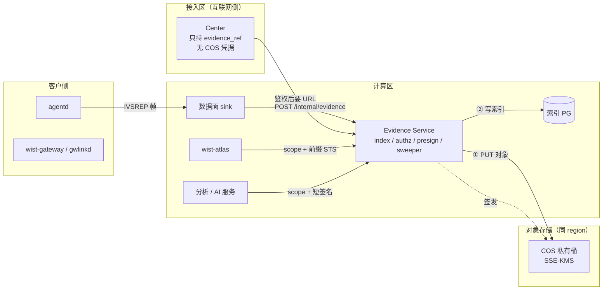

# 证据服务（Evidence Service）设计

> 状态：**设计稿**（2026-11-01）。本文原名为《调查报告结果服务》，2026-11 泛化为证据服务：
> 承接平台里**所有"某次动作的产物"**，不再只服务调查报告。
>
> 上游：
> [`investigation-surfaces.md`](investigation-surfaces.md)（报告怎么产生、为什么走数据面 `IVSREP`）、
> [`center-open-api.md`](center-open-api.md) §7.6.1（C3 调查指令与 `evidence_ref`）、
> [`gateway-capability-contract.md`](gateway-capability-contract.md) §6（回执形状）。

## 1. 目的与边界

平台里有大量**"结果"**：调查报告、体检报告、命令执行日志、`ActionPlan` 的原始输出、
升级前置检查、支持包、合规扫描……它们的共同点是：

- 是**某次动作的产物**，不是当前状态；
- 一份一份、只读、不可变；
- 正文可能不小，且常含主机内部信息；
- 保留期由策略决定，且要能按客户删除。

这些不该散落在接入区的 PG、网关的本地目录、各自服务的临时盘里。本文定义它们统一的落点、
索引、授权、保留与删除。

明确不在本文：

- 调查题的内容与预算 → [`investigation-surfaces.md`](investigation-surfaces.md)
- 封堵与处置 → [`security-containment-actions.md`](security-containment-actions.md)
- 数据面帧格式 → [`discovery-sync-protocol.md`](discovery-sync-protocol.md)
- 备份与恢复的实施方案 → 只划边界，见 §11

---

## 2. 结论（先看这十四条）

| 编号 | 决定 | 为什么 |
|---|---|---|
| **D1** | **只放"某次动作的产物"，不放状态** | 状态需要事务和热路径读；放进来就会变成第二个数据库 |
| **D2** | 证据面 = **COS 私有桶 + 一个薄服务** | COS 解决"存、加密、低成本"；索引/授权/删除/签名必须有人做 |
| **D3** | 服务是**数据访问层**，不是"结果管理平台" | 不做派发、不做分析、不出结论 |
| **D4** | 一个 region 一个桶；**租户靠前缀 + 每客户 CMK + 前缀级 STS 隔离** | 桶不是隔离边界；每客户一桶会让配置面变成 N 份并开始漂移 |
| **D5** | **保留期由服务驱动删除**；桶生命周期只做存储降级，不做删除 | 生命周期前缀是字面匹配，按「租户 × 档位」铺规则会撞上限，且一次误配就是批量删 |
| **D6** | 写入顺序 **先对象、后索引**；**索引可从对象元数据重建** | 反过来会出现"索引说有、点开 404"；索引可重建才敢说它是衍生物 |
| **D7** | **租户只从身份来**；对象键由服务端拼 | 请求体里的 `tenant_id` / `prefix` 一律不可信 |
| **D8** | 读默认**短签名（60s、单对象）**；批量消费者用**前缀级 STS** | 预签名是 bearer token；STS 让 atlas/AI 直连，省带宽 |
| **D9** | **center 零 COS 凭据**，只持 `evidence_ref` | 接入区被攻破也拿不到正文 |
| **D10** | `kind` 决定默认保留档，`sensitivity` 决定可见范围与是否脱敏 | 两轴正交：体检 30 天、调查按敏感度 7–180 天 |
| **D11** | 中央副本 v1 是 **best-effort**（不做 at-least-once）；写入方是**数据面 sink**，只有它自带的 3 次重试 | sink 的 `max_retries` 是投递机制、不是必达承诺；仍失败落 rescue 文件（可见、可人工重放）；网关本地副本兜底 |
| **D12** | 删除必须产出**删除凭证** | 客户问"删干净没有"时，要能给出对象数、索引行数、时间与密钥处理 |
| **D13** | **不做热路径、不做流、不做状态** | 三条红线，见 §4.3 |
| **D14** | **证据库与备份库分离**：不同桶、不同账号、不同生命周期 | 证据按客户删，备份按保留期留；共用一套策略必然有一方违背承诺 |

一句话：

> **动作的产物进 COS（私有桶 + KMS + 服务驱动删除），索引与授权留在计算区的薄服务，
> 控制面只持引用；状态、流、热路径数据一律不进。**

---

## 3. 定位与分区



| 组件 | 持有 | 不持有 |
|---|---|---|
| **Center**（接入区） | `command_id → evidence_ref`、`verdict`、大小、敏感度 | 正文、COS 凭据、KMS 权限 |
| **Evidence Service**（计算区） | 索引、授权、KMS 解密权、签名权 | 网关通道、指令队列、业务判断 |
| **COS** | 密文对象 + 对象元数据 | 任何授权逻辑 |

> 证据服务挂了，center 照常工作，页面显示「正文暂不可用」；反过来，center 挂了也不影响历史证据读取。

---

## 4. 管什么、不管什么

### 4.1 `kind` 清单

| `kind` | 产物 | 产生方 | 典型大小 | 默认保留 | 敏感度档 |
|---|---|---|---|---|---|
| `investigation_report` | 调查报告 | agentd（`IVSREP`） | ≤ 64 KiB（单帧上限，超限**丢行不拆帧**） | 按 `sensitivity` 7–180 天 | 全档 |
| `diagnose_report` | 网关体检报告 | gwlinkd（`wparse run diagnose`） | ≤ 1 MiB | 30 天 | paths |
| `command_log` | 命令执行日志 / 任务记录 | gwlinkd `tasks/<kind>-<id>/` | KB – MB | 30 天 | commandlines |
| `action_output` | `ActionPlan` 的原始输出 | `wist-exec` → 网关 | 变化大 | 90 天 | commandlines |
| `upgrade_preflight` | 升级前置 / 兼容性检查 | 网关 / agentd | KB | 30 天 | paths |
| `support_bundle` | 支持包 | 未来能力 | MB | 90 天 | commandlines |
| `compliance_scan` | 合规基线扫描 | 未来能力 | KB – MB | 180 天 | security_posture |
| `derived` | 分析 / AI 派生物 | 计算区服务 | KB | 跟随来源 | 跟随来源 |

新增 `kind` 是**加性变更**（枚举只增不改名）；语义变了就开新 `kind`，不修改旧的含义。

### 4.2 五问判据（决定要不要进）

| # | 问题 | 答"是"的去向 |
|---|---|---|
| 1 | 它是**某次动作的产物**，不是当前状态？ | 状态 → 不进 |
| 2 | 它**不需要**和控制面其他表事务一致地更新？ | 需要 → 控制面 |
| 3 | 它是**一份一份**的，不是持续追加的流？ | 流 → 数据面 |
| 4 | 正文可能大 / 含主机内部信息 / 要按客户删除？ | 任一满足 → 进 |
| 5 | 读它**不在热路径**（派发、决策）上？ | 在 → 控制面留存，证据库只归档 |

经验：**第 1、3、4 问都过，且第 2、5 问都不过**，才进。其余组合见 §14 的迁移案例。

### 4.3 三条红线

1. **不做热路径**：控制面派发/决策要读的东西，必须在控制面侧有一份；证据库只做归档与取证。
2. **不做流**：一次一份，不追加；日志、指标、事件流一律走数据面。
3. **不做状态**：任何"当前是什么"的对象（discovery 快照、软件清单、计划状态）都不进。

> 这三条一旦破，服务就会从"证据库"退化成"第二个数据库 + 日志湖 + 慢查询源"，而且没人敢删任何东西。

---

## 5. 数据模型

### 5.1 索引表

```sql
create table evidence_artifact (
  artifact_id      text primary key,          -- art_xxx（不透明）
  tenant_id        text not null,
  customer_id      text not null,             -- 密钥与计费归属（= center 的绑定客户）
  kind             text not null,             -- 见 §4.1
  subtype          text,                      -- 调查的 topic / 体检的 profile / 升级的组件
  subject_type     text not null,             -- agent | gateway | host | rollout
  subject_id       text not null,
  gateway_id       text,
  agent_id         text,
  command_id       text,                      -- 与回执 / 正文 join 的键
  dedupe_key       text not null,             -- command_id；无命令的产物用 artifact_id
  schema_id        text not null,             -- wist.investigation.disk/v1 之类
  sensitivity      text not null,             -- metrics | paths | commandlines | identities |
                                              -- secret_metadata | security_posture
  retention_class  text not null,             -- r7d | r30d | r90d | r180d | custom-<id>
  bucket           text not null,
  object_key       text not null,
  size_bytes       bigint not null,
  sha256           text not null,
  verdict          text not null,             -- ok | warn | fail | unknown
  marker_ids       jsonb not null default '[]'::jsonb,  -- 闭集标识（调查的 finding.id 等），不含值
  source_ref       text,                      -- kind=derived 时指向来源 artifact_id
  source_sha256    text,
  durability       text not null,             -- best_effort | confirmed
  reported_at      timestamptz not null,
  stored_at        timestamptz not null default now(),
  retention_until  timestamptz not null,
  legal_hold       boolean not null default false,
  state            text not null default 'stored',  -- stored | missing | superseded | purged
  unique (tenant_id, kind, subject_id, dedupe_key)
);

create index on evidence_artifact (tenant_id, kind, reported_at desc);
create index on evidence_artifact (tenant_id, subject_id, reported_at desc);
create index on evidence_artifact (tenant_id, kind, subtype, reported_at desc);
create index on evidence_artifact (retention_until)
  where state = 'stored' and not legal_hold;
```

**刻意不存的字段**：正文、自由文本摘要、具体路径 / 用户名 / 命令行、凭据。
`marker_ids` 只记闭集标识（如 `disk.top_dirs`），不含值。

### 5.2 对象键与对象元数据

```
{tenant_id}/{kind}/{yyyy}/{mm}/{object_id}.{ext}.zst
```

- **租户在最前**：STS 的前缀策略（`{tenant_id}/*`）能直接表达隔离；
- **键里不编码查询维度**（subject / topic 都靠索引查），避免键结构随需求变化；
- **`object_id` 每次写入新生成**，`artifact_id` 是索引行的**逻辑身份**（一次动作一份）：
  同键同 `sha256` 的重投不换 id 也不写新对象；同键新正文换新 `object_id`、
  旧对象保留待清 —— 否则“键不可覆盖”和“`(tenant, kind, subject, dedupe_key)` 唯一”
  两条会打架；
- 键不可变、不覆盖；同名冲突按 `sha256` 判重并告警；
- 正文 zstd 压缩，`Content-Encoding: zstd`；`ext` 按 kind：`json` / `log` / `tar`。

**对象元数据（自描述，关键）**：

```
x-cos-meta-tenant-id: t-001
x-cos-meta-kind: investigation_report
x-cos-meta-subject-id: agent-7f3
x-cos-meta-schema-id: wist.investigation.disk/v1
x-cos-meta-sensitivity: paths
x-cos-meta-sha256: <hex>
x-cos-meta-command-id: cmd_...
```

这七个字段让**索引丢失后可以从对象重建**（D6）。没有它，"索引是衍生物"就只是一句口号。

### 5.3 元数据从哪来

| 字段 | 来源 |
|---|---|
| `tenant_id` / `customer_id` / `gateway_id` / `agent_id` | **身份 + 网关绑定**，不信正文里的同名字段 |
| `kind` / `subtype` / `schema_id` | 写入方声明，服务按 `kind` 白名单校验 |
| `sha256` / `size_bytes` | 写入时由服务计算，不信任上报值 |
| `verdict` / `marker_ids` | 由服务从 payload 的闭集字段汇总，**不解析自由文本** |
| `retention_class` | `kind` 默认档 × `sensitivity` × 租户策略（§8.1） |
| `durability` | 生产方声明 + 是否有兜底副本（§10.2） |

---

## 6. 写入

写入方是**数据面的 wparse**：它按 `agent_uplink_ivsrep` 规则把 ` IVSREP: ` 帧解析成记录，
再用 `http_sink` 直接 POST 给证据服务。链路：

```text
agentd ──IVSREP──▶ 网关数据面 ──上行──▶ 平台数据面（wparse）
                                            │ http_sink（明文 + 站点 token）
                                            ▼
                              POST /internal/evidence
                                            │ 1) PUT 对象（带元数据 + sha256）
                                            │ 2) 写索引（唯一键去重）
                                            ▼
                                          COS
```

> 本文按**平台侧** `wist-ingest` 的 wparse 描述：sink 没有 TLS 参数，而证据服务只在内网。
> 若改由网关侧写入，必须另加中继（见 §19 开放问题 10）。

两条都不做：

- **不让生产方直写 COS**：那样索引就没有必达责任，漂移只能靠事后对账；
- **不为证据单开一条上行**：数据面已经有一条（与 `OBSFACT` / `DSNAP` 同一条纪律），
  再造一条就是第二套连接、第二套失败模式。

### 6.1 sink 面的硬约束（决定写接口长什么样）

wparse 的 http 连接器只有 `endpoint / method / headers / username / password / fmt /`
`batch_size / timeout_secs / max_retries / compression`（见 `wp-infra` 的
`connectors/sink.d/12-http_sink.toml`），**没有 TLS 参数**。所以写端点必须按"sink 兼容"设计，
不能照抄读端点的 mTLS 模型：

| 约束 | 后果 |
|---|---|
| 无 TLS | 写端点**只绑内网**、明文 HTTP；与读端点（mTLS）**分端口、分信任域** |
| 身份只有 header / basic auth | 用**每站点一个写入 token**（`headers` 注入），服务端映射到 `tenant_id`；不用证书 |
| 非 2xx 会重试 `max_retries` 次后落 rescue 文件 | 重复投递是常态 → 写接口必须**幂等**，重复回 `200` 而不是 `4xx` / `409` |
| 一段 body 可能是一条记录，也可能是数组（`batch_size > 1`） | 接口同时接受单对象与数组 |
| 记录是 `{schema, agent, ts, seq, body}`，`body` 是**契约对象的 JSON 字符串** | 服务端要再解析一层（与 `wist-gateway` 的 `api/ingest.rs` 同一条纪律） |
| `batch_size` 目前是 1 | 批量路径先支持，但不是 P0 的验收项 |

### 6.2 顺序与幂等

1. 校验信封：`kind` 在枚举内，`schema_id` / `sensitivity` 齐全且合法；
2. **身份先于内容**：token → `tenant_id`；记录里的 `agent` / `gateway` 与中心绑定交叉核对，
   不一致 → `403`（不信上报方自述，也不信正文里的 `tenant_id`）；
3. `PUT` 对象（带 §5.2 元数据）；`sha256` 不符 → 丢弃并记 `evidence_integrity_failed`；
4. 写索引：`(tenant_id, kind, subject_id, dedupe_key)` 唯一（`dedupe_key` = `command_id`，
   无命令的产物用 `artifact_id`）。**同键同 `sha256` = 重投** → `200` + 已有 `artifact_id`，
   不改行、不报错；同键不同 `sha256` 按 `reported_at` 取新，旧对象标 `superseded`；
5. 返回 `artifact_id` + `durability`。

### 6.3 失败与对账

| 失败 | 处置 |
|---|---|
| PUT 失败 | 返回 5xx；sink 重试 `max_retries`（默认 3）次后落 rescue 文件，索引不写 |
| 索引写失败（对象已在） | 返回 5xx；**孤儿对象**由每日对账按对象元数据补索引 |
| 对象丢失（索引在） | 抽验发现 → `state=missing` + 告警；不自动重建 |
| 同命令两份正文 | 按 `reported_at` 取新，旧对象打标签待清 |

---

## 7. 读取与授权

### 7.1 三种读路径

| 路径 | 谁用 | 做法 | 代价 |
|---|---|---|---|
| **短签名**（默认） | admin-web、CLI、单次取证 | 鉴权后签发 60s、单对象、绑定 `audit_id` 的预签名 URL | URL 是 bearer，必须短命 + 单对象 |
| **流式代理** | 证据桶不可达、或不允许 URL 外流 | 服务边读边转，不落盘 | 带宽过服务 |
| **前缀级 STS** | atlas / AI 等批量消费者 | 签发 `{tenant}/*` 前缀的临时凭证，消费方直连 COS | 审计粒度降到"每次签发" |

v1 只做前两种；STS 在出现批量消费需求时再加。

### 7.2 授权模型

一次读要同时满足：

1. **调用方身份**：服务证书 + scope（`evidence:read`，可细化到 `evidence:read:<kind>`）；
2. **租户范围**：令牌 / 证书里的租户集合必须包含该对象；
3. **敏感度**：调用方 `max_sensitivity` ≥ 对象档位（例如 AI 默认只到 `paths`）；
4. **对象状态**：`state=stored` 且未过期（过期后即使对象还在也不给）。

失败统一回 `404`（不泄露"存在但不能看"）。

### 7.3 审计

每次签发与每次流式读都记一行：

```
artifact_id / tenant_id / kind / actor(service或人) / scope / 用途origin / 结果 / at
```

预签名 URL 把 `audit_id` 编进查询参数，COS 访问日志能对回是哪次签发。

---

## 8. 保留与删除

### 8.1 `kind × sensitivity → 保留期`

先按 `kind` 取默认，再被 `sensitivity` 与租户策略覆盖：

| kind | 默认 | 覆盖规则 |
|---|---|---|
| `investigation_report` | 按敏感度 | `metrics` 180d / `paths` 30d / `commandlines` 7d / `identities` 30d / `secret_metadata` 7d / `security_posture` 90d |
| `diagnose_report` | 30d | 可被租户策略拉长到 90d |
| `command_log` | 30d | 可降到 7d |
| `action_output` | 90d | 按敏感度降档 |
| `upgrade_preflight` | 30d | — |
| `support_bundle` | 90d | 合同可拉长 |
| `compliance_scan` | 180d | 合同可拉长 |
| `derived` | 跟随 `source_ref` | 不得长于来源 |

> 与网关本地保留期**不是一回事**：本地是兜底缓存（如 `[investigations] report_retention_days`=7），
> 这里是归档。两者独立配置，别互相推导。

### 8.2 删除由谁驱动

**服务驱动的清理作业**，不是桶生命周期：

```
每 15 分钟：select ... where retention_until < now() and state='stored' and not legal_hold
          limit 500
   → 删对象（幂等）→ state='purged' → 记删除审计
```

- 桶生命周期**只配"转低频存储"**（30 天后转 IA），**不配删除**；
- 清理作业滞后要告警（`p99 > 6h`）；
- 删除是**软删 + 对象版本保留 7 天**：误删可恢复。

### 8.3 删除凭证

```json
{
  "request_id": "del_01J9...",
  "scope": { "tenant_id": "t-001", "kind": "investigation_report", "subject_id": "agent-7f3", "from": "2026-01-01", "to": "2026-10-01" },
  "objects_deleted": 1284,
  "index_rows_purged": 1284,
  "object_versions_removed_at": "2026-11-08T00:00:00Z",
  "legal_hold_skipped": 3,
  "derived_cascaded": 12,
  "requested_by": "wist-ops/zhangsan",
  "at": "2026-11-01T12:00:00Z"
}
```

- `legal_hold_skipped` 必须显式列出 ——「删干净了」和「有三条因法律保留没删」是两码事；
- `derived_cascaded`：删原文时派生物要一起删（§9.3）；
- 密钥销毁（客户自带 CMK）单独记，不混在对象数里。

### 8.4 法律保留

`legal_hold=true` 的行**跳过清理**并在列表可见。区域/版本支持对象锁时再叠一层；
不支持就靠服务端跳过 + 告警双保险，不依赖桶配置。

---

## 9. 多租户与密钥

### 9.1 三条铁律

| # | 铁律 | 违反后果 |
|---|---|---|
| 1 | 租户只从身份来（证书 claim / 网关绑定） | 跨租户写入 / 读取 |
| 2 | 对象键由服务端拼，客户端给不出 prefix | 前缀穿越 |
| 3 | STS 只签到自己前缀；预签名只签单个对象 | 一张临时凭证变成整桶权限 |

### 9.2 桶：共享是默认，专享是例外

| 形态 | 适用 | 说明 |
|---|---|---|
| **共享桶**（默认） | 绝大多数客户 | `{tenant_id}/` 前缀 + CAM 前缀策略 + 每客户 CMK |
| **专享桶** | 物理隔离 / BYOK / 跨 region / 超大客户 / 独立对象锁 | `evidence_artifact.bucket` 记具体桶；API 不变 |

判据不是"客户多"，而是「是否需要在**账单、密钥、策略、区域**上独立」。

### 9.3 派生物（`kind=derived`）

- 必须在 `source_ref` / `source_sha256` 里指向来源；
- 只能放在 `derived/` 前缀下，**不与原文混放**；
- 删除原文时必须级联删除派生物（凭证里体现 `derived_cascaded`）；
- 派生物不得比来源保留更久。

### 9.4 密钥强度分级

| 形态 | 谁解密 | 隔离强度 | 何时用 |
|---|---|---|---|
| **v1：服务代解** | Evidence Service | 策略 + 审计级 | 默认 |
| **强隔离：消费方直解** | 消费方（STS + KMS grant） | 密码学级 | BYOK / 独立审计客户 |

诚实地说：v1 里服务能解所有租户密文。靠 scope、审计、最小权限账号兜，不是密码学隔离。

### 9.5 身份与权限

- 写入方是数据面 sink：用**站点 token**（`Authorization` 头，映射 `tenant_id`）；
  sink 没有证书，**写端点不做 mTLS**。这个 token 的签发 / 登记 / 撤销按
  [`../foundation/auth-token-verification.md`](../foundation/auth-token-verification.md) §6–§7 走
  （只存 `sha256`、`register` 先登记后交付、`audience = evidence`）；
- 读服务用**独立 service 证书**（`evidence:read` / `evidence:read:<kind>`），不复用 center 的内部服务凭据；
- 凭据走 `${SEC_...}`，0600；
- **center 没有 `evidence:write/read`**，只有 `evidence:ref`（拿 URL 的资格）。

---

## 10. 可靠性

### 10.1 容量

| 项 | 量级 |
|---|---|
| 调查报告 | 100 台 × 10 次/天 × 200 KB ≈ 200 MB/天 |
| 体检报告 | 每天每网关 1–4 次 × ≤1 MiB |
| 命令日志 | 与命令量同阶，通常小于体检 |
| 索引行 | 与产物数同阶（千行/天），可忽略 |

成本主要在**请求数 + KMS 调用**，不在存储。转 IA 可再降一半存储成本，取回有延迟（证据通常几天内看，可接受）。

### 10.2 `durability`

- `best_effort`：**默认**。sink 自带的 `max_retries`（3 次）是投递机制，不是必达承诺；
  仍失败就落 rescue 文件（可见、可人工重放）；
- `confirmed`：生产方声明本地还有副本（如网关本地 7 天），或产物已落两处。

**什么时候必须改**：如果某类产物被定义为**合规证据**（要能证明"当时看到了什么"），
best-effort 不成立，需要在生产方加 spool 或做定时补取。这是产品定性问题，见开放问题 1。

### 10.3 对账与索引重建

| 作业 | 频率 | 做什么 |
|---|---|---|
| 孤儿对象扫描 | 每日 | 列对象键 + 读对象元数据 → 补索引（`durability=best_effort`） |
| 缺失对象抽验 | 每日（抽 1%） | 索引在、对象不在 → `state=missing` + 告警 |
| 清理作业 | 每 15 分钟 | 到期删除（§8.2） |
| 完整性 | 每周 | 抽样重算 `sha256`，不一致 → 告警并冻结该行 |
| **索引重建演练** | 每季度 | 从对象元数据重建一个租户的完整索引，与现索引对账 |

---

## 11. 与备份 / 容灾的边界

### 11.1 三个词，别混

| 词 | 语义 | 谁有权 | 保留 | 删除 |
|---|---|---|---|---|
| **证据 / 归档** | 某次动作的产物 | 按租户 + 敏感度 | 短（7–180 天） | **必须**能按客户删 |
| **备份** | 某一时刻的可恢复副本 | 极少数平台管理员 | 长（月/年分层） | **不能**被日常删除 |
| **状态** | 当前是什么 | 所属服务 | 长期 | 业务语义 |

### 11.2 为什么不能拿证据库当备份库

| # | 冲突 |
|---|---|
| 1 | **保留期相反**：sweeper 按到期删；备份到期前谁也不能删 |
| 2 | **删除语义相反**：证据要按客户删除；备份常需在删除请求后继续保留 |
| 3 | **权限相反**：证据按租户切碎；恢复要一次读全部 |
| 4 | **凭据风险**：center 的备份含 CA 私钥 / token 哈希；证据库的前提是"center 零 COS 凭据" |
| 5 | **一致性模型不同**：PG 备份要事务一致 + PITR；证据是独立对象 |
| 6 | **演练不同**：备份要真恢复；证据库只有"读" |

### 11.3 分层

| 数据 | 能进证据库 | 备份方式 |
|---|---|---|
| 调查 / 体检 / 命令日志 / 原始输出 | ✅ | COS 版本控制 + 对象元数据（可重建索引） |
| center PG（注册、绑定、队列、指令） | ❌ | PG PITR / 逻辑备份 |
| 网关证书、CA 私钥、token 哈希 | ❌❌ | 独立密钥备份（离线 / HSM / KMS） |
| 现场配置（toml / `.env` / 证书文件） | ❌ | 配置版本库 + 备份包 |
| 发布制品 / 镜像 | ❌ | artifact store / 镜像仓库 |
| 审计记录 | ❌ | append-only 账本（WORM） |
| 证据索引 PG | ✅（它自己要备份，但**可重建**） | 逻辑备份 + 从对象元数据重建 |

### 11.4 证据库自己怎么活下来

1. **版本控制开**：误删 / 勒索改写可回退；
2. **对象元数据自描述**（§5.2）：索引丢了能从对象重建；
3. **跨区复制默认关**，按客户开（数据驻留优先），开之前过合规；
4. **季度恢复演练**：随机抽 20 个对象 + 一次索引重建，记录耗时；
5. **独立备份账号**：备份写入用它，与证据服务 CAM 主体分开。

### 11.5 若要用 COS 做备份目标

可以，但四条隔离：

| 隔离项 | 要求 |
|---|---|
| 桶 | 独立桶（`wist-backup-*`），不共用证据桶 |
| 账号 / CAM | 独立子账号，不共享密钥 |
| 生命周期 | 备份自己的分层规则；**不配"按租户删除"** |
| 访问路径 | 不经过证据服务（它没有恢复语义、没有增量链） |

> 共享的是对象存储这个技术，不是这个服务、不是这个桶、不是这套权限。
> 部署检查里加一条：**证据桶上不得出现备份工具写入的前缀**。

---

## 12. API

写与读是**两张面**，不要混在一个监听上。

### 12.1 写（sink 面：明文 + 站点 token）

```
POST   /internal/evidence        # 数据面 http_sink 直投；单对象或数组；幂等
```

- 只在内网监听；身份 = `Authorization` 里的站点 token（映射 `tenant_id`）；
- 非 2xx 会被 sink 重试并最终落 rescue 文件 —— 所以**只有真的没存下才回 5xx**，
  重复投递回 `200`；
- 请求体上限 4 MiB（含 `body` 字符串的转义膨胀）；超出 `413`；
- 响应回 `artifact_id` + `durability`，并按输入顺序一一对应（数组时）。

### 12.2 读 / 删除（服务面：mTLS + service scope）

```
GET    /internal/evidence/{artifact_id}        # 元数据（evidence:ref）
POST   /internal/evidence/{artifact_id}/presign
GET    /internal/evidence/{artifact_id}/content  # 流式读（可选）
GET    /internal/evidence?kind=&subject_id=&sensitivity=&since=&limit=&cursor=
DELETE /internal/evidence/{artifact_id}        # 单条删除（evidence:admin）
POST   /internal/evidence:purge                # 按 tenant/kind/subject/时间批量删除
POST   /internal/evidence/{artifact_id}/hold   # legal hold
```

- 全部 `mTLS` + service scope；租户来自证书 claim；
- 分页用 `cursor`；
- 未知 id 与无权限都回 `404`；
- 流式读的请求体上限不适用，但单对象读取按 `size_bytes` 限额。

---

## 13. 与 Center / 控制面的边界

| 事项 | Center | Evidence Service |
|---|---|---|
| 指令下发 / 回执 | ✅ | ❌ |
| `command_id → evidence_ref` | ✅（一小行） | ✅（完整索引） |
| 正文 | ❌ | ✅（只给 COS 键） |
| COS 凭据 / KMS 解密 | ❌ | ✅ |
| 保留期决策 | ❌ | ✅ |
| 删除 | ❌ | ✅ |

- center 的 `evidence_ref` 由**回执里的元数据**写入，**不等**证据服务返回；
- 页面点开时才向证据服务要 URL，失败显示「正文暂不可用」。

---

## 14. 迁移案例：体检报告从 center PG 搬出

**现状**：`diagnose` 的结果存在 `gateway_commands.response_body`（center PG，接入区），
上限 1 MiB（`MAX_RESULT_BODY_BYTES`）；`admin_latest_diagnose` 直接读它。

这是"证据进接入区 PG"的同一个问题，只是没人把它当证据看 —— 而且它让队列表背着最多 1 MiB 的正文。

**目标**：`kind=diagnose_report`，`r30d`；center 行只留 `command_id + evidence_ref + verdict`。

**步骤**：

1. 证据服务先支持 `kind=diagnose_report`（枚举 + 默认保留档）；
2. gwlinkd 在体检完成后，把报告 POST 到 `/internal/evidence`（带对象元数据）；
3. 回执里返回 `evidence_ref`；center 存 ref，**不再写 `response_body`**（或只写 ≤32 KiB 摘要）；
4. `admin_latest_diagnose` 改为"读 ref → 要短签名/流"，旧行按回退路径继续读 `response_body`；
5. 一次性回填作业：把存量 `kind=diagnose` 的 `response_body` 转存证据库；
6. 一个发布周期后，停止写入大正文，只保留摘要。

**验收**：新产生的体检报告不再增加 center PG 体积；存量报告仍能读；回填后可删旧列。

---

## 15. 威胁模型

| 威胁 | 后果 | 兜底 |
|---|---|---|
| 桶被误设公开 | 全量证据泄露 | 部署检查 + CI 断言（bucket ACL 必须 private）；访问日志告警 |
| 预签名 URL 泄露 | 单份证据泄露 | 60s + 单对象 + 审计 |
| STS 过宽 | 跨前缀读 | 只签 `{tenant}/*`；按敏感度再切 |
| 键路径注入 | 写到别人目录 | 服务端拼键；拒绝 `..` / 前导 `/` |
| 服务被攻破 | v1 可读全部租户 | scope 最小化、审计、专享桶/独立实例分档；登记为已知风险 |
| 清理作业误删 | 证据丢失 | 软删 + 版本保留 7 天；`legal_hold` 跳过 |
| KMS 策略改错 | 解密全线失败 | 解密失败率告警；密钥变更走变更单 |
| 派生物泄漏原文 | 删除后仍可还原 | 派生物同前缀族 + 删除级联 + 独立审计 |
| 备份混入证据桶 | 两套策略互斥 | §11.5 部署检查 |

---

## 16. 部署与配置

- 证据服务：**计算区**，per region；无公网入站。**两张监听**：读/删 mTLS（`[server]`），
  写 明文 + 站点 token（`[sink]`，只在内网）；
- COS：同 region，内网接入点；桶私有、版本控制开、访问日志到独立桶；
- 存储类：`STANDARD → IA`（30 天），**不配删除**；
- 备份：跨区复制默认关（数据驻留优先）。

```toml
[server]
listen_addr = "0.0.0.0:8443"
tls_cert = "${SEC_EVIDENCE_TLS_CERT}"
tls_key  = "${SEC_EVIDENCE_TLS_KEY}"
client_ca = "${SEC_EVIDENCE_CLIENT_CA}"       # 只信内部服务 CA（CA-I）；只作用于读/删端点

[sink]
# 数据面 http_sink 直投：wparse 的 http 连接器没有 TLS，所以这张监听是**明文**，
# 只绑内网（不要和 [server] 共用端口）。
listen_addr    = "0.0.0.0:8080"
token_file     = "${SEC_EVIDENCE_SINK_TOKEN_FILE}"   # 每站点一个，映射到 tenant_id
max_body_bytes = 4194304

[store]
database_url = "${SEC_EVIDENCE_DB_URL}"       # 独立库

[cos]
bucket          = "wist-evidence-prod"
region          = "ap-guangzhou"
endpoint        = "https://cos.<region>.myqcloud.com"   # 内网域名按现场确认
secret_id_file  = "${SEC_COS_SECRET_ID_FILE}"
secret_key_file = "${SEC_COS_SECRET_KEY_FILE}"
kms_key_prefix  = "evidence-tenant-"          # 每客户 CMK：evidence-tenant-<customer_id>

[retention]
sweep_interval_seconds = 900
batch_size = 500
```

---

## 17. 分阶段

| 阶段 | 内容 | 验收 |
|---|---|---|
| **P0** | 索引 + **sink 写入** + 元数据读 + 短签名；单共享桶；只开 `investigation_report` | 正文不进 center PG；**同一条 sink 记录重放 → `200` 且同一 `artifact_id`**；跨租户读 404；预签名 60s 单对象 |
| **P1** | 清理作业 + 删除凭证 + 版本控制 + 对账 + **索引重建演练** | 到期删除可查；孤儿对象能补回；索引可从对象元数据重建 |
| **P2** | `diagnose_report` 与 `command_log` 迁入（§14）+ 前缀级 STS | 体检报告不再进 center PG；atlas 可批量读 |
| **P3** | 每客户 CMK + 专享桶 + 消费方直解 + legal hold | BYOK 客户密文只有该客户消费方能解 |

---

## 18. 验收判据

1. **落点**：center 的 PG schema 里不存在任何证据正文字段（CI 检查）。
2. **隔离**：租户 A 的凭据读租户 B 的 `artifact_id` → `404`；前缀穿越写入 → `400`。
3. **授权**：`max_sensitivity=paths` 的服务读 `commandlines` 对象 → `404`。
4. **保留**：把 `retention_until` 拨到过去 → 15 分钟内对象删除、索引 `purged`、审计可查。
5. **删除凭证**：批量删除后，对象数 / 索引行数 / `legal_hold_skipped` / `derived_cascaded` 对得上。
6. **重建**：清空索引表 → 用对象元数据重建 → 与备份索引逐行一致（含 `retention_until`）。
7. **对账**：手工删对象 → 24h 内 `missing` + 告警；塞孤儿对象 → 24h 内补索引。
8. **降级**：停掉证据服务，center 的指令/状态/升级全部正常。
9. **备份隔离**：证据桶上没有备份工具写入的前缀；备份桶不响应证据服务凭证。
10. **sink 幂等**：同一条 sink 记录重放 → `200` + 同一 `artifact_id`；同键不同 `sha256` →
    新行生效、旧对象 `superseded`、两者都能对账；写端点不接受 `tenant_id` 自述。

---

## 19. 开放问题

1. **产物是"排障材料"还是"证据材料"**：决定要不要 at-least-once（§10.2）。
2. **`customer_id` 与 `tenant_id`**：一客户多租户时，CMK 按客户还是按租户切？
3. **跨 region 读取**：客户数据在 A 区、计算服务在 B 区，是否允许跨区读？
4. **全文检索**：现在只索引元数据。要做"按内容搜"需第二套索引，且必须先脱敏。
5. **派生物的边界**：AI 结论算不算证据？本文按"派生、可级联删除"处理，可能不够。
6. **`kind` 的治理**：谁有权新增 kind？建议跟 `InvestigationSurface` 一样走脚本校验 + 发版。
7. **对象锁可用性**：按区域确认；不可用时 legal hold 只能靠服务端跳过。
8. **`support_bundle` 的边界**：包内可能含配置与凭据引用，需要单独的脱敏规则。
9. **写端点的身份**：`http_sink` 只有 header / basic auth，没有证书。用"每站点一个 token"
   （服务端映射 tenant）还是接受"内网即信任 + 台账 tag"？前者要做 token 发放与轮换，
   后者把租户隔离降级成网络边界。
10. **哪一层数据面写**：本文按**平台侧** `wist-ingest` 的 wparse 描述。这要求
    (a) 平台 ingest 装载 `agent_uplink_ivsrep` 规则（现在只在网关栈里）；
    (b) 网关把 `IVSREP` 上行到 ingest（`tcp_sink` 目前全部注释）。
    两步不做，就只能退回"网关本地 http_sink + 中继"。
11. **sink 送不了的大产物**：`support_bundle` / `action_output` 可能远超一条记录。
    是限定"只有 ≤ N KiB 的 kind 走 sink"，还是给这些 kind 单独开客户端上传？

---

## 20. 相关文档

- [`investigation-surfaces.md`](investigation-surfaces.md)：报告生产、`IVSREP`、敏感度与脱敏
- [`investigation-security-surfaces.md`](investigation-security-surfaces.md)：安全向调查面与敏感度档
- [`center-open-api.md`](center-open-api.md)：C3 调查指令、`evidence_ref` 形状
- [`gateway-capability-contract.md`](gateway-capability-contract.md)：`investigate` 回执与 `result` 字段
- [`../execution/action-result-schema.md`](../execution/action-result-schema.md)：`ActionResult.outputs` 的原始输出
- [`../telemetry/data-loss-prevention.md`](../telemetry/data-loss-prevention.md)：数据面不丢帧与 sink 行为
- [`../foundation/config-and-state-layout.md`](../foundation/config-and-state-layout.md)：配置分层与 `${SEC_...}`
