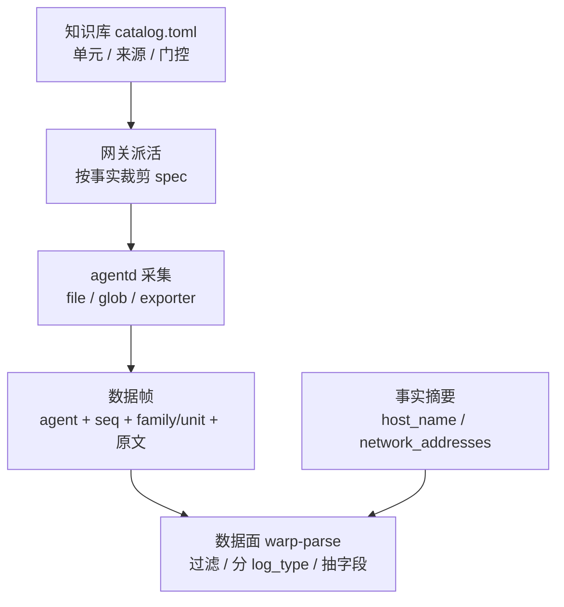

# Linux 服务器日志采集覆盖与支持方案（16 类）

> 状态：**设计（D0–D13 已锁定；§8.1 待外部确认；§8.3 明确延后；W0 已实现（未发布），W1–W4 待实现评审）**
> 需求基线：`server-file-scope.md`（工作区根，对齐链路页「主机日志」16 类，
> `collect-stat-service/catalog/pipeline_catalog.json` 的 `origin=host_systems`）
> 范围：Linux 服务器上的 **16 个页面分类**（记录级 `log_type` 与映射见 D8）。CWP / 流量探针 / 云产品属设备日志与云平台日志，不在本文。

---

## 1. 结论速览

| 结论 | 内容 |
|---|---|
| 范围口径 | 16 类是**当前需求**，不是采集面全集：按子集处理，不重排/删除现有面；后续新增页面分类优先在数据面规则里加 |
| 分类模型 | 16 类是**页面分类**；记录侧拆 `source_type` + `log_type`，容器三类按 `gateway` > `business` > `k8s_pod` 互斥 |
| 解析归属 | **agentd 只搬原文**，帧协议不动；`log_type` / `auth_*` / `level` / `extra` / `date` 全部由数据面规则产出 |
| 现状覆盖 | 16 类中 **3 类原文可采**（1–3）、**1 类部分**（6，仅 `ausearch -m execve`）、**12 类不可采**；输出语义 0 类对齐 |
| 补齐路径 | 采集侧只补 4 种能力：派活裁剪、文件族读取、journald 导出器、记录边界；其余全在目录与数据面 |
| 关键约束 | 同一文件只读一次；`family` 是粗载体，`log_type` 由数据面按正文分派 |

---

## 2. 需求基线（16 类）

公共字段：`date`（epoch 秒）、`host_ip`、`host_name`；一条记录一个 JSON 对象。
12 个安全类型来自 **3 个 OS 源**（`auth.log`/`secure`、`audit.log`、journal），不是 12 个文件；13 与 16 同源。

| # | log_type | 采集源 |
|---|---|---|
| 1 | `host_auth_ssh` | `/var/log/auth.log`（RHEL：`/var/log/secure`） |
| 2 | `host_auth_session` | 同上 |
| 3 | `host_auth_sudo` | 同上 |
| 4 | `host_audit_pam` | `/var/log/audit/audit.log` · `CRED_*` / `USER_ACCT` / `USER_START` / `USER_END` / `USER_LOGIN` |
| 5 | `host_audit_login` | 同上 · `type=LOGIN` |
| 6 | `host_audit_execve` | 同上 · `type=EXECVE` |
| 7 | `host_audit_proctitle` | 同上 · `type=PROCTITLE` |
| 8 | `host_audit_path` | 同上 · `type=PATH` |
| 9 | `host_audit_cwd` | 同上 · `type=CWD` |
| 10 | `host_audit_service` | 同上 · `SERVICE_START` / `SERVICE_STOP` |
| 11 | `host_audit_syscall` | 同上 · `type=SYSCALL` |
| 12 | `host_kernel` | journal `_TRANSPORT=kernel`，`PRIORITY<=4` |
| 13 | `business` | 节点 `/var/log/containers/*.log` |
| 14 | `database` | Postgres `postgresql-*.csv`、MySQL `slow.log` |
| 15 | `gateway` | 同上容器日志里的 APISIX / Ingress stdout |
| 16 | `k8s_pod` | 与 13 同一批文件（账本回退维） |

---

## 3. 现状判定

判据只看两处：`wist-contracts/src/work.rs::is_executable_source`（两侧同源）与
`wist-knowledge/catalog.toml` 的 `active` 单元。当前可执行来源只有三种：
`FileGlob`（**显式绝对路径**）、`Exporter`（8 个固定 ID）、`MetricInterval`。

| 类型 | 现状 | 判定 |
|---|---|---|
| 1–3 | `linux-auth-session` 两条显式路径 | ⚠️ 原文可采；无行过滤、无字段拆分 |
| 4、5、7–11 | 目录里没有 `audit.log` 单元 | ❌ |
| 6 | 仅 `Exporter auditd-execve`（`ausearch -m execve --start recent`） | ⚠️ 只覆盖 EXECVE，且与「整文件、不按 type 丢行」相反 |
| 12 | 无 journald 输入；`dmesg:panic` 只覆盖优先级 0–2 | ❌ |
| 13 / 15 / 16 | 通配直接判 `unsupported`；无 CRI 解包、无标签 | ❌ |
| 14 | `linux-db-service` 是 glob 且 `draft` | ❌ |

**根因（4 条，均不是配置问题）**

1. 文件来源只认显式单路径（`is_explicit_path` 拒绝 `*` / `~`）。
2. 没有 journald 与容器 stdout 两类源（kind 词表里不存在，`UnifiedLogPredicate` 也未实现）。
3. 记录是「原样正文」，没有过滤与解析（`TelemetryRecord` 固定字段，`parser.rs` 只做行→记录搬运）。
4. 派活基于目录单元，目录里没有对应 `active` 单元，agent 有能力也收不到。

---

## 4. 决策（D0–D13）

> **D0–D13 均已锁定（2026-10-22）；§8.1 / §8.3 是仍需外部确认的项。**

### D0 范围：16 类是当前需求，按子集处理

- 不因为这份需求重排或删除现有采集面（`BackupJob` / `NetworkService` / `MiscSystem` 等保持现状）。
- 后续新增 `log_type` 的默认做法：**优先在数据面规则里加**（同一份原文产出多个类型）；
  只有出现新文件/新来源时才加单元或来源。
- 因此「同一文件只读一次」是长期不变量，不会因为类型变多而破。

### D1 解析归属：agentd 只搬原文

- `TelemetryRecord` / `DataFrame` **不改**，帧保持 v1。理由：两者都是 `deny_unknown_fields` 的协议契约
  （`wist-contracts/src/telemetry_record.rs:9`、`:86`），扩字段等于帧 v2，要同步契约、agentd、网关、
  数据面与历史 spool。
- 采集侧只保留三类**记录边界**能力：`multiline_mode`、`drop_if_contains`、文件族/glob。
- `filename` 由 `source_path` 提供；`date` 由下游从正文时间解；`log_type` / `auth_*` / `level` /
  `service_name` / `namespace` / `extra` 全部由数据面规则产出（`rule_ref` 空 = 只落原文，语义不变）。

### D2 `audit.log`：单单元挂 `PrivilegeExecution`

- **替换** `linux-auditd-exec` → `linux-audit-log`，来源改为显式路径 `/var/log/audit/audit.log`，
  `match = "path_exists:/var/log/audit/audit.log"`，`status = active`，`requires_privilege = root`。
  不新增第二个单元：同 family 两个 `active` 单元会被同时选中，同一批 EXECVE 会从文件和
  `ausearch` 两路重复。
- `auditd-execve` 保留在 `EXPORTER_IDS` / agentd / web 词表（协议词表只增），但目录不再引用。
- `family = PrivilegeExecution` 只是粗载体：PAM / LOGIN / 会话事件也会带这个 family，
  **下游必须按 `type=` 覆盖归类**。
- 分派机制（已核实现状）：**`rule_ref` 不进帧**；帧里只有 `family` / `unit`（可选），数据面按
  **正文规则**分类（`agent_uplink/log_frame` + 内容规则 tag）。所以 audit 的 8 类落成一个
  Linux audit 内容规则包、规则内按 `type=` 分支即可；`unit` 可作为规则内的匹配条件。
  不需要引擎级「按 unit 路由」，但要确认规则顺序/兜底与未知 `type=` 的 `log_type`（见 §8.1.1）。
- 单元 id **改名已确认**：历史记录的 `unit` 字段会从 `linux-auditd-exec` 变 `linux-audit-log`，消费方需兼容两者。

### D3 `host_ip` / `host_name`：数据面 join agent 事实

已核实事实摘要里有（`wist-agentd/src/reporting/fact_summary.rs:46`，随 `report_agent_fact_summary`
走 OBSFACT 帧）：

- `host_id`、`host_name`、`network_addresses`。

三个必须写进消费契约的细节：

1. **没有 `host_ip` 字段**，只有 `network_addresses` 列表，元素形如 `"en0 192.168.1.5/24"`。
   取值规则（已定）：非回环 IPv4，按接口名排序取第一条，取不到给空；否则多网卡机器
   会出现同一主机多个 `host_ip`。
2. **join 有滞后**：事实摘要节流 ≥5 分钟，且 `host_name` / IP 变化**不进内容摘要**（设计上只留痕）。
   最多滞后一个上报周期，不能用于严格时序判断。
3. **事实里没有时区**：帧 `ts` 是 UTC，事实摘要没有 `timezone` / 偏移。RHEL 传统的无年份时间行
   需要它才能算 `date`，建议 facts 增 `timezone` + `utc_offset_seconds`（见 §8.1.4）。

### D4 容器选源：v1 通用 glob + exclude；长期是「一个读取器 + 结构化过滤器」

**v1（已定）**：复用 W1 的文件族能力，`/var/log/containers/*.log` + `exclude_globs`（属于 W1 的来源字段）。不写业务服务名。

**长期形态（已定）**：不把 `ContainerStdout` 做成新 source kind。同一套读取器继续承接，只把选择层从 path pattern 升级为结构化的 `filters` 块（W2，`namespace_in` / `pod_not_in`）。

**选源根（已定）**：`/var/log/containers`——每个活容器恰好一条 symlink，文件名带 pod/ns/container，
没有 `/var/log/pods` 里 `0.log` / `1.log` / 轮转件的重启序号歧义；读取与轮转走 `realpath` 得到的
真实文件（权威字节仍来自 `/var/log/pods`）。

| 依据 | 说明 |
|---|---|
| 读取语义相同 | 容器日志就是文件：tail / checkpoint / rotate / spool / 预算完全复用；新 kind 只会复制一套读取入口 |
| 选择逻辑应结构化 | namespace 白名单散落成 N 条 path pattern 会随集群漂移；应升级为 `filters` 块（`namespace_in` / `pod_not_in`） |
| label 今天没有数据源 | `K8sDiscoveryProbe` 未实现（`wist-agentd/src/discovery/k8s.rs:28` 返回 `NotImplemented`），本地只有文件名与运行时 annotations |
| 新 kind 的正当理由 | 只有**读取模型**变化才成立（例如改为向 CRI/kubelet 要流），而不是「选哪些文件」 |

**必须修的读取缺陷（与 v1/v2 无关）**：`/var/log/containers/*.log` 是 symlink，真实文件在
`/var/log/pods/<ns>_<pod>_<uid>/<container>/0.log`；轮转产物落在**真实文件所在目录**，而
`find_rotated_path_async` 只在**源路径父目录**里找（`wist-agentd/src/telemetry/logs/files/checkpoint_support.rs:37`）。
直接按 symlink 路径 glob 会在每次轮转时丢掉旧文件尾巴，容器重启后 symlink 消失更读不到。
正确处理：发现时 `realpath()` 并持久化 `real_path`，轮转/排空在真实目录进行；`source_path` 仍保留
symlink 路径（`filename` 形状不变）。

### D5 glob 起始位置（写死）

- 首次见到这个 pattern：按 `startup_position`（默认 `tail`，不重放存量）；
- 运行中新出现的文件：**从 head 读**（新 pod / 新 csv 卷都是新内容）；
- 重启后新出现的文件：同样 head（靠持久化已见集合判定，见 D10）；
- 轮转：沿用 inode 跟踪，先排空被改名文件的尾部，再跟新主文件。

### D6 内核日志：journald 唯一权威源（不做「优先」）

| 维度 | journald（`journalctl -k`） | 文件（`kern.log` / `messages`） |
|---|---|---|
| `PRIORITY` | JSON 直接有 | **没有**（rsyslog 写出的行不带 `<N>`） |
| `_TRANSPORT` / `SYSLOG_IDENTIFIER` | 直接有 | 只能猜 |
| 完整性 | 权威源 | `ForwardToSyslog` 的派生副本 |
| 保留期 | `SystemMaxUse` 统一 | logrotate 独立，和 journal 不同步 |
| 停机期间轮转 | 游标续读不丢 | 可能整段错过 |

两个源并列必然重复 + 漂移，所以不存在稳定的「优先」中间态。落地：

- `linux-kernel-system` 只保留 `Exporter journalctl-kernel`（`journalctl -k -p 4 -o json` + 游标），
  删除 `/var/log/kern.log`、`/var/log/messages` 两条来源。
- 非 systemd 主机：该面不采集（`path_exists:/run/systemd/journal` 为 No，单元不展开），如实可见；
  **不做文件回退（已定）**。将来真出现需求，再引入 `exclusive_group` + `priority`
  （比给 `match` 加取反更通用）。

**传输形态（已定）**：exporter + 游标，周期 **60s**（已确认可接受，复用现有导出器基础设施）。
若将来要求秒级延迟，再加流式 `Journald` source（`journalctl -f` + 进程监督），数据模型不返工。
实现必须处理「游标被 vacuum」：`--after-cursor` 报 cursor not found 时回退
`--since=-<2×period>` 并记一条自观测，否则采集卡死。

### D7 能力上报（已定：随 W1 落地）

`CapabilityReport` / `LogsCapabilities` 在契约里已存在但**零引用**
（`wist-contracts/src/capability_report.rs:78`，能力契约文档 §12 第 9 项标为「待做」）。

理由不是混合版本，而是**回滚**：agentd 回滚 + 新知识库 = 单元 `active` 但 agent 报 `unsupported`，
发布顺序纪律救不了回滚。最小切片：agentd 上报
`file_inputs: ["absolute-path", "glob"]`、`multiline_modes`、`exporters`；网关把「目标 agent 是否声明该能力」
并入 `collect_ready`。词表由 `is_executable_source` 同一组常量派生，避免两侧漂移。
在其落地前，glob / journal 单元先保持 `draft`，机队升级验证后再单独发知识库翻 `active`。

### D8 分类模型：两层词表（页面分类 ≠ 记录类型）

需求文档的「16 类」是**页面分类**，不是记录级 `log_type` 词表。文档里两者已经混用：
`database` vs `postgres_csvlog` / `mysql_slow`；`business` / `gateway` / `k8s_pod` 并列。
按两层落：

| 层 | 用途 | 值 |
|---|---|---|
| `source_type` | 账本 / 来源维度（一个来源一个值） | `auth_log` / `audit_log` / `journal_kernel` / `container_stdout` / `postgres_csvlog` / `mysql_slow` |
| `log_type` | 记录分类（下游按它归类） | 12 个 `host_*` + `business` / `gateway` / `k8s_pod` + `postgres_csvlog` / `mysql_slow` |

**页面分类 → 记录类型（写死）**

| 页面分类（16） | `source_type` | `log_type` |
|---|---|---|
| 1–3 auth | `auth_log` | `host_auth_ssh` / `host_auth_session` / `host_auth_sudo` |
| 4–11 audit | `audit_log` | `host_audit_*` |
| 12 kernel | `journal_kernel` | `host_kernel` |
| 13 business | `container_stdout` | `business` |
| 15 gateway | `container_stdout` | `gateway` |
| 16 k8s_pod | `container_stdout` | `k8s_pod`（兜底） |
| 14 database | `postgres_csvlog` / `mysql_slow` | `postgres_csvlog` / `mysql_slow` |

**容器三类不正交（A2）**：需求把「角色」（business / gateway）和「来源/账本」（k8s_pod）写成了并列类型。
修正为：**每行只出一个 `log_type`**，优先级 `gateway` > `business` > `k8s_pod`（兜底）；
`source_type` 恒为 `container_stdout`，账本维度不丢。不允许同一行同时记 `business` 和 `k8s_pod`。

> 需求方需要同步修正原文档的「16 类」表述：它是**页面分类**，不是 `log_type` 词表。

### D9 首次安装不回放历史（B1 = A）

- 授权派活继续写死 `startup_position = "tail"`（`wist-agentd/src/control/work.rs:545`）。
- 首装之前的历史不回放；要看历史走**一次性动作**（`file.read_range` 或专门的回放工作），不由授权顺带触发。
- 产品口径写清：采集数据从安装时刻开始。

### D10 重启后的新文件从 head 读（B2 = B）

D5 的「首次扫描 tail」在重启时会把**停机期间新建的文件**直接 tail 到尾部，整段丢失。
修正：每个 pattern 持久化**已见集合**（`realpath` + `inode`）。

- 重启后：不在已见集合里的文件 = 停机期间新建 → **head**；
- 已在集合里的文件：按 checkpoint / inode 续读；
- 受 `max_files` 与年龄上限约束（见 §8.2）。

### D11 源配置是部署前置条件（C2）

agentd **不负责**配置 auditd / rsyslog / journald / PG csvlog / MySQL slow log；这些由安装或运维保证。
agentd 的职责是把差异**报出来**：扩展 `src/doctor.rs` 做 preflight——路径不存在、auditd 未加载审计规则、
`csvlog` 未开等，与「采集失败」分开上报。

前置条件清单进部署文档：auditd 规则（execve 等）、`log_destination=csvlog` + `logging_collector=on`、
`slow_query_log=on`、kubelet CRI 日志格式、rsyslog（或 journald）。

### D12 每主机日志量预算：50 MB/天（C4）

- 超预算时的处置顺序：`drop_if_contains` → 容器 namespace 白名单 → 再考虑采样/限流。
- 该值作为验收指标：16 类全开的稳态上送量 ≤ 50 MB/天/主机。
- 每类配额与容器默认白名单见 §8.2 的「预算分配」。

### D13 旧 agent：按旧契约判（C5 = A）

- 未上报 `capabilities` 的 agent 继续用 `is_executable_source`（旧契约）判定，不因缺 manifest 停派。
- 只有新能力（glob / `journalctl-kernel`）依赖 manifest；最低版本阈值 = 首个带能力上报的 agentd 版本（待定）。

---

## 5. 不变量

1. **agentd 不解析正文**：不加字段、不做 audit/auth/CRI/csv 字段抽取。
2. **一个文件只读一次**：同一平台下同一显式路径不得出现在两个 `active` 单元里（目录校验强制）。
3. **采集就绪度 ≠ 解析就绪度**：`rule_ref` 为空不影响 `active`；`active` 只要求「至少一条来源 agentd 真能执行」。
4. **两侧同源判定**：`is_executable_source` 只有一份实现，网关 / agentd / web 不得各自复写。
5. **只增不改名**：面、来源 kind、导出器 ID 的演进遵守词表追加规则。

---

## 6. 工作分解

### W0 派活侧修正（不新增采集能力）

| 改动 | 位置 | 要点 |
|---|---|---|
| 探测白名单扩到所有显式路径 | `wist-gateway/src/app/content.rs::ContentSet::probe_paths` | 除 `match` 的 `path_exists`，也收所有显式 `FileGlob` target（去重，仍受 512 上限） |
| 物化时按事实裁剪来源 | `wist-gateway/src/app/work.rs::derive_spec` / `materialize_spec` | 传 facts；丢弃「已探测且不存在」的显式路径；单元被裁到零来源则丢单元；整面为空返回 `Conflict` 并列出路径 |
| 人工 spec 不过滤 | `work.rs::validate_spec` | 传 `facts = None`：手写是运维显式动作，应看得见失败 |
| 同路径只允许一个 active 单元 | `content.rs`（装载后统一校验） | 只约束 active×active；draft 允许并列 |
| 目录内容 | `wist-knowledge/catalog.toml`、`packs.toml` | `linux-auth-session` 加 `path_exists:/var/log/auth.log|/var/log/secure`；`linux-auditd-exec` → `linux-audit-log`；`packs.toml` 的 `unit_refs` 同步；`catalog_version` +1 |

顺带修掉一个现存问题：`linux-software-change` 在 Ubuntu 上会派 `dnf.log`/`yum.log` 两条永远失败的输入，
RHEL 上反过来；裁剪后每个发行版只剩存在的两条。

**测试**：`probe_paths_cover_match_conditions_and_explicit_sources`；
`rejects_two_active_units_collecting_the_same_file`；`an_absent_explicit_path_is_not_dispatched`；
`an_unprobed_path_is_not_treated_as_absent`；`a_unit_whose_only_source_is_absent_is_not_dispatched`；
`only_the_absent_sources_are_dropped_from_a_multi_source_unit`；`a_hand_written_spec_is_not_filtered_by_path_facts`；
`the_real_catalog_dispatches_only_the_auth_file_that_exists`。

**实现状态（2026-10-22）**：已落地，未发布。

- 网关：`content.rs::probe_paths` 纳入显式来源、新增 `validate_unique_active_paths`；
  `work.rs::materialize_spec` 按事实裁剪（`derive_spec` 传 facts，`validate_spec` 不过滤）；
- 知识库：`catalog.toml` / `packs.toml`（`catalog_version` 8、`linux-audit-log`、auth 门控），
  组件版本 0.4.0；
- 验证：网关 lib 测试全绿（含真实目录的「只派存在的 auth.log」用例）、`clippy -D warnings` 0、`fmt` 干净。

**已知限制（W0 范围）**

- 工作参数在**授权时**派生：授权之后才出现的文件（例如之后再装 auditd、再配 `sudo.log`）
  不会自动进入 spec，需要重新授权一次。按事实自动重派生是后续能力。
- 探测白名单受事实上报校验上限 **512 条**约束（`api/agent_ops.rs::MAX_PROBE_PATHS`）；
  当前目录约 40 条，余量充足。
- 裁剪只发生在**网关派活**这一层；管理页展示的是目录里的来源，不区分“该 agent 上是否被裁掉”。

### W1 文件族（glob / 目录）输入

- 契约：`FileGlob` 判据从「显式路径」放宽为「绝对路径，允许通配」；保留 `is_explicit_path` 给单文件场景。
  `SourceRow` / `WorkSpecSource` 增 `exclude_globs`（默认空）—— 容器选源的 v1 就靠它（D4）。
- agentd：新模块 `telemetry/logs/files/family/`；pattern 展开（`globset`、`literal_separator(true)`、
  只扫固定前缀目录）+ 文件集合差分 + 单 input 多文件读取。
- **checkpoint 迁移**：`pending_multiline` 从 input 级下移到 `TrackedFileCheckpoint`（多文件交错会把两个
  文件的块粘错），旧字段保留只读 + `#[serde(default)]`。
- **symlink**：新增 `real_path`（默认空 = 与 `path` 相同）；发现时 realpath，轮转在真实目录排空；
  已登记文件在 symlink 消失后继续读完。
- **已见集合**：每个 input 持久化 `(realpath, inode)`；重启后不在集合里的文件按新文件 head 读（D10），
  集合随 checkpoint 一起清理（见 §8.2）。
- 预算与保护：每 input `max_files`（默认 512）、每 tick `max_new_files`（默认 32）、glob 重扫 15s
  （与 3s tick 解耦，`wist-agentd/src/runtime/daemon.rs:73`）。
- 失败语义：pattern 无匹配不算失败；目录不可读算失败并上报。
- 能力上报（D7）：随本阶段落地 `file_inputs: ["absolute-path", "glob"]` 与 `multiline_modes`，
  网关据此判定 `collect_ready`。

**验收**：2 ns × 3 pod；新 pod 即采；改名轮转不重放；重启不丢不重；超过 `max_files` 有明确上报。

### W2 容器选源过滤器

- 选源根固定 `/var/log/containers`（D4）；已登记的 `real_path` 在 symlink 消失后继续读完。
- 在 W1 的 `exclude_globs` 之上增结构化 `filters`（`namespace_in` / `pod_not_in`，默认空），
  由发现阶段求值，读取器不动。
- 容器文件名约定 `<pod>_<ns>_<container>-<id>.log`（k8s 名称不含 `_`，可无歧义解析）。
- CRI 头不拆：正文原样，`stream` 与 pod/ns/container 由下游从正文头和 `source_path` 取。
- `business` / `gateway` / `k8s_pod` 是同一批流的三种归类，采集侧只采一次。
- label 选择列为独立能力，等 `K8sDiscoveryProbe` 落地后再评估。

### W3 journald 内核导出器

- 契约 / agentd / web 增 `journalctl-kernel`：`/usr/bin/journalctl -k -p 4 -o json`，周期 60s；
  有 `state/exporters/journalctl-kernel.cursor` 用 `--after-cursor`，否则 `--since=-5m`；
  每次取输出最后一行的 `__CURSOR` 原子落盘；cursor not found 回退 `--since`。
- 目录：`linux-kernel-system` 改为 journal 唯一来源（删除文件来源）。

### W4 记录边界与行丢弃

- `drop_if_contains`（per source，默认空）：只做子串、不做正则，限条数/长度，丢弃数进自观测。
  `auth.log` 配三条：`pam_unix(cron:session)`、`systemd-logind`、`pam_unix(systemd-user:session)`。
- `multiline_mode` 增两种：
  - `mysql_slow`：`# Time:` 起块，下一 `# Time:` 或空闲超时 flush；
  - `postgres_csv`：只在**引号外**的换行切记录（CSV 状态机），否则多行 SQL 被切碎。

### W5 明确不做

- 不扩 `TelemetryRecord` / `DataFrame`；不在 agentd 内做 audit / auth / CRI / csv 字段解析；
- 不做 Windows 与云产品日志。

---

## 7. 16 类最终落点

| # | 采集侧（agentd） | 解析侧（数据面） | 阶段 |
|---|---|---|---|
| 1–3 | `auth.log`/`secure` 单路径 + 行丢弃 | `auth_*` 抽取、`auth_event`→`log_type` | W0 + W4 |
| 4–11 | `audit.log` 整文件，`unit=linux-audit-log` | 按 `type=` 分 8 类；跨行按 `msg=audit(...)` 聚合 | W0 |
| 12 | `journalctl -k -p 4 -o json` + 游标 | 抽 `MESSAGE/PRIORITY/_TRANSPORT` | W3 |
| 13/15/16 | 容器目录文件族 + 过滤器 | 解 CRI 头、按 ns/service 分派 | W1 + W2 |
| 14 | DB 目录文件族 + 记录边界 | csvlog / slow 字段、`extra.db` | W1 + W4 |
| 全部 | 只给 `source_path` / `body` / `family` / `unit` | join 事实摘要补 `host_ip` / `host_name` | D3 |

---

## 8. 未决项

### 8.1 仍需确认（跨团队）

> 这 5 条不阻塞 W0；其中 **8.1.1 决定 D2 是否成立**，**8.1.4 决定 1–3 在 RHEL 上能否结构化**。

#### 8.1.1 数据面规则分派：按 `unit` 还是按内容

**现状（已核实）**

- 帧信封是 `{schema, agent, ts, seq, family?, unit?}`（`wist-contracts/src/telemetry_record.rs:86`）。
- **`rule_ref` 不进帧**：它只存在 `WorkSpecUnit`，agentd 写记录时只带 `family` / `unit`
  （`wist-agentd/src/runtime/daemon_telemetry.rs:257`）。
- WPL `agent_uplink/log_frame` 把 `family` / `unit` 当**可选**字段读出
  （`models/wpl/agent_uplink/parse.wpl:19-35`）；注释明确「新帧不再携带 `input_id` / `source_path` / 偏移」。
- `log_type` 由正文规则的 `#[tag]` 决定（如 `mac-drafts/launchd-service/parse.wpl:3`），
  OML 里 `category = read(log_type)`；sink group 按 OML 名选择。**目前没有按 `unit` 路由**。

**结论**：D2 不需要引擎级「按 unit 选规则」。落成一个 **Linux audit 内容规则包**，规则内按 `type=`
分支、每条打不同 `log_type` tag 即可；`unit` 可作为**规则内的匹配条件**（`unit == linux-audit-log`）。

**需数据面确认**

| # | 问题 | 影响 |
|---|---|---|
| 1 | 规则顺序 / 兜底：通用 `agent_uplink/log_frame` 会不会先吞掉？具体规则能否优先？ | audit 规则是否生效 |
| 2 | 一个包内多条规则、不同 `log_type` tag，能否各自进 sink group | 8 类分账 |
| 3 | 未列出的 `type=`（`SOCKADDR` 等）给什么 `log_type` | 需求要求「仍要出」，不能丢 |
| 4 | 是否接受用 `unit` 做规则匹配条件 | 不接受也能做（纯内容匹配），但要提前知道 |

**若答案是否**：agentd 按 `type=` 拆（违反「整文件、不按 `type=` 丢行」）或「一 type 一单元」
（同一文件重复读）都不可取 → D2 需要重设计。

#### 8.1.2 规则与输出 JSON 的维护方

四样东西，四个归属：

| 产物 | 内容 | 建议归属 |
|---|---|---|
| 传输 + 来源字段 | 原文、`source_path`、`family` / `unit` | **wist-agentd** |
| 目录 / 派活 | 单元、来源、门控、`rule_ref` | **wist-knowledge + gateway** |
| 解析规则 | WPL / OML、`log_type` tag、字段抽取 | **数据面（`wp-rules`，CNB）** |
| 输出 JSON | 需求文档里的对象形状、`log_type` 词表 | **collect-stat-service** |

- 规则发布链路独立于本仓（`warpstation-rule-publishing.md`）：CNB `wp-rules` / `wp-infra` →
  Center Git Proxy → `wparse-proxy` + gwlinkd → wparse；网关零入站。**规则不经过 wist-agentd / wist-gateway**。
- `pipeline_catalog.json` 在 collect-stat-service 侧，不在本仓。

**需确认**

| # | 问题 | 建议 |
|---|---|---|
| 1 | 16 个页面分类是否固定？记录级 `log_type` 词表谁批准新增 | 照 `families` 的规矩：只增不改名 + CI 对照 |
| 2 | `rule_ref` 的取值谁定 | `wp-rules` 提供命名（如 `linux/audit`、`linux/auth`、`linux/kernel`、`linux/container`、`linux/db`），知识库引用 |
| 3 | 规则版本与 `catalog_version` 的关系 | 规则走自己的发布链，不跟 catalog 版本绑定；`rule_ref` 名字保持稳定 |
| 4 | 16 类联调样本谁出 | collect-stat-service 出样本集，`wp-rules` 写规则，wist 只验「原文到达 + 去重」 |

**风险**：`rule_ref` 为空时，「解析就绪」轴对这些单元永远为 0；规则落地后必须回填。

#### 8.1.3 跨 `log_type` 的同类事件是否允许重复

**事实**

- auth.log 的 `Accepted password` → `host_auth_ssh`；audit 的 `USER_LOGIN` / `CRED_*` →
  `host_audit_pam` / `host_audit_login`：**同一次登录，两本账**。
- auth.log 的 `sudo: ... COMMAND=` → `host_auth_sudo`；audit 的 `EXECVE` → `host_audit_execve`：
  后者是**所有命令**（含 sudo 执行的命令），是前者的**超集**，不是等价物。
- 没有共享 ID：audit 有 `msg=audit(epoch:serial)`、`ses`（audit 会话）、`auid` / `pid`；
  auth.log 有 `sshd[pid]`、源端口。理论上 `(pid, acct, addr, 时间窗)` 可关联，但 **pid 会复用、
  NAT 后 addr 相同**，启发式合并会误伤且不可审计。

**选项**

| 选项 | 做法 | 代价 |
|---|---|---|
| **A 允许重复（推荐）** | 两种类型各记各的；指标口径指定权威类型 | 必须写清口径，否则看板双计 |
| B 数据面关联 | 打 `correlation_id` / 合并成一条 | 无统一 ID，只能启发式；误合并不可审计 |
| C 只采一处 | 例如 LoginSession 只读 auth.log | 需求明确要 audit 的 PAM/LOGIN 类型，做不到 |
| D 采集侧去重 | 在 agentd 里匹配时间窗 | 违反 D1（agentd 不解析），跨文件状态开销大 |

**推荐 A + 权威口径**

| 指标 | 权威来源 |
|---|---|
| 登录次数 | `host_auth_ssh`（auth.log） |
| PAM / su | `host_audit_pam`（audit） |
| sudo 命令 | `host_auth_sudo`（auth.log）**或** `host_audit_execve`（audit），同一指标只能选一个 |
| 命令执行全量 | `host_audit_execve`（audit），不要与 `host_auth_sudo` 1:1 比较 |

若产品坚持「一条事件只出现一次」：去重放 collect-stat-service，用显式的
`(host, user, src_ip, log_type, ±N 秒)` 并保留 `merged_from`；**不要放在采集侧**。

#### 8.1.4 RHEL 无年份时间行（`Mon DD hh:mm:ss`）

**比「年份」更麻烦的发现**

- 帧里的 `ts` 是 **UTC**（`wist-shared/src/time.rs:7`，`OffsetDateTime::now_utc()`）。
- 事实摘要里**没有时区**（`wist-agentd/src/reporting/fact_summary.rs:46` 只有 os / arch / host / network）。
- RHEL 传统格式 `Oct 22 10:00:00` 是**本地时间、没有 offset**。

=> 即使推断出年份，**也算不出 epoch 秒**，除非知道主机时区。

**选项**

| 选项 | 做法 | 评价 |
|---|---|---|
| A 按需求文档 | `auth_event = unparsed` | 最省事；但 RHEL 上 1–3 类全部失去结构化，等于 RHEL 不支持 |
| **B 事实摘要补时区 + 推断年份（推荐）** | 新增 `timezone`（IANA）/ `utc_offset_seconds`；年份取当前年，若结果晚于 now+1d 则减 1 年 | 只改 facts 契约，不动日志帧 |
| C 改 rsyslog 为 ISO 格式 | RHEL 上配 `RSYSLOG_FileFormat` | 影响全机日志与其他工具，不建议 |
| D 用采集时间当 `date` | 保留原文 | 排序错、跨年错 |

**推荐 B 的具体规则**

1. agentd 在事实摘要里上报 `timezone`（如 `Asia/Shanghai`）+ `utc_offset_seconds`；
   这是**主机元数据**，不是每条记录的字段，不违反 D1。
2. 数据面用 IANA 时区解析（DST 历史正确）。
3. 年份推断：`year = 当前年`；若解析结果 > `now + 1 天`，减 1 年。
4. `head` 回放老文件时：若文件 mtime 早于当前年，用 mtime 的年份做锚点；否则 `unparsed`。
5. `auth_log_ts` 保留原始字符串；可行的话加 `auth_ts_inferred` 标记。

**代价**：facts 契约加两个字段 = `wist-contracts` + agentd + 网关存储 + 数据面消费（跨仓小改），
比让 RHEL 失去 1–3 类便宜。

#### 8.1.5 容器是否需要 label 选择

**现状**

- `K8sDiscoveryProbe` 未实现（`wist-agentd/src/discovery/k8s.rs:28` 返回 `NotImplemented`）。
- `container.rs` 只读运行时根与 sandbox annotations（namespace / pod / uid / container），**没有 label**。
- agentd 没有 k8s 客户端依赖。

**选项**

| 选项 | 做法 | 评价 |
|---|---|---|
| **A 不做 label（推荐 W2）** | `namespace_in` / `pod_not_in` + path exclude | 零新依赖，立即可用 |
| B kubelet `/pods` 短轮询 | 本机 10250（默认要认证）；30–60s 缓存；失败回退 | 依赖 node 凭据，需安全评审 |
| C apiserver list/watch | SA / RBAC；agentd 是主机进程，没有 SA | 要分发 kubeconfig，最重 |
| D 下游 join | 采集全 namespace，中心按 `PodInventory` 富化 / 路由 | 带宽换简单；需确认 `PodInventory` 是否含 label |

**推荐**：A 起步。label 成为硬需求时先做 D（不增加 agent 依赖），只有带宽顶不住才做 B。
任何方案都必须 **fail open**：k8s API 不可用时退回 namespace / name 过滤，不能停止采集。

#### 8.1.6 汇总：按推荐各自会改什么

| # | 若按推荐 | 改动位置 |
|---|---|---|
| 1 | 数据面按内容分支（规则内按 `type=`） | `wp-rules` 新增 Linux audit 包；本仓无改动 |
| 2 | RACI 如上 | 知识库回填 `rule_ref`；文档 |
| 3 | 允许重复 + 写清权威口径 | 文档 / 看板口径；无代码 |
| 4 | facts 加 `timezone` / `utc_offset_seconds` + 年份推断 | `wist-contracts` + agentd + 数据面 |
| 5 | W2 只做 namespace / pod 过滤 | agentd `filters`；不接 k8s API |

### 8.2 工程默认值（按此实现，不需再拍板）

| 项 | 默认值 |
|---|---|
| glob 语法 | `globset` + `literal_separator(true)`；支持 `*` `?` `[]` `{a,b}`；禁 `**`；默认不跟随 symlink |
| pattern 首次求值 | 首次见到 pattern 用 `startup_position`（tail）；运行中/重启后新出现的文件 head |
| glob 重叠 | 全局按 `(device, inode)` / `real_path` 去重；同一文件只允许一个 input 读，冲突作配置错误上报 |
| checkpoint / 已见集合清理 | 文件连续 7 天不存在 → 删条目；文件消失时丢弃 pending 块并计数 |
| `max_files` 超限 | 拒绝新文件、保留已跟踪、上报一次（不淘汰） |
| 预算分配（D12） | 容器默认只采白名单 namespace；DB csv 依赖数据面过滤；`drop_if_contains` 必配 |
| 每 input `max_files` / 每 tick `max_new_files` / 重扫 | 512 / 32 / 15s |
| 不符合 `<pod>_<ns>_<container>-<id>.log` 的文件 | 跳过并计数 |
| `drop_if_contains` | 仅 `multiline_mode = none` 允许；子串、区分大小写；上限 32 条 × 256 字节 |
| `mysql_slow` | 下一 `# Time:` 或空闲 1s flush；单块上限 1 MiB |
| `postgres_csv` | 按 PostgreSQL `csvlog`：`""` 转义，仅引号内允许换行 |
| `host_ip` 取值 | 非回环 IPv4，按接口名排序取第一条；取不到给空，不丢记录 |
| DB csv 行过滤 | 数据面规则过滤（不做采集侧 allow-list） |

### 8.3 范围与部署（明确延后）

> **状态：延后，不阻塞 W0/W1 的优先开发。** 开发与联调先按各节的「推荐」值执行：
> Tier 1 = RHEL 9 / Ubuntu 24.04 / Debian 12 + k8s/containerd；纯 Docker 主机不采；root + unconfined + `doctor` 预检。
> 正式范围与部署承诺在验收前确认，届时再把本节转成决策（D14–D16）。

#### 8.3.1 支持矩阵

**要分层的维度**：发行版与版本（决定 rsyslog 模板、auditd `log_format`、journald 存储）、
架构（x86_64 / arm64）、k8s 版本与容器运行时（containerd / CRI-O / cri-dockerd）、部署形态（主机服务 / DaemonSet）。

**建议**

| 层级 | 范围 | 说明 |
|---|---|---|
| **Tier 1（每次发版必测）** | RHEL 9、Ubuntu 24.04、Debian 12；k8s 1.28–1.31 + containerd；x86_64 | e2e 基准 |
| **Tier 2（支持，按需验证）** | RHEL 8、Ubuntu 22.04、Debian 11、Kylin V10 / UOS（若客户要求）；arm64；CRI-O | 发版前抽测 |
| **Tier 3（不支持）** | RHEL 7 / CentOS 7（EOL）、非 systemd、DaemonSet、非 k8s Docker（见 8.3.2） | 写进文档，不承诺 |

Tier 1 的 RHEL 9 实例要分别覆盖 auditd `RAW` 与 `ENRICHED` 两种（需求样本里两种字段都出现过）。

**每发行版要核对的「源格式」**

| 项 | 影响 |
|---|---|
| rsyslog 模板（ISO vs 传统无年份） | 1–3 是否可结构化（§8.1.4） |
| auditd `log_format`（`RAW` / `ENRICHED`） | 4–11 的字段抽取；需求样本里两种形态混用（`AUID=` / `UID=` 是 ENRICHED 追加） |
| journald `Storage`（persistent / volatile） | 12 重启后能否补上一 boot |
| 容器运行时日志格式（CRI） | 13/15/16 |

**部署形态**：本方案假设 agentd 是**主机 systemd 服务**（`agentd-service-deployment.md`）。
DaemonSet 形态下 symlink 目标（`/var/log/pods/...`）在容器内不可见，需要额外挂载与路径重写，列为不支持。

#### 8.3.2 非 k8s Docker

**事实**

- `/var/log/containers` 是 **kubelet** 建的，纯 Docker 主机没有。
- Docker 容器日志在 `/var/lib/docker/containers/<id>/<id>-json.log`，格式是每行一个 JSON：
  `{"log":"...","stream":"stdout","time":"..."}`；`log` 里的换行是转义的。
- 只有 `json-file` 驱动有可读文本；`local` 是二进制，`journald` 进 journal，`syslog` / `fluentd` / `awslogs` 不落本地文件。
- 名字 / 标签只能从 `/var/lib/docker/containers/<id>/config.v2.json` 或 Docker API 取；没有 pod / namespace。

**选项**

| 选项 | 做法 | 评价 |
|---|---|---|
| **A 不支持（推荐）** | 明确「只支持 k8s 节点」；纯 Docker 主机不在范围 | 与需求的 `/var/log/containers` 源一致，W1 不引入第二套格式 |
| B 支持 `json-file` | 新 source kind（或 `format=json-file`）+ 新路径 + `config.v2.json` 取名 | 工作量≈半个 W1；同一主机同时跑 k8s 与 Docker 时 `/var/lib/docker/containers` 会把 k8s 容器也扫进来，需排除 |
| C 只支持 `journald` 驱动 | 走 journal 源 | 与 D6 复用，但要求客户改 Docker 日志驱动，且丢失 stream 区分 |

**推荐 A**：本方案只承诺 k8s 节点。纯 Docker 主机作为独立能力项（B）另开，不与 W1 混。

#### 8.3.3 SELinux / AppArmor

**事实**

- RHEL 8/9 默认 SELinux enforcing；`/var/log/audit/audit.log` 的类型是 `auditd_log_t`，默认 0600 root（可用 `log_group` 放宽）。
- agentd 以 root 运行的 systemd 服务默认落在 `unconfined_service_t`（未加载自定义策略时），一般可读；
  **一旦做策略收敛（confined），需要显式 allow**。
- Ubuntu 默认没有针对自定义二进制的 AppArmor profile；不主动加载时是 unconfined。
- DB 日志：Debian `/var/log/postgresql` 属 `adm`；RHEL 是 `postgresql_log_t` / `mysqld_log_t`，root 读一般可以，confined 时同样要 allow。

**选项**

| 选项 | 做法 | 评价 |
|---|---|---|
| **A 以 root + unconfined 运行（推荐 v1）** | 不 ship 策略；部署文档写明；`doctor` 检测 AVC 拒绝并给可执行提示 | 与现状一致，落地最快 |
| B ship 一个最小 SELinux 策略模块 | 只允许读 `auditd_log_t` / `postgresql_log_t` / `mysqld_log_t` / `var_log_t` | 更安全；需要 RHEL 回归与策略维护 |
| C 降权到专用用户 + `adm` / `systemd-journal` 组 | 减少 root 面 | 需处理 audit / DB 权限与 journal 读取；改动大 |

**推荐 A + preflight**：

- `doctor` 增加：目标路径可读性、最近 `avc: denied`（`ausearch -m avc -ts recent` 或扫 `audit.log`）、
  `aa-status` 是否有匹配 profile；
- 部署文档给出可选的 `allow` 片段与 `log_group` 配置，**不自动改主机**；
- 若产品要求 confined，另开硬化项（B/C）。

---

## 9. 验收清单（一次跑完 16 类）

1. Ubuntu 24.04 + RHEL 9 各一台；auditd 开、sshd 有成功/失败登录、sudo 有用例；
2. 两个 namespace（`default` / `kube-system`），APISIX + 一个业务 pod；
3. Postgres（csvlog 开 `log_duration`）+ MySQL（slow log 阈值 10s）；
4. 断言：
   - 16 个**页面分类**都有数据；`source_type` / `log_type` 的映射符合 D8，且同一行不出现两个 `log_type`；
   - 所有记录按 `seq` + `source_path` + 正文**互不重复**；
   - Ubuntu 的 `auth.log` 噪声行为 0；上送量下降 ≥95%；
   - `logrotate -f` 后不丢不重（含容器符号链接场景：真实文件尾巴被排空）；
   - 重启后续读不重放；**重启前创建、重启后才发现的新文件从 head 读**（D10）；
   - `journalctl` 连续两轮不重复；
   - 稳态上送量 ≤ **50 MB/天/主机**（D12）；
   - 没有非预期的 `unsupported` 单元；
   - 延迟：文件 ≤3s，glob 新文件 ≤15s，journal ≤60s。

---

## 10. 风险

| 风险 | 影响 | 处置 |
|---|---|---|
| `/var/log/containers` 文件多 | fd / 目录扫描开销 | `max_files`、15s 重扫、固定前缀扫描 |
| audit 事件跨多行、按行提交 | 下游见到半事件 | 需求本身要求「每行一条输出」；数据面按 `msg=audit(...)` 聚合 |
| 同路径多单元 | 重复采集、重复存储 | W0 目录校验（同一平台同路径只允许一个 active 单元） |
| 旧 agent 遇新来源 | 面看似就绪但报 `unsupported` | 发布顺序 agentd→网关→知识库；D7 能力上报 |
| journal 游标丢失/被 vacuum | 重复或卡死 | 游标原子写 + cursor not found 回退 `--since` |
| 事实摘要 join 滞后 | `host_ip/host_name` 非实时 | 只作展示/归属，不做时序判断（D3） |

---

## 11. 相关文档

- `server-file-scope.md`（需求基线，工作区根）
- [collection-family-capability-contract.md](./collection-family-capability-contract.md)（来源 kind / 能力契约 / 新增面标准流程）
- [collection-families.md](./collection-families.md)（采集面词表）
- [agent-work-templates.md](./agent-work-templates.md)（模板与单元组合）
- `wist-agentd/docs/design/log-file-input-spec.md`（文件输入：tail / checkpoint / rotate）
- `wist-agentd/docs/design/log-source-exporters.md`（定时导出器）
- `wist-agentd/docs/design/linux-security-audit-log-sources.md`（Linux 源清单）
- `wist-knowledge/catalog.toml` / `packs.toml`（单元与包）
