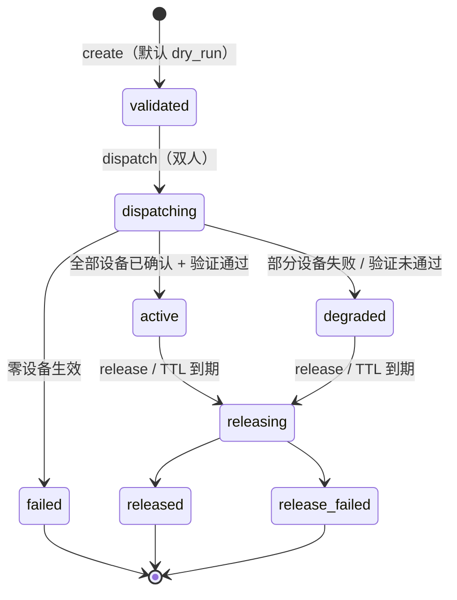

# 安全设备封堵（`Containment`）设计

> 状态：**设计稿**（2026-11-01）。本文定义「平台内部服务调 Center 下发封堵 / 解封指令」这一条能力。
> 调查指令（另一条 C3 写能力）见 [`center-open-api.md`](center-open-api.md) §7.6.1。

## 1. 文档目的

安全事件的处置闭环里，「把边界封住」是唯一一个**会改变客户现场**的动作。它和调查的区别是：

- 调查只读，最坏结果是「没拿到证据」；
- 封堵写边界，最坏结果是**客户业务断掉**，或者**以为封了其实没封**。

本文回答六个问题：

- 封堵指令从谁来、到哪去、在哪个组件执行
- 封什么（指示器闭集）与不许封什么（自锁保护）
- 怎么保证「真封了」（设备回执 ≠ 生效）
- 怎么保证「封错能退」（TTL、解封、引用计数）
- 和高危动作（`ActionPlan`）的关系
- 分阶段怎么落

明确不在本文：

- 调查面本身 → [`investigation-surfaces.md`](investigation-surfaces.md) /
  [`investigation-security-surfaces.md`](investigation-security-surfaces.md)
- 主机侧的处置（重启 / 清理 / 改配置）→ [`../execution/action-dsl.md`](../execution/action-dsl.md)
- 设备自身的策略管理（长期 ACL、白名单治理）→ 设备侧变更流程

---

## 2. 结论（先看这十条）

| 编号 | 决定 | 为什么 |
|---|---|---|
| **D1** | 封堵是**有生效期的资源**（`Containment`），不是一次 `Command` | 「成 / 败」终态表达不了「现在还在封着」 |
| **D2** | **默认演练**：创建即 `dry_run`，只出影响预览；`dispatch` 才碰设备 | 误封的代价不对称，多一步比少一步好 |
| **D3** | **双人**：`created_by` ≠ `dispatched_by` | 封堵没有「撤销键」，只有「再发一次解封」 |
| **D4** | **不可永久**：`ttl` 必填，首次生效起累计 ≤ 7 天 | 永久封堵属于设备策略配置，不属于应急 API |
| **D5** | 指示器是**闭集 + 结构化**，宽度有下限（IPv4 ≥ `/24`，IPv6 ≥ `/64`） | 挡住「封 `0.0.0.0/0`」这类一键断网 |
| **D6** | **自锁保护**：中心 / 网关 / 数据面 / 监控的地址永远进不了封堵目标 | 处置工具不能把自己封死 |
| **D7** | **设备回执 ≠ 生效**：必须 readback 验证，未验证记 `degraded`，不记成功 | 「以为封了」比「没封」更危险 |
| **D8** | 同一 `(gateway, capability, indicator)` 只有一条设备规则 + **引用计数** | 否则一张工单解封会把别人封的一起解掉 |
| **D9** | 封堵**只经网关暴露的封闭能力**执行；Center 不连设备、不加载插件 | 能力集合在网关侧编译期固定，可审计、可版本化；Center 只做调度与治理 |
| **D10** | **三封闭**：能力清单封闭、操作封闭（`apply` / `readback` / `remove`）、参数封闭 | 不做插件、不做 SSH / CLI 模板、不做 URL / 请求体透传 —— 否则就是「带审批的远程 shell」 |

一句话：

> **封堵是一条有时限、双人确认、可验证、可解封、按引用计数的处理项；它默认只演练，永远不提供「永久」，
> 执行只走网关暴露的封闭能力（不做插件、不做自由命令）。**

---

## 3. 名词与边界

| 名词 | 含义 | 不是什么 |
|---|---|---|
| `Containment` | 一段生效期内，在若干安全设备上对某指示器的拒绝 | 不是一份设备配置，也不是一条命令 |
| 指示器 `indicator` | 被封的对象（IP / CIDR / 域名 / URL / 文件哈希 / 端口+协议） | 不是自由文本，不是正则，不是命令行片段 |
| 安全设备 `SecurityDevice` | 由**网关上报**的边界设备（防火墙 / WAF / IPS / ACL / 云安全组 / EDR）；Center 只存不造 | 不是受管主机，也不是 agentd |
| 设备操作 `DeviceOperation` | 一次「在设备 X 上增 / 删一条规则」的投递与回执 | 不是 `Containment` 的终态 |
| 解封 `release` | 结束一条 `Containment` 的生效（按引用计数） | 不是「删除工单」 |

三条边界：

1. **不改主机**：封堵只碰安全设备。主机侧隔离（进程 / 文件 / 账号）通过 `ActionPlan` 走 `wist-exec`。
2. **不做长期策略**：`Containment` 有 TTL。永久 ACL、白名单版本化是设备和 CMDB 的事。
3. **不做自动封堵**：本能力**只接受具名调用方 + 来源工单**。无人工 / 无审批的自动封堵不在本次设计内 —— 误报率决定它只能做「建议」。

### 3.1 与 `ActionPlan` 的关系

控制平面的原则是「**会改机器的动作走 `ActionPlan`**（审批 / 编译 / 签名 / 回滚）」。
封堵本质上是 R3 动作，最终形态应当**编译成 `ActionPlan`**：每个设备一条 plan，
`Containment` 退化为它的读投影。

但 `ActionPlan` 尚未落地，而封堵不能等。所以本文采取：

- **语义按 `ActionPlan` 的治理要求走**（审批 / 双人 / 时限 / 验证 / 回滚 / 审计）；
- **执行先走现有网关命令通道**（`gateway_commands`）到网关暴露的封闭能力；
- `Containment` 记录 `action_id`（可空），为迁移留位。

> 迁移判据：当 `ActionPlan` 能表达「非主机目标（设备）」时，封堵改为「编译 → 派发」，
> `Containment` 只保留 TTL / 引用计数 / 验证三项，不再自带投递逻辑。

### 3.2 为什么这不违反「R3 第一版不开放」

[`action-dsl.md`](../execution/action-dsl.md) §9.4.7 的「`R3` 第一版暂不开放」针对的是**主机 opcode**
（任意写文件 / 执行程序 / 改系统配置）。封堵：

- 不经过 `wist-exec`，没有 opcode；
- 不走开放 / 自由模式：能做什么由**网关暴露的封闭能力清单**决定（§5），Center 只能按 `capability_id` 调用；
- 每套能力只有 `apply` / `readback` / `remove` 三个动作，参数只有 `{indicator, direction, ttl}`；
- 用 §7 的六道闸把「任意性」压到零。

所以它属于「**新开一类受控 R3**」：动作空间是**枚举**，不是**图灵完备**。

---

## 4. 调用方与入口

| 调用方 | 面 | scope | 典型用途 |
|---|---|---|---|
| C3 平台内部服务（响应 / 编排 / SOAR） | `/api/v1/internal/containments` | `write:containment` | 事件定级后按剧本封堵，结束时解封 |
| C2 管理者（人 / 控制台） | `/api/v1/admin/containments` | 反代注入 + 角色 | 值班人员补刀、复核、紧急解封 |
| C1 网关 | 不可调 | — | 只执行，不发起 |

两个面共享同一套服务层与同一张表；**区别只在身份与配额**。C3 的写请求额外要求 `origin`（服务名 / 事件 id）。

### 4.1 端点

| 方法 | 端点 | 语义 |
|---|---|---|
| `POST` | `…/containments` | 创建（默认 `dry_run`），返回影响预览 |
| `POST` | `…/containments/{id}/dispatch` | 真正下发（双人） |
| `POST` | `…/containments/{id}/renew` | 续期（累计上限 7 天） |
| `POST` | `…/containments/{id}/release` | 解封（必带 `reason`） |
| `GET` | `…/containments/{id}` | 详情（含每目标操作与验证结果） |
| `GET` | `…/containments?state=active&indicator=&gateway_id=` | 列表（默认只看 `active` / `degraded`） |
| `GET` | `…/containment-capabilities?gateway_id=` | **可用能力清单**（从网关上报里读，不手填） |

### 4.2 形状

**创建（演练）**

```json
POST /api/v1/internal/containments
{
  "indicators": [
    { "kind": "ip", "value": "203.0.113.45" },
    { "kind": "domain", "value": "evil.example.com" }
  ],
  "capabilities": [
    { "gateway_id": "gw-001", "capability_id": "fw-acl-v1" }
  ],
  "direction": "inbound",
  "ttl_seconds": 3600,
  "dry_run": true,
  "reason": "INC-2026-1101-07 C2 回连",
  "origin": "wist-response/INC-2026-1101-07"
}
```

`201 Created`

```json
{
  "containment_id": "ctn_01J9ZA3",
  "state": "validated",
  "dry_run": true,
  "created_by": "WistResponse",
  "created_at": "2026-11-01T12:03:00Z",
  "expires_at": "2026-11-01T13:03:00Z",
  "impact": [
    { "gateway_id": "gw-001", "capability_id": "fw-acl-v1", "device_id": "dev-fw-001", "indicator": "ip:203.0.113.45", "action": "deny inbound", "supported": true },
    { "gateway_id": "gw-001", "capability_id": "fw-acl-v1", "device_id": "dev-fw-001", "indicator": "domain:evil.example.com", "supported": false, "reason": "capability_has_no_dns_support" }
  ],
  "protected_hits": []
}
```

> `supported: false` 的那一项在 `dispatch` 时会被拒（`422 containment_indicator_unsupported`）。
> 调用方要么去掉它，要么换一个支持该指示器的能力 —— **不允许静默跳过**。

**下发（双人）**

```json
POST /api/v1/internal/containments/ctn_01J9ZA3/dispatch
{ "capabilities": [{ "gateway_id": "gw-001", "capability_id": "fw-acl-v1" }], "confirm_indicators": ["ip:203.0.113.45"] }
```

- `capabilities` / `confirm_indicators` **只能收窄**，不能扩大（同 Command 的规矩）。
- 成功 `202` + `state=dispatching`；不等设备回执（异步，查详情收敛）。
- `created_by = dispatched_by` → `409 containment_requires_second_actor`。

**解封**

```json
POST /api/v1/internal/containments/ctn_01J9ZA3/release
{ "reason": "误报，客户确认非恶意" }
```

---

## 5. 执行方：网关暴露的封闭能力

一句话：**Center 不碰设备，也不定义「怎么封」；它只调网关暴露的、封闭的能力清单。**

```text
ContainmentCapability {          // 网关上报，随网关版本发布；Center 只读，不造
  capability_id        // 封闭枚举：fw-acl-v1 | waf-deny-v1 | cloud-sg-v1 | edr-isolate-v1
  gateway_id
  device_id            // 网关本地设备标识
  device_kind          // firewall | waf | ips | acl | cloud_security_group | edr
  indicator_kinds[]    // 这套能力真的支持哪些指示器
  directions[]         // inbound | outbound
  max_ttl_seconds      // 该能力允许的最长时限
  supports_readback    // 能不能验证
}
```

### 5.1 三条边界（D9 / D10 的落地）

1. **能力清单封闭**：`capability_id` 是网关代码里写死的枚举，随版本发布。Center **不接受**
   动态注册、第三方插件、厂商脚本 —— 没有「接一个新设备就多一个执行面」这回事。
2. **操作封闭**：一套能力只有 `apply` / `readback` / `remove` 三个动作，没有第四个。
3. **参数封闭**：Center 下发的只能是 `{capability_id, indicator, direction, ttl}`；
   **不能**带设备 API 路径、请求体、CLI、URL。

### 5.2 为什么不在 Center 做

| 方案 | 为什么否 |
|---|---|
| Center 直连设备 | 设备在客户网内，Center 通常不可达；且把「能改客户边界」的能力放进公网可达的服务 |
| Center 侧通用适配器 + 插件 | 插件 = 新的任意执行面（新的解析器、新的凭据、新的网络出口），风险不可控 |
| 自由 CLI / SSH 模板 | 等价于「带审批的远程 shell」，与 R3 红线冲突 |
| **网关暴露封闭能力**（采用） | 动作集合编译期固定、可审计、可版本化；Center 只做调度与治理 |

设备凭据也不进 Center：由网关自己从现场配置 / `${SEC_...}` 取，Center 从头到尾见不到。

### 5.3 链路

```text
C3 ──POST /internal/containments──▶ Center（校验 / 影响预览 / 双人）
                                     │ dispatch：每 (网关, 能力) 一条 gateway_commands
                                     ▼
                        gwlinkd 短轮询（既有 1–2s）
                                     │ 只带 capability_id + 归一化 indicator
                                     ▼
                       网关封堵能力（封闭实现，随版本发布）
                                     │ apply → readback
                                     ▼
                              Center 收敛状态 + 审计
```

### 5.4 能力协商与发布顺序

> 指令信封（`kind` / body / 回执）、relay 面与能力广告的 wire 细节见
> [`gateway-capability-contract.md`](gateway-capability-contract.md)。本节只保留 Center 侧的判断规则。

- 网关在状态上报里带 `containment_capabilities`（与 `investigation_capabilities` 同一个模式，加性字段）。
- **网关先发**：旧网关没报 = 不支持；Center 对这类目标回 `409 containment_unsupported`，不下发。
- 闸 4 只在 `indicator_kinds` 与 `direction` 都支持时通过；否则同样拒绝。
- `max_ttl_seconds` 是**能力的上界**：`ttl` 取 `min(request, capability.max_ttl_seconds, 7d)`。

> 能力清单随网关版本变：升一批网关 = 多一批能力。Center 不需要跟着发版，
> 但发布顺序仍然是**先网关后 Center**（否则新能力用不上，且旧网关会收到自己不认识的 id）。

**能力为空时**：`dry_run` 仍返回 `validated`，但 `impact = []` + `warnings[]` 点名「无可用能力」；
`dispatch` 直接 `409 containment_unsupported`。**不允许创建一条永远不会执行的封堵项** ——
那会让值班以为已经封住了。

---

## 6. 指示器

### 6.1 闭集

| `kind` | 例 | 校验 |
|---|---|---|
| `ip` | `203.0.113.45` | 合法单播地址；回环 / 链路本地 / 组播 / 广播一律拒绝 |
| `cidr` | `203.0.113.0/24` | 主机位归零；IPv4 前缀 ≥ 24，IPv6 ≥ 64 |
| `domain` | `evil.example.com` | 小写、无通配（首版）；≤ 253 字符 |
| `url` | `https://evil.example.com/p` | 仅 http/https；只取 host 比对，路径仅作展示 |
| `sha256` | 64 位十六进制 | 小写归一 |
| `port_proto` | `3389/tcp` | 端口 1–65535；协议 tcp / udp |

规范化在**入口**做一次，之后全链路只认归一值（否则 `EVIL.example.com` 与 `evil.example.com`
会变成两条规则、两次计数）。

### 6.2 自锁保护（硬约束）

以下目标**永远不可封**，命中即 `409 containment_protected_target`：

| 受保护对象 | 来源 |
|---|---|
| 中心自身地址 | `public_url` 解析出的 IP |
| 网关管理 / 出站地址 | 网关登记记录 + 现场配置 |
| 数据面（wparse / ingest）地址 | 现场配置 `data plane endpoints` |
| 监控 / 日志汇聚地址 | 现场配置 |
| 平台自身依赖的域名 | 配置的 `protected_domains` |
| 回环 / 链路本地 / 组播 / 广播 | 协议常量 |

理由：封堵是**处置工具**。它一旦能把平台自己的控制面或数据面封掉，
接下来的解封指令也发不出去 —— 这就是自锁。

> 这条不能用「审批通过就能放行」绕过。要改受保护集合，改配置并重启，是另一个变更。

### 6.3 私网地址

允许封私网（横向移动处置必须能封东西向），但要求：

- 显式 `allow_private=true`（C2 默认关，C3 必须显式声明）；
- 命中受保护集合仍然拒绝；
- 审计里单列「封了私网地址」这个事实。

---

## 7. 六道闸

| # | 闸 | 判据 | 失败 |
|---|---|---|---|
| 1 | **身份** | scope `write:containment`；C3 必须有 `origin` | `403 service_scope_denied` / `400 origin_required` |
| 2 | **双人** | `created_by ≠ dispatched_by` | `409 containment_requires_second_actor` |
| 3 | **指示器** | 闭集 + 归一 + 宽度下限 + 受保护集合 | `422` / `409 containment_protected_target` |
| 4 | **能力** | `(gateway_id, capability_id)` 在网关上报里存在，且 `indicator_kinds` + `direction` 都支持 | `409 containment_unsupported` / `422 containment_indicator_unsupported` |
| 5 | **配额** | 单次 ≤ 100 指示器、≤ 20 个能力；在飞封堵项 ≤ 50 | `429` / `422` |
| 6 | **幂等** | `(gateway_id, capability_id, indicator_digest)` 已有活跃规则 → 复用 + 计数 | 不报错，返回既有 `containment_id` |

> **闸 4 必须拒绝而不是忽略**：设备不支持域名封堵时静默跳过，等于给调用方一个
> 「成功了但什么也没封」的假象 —— 这正是 D7 要避免的那类错误。

---

## 8. 生命周期



| 状态 | 语义 |
|---|---|
| `validated` | 校验 + 影响预览通过，**未碰设备**（含已演练但未下发的） |
| `dispatching` | 正在逐设备 apply |
| `active` | 全部设备 apply 成功**且** readback 验证通过 |
| `degraded` | 有设备未生效或未验证通过（**需要人看**，不会自动回滚） |
| `failed` | 零设备生效（指令失败，现场无变化） |
| `releasing` / `released` | 解封中 / 已解封 |
| `release_failed` | 解封失败（**最高优先级告警**：现场可能还封着） |

关键点：

- **`degraded` 不是成功**。调用方看到 `degraded` 必须继续处置（换设备 / 人工确认），
  不能当 `active` 用。
- **`expired` 不是状态，是触发**：TTL 到期进入 `releasing`；解封失败就是 `release_failed`。

---

## 9. 生效验证

设备回执只证明「API 调成功了」，不证明「规则真的在生效」。三层验证：

| 层 | 做什么 | 现状可得性 |
|---|---|---|
| L1 回执 | 设备 API 返回成功 + 规则 id | 网关能力内 |
| L2 readback | 主动查设备的有效规则列表，确认新规则在 | 网关能力内（能力协商） |
| L3 探针 | 从受控探针发起连接，确认被拒 | P3（需要探针位置） |

规则：

- L2 不支持 → `verification: unsupported`，状态记 `degraded`（**不记 active**）；
- L2 失败 → `degraded` + 告警；
- L3 只做补充证据，不阻塞状态（探针本身可能被别的原因影响）。

---

## 10. 引用计数与解封

同一 `(gateway_id, capability_id, indicator_digest)` 只允许**一条**设备规则：

| 场景 | 行为 |
|---|---|
| 第二个 `Containment` 封同一指示器 | 复用设备规则，`ref_count += 1`，不再调设备 |
| 其中一个 `Containment` 解封 | `ref_count -= 1`，**设备规则不动** |
| `ref_count` 归零 | 真正 `remove` |
| TTL 到期 | 与解封同一条路径（减计数） |
| 设备规则被外部改动 | readback 发现 `present=false` → `degraded` + 告警（不自动重封） |

这样设计的原因：封堵是**多人多工单**操作的同一个现场。按工单直删规则，
第二张工单的封堵会被第一张工单的解封静默撤销 —— 这是最隐蔽的处置失效。

---

## 11. 失败与回滚

| 失败 | 处置 |
|---|---|
| 设备不可达 | 该设备 `failed`；整体 `degraded`（有其它设备成功时）/ `failed`（全失败） |
| 能力执行超时 | 不重试超过 2 次（沿用命令队列口径）；记 `attempts` |
| 部分指示器不支持 | 入口就拒（闸 4），不会出现「一半封了」 |
| 验证不通过 | `degraded` + 告警；不回滚（封一半比不封更安全，需人判断） |
| 解封失败 | `release_failed`；**最高优先级告警**，并自动重试有限次 |
| 紧急全量解封 | 单独端点 `POST /admin/containments:release-all`（C2，双人 + 原因），用于事件结束后清场 |

**不做自动回滚**：封堵失败时「退回到没封」并不总是安全（攻击仍在进行）。
状态如实上报，由调用方 / 值班决定。

---

## 12. 审计

每次状态迁移与每次设备操作都落审计：

| 字段 | 例 |
|---|---|
| `containment_id` | `ctn_01J9…` |
| `indicator` | `ip:203.0.113.45`（审计存归一值 + digest，可按需掩码） |
| `device_id` / `device_rule_id` | `dev-fw-001` / `rule-8891` |
| `actor` | `wist-response` / `AdminOperator:zhangsan` |
| `action` | `create` / `dry_run` / `dispatch` / `verify` / `release` / `expire` / `release_failed` |
| `from_state → to_state` | `dispatching → degraded` |
| `reason` / `origin` | `INC-2026-1101-07` |
| `at` | RFC3339 UTC |

审计要能直接回答三问：**谁封的、封的什么、现在解了没有。**

---

## 13. 安全边界与威胁

| 威胁 | 后果 | 兜底 |
|---|---|---|
| 误封业务关键地址 | 客户业务断 | 演练 + TTL + 双人 + 影响预览（可接 atlas 关联资产） |
| 封掉平台控制面 / 数据面 | **自锁**，连解封都发不出去 | 受保护集合（D6），不可审批绕过 |
| C3 服务被控后批量封堵 | 大面积断网 | scope + 配额 + 单次上限 + 双人 + 无永久 + 审计 |
| 设备凭据泄露 | 攻击者直接操作设备 | 最小权限账号 + `${SEC_...}` + 不进日志 + 可轮换 |
| 假成功 | 以为封了其实没封 | readback 验证 + `degraded` + L3 探针（P3） |
| 解封误伤 | 别人的封堵被撤 | 引用计数（§10） |
| 重放 | 重复封 / 重复解 | 幂等键 + 唯一活跃规则约束 |
| 适配器被滥用为远程执行 | 任意命令 | **没有适配器入口**：只有网关侧封闭能力 + 三个固定动作（§5） |
| 能力集被「扩展」成自由执行 | 新增插件即新增攻击面 | 能力清单随网关版本发布，Center 无注册接口；新增能力 = 一次代码评审 + 一次发版 |

---

## 14. 模型落地（提案，待 `jumo` 校验）

```mju
variant ContainmentIndicatorKind {
  Ip Cidr Domain Url FileHash PortProto
}

variant ContainmentState {
  Validated Dispatching Active Degraded Failed Releasing Released ReleaseFailed
}

variant SecurityDeviceKind {
  Firewall Waf Ips Acl CloudSecurityGroup Edr
}

// 网关上报的封闭能力：Center 只读，不存在「注册设备 / 注册插件」的接口
struct ContainmentCapability {
  unique capability_id: String      // 枚举，不是自由字符串
  gateway_id: String
  device_id: String
  device_kind: SecurityDeviceKind
  indicator_kinds: List<String>
  directions: List<String>
  max_ttl_seconds: Int
  supports_readback: Bool
}

struct Containment {
  unique containment_id: String
  tenant_id: String
  environment_id: String
  indicator_kind: ContainmentIndicatorKind
  indicator_value: String
  direction: String
  gateway_ids: List<String>
  capability_ids: List<String>
  device_ids: List<String>          // 从能力推导，仅作审计回显
  state: ContainmentState
  created_by: String
  dispatched_by: String?
  created_at: DateTime
  dispatched_at: DateTime?
  expires_at: DateTime
  verified: Bool
  action_id: String?          // 迁移到 ActionPlan 后回填
  release_reason: String?
}
```

报文归属：

- `Containment` / `ContainmentCapability` 属 **Control 域**（有状态、有生效期），不进 `wist-api`；
- 网关侧只见到**能力投递信封**（`capability_id` + `indicator` + `operation`），不需要理解 `Containment` 的业务状态。

---

## 15. 分阶段

> 阶段顺序由**网关能力就绪**决定：P0（`dry_run` / 校验 / 预览）不需要网关配合，
> 可以先把接口与闸门做完；P1 必须等第一套网关能力上报之后才能真下发。

| 阶段 | 内容 | 验收 |
|---|---|---|
| **P0** | 能力清单读取（网关上报落库）+ 指示器校验 + `dry_run` 影响预览 | 演练不产生任何设备副作用；受保护集合命中即 409；能力不支持的能力在预览里标红；无能力时 dispatch 回 409 |
| **P1** | **网关先发**：一套封闭能力（含 readback）+ 上报；Center 双人 + TTL + 解封 | 一条 `ip` 封堵端到端生效；TTL 到期规则消失且有证据；`created_by = dispatched_by` 被拒；旧网关无能力上报 → 409 |
| **P2** | 多网关 / 多能力 + 引用计数 + `renew` + 事件（`containment.*`） | 两条封堵同一 IP，解掉一条后规则仍在；`ref_count` 归零后规则消失 |
| **P3** | 审批单（`ApprovalRecord`）+ L3 探针 + atlas 影响面关联 + 迁移 `ActionPlan` | 审批单缺省时不能 dispatch；影响预览能列出受影响业务系统 |

---

## 16. 开放问题

1. **能力清单的范围**：网关首版暴露哪一套（防火墙 ACL / WAF / 云安全组）？能力粒度是「设备」还是「设备+规则集」？
2. **能力与设备的映射**：一台设备可能有多个能力（如 L3 + L4），重复封同一指示器时谁负责去重 —— 网关内部还是 Center 按 `capability_id` 去重。
3. **设备凭据在网关怎么存**：现场配置 / `${SEC_...}` / 独立密钥文件；轮换是否要 Center 参与（观点：不参与，网关自管）。
4. **私网封堵的默认值**：C3 默认 `allow_private=false` 会不会挡住东西向处置？是否需要按环境配置。
5. **L3 探针放哪**：另一个客户的机器？网关主机？没有探针时 `degraded` 会不会淹没告警。
6. **共享设备**：一台防火墙服务多个客户时，规则的租户隔离与冲突检测在哪一侧做（倾向网关侧，因为它知道本地规则）。
7. **与 EDR / 主机隔离的边界**：EDR 隔离是「主机级封堵」，走网关能力还是走 agentd？倾向走 agentd（它已经在主机上），但对外仍以 `Containment` 表达。
8. **解封是否需要比封堵更高的权限**：解封可能比封堵更危险（撤掉正在保护的措施）。是否要单独 scope `write:containment:release`。
9. **与 `ActionPlan` 的迁移时点**：`ActionPlan` 支持非主机目标后，`Containment` 的投递字段如何退役。

---

## 17. 相关文档

- [`center-open-api.md`](center-open-api.md)：C3 面、写能力白名单、调查指令、`Containment` 的端点与闸门
- [`investigation-surfaces.md`](investigation-surfaces.md)：调查只读契约与三道闸（处置前取证）
- [`investigation-security-surfaces.md`](investigation-security-surfaces.md)：安全向调查面（暴露面 / 持久化等，处置依据）
- [`control-plane.md`](control-plane.md)：审批 / 编译 / 派发 / 审计闭环（封堵的最终形态）
- [`../execution/action-dsl.md`](../execution/action-dsl.md)：风险分层与「R3 第一版不开放」的原始口径
- [`warpstation-rule-publishing.md`](warpstation-rule-publishing.md)：网关命令队列的租约 / 上限 / 幂等参数
