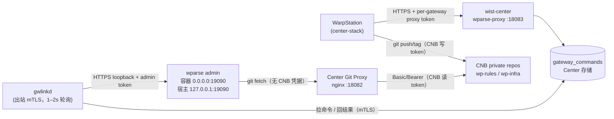
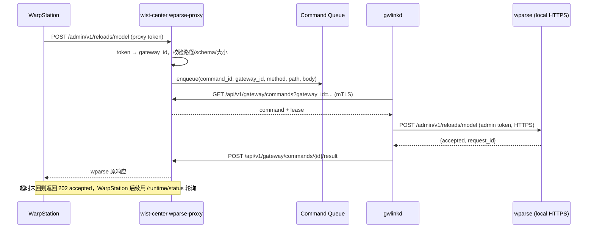
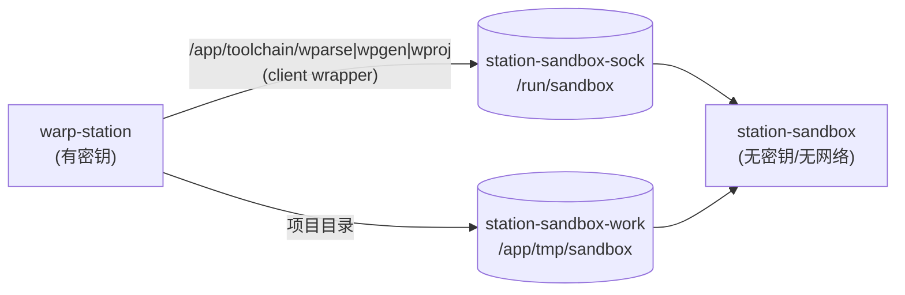

# WarpStation 规则管理下发（Center Git Proxy + gwlinkd 命令通道）

> **状态**：设计稿（2026-10-19）；安全风险与 Hardening Checklist 见 §10；
> **R3（PG 分账号）纳入 v1**；**R2（沙盒拆容器）推迟到运行跑通后的安全分析阶段**（v1 先单容器）。
> 具体设计见 §9.6 / §9.7。
> **目标**：把 WarpStation 集成进 `wist-center-stack`，对 Gateway 的 WarpParse 做规则/配置管理、版本化与发布。
> **范围**：`wist-center`、`wist-gwlinkd`、`wist-center-stack`、`wist-gateway-stack`、外部 CNB 仓库。
> **不在范围**：WarpStation 自身 UI/业务逻辑改造；CNB 平台改造；Git Proxy 的客户端认证（本期 TODO）。

## 1. 结论

采用两条互相独立的链路：

1. **Git 链路（规则/配置版本化）**
   - WarpStation 在 Center 侧维护 `gitea/wparse__models` / `gitea/wparse__infra` 两个工作区；
   - 保存/发布时用**本地 git 命令** commit/push/tag 到外部 CNB 私有仓库；
   - **不依赖 Gitea API**；
   - Gateway 的 wparse 通过 **Center Git Proxy** 拉取 CNB，CNB 凭据只在 Center。

2. **控制链路（发布触发/状态查询）**
   - WarpStation 调 **Center `wparse-proxy`**（wparse 管理面兼容路径）；
   - Center 把请求写入**命令队列**；
   - gwlinkd 用**现有出站 mTLS 通道**每 1–2s 短轮询取命令，在本机通过 HTTPS 调 `127.0.0.1:19090` 的 wparse admin API，再回传结果；
   - Gateway **不开放任何入站端口**：wparse admin 在容器内绑 `0.0.0.0` + TLS，宿主只发布 `127.0.0.1:19090`。



## 2. 设计原则

1. **Gateway 零入站端口**：gwlinkd 只主动出站连 Center；wparse admin 在容器内绑 `0.0.0.0` + TLS，宿主只发布 `127.0.0.1:19090`（bridge 网络下宿主访问不到容器 loopback）。
2. **凭据只在 Center 与 Gateway 本机**：
   - CNB 写 token：Center（WarpStation 用）；
   - CNB 读 token：Center（Git Proxy 用）；
   - wparse admin token：Gateway 本机（gwlinkd 用）；
   - per-gateway proxy token：Center 生成、WarpStation 使用。
3. **WarpStation 代码零改动**：Center `wparse-proxy` 原样支持 `POST /admin/v1/reloads/model`、`GET /admin/v1/runtime/status` 的路径与响应结构。
4. **git-only**：WarpStation 不做 Gitea API 建仓；两个 CNB 仓库预先存在，Center localize 预克隆。
5. **失败可诊断**：超时、租约、重试、错误码都要能在 Center 日志/WarpStation 响应中看到。
6. **默认最小暴露**：Git Proxy 本期客户端认证放开（TODO），但预留 IP allowlist；Center `wparse-proxy` 必须带 proxy token。

### 2.1 关键决策

| 决策 | 选择 | 理由 |
|---|---|---|
| Gateway 入站端口 | **不开** | 安全边界；gwlinkd 只出站 |
| 管理面代理 | **Center 命令队列 + gwlinkd 1–2s 短轮询** | 复用现有 mTLS 出站通道；WarpStation 无需改代码 |
| Gateway 拉 Git | **Center Git Proxy → CNB** | CNB 读 token 只在 Center；Gateway 无凭据 |
| WarpStation 版本化 | **git-only（本地 git push/tag）** | 两个 CNB 仓库已存在；不依赖 Gitea API |
| Gitea | **不引入** | 不是 Git 代理；mirror 会引入第二源与同步延迟 |
| wparse 管理面 | **容器内 `0.0.0.0:19090` + TLS；宿主仅发布 `127.0.0.1:19090`** | bridge 网络下宿主访问不到容器 loopback；TLS 满足 WarpParse 非回环绑定约束（硬校验，不可关闭） |
| Gateway `admin-tls` | **用于 gwlinkd → wparse 的本地 HTTPS** | WarpStation 不直连；gwlinkd 用 `gateway-ca.crt.pem` 校验 |
| Git Proxy 客户端认证 | **本期放开 + TODO** | 先跑通；上线前至少加路径白名单 + 细粒度 token + IP allowlist |
| DB 账号 | **v1 必做：Center / WarpStation 分库分账号（`center_app` / `station_app`），禁用 superuser 共用** | 阻断 WarpStation → 中心库的横向移动 |
| 沙盒 | **v1 暂不启用（先单容器跑通）**；后续安全分析再评估独立 worker | 规则/OML 的风险面与凭据隔离需结合真实运行数据判断，先避免过度设计 |
| tag 完整性 | **CNB tag 保护 + 签名/commit SHA 核对** | 防“沙盒验 A、Gateway 拉 B” |
| Git Proxy 路径 | **只允许两个仓库的 upload-pack 路径** | 防止用注入 token 的代理访问其他 CNB 路径 |

> 早期讨论过的“gwlinkd 开 19091 入站、复用 Gateway admin-tls”方案已被本决策取代；本设计不在 Gateway 上新增任何监听端口。

## 3. 组件与职责

| 组件 | 仓 | 职责 |
|---|---|---|
| WarpStation | 上游 `wp-labs/wp-station` | 规则/配置编辑、沙盒验证、发布编排；本地 git push/tag 到 CNB；调 Center `wparse-proxy` |
| Center Git Proxy | `wist-center-stack`（nginx） | 对 Gateway 提供只读 Git smart HTTP；注入 CNB 读凭据 |
| Center `wparse-proxy` | `wist-center` | wparse 管理面兼容入口；proxy token → gateway_id；命令入队/等待/返回 |
| Command Queue | `wist-center`（PgStore/FileStore） | 持久化待执行命令、租约、结果、过期 |
| gwlinkd | `wist-gwlinkd` | 轮询命令；校验白名单；调本机 wparse；回传结果 |
| wparse | `wist-gateway-stack` | `project_remote` 拉 Center Git Proxy；admin API 容器内 `0.0.0.0:19090` + TLS，宿主仅发布回环 |
| CNB | 外部 | `wp-rules`（models）、`wp-infra`（infra）私有仓库；版本 tag 的唯一持久源 |

## 4. 数据流

### 4.1 规则维护与版本化（Git）

1. Center localize 预克隆：
   - `https://cnb.cool/dy-sec/jingang-cust/wist/wp-rules` → `configs/station/gitea/wparse__models`；
   - `https://cnb.cool/dy-sec/jingang-cust/wist/wp-infra` → `configs/station/gitea/wparse__infra`。
2. WarpStation 启动时检测到 `.git` 已存在，跳过 `init_gitea_repo`（不调 Gitea API）。
3. 规则/配置保存：
   - 写工作区 → commit → push 到 `origin`（CNB）→ 刷新草稿发布记录。
4. 发布：
   - 生成版本号（`vX.Y.Z`）→ 打 tag → push tag 到 CNB；
   - 调 Center `wparse-proxy` 触发 Gateway reload。

> **前提**：两个仓库默认分支为 `main`；`wp-rules` 根下有 `models/`，`wp-infra` 根下有 `conf/`、`topology/`、`connectors/`。
> localize 脚本会校验，不符合则 fail-closed 并提示。

### 4.2 Gateway 拉取（Git Proxy）

wparse 的 `[project_remote]` 使用环境变量占位，真实地址由 Gateway 容器环境注入：

```toml
[project_remote]
enabled = true
repo = ""

[project_remote.models]
repo = "${WPARSE_PROJECT_MODELS_REPO}"

[project_remote.infra]
repo = "${WPARSE_PROJECT_INFRA_REPO}"
```

```text
WPARSE_PROJECT_MODELS_REPO=https://<center-domain>:18082/dy-sec/jingang-cust/wist/wp-rules
WPARSE_PROJECT_INFRA_REPO=https://<center-domain>:18082/dy-sec/jingang-cust/wist/wp-infra
```

- Gateway 不持有 CNB 凭据；
- Git Proxy 注入 CNB 读 token；
- Gateway 通过 `GIT_SSL_CAINFO` 信任 Center CA（把 `identity/gwlinkd/control-center.pem` 只读挂进
  wparse 容器，例如 `/data/identity/control-center.pem`），或把 Center CA 装进容器信任库。
  `GIT_SSL_CAINFO` / `SSL_CERT_FILE` 对 libgit2 的生效性需在 wparse 0.30.0-alpha 上实测。

### 4.3 发布触发（Center 命令通道）



- `reloads/model`：入队后最多等 15s；拿到结果原样返回；超时返回 `202 {accepted:true, request_id, message}`。
- `runtime/status`：优先返回最近缓存；否则入队并最多等 5s；超时返回 `504` + 明确错误。
- 同一 gateway 同时只允许一个 in-flight `reloads/model`；重复请求返回现有 `command_id`（幂等）。

## 5. Center Git Proxy 设计

### 5.1 服务

- 独立服务 `git-proxy`（`nginx:1.27-alpine`），宿主端口 `${GIT_PROXY_PORT}`（默认 `18082`）。
- TLS：复用 `identity/center/control-center-server.{crt,key}`；Gateway 信任 Center CA。
- 只读：上游 CNB 使用**只读 token**；可选阻断 `git-receive-pack`。

### 5.2 关键配置

```nginx
server {
    listen 8443 ssl;
    server_name center.example.com;

    ssl_certificate     /certs/server.crt;
    ssl_certificate_key /certs/server.key;

    # 本期放开；上线前至少加 IP allowlist，后续加 auth_basic。
    # allow <gateway-cidr>; deny all;
    # auth_basic "wist git proxy";
    # auth_basic_user_file /etc/nginx/git-proxy.htpasswd;

    # **只允许两个仓库的 smart HTTP 读端点**；禁止任意路径透传到 CNB。
    location ~ ^/dy-sec/jingang-cust/(wp-rules|wp-infra)\.git/(info/refs|git-upload-pack)$ {
        if ($arg_service = "git-receive-pack") { return 403; }
        if ($request_method !~ ^(GET|POST)$) { return 403; }

        proxy_pass https://cnb.cool;
        proxy_http_version 1.1;
        proxy_set_header Host cnb.cool;
        proxy_set_header Authorization "Basic <base64(cnb-user:read-token)>";
        proxy_ssl_server_name on;
        proxy_ssl_verify on;
        proxy_redirect off;

        proxy_buffering off;
        proxy_request_buffering off;
        proxy_max_temp_file_size 0;
        proxy_read_timeout 300s;
        proxy_send_timeout 300s;
    }

    # Git 客户端可能探测 HEAD；仍只限两个仓库（配置同上的精简版）。
    location ~ ^/dy-sec/jingang-cust/(wp-rules|wp-infra)\.git/HEAD$ {
        proxy_pass https://cnb.cool;
        proxy_http_version 1.1;
        proxy_set_header Host cnb.cool;
        proxy_set_header Authorization "Basic <base64(cnb-user:read-token)>";
        proxy_ssl_server_name on;
        proxy_ssl_verify on;
        proxy_buffering off;
    }

    # 其它路径一律拒绝：避免把代理当成“带 CNB token 的通用 SSRF”。
    location / { return 404; }
}
```

### 5.2.1 安全约束

- **路径白名单是硬要求**：只放行两个仓库的 `info/refs` / `git-upload-pack` / `HEAD`，
  不写 `location / { proxy_pass ...; }`。否则任何能访问 18082 的人都能用注入的 CNB token
  访问 CNB 的其他路径。
- **CNB 读 token 最小权限**：只授权 `wp-rules` / `wp-infra` 两个仓库、只读；
  不要用组织级/全仓 token。
- **客户端认证**：本期放开是已知风险；上线前至少 `allow <gateway-cidr>; deny all;`，
  再升级到 `auth_basic` / mTLS。
- **限流**：`limit_req` / `limit_conn` 防大仓库反复 clone、CNB 限流与带宽耗尽。
- **不记录凭据**：access log 不含 `Authorization`；不要开 debug 日志打印请求头。
- **上游 TLS 校验**：`proxy_ssl_verify on`、`proxy_redirect off`，避免被重定向到非 CNB 主机。
- **请求走私/大 body**：固定 nginx 版本并定期升级；限制 `client_max_body_size` 与 header 大小。

### 5.3 变量与密钥

| 变量 | 说明 |
|---|---|
| `GIT_PROXY_PORT` | 宿主端口，默认 `18082` |
| `GIT_PROXY_ALLOW_CIDR` | 可选 IP allowlist；空 = 放开 |
| `STATION_MODELS_REPO_URL` / `STATION_INFRA_REPO_URL` | 两个外部 Git 仓库；必须同主机 |
| `WP_GIT_BASE_URL` | 外部 Git 基址；空 = 从仓库 URL 推导 |
| `WP_GIT_AUTH_HEADER` | 默认 `Authorization`（可改 Bearer/自定义 header） |
| `WP_GIT_PUSH_USER` / `WP_GIT_PUSH_TOKEN` | WarpStation 写路径；token 只落 `.wist` / 运行时配置 |
| `WP_GIT_PUB_USER` / `WP_GIT_PUB_TOKEN` | Git Proxy 读路径；token 只落 `.wist` / 运行时配置 |

> 变量名与 Git 提供商无关；文中“CNB”只是当前部署的一个实例。

### 5.4 TODO

- **客户端认证**：本期放开；上线前至少 IP allowlist，后续加 `auth_basic`（proxy token）或 mTLS。
- **路径白名单实测**：确认 CNB 的 Git smart HTTP 只走 `info/refs` / `git-upload-pack` / `HEAD`；
  若还有 LFS 等端点，按需最小放行。
- CNB 鉴权方式实测：Basic（用户名 + token）优先；若 CNB 只接受 Bearer/自定义 header，改渲染值即可。
- 可选缓存 `info/refs`；本期不做。

## 6. Center `wparse-proxy` 与命令队列

### 6.1 监听与路由

- `wist-center` 新增独立 HTTPS listener：容器 `0.0.0.0:3101`，宿主 `${WPARSE_PROXY_PORT}`（默认 `18083`）。
- TLS 复用 Center 服务器证书/私钥。

```toml
[wparse_proxy]
enabled = true
listen_addr = "0.0.0.0:3101"
# TLS 证书/私钥复用 [server] 的 server cert/key（容器内 /wist-center/ca/...）
```
- 认证：`Authorization: Bearer <per-gateway proxy token>`；Center 存 token 的 SHA-256，反查 `gateway_id`。
- 只允许：
  - `POST /admin/v1/reloads/model`
  - `GET /admin/v1/runtime/status`
- 其它路径 404；body 上限 4 KiB；响应 body 上限 1 MiB。

### 6.2 命令模型

```text
gateway_commands
  command_id        text primary key
  gateway_id        text not null
  method            text not null
  path              text not null
  body              text
  state             text not null   -- pending | leased | done | failed | expired
  attempts          int not null default 0
  lease_expires_at  timestamptz
  response_status   int
  response_body     text
  error             text
  created_at        timestamptz not null
  updated_at        timestamptz not null
```

- 租约：`leased` 默认 30s；gwlinkd 崩溃后租约过期，命令回到 `pending`（最多重试 1 次）。
- 过期：`pending` 超过 60s → `expired`。
- 幂等：同一 gateway + 同一 `(version, group)` 的 `reloads/model` 复用现有 pending/leased 命令。

### 6.3 Proxy Token

```text
gateway_wparse_tokens
  gateway_id        text primary key
  token_sha256      text not null
  created_at        timestamptz not null
  rotated_at        timestamptz
  revoked_at        timestamptz
```

- 管理面 API：`POST /api/v1/admin/gateways/{gateway_id}/wparse-proxy-token` 返回明文一次；`DELETE` 撤销。
- WarpStation 设备 Token 填该值；**不要**复用网关 mTLS 客户端证书或 wparse admin token。

### 6.4 等待语义

| 路径 | 等待 | 超时返回 |
|---|---|---|
| `POST /admin/v1/reloads/model` | 最多 15s | `202 {accepted:true, request_id, message:"queued"}` |
| `GET /admin/v1/runtime/status` | 最多 5s | `504` + `{success:false,error:{code:"upstream_timeout",...}}` |

- `reloads/model` 拿到 gwlinkd 回传的 wparse 响应时，原样返回状态码/body。
- `runtime/status` 可加 60s 缓存，减少命令量；本期先不做，后续可在 gwlinkd 状态上报里带 wparse 状态。

### 6.5 安全约束

- **路径白名单（双端）**：Center 只接受两个 admin 路径；gwlinkd 也独立校验，
  不把 Center 当可信来源。
- **body schema 严格校验**：`version` 限制 `^[A-Za-z0-9._-]{1,64}$`，
  `group ∈ {models, infra}`，`wait/update` 布尔，`timeout_ms` 有上限；拒绝未知/超长字段。
- **gateway_id 绑定**：`GET /api/v1/gateway/commands` 必须校验 **mTLS 证书里的 gateway_id
  与查询参数一致**；`POST .../result` 校验命令归属。
- **proxy token**：高熵（≥256 bit）、只存 SHA-256、常量时间比较、可撤销/轮换；
  按 gateway 限流（如 60 req/min），队列上限（如每 gateway 32 条）。
- **不转发客户端头**：gwlinkd 只注入本机 admin token 和必要 JSON 头；忽略 `Authorization`、
  `Host`、`X-Forwarded-*` 等客户端头。
- **响应限制**：body ≤ 1 MiB；Content-Type 固定 JSON；不反射任意 header。
- **审计**：记录 `request_id` / `command_id` / gateway_id / version / group / 结果，不记录 token。

## 7. gwlinkd 命令通道

### 7.1 Center 侧 API（mTLS）

- `GET /api/v1/gateway/commands?gateway_id={id}&limit=1`
  - 返回 `pending` 命令并**原子租约**；
  - 响应：`{command_id, method, path, body, lease_expires_at}`。
- `POST /api/v1/gateway/commands/{command_id}/result`
  - body：`{status_code, body, error}`；
  - Center 按 `command_id` 写回并唤醒等待者。

### 7.2 gwlinkd 配置

```toml
[wparse_relay]
enabled = true
# 容器内 0.0.0.0:19090 + TLS；宿主只发布 127.0.0.1:19090
upstream = "https://127.0.0.1:19090"
ca_file = "/abs/path/identity/gateway/public/gateway-ca.crt.pem"
token_file = "/abs/path/data-plane-run/.run/admin_api.token"
poll_interval_ms = 1500
request_timeout_ms = 20000
allowed_paths = ["/admin/v1/reloads/model", "/admin/v1/runtime/status"]
```

### 7.3 循环

1. 每 1–2s 拉命令；空闲时短轮询，错误时指数退避（上限 30s）。
2. 白名单校验 `method + path`；否则直接回 `403` 结果，不执行。
3. 读本机 admin token，用 Gateway CA 校验 `upstream` 的 TLS 证书，调 `upstream`；
   不再向 Center 传 wparse token。
4. 回传状态码 + body；只记日志，不打印 token。
5. 若 Center 不可达，命令租约会过期，Center 重排；gwlinkd 不回滚已执行的重载（重载本身幂等）。

## 8. Gateway wparse 改造

### 8.1 admin API

```toml
[admin_api]
enabled = true
# 容器内绑 0.0.0.0；宿主只发布 127.0.0.1:19090，不对外暴露。
bind = "0.0.0.0:19090"
request_timeout_ms = 15000
max_body_bytes = 4096

[admin_api.tls]
# 非回环绑定必须 TLS；复用 Gateway admin-tls 证书。
enabled = true
cert_file = "/data/identity/admin-tls.crt.pem"
key_file = "/data/identity/admin-tls.key.pem"

[admin_api.auth]
mode = "bearer_token"
token_file = ".run/admin_api.token"
```

- **为什么不能只绑 `127.0.0.1`**：wparse 是容器、gwlinkd 是宿主进程；bridge 网络下宿主访问不到容器 loopback。
  正确做法是容器内绑 `0.0.0.0` + TLS，compose **只发布** `127.0.0.1:19090:19090`。
- **TLS 不能关**：WarpParse 二进制里有硬校验
  `non-loopback admin_api.bind '<bind>' requires admin_api.tls.enabled=true`（`warp-parse:0.30.0-alpha` 实测）。
  只有绑回环才允许明文；而容器内绑回环后宿主又访问不到，因此 bridge 网络下不存在“HTTP 也能通”的组合。
  唯一能去掉 TLS 的方式是 `network_mode: host` + 绑 `127.0.0.1`，代价是整站端口模型与隔离形变，不采用。
- 证书复用 `identity/gateway/{public,private}/admin-tls.{crt,key}.pem`；gwlinkd 用
  `identity/gateway/public/gateway-ca.crt.pem` 校验。
- token 由 gateway localize 生成：`data-plane-run/.run/admin_api.token`，mode `600`。
  ⚠ **实测约束（2026-10-19）**：WarpParse 校验 token 文件必须 **0600 且属主=运行用户**；
  而 `gops sys perms` 会把 bind 挂载里的文件统一成 `0660`（owner=部署账号、group=999），
  两者冲突。落地做法：`/data/.run` 改为**命名卷** `wist-gateway-stack-wparse-run`，
  由 `wparse-run-init` 在容器内以 999 身份从宿主 `data-plane-run/.run/admin_api.token.host`
  复制并 `chmod 600`；宿主这份 `.host` 属主=部署账号、0600，留给 gwlinkd 读。
  详见 `wist-gateway-stack/sys/docker-compose.yml` 与 `scripts/init-wparse-admin.sh`。
- **不要**把宿主端口发布成 `0.0.0.0:19090:19090`。

### 8.2 工作根：种子 + 可写运行根

- `data-plane/` 只读挂到 `/seed`；
- `data-plane-run/work` 可写挂到 `/data`；
- 启动：`cp -an /seed/. /data/`（只补缺失，不覆盖现场）；
- `data-plane-run/{data,.run}` 继续挂到 `/data/data`、`/data/.run`；
- wparse 跑 `/data`，`project_remote` 可安全写入；
- `data-plane-run/work` 可写权限由 `gops sys perms` 按 wparse 容器 uid `999` 对齐。

### 8.3 外部 infra 仓库的 `conf/wparse.toml`

首次 infra 同步后，`wp-infra/conf/wparse.toml` 会覆盖 Gateway 的种子。它必须包含：

- `[project_remote]` 双仓库 + `${WPARSE_PROJECT_*_REPO}` 占位；
- `[admin_api]` 上述配置（`0.0.0.0:19090` + TLS + bearer token）；
- `models/`、`topology/`、`connectors/` 的相对路径。

这是**外部仓库的变更**，需在 `wp-infra` 里同步维护；Center 生成一份可粘贴片段供对照。

## 9. WarpStation / Center-stack

### 9.1 服务

| 服务 | 作用 | 端口 / 卷 |
|---|---|---|
| `warp-station` | 规则管理/发布控制台（**持有密钥**，v1 直接执行工具链） | `${STATION_PORT}:8081`；挂 `station-toolchain:/app/toolchain:ro` |
| `warp-toolchain` | 一次性：把真实 `wparse/wpgen/wproj` 复制进命名卷 | 无 |
| `db-init` | 一次性：创建 `center_app` / `station_app` 角色与数据库 | 无 |
| `db-schema` | 一次性：以 `center_app` 幂等套 schema | 无 |
| `git-proxy` | CNB 只读 Git 反代 | `${GIT_PROXY_PORT}:8443` |

**移除**内置 `gitea` / `gitea-init` / `gitea-data` / `GITEA_*` 变量。

> **v1 是单容器**：`warp-toolchain` 把真实工具链复制进 `station-toolchain` 命名卷，
> WarpStation 只读挂到 `/app/toolchain` 直接执行。沙盒拆容器（§9.6）推迟到安全分析阶段，
> 当前 compose **不启用**；源码保留在 `sys/sandbox/`。

### 9.2 WarpStation 配置

- `[gitea] base_url = "https://cnb.cool"`（仅占位；git-only 不调 API）；
- `username` = `WP_GIT_PUSH_USER`；`password` 由 `station.env` 注入（`WP_GIT_PUSH_TOKEN`）；
- v0.2.14 使用**固定布局**（不再有 `project_models/project_infra` 配置项）：
  `/app/gitea/{wparse,wfusion}__{models,infra}`；CNB 的两个仓库分别落到
  `wparse__models` / `wparse__infra`，`wfusion__*` 由 WarpStation 自动补齐。
- `warparse.ca_file = "/app/tls/CA.crt"`，挂 Center CA（WarpStation 调 Center `wparse-proxy` 用）。

### 9.3 Localize

1. 确保 `.wist/sec-value.yml` 有：`center_db_password`、`station_db_password`、
   `wp_git_push_token` / `wp_git_pub_token`（外部 Git 写/读 token，运维提供）；
2. `warp-toolchain` 由 compose 一次性服务执行（复制 `wparse/wpgen/wproj` 进命名卷），localize 不额外处理。
3. 预克隆两个 CNB 仓库到 `configs/station/project_*`；校验分支 `main` 与目录结构。
   - 私有仓库需要凭据：使用 `WP_GIT_PUSH_USER` + `WP_GIT_PUSH_TOKEN`（外部 Git 写 token）
     通过临时 credential helper 完成 clone；`.git/config` 里的 `origin` 保持**干净 URL**（不带 token）。
   - 两个目录都已有 `.git` 时跳过 clone，不覆盖现场改动。
4. 写 `station.env`：`WP_STATION__GITEA__USERNAME` / `WP_STATION__GITEA__PASSWORD`（外部 Git 写账号/token）、
   `WP_STATION__DATABASE__PASSWORD`（`station_db_password`）、
   `WPARSE_PROJECT_MODELS_REPO` / `WPARSE_PROJECT_INFRA_REPO`（写进 Gateway 对接片段）。
5. 渲染 `configs/station/config.toml`（`station_app` / CNB 写账号）。
6. 渲染 `configs/git-proxy/nginx.conf`（含 CNB 读凭据）。
7. `gops sys perms --apply` 对齐 `project_*`、`config.toml`、`station.env`、CA。

### 9.4 备份

- `configs/station/project_*`、`config.toml`、`station.env` 随 `configs/` 进 `gops prj backup`；
- CNB 是版本的持久源，本地工作副本可重建；
- 无 Gitea 卷备份。
- 备份含 CNB 写 token / DB 密码：备份文件必须加密并限制访问；泄露后立即轮换 token。

### 9.5 安全硬化（详见 §10）

- **沙盒拆容器（§9.6，v1 暂不启用）**：WarpStation 主容器持有 CNB 写 token / proxy token /
  DB 凭据；后续安全分析再评估是否拆到无密钥、无外网的独立 worker。
- **DB 隔离（§9.7）**：Center 与 WarpStation 使用不同 PG 账号/库，禁止 superuser 共用。
- **WarpStation 入口**：首启改默认 `admin/123456`；TLS 反代 + 网络 ACL；不要直接暴露公网 HTTP。
- **CNB 写 token 最小权限**：只授权 `wp-rules` / `wp-infra`；定期轮换；不写入 git/vars/日志。
- **egress allowlist**：WarpStation 只允许访问 CNB 与 Center；防止 `.git/config` 被篡改后把 token 发给恶意 origin。
- **git 硬化**：push 前校验 `origin` URL；`git -c core.hooksPath=/dev/null`；禁用 `protocol.file.allow`。
- **tag 完整性**：CNB 保护 tag/禁止强推；发布 tag 签名；gwlinkd reload 前核对 commit/tag。
- **镜像**：`wp-station` / `nginx` / `warp-parse` / `postgres` 按 digest 固定，尽量验签 + CVE 扫描。

### 9.6 沙盒容器化（后续安全加固，v1 暂不启用）

> **v1 决策（2026-10-19）**：先把单容器模式跑通；沙盒拆容器保留为后续安全加固项。
> 当前 `wist-center-stack/sys/docker-compose.yml` 不包含 `station-sandbox*` 服务，
> WarpStation 直接使用 `station-toolchain` 卷里的真实工具链。下面的设计用于后续评估。

目标：WarpStation 主容器**不再执行用户可控的 wparse/wpgen**，沙盒拆到独立 worker；
worker 无 CNB/proxy/DB 密钥、无外网；主容器保留业务凭据。



**组件：**

| 组件 | 说明 |
|---|---|
| `wist-center-sandbox:${SANDBOX_TAG}` | 基于 `warp-parse:${WARPPARSE_TAG}` + Go `wist-sandbox`；含 `wparse/wpgen/wproj` 与 runner/client |
| `station-sandbox` | worker 服务；`network_mode: none`、`read_only: true`、`user 999:999`、`cap_drop: ALL`、`no-new-privileges`、默认 seccomp、CPU/内存/pids 限制；挂 `work`、`sock` |
| `station-sandbox-init` | 一次性：`chown 999:999` 三个 sandbox 卷 |
| `station-sandbox-client` | 一次性：把 `/usr/local/bin/wist-sandbox` 复制为 client 卷里的 `wparse`/`wpgen`/`wproj`；`user 999:999` |
| `warp-station` | 只挂 client 卷（`/app/toolchain:ro`）、工作卷、socket 卷；**不再**挂真实工具链、不再 `seccomp=unconfined` |

**依赖顺序**：`station-sandbox-init` → `station-sandbox-client` / `station-sandbox` → `warp-station`。

**协议（Unix socket，避免网络暴露）：**

- socket：`/run/sandbox/control.sock`；
- client 通过 `argv[0]` 识别自己叫 `wparse` / `wpgen` / `wproj`，发送
  `{cmd, args, cwd}`；
- runner 校验：
  - `cmd` 只允许三个白名单；
  - `cwd` 必须是 `/app/tmp/sandbox/` 下、且 `EvalSymlinks` 后仍在该目录；
  - args 数量/长度上限；不经过 shell；
  - 只注入最小 env（`PATH` / `HOME=/tmp` / `TMPDIR=/tmp` / `TZ`），不继承 WarpStation 的业务环境；
- 输出以帧回传（stdout / stderr / exit code）；client 写入自己的 stdout/stderr，WarpStation 现有日志重定向不变；
- 长驻 `wparse daemon`：client 断开即杀 runner 内的进程组，兼容 WarpStation 的 `start_kill`；
- 并发上限（如 2），超限拒绝并回明确错误。

**安全属性：**

- worker 看不到 CNB 写 token / proxy token / DB 密码 / Center CA；
- `network_mode: none`，不能外连 CNB/Center/任意 sink；
- 只读 rootfs + 只写 `station-sandbox-work` 与 `/tmp`；drop all caps；非 root；默认 seccomp；
- 三个 sandbox 卷由 `station-sandbox-init` 统一 `chown 999:999`；`gops sys perms` 不处理命名卷。
- 即使规则/OML 触发 wparse 漏洞，攻击面也限制在“无密钥、无网络、只读镜像”的 worker 内。

**构建/发布：**

- `sys/sandbox/` 放 Go 源码 + `Dockerfile`（multi-stage：Go builder → `warp-parse` 基镜像）；
- 与其它 `wist*` 镜像一样**多架构构建并双推** GHCR / TCR；
- 基镜像 `warp-parse` 按 digest 固定，定期升级；
- 这是对上游 wp-station“本地 spawn wparse”的兼容层；若上游未来支持远程 runner，可替换。

### 9.7 PG 分账号（v1 必做）

目标：WarpStation 被攻破时，不能读写 Center 的库。

**角色与库：**

| 角色 | 用途 | 权限 |
|---|---|---|
| `db_admin` | 仅 bootstrap / `db-init` / 备份 | superuser，不用于应用 |
| `center_app` | Center 应用 | 仅 `insight_demo`，owner |
| `station_app` | WarpStation | 仅 `wp-station`，owner |

**一次性 `db-init`：**

- 以 `db_admin` 连接；从 `.wist/sec-value.yml` 读取 `center_db_password` / `station_db_password`；
- 幂等创建角色/库；设置 owner；
- `REVOKE CONNECT ON DATABASE insight_demo FROM PUBLIC`，只授 `center_app`；
- `REVOKE CONNECT ON DATABASE "wp-station" FROM PUBLIC`，只授 `station_app`；
- 顺序：`postgres` healthy → `db-init` completed → `db-schema` / `warp-station`。

```sql
CREATE ROLE center_app LOGIN PASSWORD '...';
CREATE ROLE station_app LOGIN PASSWORD '...';

ALTER DATABASE insight_demo OWNER TO center_app;
ALTER DATABASE "wp-station" OWNER TO station_app;

REVOKE CONNECT ON DATABASE insight_demo FROM PUBLIC;
GRANT CONNECT ON DATABASE insight_demo TO center_app;

REVOKE CONNECT ON DATABASE "wp-station" FROM PUBLIC;
GRANT CONNECT ON DATABASE "wp-station" TO station_app;
```

- 既有现场迁移：先备份；在各自库内 `REASSIGN OWNED BY demo TO center_app/station_app`，再改 database owner；
  最后做交叉连接验证（`station_app` 连 `insight_demo` 必须失败）。

**配置/密钥：**

- `init-center.sh` 确保 `.wist` 有 `center_db_password`，写 `configs/center/center.env` 的 `PGPASSWORD`，
  并用 `center_app` 构造 center DSN；
- `init-station.sh` 确保 `.wist` 有 `station_db_password`，写 `configs/station/station.env` 的
  `WP_STATION__DATABASE__PASSWORD`；
- **不**把 app 密码写进 `vars.yml` / `merged_vars.yml`；`db_admin` 密码只用于 `db-init`/备份。

## 10. 安全设计与风险登记

### 10.1 资产与信任边界

**高价值资产：**

- CNB 私有仓库（规则/OML/拓扑/连接器；可能含 sink 凭据）；
- CNB 写 token / 读 token；
- wparse admin token、per-gateway proxy token；
- Center CA 私钥、Center 服务器证书私钥、Gateway 客户端证书/私钥；
- Center PostgreSQL（网关凭据、命令队列、proxy token 哈希）；
- WarpStation 工作区、用户库、CNB 写 token、proxy token；
- Gateway wparse 工作根与运行态。

| 信任问题 | 机制 |
|---|---|
| WarpStation → Center `wparse-proxy` | per-gateway proxy token（Bearer，TLS） |
| Center → gwlinkd | 现有 mTLS 客户端证书 |
| gwlinkd → wparse | 本机 admin token + HTTPS（宿主回环） |
| Gateway → Center Git Proxy | 本期无客户端认证（TODO）；路径白名单 + 可选 IP allowlist；TLS |
| Git Proxy → CNB | CNB 只读 token（Center 本机） |
| WarpStation → CNB | CNB 写 token（Center 本机） |
| 仓库内不得出现密钥 | `${WPARSE_PROJECT_*_REPO}` 占位；token 只在 env/密钥文件 |

- 禁止把 CNB token、wparse admin token、proxy token 写入 git、`values/`、`merged_vars.yml`、日志。
- `git-proxy` 本期放开是**已知风险**：任何能访问 `GIT_PROXY_PORT` 的人可拉私有仓库；
  上线前至少加路径白名单 + 细粒度只读 token + IP allowlist。

### 10.2 风险登记

| ID | 风险 | 等级 | 影响 | 现状/建议 |
|---|---|---|---|---|
| R1 | Git Proxy 无客户端认证 + 任意路径代理 | **Critical** | 可拉私有仓库；可当作“带 CNB 读 token 的 SSRF”访问 token 权限内其他路径 | §5.2.1 已加路径白名单；仍须细粒度 token + IP allowlist，认证为 TODO |
| R2 | 沙盒与凭据同容器（v1 状态） | **High（条件性，推迟）** | 只有 WPL/OML 触发引擎/连接器漏洞时才成立；本阶段先按单容器运行，后续安全分析再评估 | 已保留 §9.6 的沙盒设计；v1 不启用，先保证功能跑通 |
| R3 | Center 与 WarpStation 共用 PG 超级用户 | **High** | WarpStation 被攻破即可读写中心库（网关凭据/命令队列/token 哈希） | 拆 `center_app` / `station_app`，各自只连自己的库；禁止 superuser |
| R4 | 规则/配置仓库含 sink 凭据 | **High** | CNB 或 Git Proxy 泄露 = DB/Kafka 等凭据泄露 | 强制 `${SEC_*}` 占位 + Gateway 运行时注入；提交前 secret 扫描 |
| R5 | Tag 可变 / 无签名 / 沙盒与发布内容不一致 | **High** | 验证 A、Gateway 拉 B；可投放恶意规则 | CNB tag 保护/禁强推；签 tag；gwlinkd reload 前核对 commit/tag；沙盒跑干净 commit |
| R6 | 容器 loopback 与宿主 gwlinkd 的边界 | **High** | 设计若按“只绑 127.0.0.1”实现，宿主根本调不到；实现时可能误绑 `0.0.0.0` 暴露 | §8.1 已改为容器内 `0.0.0.0` + TLS，宿主仅发布 `127.0.0.1`；实现必须按此验收 |
| R7 | WarpStation 默认 `admin/123456` + HTTP + alpha 软件 | **High** | 控制台被接管 → 改规则/发布/拿 CNB 写 token | 首启改密/自动随机；TLS 反代；网络 ACL；升级/扫描 |
| R8 | `.git/config` origin 被篡改 → CNB token 外泄 | **High** | WarpStation 的 git 回调可能把 token 发给恶意 origin | push 前校验 origin；egress 只允许 CNB；禁用 hooks；限制工作区写权限 |
| R9 | Center `wparse-proxy` 命令注入/SSRF/DoS | **Medium-High** | 触发任意 reload、刷队列、拖垮 Center | §6.5：双端路径白名单、body schema、限流、租约、大小上限 |
| R10 | proxy token / admin token 泄露与轮换 | **High** | 冒充 WarpStation 触发发布；或本机控制 wparse | 高熵、哈希存储、绑定 gateway_id、可撤销/轮换、审计 |
| R11 | Center CA / 私钥 / 备份 | **High** | CA 泄露 = MITM Git Proxy / wparse-proxy / 伪造网关证书 | CA 私钥离机/HSM；备份加密；最小权限 |
| R12 | 审计与非否认不足 | **Medium** | Git Proxy 无认证，拉取不可归因；发布链路跨 4 个系统 | `request_id` 贯穿 WarpStation→Center→gwlinkd；日志集中；告警 |
| R13 | 供应链：镜像/工具链 | **Medium** | wp-station / warp-parse / nginx 被替换或漏洞 | 按 digest 固定、签名验证、CVE 扫描；toolchain 卷只读、校验和 |
| R14 | 可用性单点 / DoS | **Medium** | Git Proxy、Center、gwlinkd 任一挂掉都影响发布 | 限流、超时、队列上限、健康检查、监控；后续可加 mirror |
| R15 | 多租户隔离 | **Medium** | 同一 Center 服务多客户时，Git Proxy 开放会跨租户泄露 | 每租户独立 token/repo 路径/命令队列；或每客户独立 Center |
| R16 | 容器权限与沙盒逃逸 | **High** | `seccomp=unconfined` + 用户规则 = 逃逸面 | 默认 seccomp/自定义 profile、drop caps、只读 rootfs、资源限制、独立 sandbox |
| R17 | TLS/网络暴露 | **Medium** | 18082/18083 误暴露到公网 | 绑定管理网；安全组只放 WarpStation/Gateway IP；TLS 1.2+ |
| R18 | **WarpStation API 无鉴权（v0.2.14 实测）** | **Critical** | `/api/auth/login` 只发 token，后端**没有任何鉴权中间件**（`src/server/app.rs` 仅 `Logger`）；任意可达者可改规则/发布/跑沙盒/读用户表（含密码哈希）。因容器内有 CNB 写 token、DB 凭据、wparse admin 访问能力，等同于无认证管理面 | **已做**：compose 端口改为 `127.0.0.1:${STATION_PORT}:8081`，只允许本机访问；**待做**：Center web 前加认证反代（Basic/OIDC/mTLS）或 SSH 隧道；向上游报 issue；升级到修复版本 |

### 10.3 重点攻击路径

#### 10.3.1 Git Proxy 开放 → CNB 读 token 滥用

如果 nginx 写成 `location / { proxy_pass https://cnb.cool; }`，它会把**任意路径**连同注入的
CNB token 转发给 CNB。攻击者可拉取 token 权限内的其他仓库、访问 CNB 其他 HTTP/API 路径，
或把代理当带宽/请求放大器。

**处置**：§5.2.1 的路径白名单（只放两个仓库的 `info/refs` / `git-upload-pack` / `HEAD`）、
CNB 只读细粒度 token、`limit_req`/`limit_conn`、上线前至少 IP allowlist。

#### 10.3.2 WarpStation 沙盒 RCE → 写 token / proxy token

WarpStation 主容器同时具备规则编辑、`wparse/wpgen` 沙盒执行、CNB 写 token、Center proxy token、
PG 访问，并且当前上游 compose 使用 `seccomp=unconfined`。**如果** WPL/OML 或其 connector 能触发
引擎漏洞（代码执行/任意文件读取），攻击者就会获得与主容器相同的环境权限。

> 这不是“WPL/OML 自带读 token 语法”；而是“规则执行进程与凭据同安全上下文”。
> 是否成立取决于引擎/连接器的实际攻击面——需在后续安全分析中验证。

**处置（后续）**：沙盒拆到独立 worker（无密钥、无外网、只挂载待验证项目副本、默认 seccomp、drop caps、
只读 rootfs、CPU/内存限制）；主容器不要 `seccomp=unconfined`；沙盒禁用 `project_remote`、
禁用真实 sink（用本地 mock/黑洞 sink）。

#### 10.3.3 共享 PG 超级用户 → 中心库横向

`PG_USER=demo` 是 superuser，Center 与 WarpStation 共用。WarpStation 一旦被攻破，攻击者可读
`gateways`/凭据/命令队列/proxy token 哈希，改命令队列给任意 gateway 注入 reload。

**处置**：拆库账号，两个账号都非 superuser；`pg_hba` 限制来源；备份/恢复账号单独。

```sql
CREATE ROLE center_app LOGIN PASSWORD '...';
GRANT CONNECT ON DATABASE insight_demo TO center_app;

CREATE ROLE station_app LOGIN PASSWORD '...';
GRANT CONNECT ON DATABASE "wp-station" TO station_app;
REVOKE CONNECT ON DATABASE insight_demo FROM station_app;
```

#### 10.3.4 Tag 可变 / TOCTOU

WarpStation 沙盒验证工作区，Gateway 拉 tag。若 tag 可移动，或在沙盒通过后、Gateway 拉取前被改写，
就会“验 A 发 B”。

**处置**：CNB 保护 tag（禁强推/删除，只允许发布账号创建）；发布 tag 签名；发布记录保存 commit SHA，
Gateway 拉取后核对；沙盒基于即将发布的 commit 做干净检出；首次初始化显式指定 `init_version`。

#### 10.3.5 命令通道 SSRF / DoS / 重放

Center `wparse-proxy` 是受信的 confused deputy。若校验不严，攻击者可用 proxy token 发任意 path，
Center 转发给 gwlinkd 后变成 SSRF；也可刷命令拖垮 Center/gwlinkd，或重放旧命令。

**处置**：§6.5 的双端路径白名单、body schema、gateway_id 与 mTLS 证书绑定、每 gateway 单 in-flight、
租约/幂等/队列上限/限流。

#### 10.3.6 `.git/config` origin 篡改 → CNB token 外泄

WarpStation 的 git 回调会用配置里的 username/password 对 `origin` 认证。若攻击者能改工作区
`.git/config` 把 `origin` 指向自己的服务器，push 时 CNB token 可能被送过去。

**处置**：push 前校验 `git remote get-url origin` 必须是预期 CNB URL；容器 egress 只允许 `cnb.cool`
和 Center；工作区写权限只给 WarpStation 运行用户；`git -c core.hooksPath=/dev/null`；
禁止 `protocol.file.allow`；监控异常出站。

#### 10.3.7 容器 loopback 暴露

`wparse` 是容器、`gwlinkd` 是宿主进程。如果运维为了“让宿主能访问”把 compose 端口写成
`0.0.0.0:19090:19090`，wparse 管理面就会暴露到所有网卡。

**处置**：按 §8.1，容器内 `0.0.0.0:19090` + TLS，宿主只发布 `127.0.0.1:19090:19090`；
验收时**宿主上** `ss -lntp` 只能看到 `127.0.0.1:19090`（容器内监听 `0.0.0.0`）。

### 10.4 上线前 Hardening Checklist

- [ ] **R1**：Git Proxy 路径白名单 + CNB 只读细粒度 token + IP allowlist；认证作为 TODO 但不长期缺省。
- [ ] **R2（推迟）**：v1 单容器先跑通；安全分析阶段再评估拆独立 worker。
- [ ] **R3（v1 必做）**：Center / WarpStation 拆 PG 账号与库权限，取消 superuser 共用。
- [ ] **R4**：规则/配置仓库 secret 扫描；连接器凭据改 `${SEC_*}` 占位 + 运行时注入。
- [ ] **R5**：CNB tag 保护 + 签名/commit SHA 核对；沙盒跑干净 commit。
- [ ] **R6**：wparse admin 容器内 `0.0.0.0` + TLS，宿主仅 `127.0.0.1` 发布；验收 `ss -lntp`。
- [ ] **R7**：WarpStation 首启改密、TLS 反代、网络 ACL、镜像 digest 固定/扫描。
- [ ] **R8**：push 前 origin 校验 + egress allowlist + 禁用 hooks。
- [ ] **R9**：Center/gwlinkd 双端路径白名单、body 校验、限流、租约、幂等。
- [ ] **R10/R11**：token 生命周期、CA 私钥/备份保护、轮换与撤销。
- [ ] **R12**：`request_id` 贯穿 + 集中审计 + 告警。
- [ ] **R13**：所有镜像按 digest 固定；`warp-toolchain` 卷只读、校验和。
- [ ] **R14/R17**：18082/18083 只在管理网；限流/超时/健康检查。

### 10.5 残余风险与接受项

- Git Proxy 客户端认证先放开（R1 的认证部分）——**前提**是路径白名单 + 细粒度 token + 网络 ACL 已到位。
- `runtime/status` 每次走命令队列有 1–2s 延迟——正确性优先，后续可缓存或并入 gwlinkd 状态上报。
- Center 单点——先做监控/限流；后续再考虑多实例或 mirror。
- WarpStation 上游 alpha 质量——用隔离/网络 ACL/监控兜底，持续升级。
- CNB 作为外部依赖——通过 tag 保护/签名/commit 核对降低内容被篡改的风险；CNB 不可达时发布失败（可后续加 mirror）。

## 11. 错误处理与可观测性

- Center：
  - 命令生命周期日志：`command_id` / `gateway_id` / path / state / latency；
  - 指标：pending 数、lease 超时数、等待超时数、gwlinkd 轮询延迟；
  - 错误码：`invalid_token`、`path_not_allowed`、`body_too_large`、`upstream_timeout`、`gateway_busy`。
- gwlinkd：
  - 日志：拉取/执行/回传，含 `command_id`，不含 token；
  - 连续失败退避；
  - 白名单拒绝记 `warn`。
- WarpStation：
  - 保持 wparse 原响应结构；超时返回 202 时 `accepted: true`，后续状态轮询。

## 12. 发布与迁移

### 12.1 发布顺序

1. `wist-control`：新增命令/结果类型（如使用生成契约）。
2. `wist-gwlinkd`：命令轮询/执行/回传（向后兼容：旧 Center 无该端点时忽略）。
3. `wist-center`：`wparse-proxy` listener + 命令队列 + proxy token 管理。
4. `wist-gateway-stack`：wparse admin API / project_remote / 可写工作根 / token 生成。
5. （后续安全加固，v1 不做）`wist-center-sandbox` 镜像：Go runner/client + `warp-parse` 基镜像。
6. `wist-center-stack`：Git Proxy、WarpStation（单容器 + `warp-toolchain`）、PG 分账号、CNB 预克隆、CLI/文档。

### 12.2 迁移

- Center：新增表/迁移；`wparse-proxy` 默认关闭，配置后启用。
- Gateway：`data-plane/` 从“只读工作根”切到“只读种子 + 可写运行根”；
  `gops sys localize` 生成 admin token；`gops sys perms` 对齐。
- Center-stack：
  - 移除内置 Gitea；新增 Git Proxy；重新 localize 预克隆 CNB；
  - v1 单容器：`warp-toolchain` 复制真实 `wparse/wpgen/wproj` 进命名卷，WarpStation 只读挂载；
    沙盒拆容器（§9.6）作为后续安全加固项；
  - 执行 PG 角色迁移：创建 `center_app` / `station_app`，改 DB/对象 owner，收紧 CONNECT；
    先备份，迁移后做交叉连接验证。
- 回滚：关闭 `wparse-proxy` / `wparse_relay`，WarpStation 仍可维护规则但不发布；
  Gateway 可回到旧工作根（保留 `data-plane-run/work` 不删）；
  PG 角色保留（回滚不影响运行，只是不再使用新账号）。

## 13. 验收

- [ ] WarpStation 保存规则 → CNB 出现 commit/tag；不调用 Gitea API。
- [ ] Gateway wparse 通过 Center Git Proxy 拉到指定 tag；Gateway 上无 CNB token。
- [ ] WarpStation 设备指向 Center `wparse-proxy`，proxy token 绑定 gateway_id。
- [ ] `reloads/model` 由 gwlinkd 在 1–2s 内取到并执行；Center 返回 wparse 响应或 202。
- [ ] `runtime/status` 能返回状态；超时有明确错误。
- [ ] Gateway 无新增入站端口；**宿主** `ss -lntp` 只看到 `127.0.0.1:19090`（容器内为 `0.0.0.0:19090` + TLS）。
- [ ] 命令租约过期/重试/幂等有测试覆盖。
- [ ] Git Proxy 直连 CNB 与经代理 `git ls-remote` 结果一致。
- [ ] **安全**：Git Proxy 对非白名单路径返回 404/403；`git-receive-pack` 被拒。
- [ ] **安全**：WarpStation 只能用 `station_app` 访问 `wp-station` 库，连不到 `insight_demo`。
- [ ] （后续）**安全**：沙盒 worker 无 CNB/proxy/DB 密钥，且无外网（`network_mode: none` 可验证）。
- [ ] （后续）**安全**：沙盒 client 的 `wparse daemon` / `wpgen` / `wproj check` 经 Unix socket 正常工作；
  断开 client 会杀掉 worker 内的进程组。
- [ ] **安全**：`station_app` 连 `insight_demo` 失败；`center_app` 连 `wp-station` 失败。
- [ ] v1 单容器：WarpStation 直接使用 `station-toolchain` 卷；`seccomp=unconfined` 保留为 TODO（安全分析阶段再评估）。
- [ ] **安全**：发布 tag 可验签或 commit SHA 与发布记录一致。
- [ ] **安全**：篡改 `.git/config` origin 后 push 被拦截，token 不会发出。
- [ ] **安全**：Center/gwlinkd 对非白名单 path 拒绝；超长/未知 body 字段被拒。

## 14. TODO

- Git Proxy 客户端认证（proxy token / mTLS）与 IP allowlist 默认值。
- CNB 鉴权方式实测（Basic / Bearer / 自定义 header）。
- WarpParse 对 `project_remote.repo` 的 `${VAR}` 替换与 libgit2 `GIT_SSL_CAINFO` 实测。
- `runtime/status` 缓存，或把 wparse 状态并入 `ReportGatewayStatus`，减少命令量。
- 长轮询/Stream 替代 1–2s 短轮询。
- 多网关命令并发与限流。
- Center 管理面 UI 发/轮换 proxy token。
- Git Proxy 缓存/镜像（CNB 不可达时的降级）。
- 外部 `wp-infra/conf/wparse.toml` 的模板化维护。
- 上游 wp-station 若支持原生远程 sandbox runner，替换 `wist-sandbox` 兼容层。
- 发布 tag 签名 + gwlinkd reload 前验签/commit SHA 核对。
- WarpStation 首启随机 admin 密码 + TLS 反代方案。
- `request_id` 贯穿 WarpStation→Center→gwlinkd 的审计与告警。
- `wist-center-sandbox` 多架构构建/双推流水线与 digest 固定。

## 15. 实施状态与实测结论（2026-10-19）

### 15.1 已完成（`wist-center-stack`）

- 移除内置 Gitea；新增 `git-proxy`（nginx，路径白名单 + CNB 读凭据注入 + 可选 IP allowlist）。
- v1 **单容器**：新增 `warp-toolchain` 一次性服务，把真实 `wparse/wpgen/wproj` 复制进
  `station-toolchain` 命名卷，WarpStation 只读挂载并直接执行；`seccomp=unconfined` 暂时保留
  （与上游一致，安全分析阶段再评估）。沙盒源码保留在 `sys/sandbox/`，compose 不启用。
- 新增 `db-init`：`center_app` / `station_app` 分库分账号，`REVOKE CONNECT, TEMPORARY ... FROM PUBLIC`，
  既有现场按 `public` schema 逐对象迁移（**不能**用 `REASSIGN OWNED BY db_admin`：bootstrap
  超级用户拥有 `information_schema` 等系统对象，会直接报错）。
- `init-station.sh`：密钥补齐、CNB 预克隆（临时 `GIT_ASKPASS`，origin 保持干净 URL）、
  分支/目录校验（空仓库只允许 README）、`station.env`、`config.toml` 渲染值、Git Proxy 渲染值、
  Gateway 对接片段。
- `init-center.sh`：生成 `center_db_password`、写 `configs/center/center.env`、DSN 改用 `center_app`。
- README / `sys-prj.yml` / `dev/push-images.sh` / `operators.gxl` 同步更新。

### 15.2 已完成（`wist-gateway-stack`）

- wparse：`data-plane/` 只读种子 → `data-plane-run/work` 可写运行根（启动时 `cp -an`）。
- `[project_remote]` 双仓库 + `${WPARSE_PROJECT_*_REPO}` 占位；`[admin_api]` 容器内
  `0.0.0.0:19090` + TLS；宿主仅发布 `127.0.0.1:${WPARSE_ADMIN_PORT}:19090`。
- `init-wparse-admin.sh`：生成宿主侧 token（0600）、初始化运行态命名卷（999/2770）。
- `wparse-run-init`：把 token 以 999/0600 放进命名卷，解决 `gops sys perms` 与 WarpParse
  权限校验的冲突（见 §8.1）。

### 15.3 实测结果

| 项 | 结果 |
|---|---|
| `gops sys localize`（center-stack / gateway-stack） | 通过 |
| `docker compose config --quiet` | 通过 |
| `scripts/db-init.sh`（全新库 / 重复执行 / 既有表迁移） | 通过；交叉连接自检失败即报错 |
| `nginx -t` + 路径白名单（`/` → 404，`git-receive-pack` → 403） | 通过 |
| 沙盒镜像原型构建 + `wparse --version` + cwd 越界拒绝 | 通过（**v1 未启用**，源码保留在 `sys/sandbox/`） |
| WarpStation `v0.2.14-alpha` 启动（PG / 迁移 / admin_api TLS / 默认配置 / Web 8081） | 通过；控制台 `GET /` 返回 200，Git Proxy 健康检查通过 |
| `wist-center-sandbox` 多架构构建 | 未执行（后续安全加固阶段） |
| Gateway wparse 运行时启动 | 通过：引擎启动、source `9000`/`1514` 监听、4 个 sink group spawn、admin API `200` |
| Gateway 从 Git Proxy 首次同步 | 通过：`infra` → `v1.0.0`，`models` → `v1.0.0`；`project_version` 两组均为 `v1.0.0` |

### 15.4 v0.2.14 适配要点（实测）

- `Setting` 新增**必填** `[admin_api]`（`enabled` / `ca_file` / 轮询参数）；缺失会直接 panic。
- 仓库布局改为固定 `<cwd>/gitea/{wparse,wfusion}__{models,infra}`；旧的
  `project_models` / `project_infra` 配置项不再存在。Center-stack 已把 CNB 工作副本放到
  `configs/station/gitea/wparse__models` / `wparse__infra`，并整体挂到 `/app/gitea`。
- 镜像里 `/app` 是 `root:root 755`，运行用户 999 写不了；`HOME` 必须指到可写目录（本栈用 `/tmp`），
  否则 `git config --global` 失败。
- `config.toml` / `nginx.conf` 是**单文件 bind mount**；`gx.tpl` 原子替换后 inode 变化，
  旧容器仍看旧文件。`gops run start` 会重建；手工 `up -d` 需 `--force-recreate`。
- WarpStation 启动会尝试 Gitea API（`get_repo`）；CNB 不是 Gitea，会打一条 warning 并降级继续。
  这不影响本地 git 的 `origin` push（`add_commit_push` / `push_tag` 都用本地 origin）。

### 15.6 Gateway 首次同步踩坑与修复（2026-10-19）

1. **容器把 Center 域名解析成自己**：宿主 `/etc/hosts` 常把 `<CENTER_DOMAIN>` 指到 `127.0.0.1`，
   容器经 DNS 继承后会 clone 到容器自己（connection refused）。修复：`wparse` 服务加
   `extra_hosts: "${CENTER_DOMAIN:-center.invalid}:host-gateway"`；单机部署设 `CENTER_DOMAIN`，
   多机部署留空即可走真实 DNS。
2. **Git Proxy 路径不带 `.git` 被 404**：Git 客户端按配置 URL 原样请求，而白名单只允许 `*.git`。
   修复：白名单同时接受 `/<repo>.git` 与 `/<repo>` 两种写法。
3. **启动不自动同步**：`wparse daemon` 启动时**不会**拉远端；必须
   `POST /admin/v1/reloads/model` 且 `update=true` + `group=models|infra`，且**先 infra 后 models**
   （infra 的 `conf/wparse.toml` 提供 models 仓库地址与 `project_remote` 配置）。

### 15.5 已完成：Center `wparse-proxy` + gwlinkd relay（2026-10-19）

- `wist-center`：
  - `src/wparse_proxy.rs`：proxy token（只存 SHA-256）、命令队列（原子租约 / 30s 过期 /
    最多重试 1 次 / reload 按 `(gateway, version, group)` 幂等）；
  - 独立 HTTPS listener（`[wparse_proxy]`，默认 `0.0.0.0:3101`，复用 Center 服务器证书、
    **不校客户端证书**）；
  - 网关面 mTLS 命令通道：`GET /api/v1/gateway/commands`、`POST /api/v1/gateway/commands/{id}/result`；
  - 管理面：`POST/DELETE /api/v1/admin/gateways/{gateway_id}/wparse-proxy-token`。
- `wist-gwlinkd`：
  - `[wparse_relay]` 配置 + 1.5s 短轮询；双端路径白名单；本机 admin token 调用 wparse；
    结果回传；证书轮换后自动重建 mTLS 客户端。
- **开发态端到端验证（本机）**：
  - WarpStation 设备 `gw-X4` → Center proxy `c-dev01...:13101` → 命令队列 →
    gwlinkd（mTLS）→ 本机 wparse `https://127.0.0.1:19090`；
  - 设备健康检查读取到 `client_version=0.30.0`、`config_version=models=v1.0.0, infra=v1.0.0`；
  - models / infra 各发布一次 `v1.0.1`：release `PASS`，device `SUCCESS`，
    wparse `project_version` 两组均 `v1.0.1`，`last_reload_result=reload_done`；
  - CNB 两个仓库均出现 `v1.0.1` annotated tag（指向 baseline commit，本次无内容变更）。

### 15.7 未完成（下一阶段）

- **正式发布**：Center 需要重新构建 **linux** 镜像（本机开发态用的是 macOS 二进制）；
  CI/发版流水线产出后把栈里的 `CENTER_TAG` 切到新版本。
- **后续安全分析**：基于真实运行数据评估 WPL/OML/connector 的攻击面，再决定是否启用 §9.6 沙盒；
  同步评估 `seccomp=unconfined`、token 文件可达性、连接器外联/文件能力。
- 两个 CNB 仓库的**内容基线**：✅ 已完成。**注意**：`v1.0.0`–`v1.0.2` 用的是 WarpStation
  自动生成的默认配置，**不是 Gateway 的真实种子**；`v1.0.3` 已把
  `wist-dev-gateway/wist-gateway-stack/data-plane/{models,conf,connectors,topology}` 镜像进两个仓库
  （models 25 个文件、infra 47 个文件），Gateway 已同步到 `v1.0.3` 并正常 reload。
  `v1.0.5` 修正了 backfill 占位文件的 sink 路由合法性（见 §15.8 末段），当前 Gateway 运行
  `models=v1.0.4, infra=v1.0.5`。后续发布走 `reload(update=true, group=...)`，
  不再需要手工 `wproj conf update`。

### 15.8 实现审查与测试（2026-10-19）

**审查轮次（10 轮）与修复：**

1. **配置/默认值**：`[wparse_proxy]` 默认关闭；`[wparse_relay]` 缺省为空且不启用；补了解析测试。
2. **认证**：proxy token 只存 SHA-256；轮换使旧 token 立即失效；撤销后不可用；补了按 gateway 的固定窗口限流（60/min）。
3. **命令队列语义**：`FOR UPDATE SKIP LOCKED` 原子租约；30s 租约；最多重试 1 次；**补了 pending 60s 过期**；**补了每 gateway 32 条上限**（pending+leased，单语句计数+插入，超限 429）。
4. **并发/等待**：同一命令可被多个请求复用等待；完成时唤醒全部等待者；超时摘除等待者；补了集成测试。
5. **输入校验**：`ReloadBody` 加 `deny_unknown_fields`；`version` 正则、`group` 白名单、`update=true`；body 上限 4 KiB。
6. **响应语义**：`reloads/model` 超时 202 `{accepted:true, request_id}`；`runtime/status` 超时 504；上游状态码/body 原样回传。
7. **gwlinkd relay**：方法与路径**精确**白名单；修正为配置只能**收窄**（此前忽略配置）；token 每条命令重读（支持轮换）；CA 缺失 fail-closed。
8. **可用性**：poll 失败指数退避（上限 30s）；无凭据日志去重；租约/pending 过期回收。
9. **请求追踪**：relay 把 Center 的 `command_id` 作为 `X-Request-Id` 传给 wparse；实测发布后 `last_reload_request_id` 与命令 id 一致。
10. **审计/部署**：租约/完成写结构化日志（不含 token）；schema、compose 端口、`extra_hosts`、开发态配置与文档同步。

**测试：**

- `wist-center`：`cargo test --all-targets` → **212 passed / 2 ignored**；
  新增 `validate_reload` 5 个单测、`ReloadBody` 严格字段、config 解析 2 个；
  6 个 PostgreSQL 集成测试（token 签发/轮换/撤销、租约+唤醒、reload 幂等、pending 过期、32 条队列上限、限流窗口）；
  6 个 **HTTP handler 级测试**（`Router::oneshot` + 模拟 gwlinkd：无 token 401、status 经队列回传、非法 group 400、
  未知字段 422 且未入队、reload 回传上游结果、队列满 429），均由 `WIST_TEST_DATABASE_URL` 开启。
- `wist-gwlinkd`：`cargo test --all-targets` → **266 + 48 + 7 passed**；
  新增 relay 6 个单测（白名单收窄、方法/路径、UTF-8 截断、CA fail-closed）、
  config 解析 2 个、Center 命令客户端 3 个（204/200/结果回传）。
- `cargo clippy --all-targets -- -D warnings`：`wist-gwlinkd` 通过；
  `wist-center` 剩 3 条**既存** lint（`src/config.rs` 的 `normalize_package_sources`，
  本次未改动；本地 clippy 1.99 新规则），新代码无告警。

**开发态复验（v1.0.2）：**

- models / infra 各发布一次：release `PASS`，device `SUCCESS`；
- wparse `project_version` = `models=v1.0.2, infra=v1.0.2`；
- `last_reload_request_id` 与命令队列里的 POST `command_id` **一致**。

**基线内容修正（v1.0.3）：**

- 问题：初版 baseline 直接用了 WarpStation 在 `configs/station/gitea/wparse__*` 生成的默认配置，
  把 Gateway 种子里的真实规则（`mac-drafts`、`agent_uplink`、网关专属 sink/source）覆盖掉了。
- 修正：以 Gateway 的 `data-plane/` 为唯一内容源，镜像 `models/` 与
  `conf/connectors/topology/` 后发布 `v1.0.3`；Gateway 工作根已恢复为种子内容
  （`topology/sources` 只剩 `syslog_1`/`tcp_1`，`models/` 含 `mac-drafts` 等 25 个文件）。
- 结论：**baseline 的内容源必须是 Gateway 种子**；WarpStation 自动生成的默认配置只能用于
  “空仓库首次可用”的占位，不能当作现场基线。

**回填占位与 sink 路由约束（v1.0.4 → v1.0.5，2026-10-19）：**

- 现象：`v1.0.4` 发布时 `infra` 分组 `reload` 失败：
  `load sink route confs` / `[key: /data/topology/sinks]`，`models` 已切换成功，release 为 `PARTIAL_FAIL`。
- 根因：WarpStation 启动 backfill 会把内置默认文件补回工作副本；为了阻止默认
  connector **重复 id**，`v1.0.4` 把 35 个“非种子”默认文件改写成**纯注释占位**。
  其中 `connectors/{source,sink}.d` 的纯注释文件可以被 wparse 接受，但
  **`topology/sinks/**` 下每个 `.toml` 必须解析出至少一个 `sink_group`**，纯注释文件会让
  热加载报 `sink error`。
- 修复（`v1.0.5`）：`topology/sinks/business.d/{ignore,raw_log,sink}.toml` 改为
  “永不命中”的最小合法分组（`oml = ["__disabled__"]`、`connect = "blackhole_sink"`）；
  连接器侧继续保留纯注释占位。`infra v1.0.5` 发布 `PASS`，Gateway
  `project_version = models=v1.0.4, infra=v1.0.5`，`last_reload_result = reload_done`。
- 调试方法：不要用 `wparse batch` 单独判断——它需要
  `WPARSE_VM_ENDPOINT` / `WPARSE_GATEWAY_ENDPOINT` 等占位变量，否则会因
  “vars not value”产生同样的 `sink error` 噪声；最可靠是**直接 POST
  `/admin/v1/reloads/model`** 看完整错误，或在临时容器里起 `wparse daemon` 后用同一个
  请求复现。
- 版本号坑：`reloads/model` 的 `version` 字段**不带 `v` 前缀**（`1.0.5`），
  `v1.0.5` 会报 `requested version 'v1.0.5' was not found`；WarpStation 内部已正确转换。
- 发布记录 API（v0.2.14）：`POST /api/releases`（body 至少 `{system}`，自动推导下一个
  semver draft）→ `POST /api/releases/{id}/publish`
  （`{system, release_group, full_publish, device_ids, note}`）；
  发布时由 WarpStation 负责 `git commit + annotated tag + push`。

**仍存（后续）：**

- 命令通道两个 mTLS handler（`/api/v1/gateway/commands`、`.../result`）尚未单独写 handler 级测试
  （已由开发态端到端覆盖：lease → 执行 → 回传 → release PASS）；
- 每 gateway 队列上限为 32（设计建议值），尚未做成可配置项。
