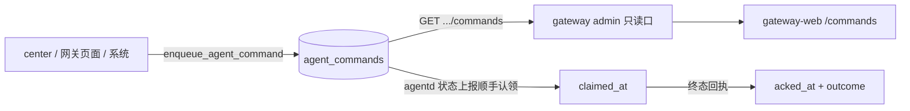

# 命令队列观测（agentd 要执行什么，网关侧唯一答案）

> **状态**：已实现（2026-11-10，`wist-gateway 0.44` / `wist-gateway-web 0.33`）。
> **关联**：[`../center/investigation-center-relay.md`](../center/investigation-center-relay.md)（调查是这条队列上的一类命令）、
> [`gateway-status-report.md`](gateway-status-report.md)（命令的认领与回执都搭在 agent 的状态上报上）、
> [`../foundation/api-seam-inventory.md`](../foundation/api-seam-inventory.md)。

## 1. 要解决的问题

一次性命令（调查 / 重采事实 / 刷新指标标签）散在各功能入口，**发起之后**就没有统一的地方看它到哪一步了：

- 中心下发一条调查 → 中心只知道「已投递给网关」（`target_command_id`），网关侧只知道「已入队」；
- 机器没在跑的时候，命令会静默躺在库里，没有任何页面说得出来；
- 更常见的现场问题：**「这条指令是中心下发的，还是网关页面点出来的？」** —— 以前只能靠翻库。

运维需要一个只读的观测面：**给 agentd 的那一队命令，现在都有哪些、谁排的、排了多久、认没认领、回了什么。**

## 2. 数据来源：已有的 `agent_commands` 表

不新增入队通道、不改投递协议 —— 队列**本来就在库里**：

| 列 | 含义 |
| --- | --- |
| `command_id` | 命令 ID（用户可见；中心侧另有 `target_command_id` 作投递主键） |
| `agent_id` / `kind` / `params` | 给谁、做什么、参数 |
| `requested_at_ms` / `requested_by` | 何时、谁排的（`center:<actor>` / `admin:<token 指纹>` / 空 = 系统） |
| `claimed_at` | agent **取走**的时刻（阶段回报 `accepted`），`NULL` = 还没取走 |
| `acked_at` / `outcome` / `detail` | 终态回执（结论 ∈ 闭集，见 `wist_api::status::command_outcome`） |

`enqueue_agent_command` 是唯一写入口（调查、重采、刷新、标签下发都走它），所以**读这张表就等于读整条队列**。

## 3. 两条只读口

| 端点 | 用途 |
| --- | --- |
| `GET /api/v1/admin/agents/{agent_id}/commands` | 单机；agent 不在注册表里 404 |
| `GET /api/v1/admin/agent-commands` | 全机队；`agent_id` 只作 query 过滤（不存在的 id 不报 404，那是一张列表） |

公共 query：`state`（闭集，缺省 `all`；全机队口的缺省是 `queued`）、`limit`（1..200，缺省 50）。

响应（两条口**同一形状**，全机队口不下发外层 `agent_id`）：

```json
{
  "agent_id": "agent-host-a55a…",       // 仅单机口
  "state": "queued",                     // 网关实际用的过滤词（回显）
  "counts": { "queued": 3, "claimed": 1 },
  "commands": [
    {
      "command_id": "cmd_…", "agent_id": "…", "kind": "investigate",
      "state": "queued", "source": "center",
      "requested_by": "center:alice", "summary": "topic=disk",
      "requested_at": "2026-11-10T10:00:00+00:00",
      "claimed_at": null, "acknowledged_at": null,
      "outcome": null, "detail": null
    }
  ]
}
```

三条**由网关派生**的字段（页面不自己猜，中心也不必知道）：

- **`state`** —— `acked_at` 是终态谓词，具体哪种终态看 `outcome`：
  - `queued` = `acked_at IS NULL AND claimed_at IS NULL`
  - `claimed` = `acked_at IS NULL AND claimed_at IS NOT NULL`
  - `acked` = `acked_at IS NOT NULL AND outcome NOT IN ('expired','superseded')`
  - `expired` / `superseded` 按 `outcome` 单独成态 —— 它们**写了回执时刻但没执行过**，
    并进 `acked` 会把「命令丢了」显示成「做完了」。
- **`source`** —— 由 `requested_by` 派生：`center*` → `center`，`admin*` → `admin`，其它 → `system`。
- **`summary`** —— 一行提示，不泄露整块参数：`topic=…`（调查）或 `what=a,b`（刷新），都没有就是空串。

排序：队列态（`queued` / `claimed`）**先到先执行**升序（谁是下一条一眼可见），终态新 → 旧。
计数 `counts` 只给 `queued` / `claimed`（它们才是「现在」），且**不受 `state` 过滤影响**；
终态数量随时间增长，给总数只会误导，页面用 `limit` 窗口看。



## 4. 页面：`/commands`（Agent管理 → 任务队列）

- 四档：待执行 / 执行中 / 已回执 / 全部，前两档带实时计数徽标；
- 每行：状态、命令（种类 + 摘要 + `command_id`，点 ID 跳对应功能页）、机器（主机名优先）、
  **来源**（中心 / 页面 / 系统）、排队多久、回执结论；
- 5 秒轮询（与状态条同频，命令认领本身就是 3s 级上报）；
- `?state=` / `?agent=` 可深链 —— 把「某一档」或「某一台机器」的队列直接发出去。

它**只读**：发起动作仍在各功能页。队列页的职责是观测与对齐口径。

## 5. 排障用法（症状 → 看哪儿）

| 现象 | 队列页应显示 | 结论 |
| --- | --- | --- |
| 中心说「已下发」，机器没动 | **没有这一条** | 命令没到网关：查 gwlinkd（≥ 0.22）与中心侧投递结果 |
| 有这条，`queued` 一直不动 | 待执行，时长在涨 | 机器/agentd 没在跑（看机队页在线状态、`/gwlinkd`） |
| `claimed` 长时间不动 | 执行中，已认领 N 分钟前 | agentd 取走了但没回执：机器侧卡住（调查上限 120s） |
| `acked` + `failed` / `unsupported` | 已回执，结论徽标 + `detail` | 命令跑了，机器侧失败；`unsupported` = agentd 太旧 |
| 汇总里只有「已接收」没有报告正文 | `acked` + `succeeded` | 报告走数据面（wparse → 证据库），按 `cmd_id` 去证据库取 |

## 6. 明确不做

- **不新增入队通道**：所有命令仍从既有入口进（`enqueue_agent_command`）；
- **不改投递协议**：agentd 依旧在状态上报里认领，网关不推送；
- **不写库**：两条口都是 `GET`，队列观测不应改变队列；
- **不在网关侧判授权**：中心下发的授权面在中心，网关只负责投递与展示。

## 7. 后续可做

- 中心侧按 `command_id` 关联到网关队列（现在两边各看一半：中心看投递，网关看执行）；
- 队列页加「按种类 / 按来源」筛选（接口已能按 `agent_id` 过滤，种类筛选要新增参数）。
