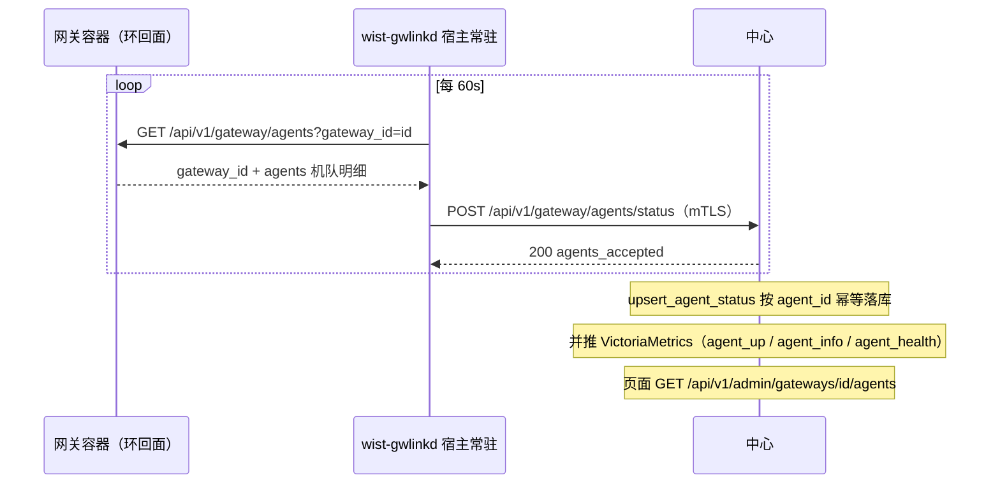

# 网关 Agent 明细上报（把网关收集到的 agentd 信息送到中心）

> **状态**：**暂缓 —— 代码与模型已整体回退**（2026-10-16）。本文件**保留**设计（不随代码一起删）。
> 为什么回退、备份在哪、怎么重放：见 §0。
> **关联**：
> - [`gateway-status-report.md`](gateway-status-report.md) —— 网关**自身**状态上报（同由 gwlinkd 代报，另一条通道，勿混）；
> - [`../foundation/cross-repo-issues.md`](../foundation/cross-repo-issues.md) **CR-003**（宿主侧常驻 `wist-gwlinkd` 代报）；
> - [`../center/agent-work-delivery-plan.md`](../center/agent-work-delivery-plan.md)（批次 1：`ReportAgentStatus` 控制面闭环）；
> - [`../foundation/api-seam-inventory.md`](../foundation/api-seam-inventory.md) §3 / §7.5（`gateway/agents/status` seam）。

## 0. 现状与回退记录（2026-10-16）

**结论**：本特性**已实现过一轮，随后整体回退** —— 当前仓库里**没有**这段代码，本文件是**暂缓的设计**。

**为什么要回退**：落它的时候撞上一个**前置阻塞** —— 环回面（本接口用的那一类面）在**容器部署**下
会把宿主自己的连接判成「外来」而**全线 403**（`self_state_loopback_only` 等）。也就是说这个面**自己
也够不到**，做完了也无法验证/联调。于是决定**先单独把环回准入修复发出去**，本特性等修好再重放 ——
免得把一件**无法验证**的东西和修复混在同一个变更集里。

- **前置修复**（独立变更，已实现）：[`gateway-status-report.md`](gateway-status-report.md) §4 与
  `wist-gateway/src/infra/local_peer.rs`（`LocalPeers`：「本机」= 环回 ∪ 容器默认网关 ∪ `[server] self_face_allow`）。
- **被回退的内容**：`wist-gateway`（环回面 `api/gateway_agents.rs` + 两个错误码 + 路由 + 测试）、
  `wist-gwlinkd`（`gateway_agents.rs` + `center.rs::report_agent_status` + 常驻循环接线）、
  模型留档 `Control.GatewayApp.AgentReportInterface`（§3/§6 描述的那份）。
- **备份**（**本机工作区**，不在任何仓里，所以不进任何变更集）：`x-topology/state/wip-agent-detail/`
  —— 两个新文件原件 + `gwlinkd/gwlinkd-A.patch`（可直接 `git apply`）+ 网关/设计的混合 diff 兑底。
- **重放**：`git -C wist/wist-gwlinkd apply <备份>/gwlinkd/gwlinkd-A.patch`；网关侧按 §6 那几行补回
  （环回面模块 + 路由 + 两个错误码 + 测试）；模型模块从备份拷回并重新登记进 `subsystem.mju`。

## 1. 背景与问题

**需求**：网关侧采集/登记的 **agentd 机队信息**（每台 agent 的运行态）要能在**中心侧看到**，
即中心「网关详情 → Agent 状态」页展示真实数据。

排查现状后定位到：**中心侧整条接收链路早已建好，唯独缺「生产者」** —— 端点一直空转：

| 环节 | 位置 | 本轮之前 |
|---|---|---|
| 上报契约 | `wist-control`：`ReportAgentStatus` / `AgentStatusAcceptedReturned` | ✅ 已有（模型 `Control.GatewayApp.FacingInterface`） |
| 中心接收端点 | `wist-center`：`POST /api/v1/gateway/agents/status` → `submit_agent_status` | ✅ 已有（mTLS 鉴权 → `upsert_agent_status` → 推 VM） |
| 中心读口 | `wist-center`：`GET /api/v1/admin/gateways/{id}/agents` → `list_agents_by_gateway` | ✅ 已有 |
| 中心 Web | `wist-center-web`：`GatewayDetailPage`「Agent 状态」区块 | ✅ 已有 |
| **生产者** | `wist-gateway` / `wist-gwlinkd` | ❌ **缺失**（全仓 grep 不到任何 `ReportAgentStatus` 发送方） |

**为什么生产者只能是 gwlinkd**：网关容器在 NAT 后，中心**连不到**它；全边缘只有宿主侧常驻
`wist-gwlinkd` 能主动出站到中心（CR-003）。所以「网关收集到的 agentd 信息」必须由 gwlinkd **代报** ——
这与网关**自身**状态上报（`gateway-status-report.md`）是同一套模式。

## 2. 拓扑与职责

```
网关容器（NAT 后）                        宿主侧常驻                中心
┌────────────────────────┐            ┌──────────────┐        ┌──────────────────────┐
│ 注册表（agent 机队）      │            │              │        │                      │
│  GET /api/v1/gateway/    │◀── 环回 ───│  wist-gwlinkd │──mTLS─▶│ POST /api/v1/gateway/│
│      agents（loopback）  │  GET 拉取   │  （唯一出站） │  POST   │      agents/status   │
└────────────────────────┘            └──────────────┘        └──────────┬───────────┘
                                                                          │ 落库 + 推 VM
                                                                          ▼
                                                          中心 Web「网关详情 → Agent 状态」页
                                                          （GET /api/v1/admin/gateways/{id}/agents）
```

- **网关**：只暴露**环回**机队面（loopback-only），不直连中心。
- **gwlinkd**：环回拉机队 → 以自身配置的 `gateway_id` 覆写 → mTLS 转报中心。
- **中心**：落库（按 `agent_id` 幂等 upsert，归属 `gateway_id`）+ 推 VictoriaMetrics，供页面读。

## 3. 契约（三份形状同钉）

| 面 | 类型 | 位置 |
|---|---|---|
| 环回机队面 | `GatewayAgentsReport`（`gateway_id` + `agents: List<AgentRuntimeStatus>`） | `wist-gateway/src/api/gateway_agents.rs`；模型 `Control.GatewayApp.AgentReportInterface.GatewayAgentsReport` |
| 上报中心 | `ReportAgentStatus`（`gateway_id` + `agents`） | `wist-control`（生成）；模型 `Control.GatewayApp.FacingInterface.ReportAgentStatus` |
| 中心视图 | `AgentRuntimeStatus`（`agent_id` / `instance_id` / `version` / `status` / `health` / `last_seen_at` / `memory_bytes` / `cpu_percent` / `admin_latency_ms`） | 模型 `Control.Agent.Status.AgentRuntimeStatus` |

- **环回面与上报契约同形**：gwlinkd 拉到后**以自身配置的 `gateway_id` 覆写**再转报
  （环回面回显的是调用方给的值，不以它为准 —— 防网关侧 misconfig 时张冠李戴）。
- **防漂移**：网关侧有键集**序列化**测试、gwlinkd 侧有同形状的**解析**测试与上报 body 解析测试；
  任一侧改名即爆。
- **seam 不变**：`gateway/agents/status` 的 wire 类型与版本矩阵（v1 / strict）在
  `api-seam-inventory.md` §3 / §7.5 已登记，本轮**只补生产者、未改 seam**。

## 4. 数据来源与字段口径

| 字段 | 含义 | 来源 / 口径 |
|---|---|---|
| `agent_id` / `instance_id` / `version` | 身份与版本 | 网关注册表（`agents ⋈ 当前 instance`） |
| `status` | `online` / `offline` | 由 `last_seen_at` **现算**（`overview::agent_is_online`，与列表页 / 单台运行态共用判据；**不写死** `online`） |
| `health` | 恒 `healthy` | agent 无独立健康度，在线/离线由 `status` 表达（与网关现有管理面读投影一致） |
| `last_seen_at` | 最近一次上报时刻 | 注册表（解析失败兜底 `now`） |
| `memory_bytes` / `cpu_percent` / `admin_latency_ms` | agent 进程资源 | 最近一次状态上报；**量不出即 `null`**，不假装 0 |

> 机队规模：环回面一次给**全量**（不分页）—— 与网关 `self_state` / `admin_view_discovery_policies`
> 同口径（「宁可全量，也不漏掉一页机器」）。机队索引页的分页是**读口**的事，不是本通道的事。

## 5. 端到端时序



## 6. 各仓落地

> **注**：下表是**回退前**的落地内容（当前已回退，见 §0）。表中 `wist-gateway` 的「本机」准入
> （`[server] self_face_allow` / `LocalPeers` / `ApiState::is_local_host_peer()`）**不属于本特性** ——
> 那是**前置修复**（独立变更）：见 [`gateway-status-report.md`](gateway-status-report.md) §4 与
> `wist-gateway/src/infra/local_peer.rs`；本特性只是**复用**它。

| 仓 | 文件 | 要点 |
|---|---|---|
| `wist-gateway` | `src/api/gateway_agents.rs`（新） | 环回面 `GET /api/v1/gateway/agents`（本机才可读），把注册表投影成上报契约形状 |
| | `src/api/codes.rs` | `GATEWAY_AGENTS_LOOPBACK_ONLY` / `GATEWAY_AGENTS_MISSING_GATEWAY_ID` |
| | `src/api/mod.rs` | `mod gateway_agents;` + 路由（挨着 `self-state`）——**准入**那部分属前置修复 |
| | `src/api/tests.rs` | 键集契约 / 真环回列表 / 非本机 fail-closed 三个测试 |
| `wist-gwlinkd` | `src/gateway_agents.rs`（新） | `GatewayAgentsClient`：环回拉取（复用 `build_http_client` 信任锚） |
| | `src/center.rs` | `CenterClient::report_agent_status()` → `POST /api/v1/gateway/agents/status` |
| | `src/main.rs` | 常驻循环接线：60s 一档、独立退避；未配环回面跳过；拉不到只记日志 |
| `wist-center` | `src/api/gateway_ops.rs` / `infra/*` | **既有**，本轮未改 |
| `wist-center-web` | `GatewayDetailPage` | **既有**，本轮未改 |
| `wist-design` | `jumo/.../agent-report-interface/` | 模型留档 `Control.GatewayApp.AgentReportInterface`（**刻意未 `bind`**） |
| | `runtime/subsystem/WistGateway/subsystem.mju` | `uses module Control.GatewayApp.AgentReportInterface` |

> 环回接口一律**刻意不 `bind`**（与 `SelfInterface` / `LinkRequestInterface` / `GwlinkdStatusInterface` /
> `AgentPackageInterface` 同口径）：只绑环回、面向本机常驻，鉴权沿用「环回 + 不写 `auth none`」的既有处理，
> 待鉴权口径与 self 面一并定案后再补 `bind`，届时 codegen 可生成路由。

## 7. 不变量与边界

1. **网关仍不直连中心**：上报由 gwlinkd 代劳（CR-003 不变）。
2. **环回面限「本机」**：非本机 / 取不到 peer 一律 **403 fail-closed**（与 self-state / agent-package 同护栏）。
   「本机」的判据是 [`crate::infra::LocalPeers`]：**环回 ∪ 容器默认网关 ∪ `[server] self_face_allow`** ——
   见下面 §7.1。
3. **量不出即 `null`**：`memory_bytes` / `cpu_percent` / `admin_latency_ms` 缺则 `null`，不写 0。
4. **节流与退避**：机队变化慢、一次全量 → **60s 一档**（比状态上报的 30s 疏一档）；中心拒证（401/403）
   按指数退避（`BACKOFF_BASE_SECS` 起，上限 `BACKOFF_MAX_SECS`），不猛击。
5. **拉不到不改现状**：网关没起 / 环回面够不到 → 只记日志、下一拍重试，**不影响**状态上报与升级链路。
6. **幂等**：中心按 `agent_id` upsert（归属 `gateway_id`），重复上报是同一条覆盖，不产生重复行。

### 7.1 前置：环回面的「本机」判据

本接口是环回面之一，其准入判据（容器里宿主的连接看起来来自 docker 网络网关）与修法**不是本文件的
范围**（属环回面通用问题，已在**前置修复**里落地）——
见 [`gateway-status-report.md`](gateway-status-report.md) §4 与 `wist-gateway/src/infra/local_peer.rs`。
上文第 2 条说的「环回面限本机」即指它；**没它本接口 403**，这也是本特性被回退的原因（§0）。

## 8. 错误码与可观测性

**网关环回面错误码**（`api/codes.rs`）：

| code | 触发 |
|---|---|
| `gateway_agents_loopback_only` | 非环回 / 取不到 peer |
| `gateway_agents_missing_gateway_id` | 缺 `gateway_id` 查询参数 |
| `agent_store_unavailable` | 注册表查询失败（复用既有码） |

**gwlinkd 日志事件**（`log` 结构化 `event=`）：

| event | 级别 | 含义 |
|---|---|---|
| `AgentStatusReported` | info | 上报成功（带 `agents=N` 回执） |
| `AgentStatusRejected` | error | 中心拒证（401/403）→ 退避 |
| `AgentStatusReportFailed` | error | 其它上报失败 → 退避 |
| `AgentFleetFetchFailed` | warn | 环回拉取失败（网关没起 / 够不到）→ 下一拍重试 |

## 9. 版本与发布顺序

> **待重放后才适用**（当前代码已回退，见 §0）。

- `wist-gateway` / `wist-gwlinkd`：新增能力 → `gx adm v_feat`（次版本位），`tag_alpha`（制品在 `alpha` 通道）。
- `wist-center` / `wist-center-web` / `wist-control`：**本轮无需改动**（接收侧已就绪，契约未动）。
- **dev 栈**：`wist-gateway-stack` 的 `sys/setting/vars.yml` 里 `GATEWAY_TAG` 跟到新网关版本；
  gwlinkd 走 `./dev/install-gwlinkd-dev.sh`（本机构建）或栈内组件更新。
- 网关先上（暴露环回面）→ gwlinkd 再上（开始拉取转报）—— 顺序反了只是暂时没有数据，不会报错。

## 10. 验收标准

> **待重放后才适用**（当前代码已回退，见 §0）。前置修复的验收见 [`gateway-status-report.md`](gateway-status-report.md)。

- 网关侧：`GET /api/v1/gateway/agents?gateway_id=` 在本机下 200，机队投影含契约 9 字段；
  非本机 / 缺 `gateway_id` 被拒；键集契约测试通过。
- gwlinkd 侧：环回拉取 + 转报的 wire 形状测试通过；常驻日志出现 `AgentStatusReported`。
- 中心侧：`GET /api/v1/admin/gateways/{id}/agents` 能读到 gwlinkd 报上来的机队；
  中心 Web「网关详情 → Agent 状态」页出现机器卡片；VictoriaMetrics 出现 `agent_up` / `agent_info` / `agent_health`。
- 全绿：`gx run lint` / `gx run test`（gateway + gwlinkd）；`jumo verify jumo/model` 0 error。

## 11. 未决与后续

0. **前置**：先发环回准入修复（§0）—— 没它本接口够不到，重放也没法联调。
1. **机队规模上限**：当前环回面一次全量。若单网关机队上万，需评估环回 payload 体积与 gwlinkd 内存占用
   （备选：环回面分页 + gwlinkd 循环，或只报**增量**）。dev 规模暂不需要。
2. **更丰富字段**：中心页目前只见契约 9 字段（无 `node_id` / `hostname` / `ip_addresses`）。
   若要展示「这是哪台机器」，需扩 `AgentRuntimeStatus` 契约（`wist-control` 发版）——属后续增强，非本需求。
3. **环回面鉴权定案**：待与 self 面一并定案后补 `bind`，本接口随之入 codegen。

## 12. 关联文档

- [`gateway-status-report.md`](gateway-status-report.md)：网关**自身**状态上报（同模式，字段与数据源）
- [`gateway-linkd-status.md`](gateway-linkd-status.md)：gwlinkd **自身**状态心跳（网关 Web 展示用）
- [`../foundation/cross-repo-issues.md`](../foundation/cross-repo-issues.md) **CR-003**：gwlinkd 代报的决策
- [`../center/agent-work-delivery-plan.md`](../center/agent-work-delivery-plan.md)：`ReportAgentStatus` 所属批次
- [`../foundation/api-seam-inventory.md`](../foundation/api-seam-inventory.md)：seam 清单与版本矩阵
