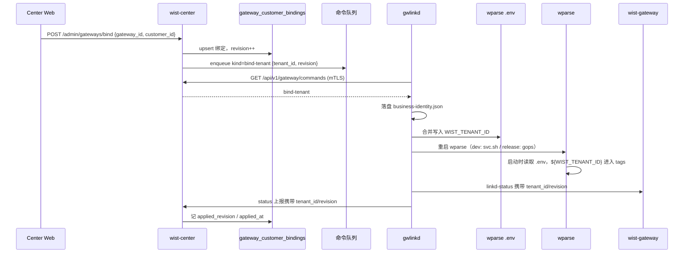

# Gateway 业务身份（tenant_id）绑定与下发

> **状态**：**设计草案**（2026-10-22；决策已更新，**尚未实现**）。
> **版本基线**：**warp-parse `0.34.0-alpha`**（当前栈为 `0.32.1-alpha`，升级与复测见 §14）。
> **当前运行形态**：**开发态**（`dev/svc.sh`；wparse 工作根 `data-plane-run/dev`）。
> **关联**：
> [`../center/warpstation-rule-publishing.md`](../center/warpstation-rule-publishing.md)（同一套 Center 命令队列 / gwlinkd 短轮询）、
> [`gateway-linkd-status.md`](gateway-linkd-status.md)（gwlinkd → 网关的环回心跳面）、
> [`gateway-status-report.md`](gateway-status-report.md)（gwlinkd → Center 的状态上报）。

## 0. 已确认决策

| # | 决策 |
|---|---|
| D1 | 数据面 / 上报的字段名与 wparse tag key 用 **`tenant_id`**；Center 既有 `customer_id` API / 表 / UI **保留不变**，在边界做映射（见 §4.3） |
| D2 | `tenant_id` **强制 tag-safe**（字符集 / 长度校验；不合法直接拒绝，不做 slug/转义） |
| D3 | 生效方式：写 wparse `.env` 后重启 wparse。**发布态**用 `gops run stop` + `gops run start`；**开发态**用 `./dev/svc.sh restart wparse --no-build`（见 §8.4） |
| D4 | tag 预算：现有 3 个 tag 保留，`tenant_id` 作为**第 4 个**（硬上限 4，不预留更多；见 §5.4） |
| D5 | **不支持解绑**（口径 A，2026-10-25 复核确认）——需要“不再归任何客户”就走归档 / 停采；换绑（覆盖 `tenant_id`）允许，`revision` 单调递增。**解绑不能靠“删绑定行”实现**，理由见 §11.3 |
| D6 | wparse 基线升级到 **`0.34.0-alpha`**；`.env` / tag 行为需在新版本上复测 |
| D7 | **注入机制用 wparse 的实例级全局 tag `WP_GLOBAL_TAGS`**（wparse ≥ 0.31 引入，0.34 沿用）：`<work>/.env` 里写 `WP_GLOBAL_TAGS=tenant_id:<客户ID>,wist-gw_id:<实例ID>`，引擎把 tag **盖在所有解析成功的记录上并覆盖同名规则字段**。不需要在 sink 里配 tag，也不靠 wp-infra 同步。原设计的 `WIST_TENANT_ID` + sink 占位**降级为兼容手段**（见 §9.1）。启动自检要两份都校（`WIST_TENANT_ID` 与 `WP_GLOBAL_TAGS` 的 `tenant_id` / `wist-gw_id`），否则升级后旧 `.env` 会被判成“一致”而不自愈（gwlinkd ≥ 0.18.4） |

> D4 的歧义：如果你的“留 3 个”是指**给业务身份预留 3 个槽位**，那当前不可行——
> 现有 `env` / `biz` / `sink` 已占 3 个，硬上限是 4。本文按“保留现有 3 个、`tenant_id` 占第 4 个”落地。

## 1. 要解决的问题

一台 Gateway 可能服务于不同客户。今天 Center 已经有“绑定客户”的管理入口，但**绑定只落在 Center 的数据库里**：

- 网关不知道自己的业务身份；
- wparse 输出的数据不携带租户标识，客户侧下游无法按租户归属消费；
- Center 收到的上报也没有业务身份字段，外部订阅方只能靠 `gateway_id` 反查。

目标是让业务身份从 Center **一路下发到数据面**：

```
Center 绑定 customer_id（既有管理面）
  → 映射为 tenant_id（数据面/上报字段）
  → 命令队列下发给 gwlinkd
  → gwlinkd 本地持久化
  → 写入 wparse 工作根的 .env
  → wparse 输出记录带上 tenant_id
  → gwlinkd / 网关自身的上报也带上 tenant_id
```

## 2. 目标与非目标

### 目标

1. Center 绑定 `gateway_id ↔ customer_id`（既有），并在数据面表达为 `tenant_id`。
2. 绑定结果能可靠下发到已接入的 Gateway；离线/重启后可补偿。
3. gwlinkd 本地持有业务身份，并在重启后保持。
4. wparse 输出（file / kafka / syslog / http 等所有 sink）携带 `tenant_id`。
5. gwlinkd 向 Center 的状态上报、向网关的 linkd-status 均携带 `tenant_id`。
6. 绑定状态可观测：未下发 / 已下发 / 已生效 / 失败。

### 非目标

1. **不把 `tenant_id` 当凭据**：它不是密钥、不做鉴权、不参与 mTLS/Token 体系。
2. 不在 Agent 上报契约里新增 `tenant_id`（Center 有 `gateway_id` 就能关联；避免扩大 Agent 契约）。
3. 不做客户信息的增删改查管理（Center 仍以外部客户系统/人工填写的 ID 为准）。
4. 不改变 wparse 的解析/富化逻辑，只增加输出元数据。
5. **不提供解绑**（D5）。

## 3. 现状盘点（代码事实）

### 3.1 已经有的

| 能力 | 落点 |
|---|---|
| Center 绑定接口 `POST /api/v1/admin/gateways/bind` | `wist-center/src/api/mod.rs`、`wist-center/src/api/admin_ops.rs` |
| 绑定存储（FileStore / PgStore 方法） | `wist-center/src/infra/store.rs`、`wist-center/src/infra/pg_store.rs` |
| 绑定模型 | `wist-control/src/control/gateway/supervision/gateway_customer_binding.rs` |
| Center 绑定页面 | `wist-center-web/src/components/GatewayCustomerBindPanel.tsx` |
| gwlinkd 命令通道（mTLS 短轮询 + 本地执行 + 回执） | `wist-center/src/wparse_proxy.rs`、`wist-gwlinkd/src/wparse_relay.rs` |

### 3.2 缺的

1. **绑定只写库，不下发**：`admin_bind_gateway_customer` 调完 `bind_gateway_customer` 就返回，没有入队命令，也没有任何网关侧字段。
2. **gwlinkd / 网关完全没有 `tenant` 概念**：`wist-gwlinkd/src` 与 `wist-gateway/src` 中无相关引用。
3. **PgStore 的表没有建**：`gateway_customer_bindings` 在 `wist-center/docker/initdb/01_schema.sql` 中**不存在**，`PgStore` 直接 `INSERT/SELECT` 该表。新装的 PostgreSQL 上绑定会失败；FileStore（store.json）可用。
4. **接口不校验网关存在**：绑定一个不存在的 `gateway_id` 也会成功。
5. **没有下发状态**：中心不知道网关是否已经收到/生效。
6. **wparse 没有身份注入机制**：数据面只有静态 `tags`，没有“网关级业务身份”概念。

### 3.3 命令通道的现状约束

- 只认 `kind`：`proxy` / `diagnose` / `restart-gateway` / `restart-gwlinkd`；未知 kind 明确失败。
- 控制命令不带 `method/path/body`（`enqueue_control` 当前签名没有 body）。
- 只按 `kind` 去重：同 gateway + 同 kind 已有 pending/leased 时复用；**同 kind 不同 payload 会被误复用**。
- `pending` TTL 60s，过期即 `expired`；网关离线时命令会丢。
- 命令通道只在 `[wparse_relay] enabled` 时启动。
- 队列在 Center 的 PostgreSQL 里；Center 未启用 proxy 时没有该通道。

=> 业务身份下发**不能只依赖命令队列**，必须有补偿路径。

## 4. 身份模型与命名

### 4.1 模型

```text
BusinessIdentity {
  tenant_id: String,   // 数据面 / 上报字段；强制 tag-safe
  revision:  i64,      // 单调递增；绑定/换绑时 +1
}
```

### 4.2 权威来源

- **Center 的 `gateway_customer_bindings` 是唯一权威**。
- 网关上报的 `tenant_id` 只作为“已生效”的证据，**不参与鉴权、不参与路由**。
- Center 收到上报时与本地绑定比对：
  - 一致 → 记 `applied_revision` / `applied_at`
  - 不一致 → 记漂移 / `reported_tenant_id`，页面提示；不修改权威绑定。

### 4.3 命名与映射（D1）

| 层 | 字段名 | 说明 |
|---|---|---|
| Center 管理 API / DB / 模型 | `customer_id` | **保持不变**，不破坏现有 UI/接口/模型 |
| Center → gwlinkd 命令 | `tenant_id` | 值 = Center 的 `customer_id` |
| gwlinkd 本地身份 | `tenant_id` | `business-identity.json` |
| wparse `.env` | `WIST_TENANT_ID` | 值 = `tenant_id` |
| wparse 记录 tag | `tenant_id` | `tenant_id:${WIST_TENANT_ID:unbound}` |
| 上报（gwlinkd → Center / 网关） | `tenant_id` | 与数据面同名 |

> 映射集中在 Center 的“绑定 → 命令 / 初始配置 / 视图”边界，以及 gwlinkd 的“命令 → 落盘”边界。
> 如果后续希望 Center 管理面也全面改名 `tenant_id`，再做一次独立的破坏性迁移；本期不做。

### 4.4 为什么需要 `revision`

- 命令可能乱序/重放：只接受 `revision >= local.revision`。
- 换绑必须覆盖旧值，不能因为队列去重把新值吃掉。
- 页面需要区分“已下发”和“已生效”。

## 5. wparse `.env` 机制（实测）

> 本节结论在 `warp-parse 0.32.1-alpha`（发布态容器）与 `0.34.0-alpha`（dev macOS 二进制）上均复测一致。
> 0.34.0 额外确认：保留 `[admin_api.auth].mode` 会直接配置错误（见 §14.0）。

### 5.1 读取位置

wparse 读取 **工作根** 下的 `.env`：

```
宿主：${WPARSE_RUN_WORK}/.env        （默认 ./data-plane-run/work/.env）
容器：/data/.env
```

实测：`cwd=/tmp`、`--work-root /data/.tmp-proj`，`.env` 在 `/data/.tmp-proj/.env`，变量正常生效
=> **按 work-root 解析，不依赖 cwd**。

### 5.2 变量替换

`${VAR}` 在 sink 配置的 `tags` 中生效：

```toml
[defaults]
tags = ["env:dev", "tenant_id:${WIST_TENANT_ID}"]
```

默认值语法是**单冒号**：

```toml
tags = ["tenant_id:${WIST_TENANT_ID:unbound}"]
```

- `.env` 有 `WIST_TENANT_ID=tenant-acme` → 记录字段 `"tenant_id":"tenant-acme"`
- `.env` 没有该键 → `"tenant_id":"unbound"`
- 写成 `${VAR:-unbound}` 是**错的**，会得到 `-unbound`。

### 5.3 tag 会变成输出记录的字段

```json
{
  "sip": "...",
  "biz": "demo",
  "tenant_id": "tenant-acme",
  "env": "dev",
  "sink": "json"
}
```

因此业务身份对所有 sink（file / kafka / syslog / http / …）都可见，不需要逐个改 sink。

> **但tag 方案有两个弱点**（2026-10-27 实测）：① 引用点（`defaults.toml` 的占位）不在本仓，
> 会被 `project_remote` 从 wp-infra 整体覆盖掉；② 与规则自己写的同名字段谁赢未定义。
> 所以首选改用**实例级全局 tag `WP_GLOBAL_TAGS`**（D7 / §9.1）：同样不需要改 sink，
> 而且**明确覆盖**同名规则字段。

### 5.4 硬约束（来自 `wp-config` 的 `validate_tags`）

| 约束 | 值 |
|---|---|
| 每条记录合并后的 tag 总数 | **≤ 4**（实测第 5 个直接配置错误） |
| tag key 长度 | ≤ 32 |
| tag value 长度 | ≤ 64 |
| tag value 允许字符 | `[A-Za-z0-9_.:/=@+,-]` |
| 默认值 | `${VAR:default}`（单冒号） |

当前配置的 tag 预算（D4）：

```
env:dev        (defaults)
biz:<group>    (sink_group)
sink:<name>    (sink)
= 3 个
+ tenant_id    (defaults)
= 4 个（刚好到上限）
```

**结论**：本期只能加一个业务身份字段。若后续还要 `environment_id` 等，必须：
- 合并/移除现有 tag，或
- 改用 OML 字段/其它机制，而不是继续加 tag。

### 5.5 不要用 `SEC_` 前缀

wparse 有独立的密钥机制（启动日志 `vars not value : SEC_xxx`）。业务身份不是密钥，
使用 `WIST_` 前缀（`WIST_TENANT_ID`），不要放进 `SEC_` 命名空间。

## 6. 总体方案



## 7. Center 侧设计

### 7.1 数据模型

`gateway_customer_bindings` 增列（FileStore 同结构，均用 `#[serde(default)]` 兼容旧数据）：

| 列 | 类型 | 说明 |
|---|---|---|
| `gateway_id` | TEXT PK | 不变 |
| `customer_id` | TEXT NOT NULL | 不变（权威值；映射为 `tenant_id`） |
| `status` | TEXT | `bound`（已下发待生效）/ `applied`（已生效）/ `drift`（网关自报不一致）/ `failed`（生效命令失败） |
| `revision` | BIGINT NOT NULL DEFAULT 1 | 绑定版本 |
| `bound_at` | TIMESTAMPTZ | 不变 |
| `applied_revision` | BIGINT NULL | 网关已生效的 revision |
| `applied_at` | TIMESTAMPTZ NULL | **最近一次变为已生效**的时间（心跳不刷新） |
| `reported_tenant_id` | TEXT NULL | 网关自报值（用于漂移检测；只展示，**不参与授权**） |
| `last_error` | TEXT NULL | 最近一次下发/应用失败原因（中/英文短句，≤300 字符） |

**必须补表**：`01_schema.sql` 增加 `CREATE TABLE IF NOT EXISTS gateway_customer_bindings`；
已有库用 `ALTER TABLE ... ADD COLUMN IF NOT EXISTS` 幂等升级。

换绑审计另起一表（只增；每网关保留最近 100 条）：

```sql
CREATE TABLE IF NOT EXISTS gateway_binding_audit (
  id BIGSERIAL PRIMARY KEY,
  gateway_id TEXT NOT NULL,
  customer_id TEXT NOT NULL,
  previous_customer_id TEXT,
  revision BIGINT NOT NULL DEFAULT 1,
  requested_by TEXT NOT NULL DEFAULT '',
  at TIMESTAMPTZ NOT NULL
);
```

> 审计与绑定在**同一次原子写**里完成（PgStore 用事务 + `SELECT … FOR UPDATE`；FileStore 在同一个
> `update` 闭包里）。只在**归属变化**时记录：同客户重复绑定不写事件（它不改变归属）。

### 7.2 绑定接口

`POST /api/v1/admin/gateways/bind`（管理面字段仍是 `customer_id`，D1）

调整：

1. 校验 `gateway_id` 存在（不存在 → 404）。
2. **校验 `customer_id` 是 tag-safe**（D2）：
   ```
   ^[A-Za-z0-9_.:/=@+,-]{1,64}$
   ```
   不合法 → 400（错误码如 `customer_id_not_tag_safe`；数据面字段名为 `tenant_id`）。
3. upsert 绑定，`revision = revision + 1`（换绑也递增）。
4. 记录 `requested_by`（目前只校验非空、未落库；建议写审计日志或加列）。
5. 已初始化网关 → 入队 `bind-tenant` 命令，payload 用 `tenant_id`。
6. 未初始化网关 → 不入队；写入 `GatewayInitialConfig`，首次 link-upstream 自带。
7. 返回体增加 `revision`、`applied_revision`、`applied_at`（可为 null）。

> **不提供解绑接口**（D5）。

### 7.3 命令

新增 kind：

```text
kind = "bind-tenant"
body = { "tenant_id": "tenant-acme", "revision": 3 }
```

`wparse_proxy::enqueue_control` 需要支持 body；去重键必须包含 `(tenant_id, revision)`，
否则换绑会被“同 kind 复用”吃掉。

### 7.4 初次接入

`GatewayInitialConfig` 增加：

```rust
pub tenant_id: Option<String>,
pub binding_revision: Option<i64>,
```

`/api/v1/gateway/link-upstream`（已初始化路径与置备路径）都带出当前绑定。
gwlinkd 在 `link_upstream` 成功后落盘（`state::save_link_config` 同一时机），
这样首次接入不需要等命令。

### 7.5 状态上报接收

`ReportGatewayStatus` 增加可选字段：

```rust
#[serde(default)]
pub tenant_id: Option<String>,
#[serde(default)]
pub binding_revision: Option<i64>,
```

Center 收到后：

- 与权威绑定（`customer_id`）比对；
- 一致 → 更新 `applied_revision` / `applied_at` / `status = applied`；
- 不一致 → 记 `reported_tenant_id` 与漂移，**不覆盖**权威值；
- `tenant_id` 仍然只做标签，不参与鉴权。

### 7.6 管理视图

`AdminGatewayInstanceView` 增加（均 `#[serde(default)]`，旧中心不带）：

```
customer_id（既有）, binding_status, binding_revision, applied_revision,
binding_last_error, reported_tenant_id
```

> 管理面**仍叫 `customer_id`**（D1）；数据面/上报才是 `tenant_id`（同值映射）。
> `reported_tenant_id` 是网关自报值，只用于漂移展示，**不参与授权**。

Center Web 的 `GatewayCustomerBindPanel` 展示：
- 当前绑定（客户 / 状态 / 绑定版本 / 生效版本 / 最近生效时间 / 最近错误 / 网关自报）
- 下发状态（已下发 / 已生效 / 漂移 / 失败 + 原因）
- 换绑审计（谁在什么时候改的，仅归属变化时记）
- **不解绑**（D5），文案显式说明。

## 8. gwlinkd 侧设计

### 8.1 本地持久化

新增 `business-identity.json`，落 `identity_dir()`（默认回落 `state_dir`）：

```json
{
  "tenant_id": "tenant-acme",
  "revision": 3,
  "applied_at": "2026-10-22T10:00:00Z",
  "wparse_applied": true
}
```

- 原子写（临时文件 + rename）
- 权限按**挂载策略**（与 `gops sys perms` 同口径：读写 `0660` / 只读 `0640`；不是密钥）
- 放 `identity_dir` 的理由：随 `contract` 备份、升级不覆盖；丢了也能从 Center 重新下发

### 8.2 命令处理

`wparse_relay::execute_control` 增加分支：

```rust
"bind-tenant" => apply_tenant_binding(config, command, task).await,
```

流程：

1. 解析 body，校验 `tenant_id`（非空、tag-safe、长度）。
2. 读取本地 `revision`；`command.revision < local.revision` → 回执 `stale`（成功但忽略）。
3. 落盘 `business-identity.json`。
4. 写 wparse `.env`。
5. 重启 wparse（开发态 `./dev/svc.sh restart wparse --no-build`；发布态 `gops run stop/start`，见 §8.4）。
6. 回执 `{tenant_id, revision, wparse_applied}`。

### 8.3 写 `.env`

目标文件：`<WPARSE_RUN_WORK>/.env`。

- 工作根来源（实现见 `wparse_env::resolve_work_dir`）：
  1. 显式 `wparse_work_dir`（必须**已存在**；不替人建目录）；
  2. 系统根下 `data-plane-run/dev`；
  3. 系统根下 `data-plane-run/work`；
  4. `dev` 与 `work` 并存 → **报错**（不猜，写错工作根 = 回执“已生效”但数据面带错租户）。

  > 刻意**不读**栈根 `.env` 的 `WPARSE_RUN_WORK`：dev 栈的 `.env` 写的是 `./data-plane-run/work`，
  > 而开发态 wparse 实际用 `data-plane-run/dev` —— 拿它当来源会把 dev 写错。开发态请显式配置。
- **合并写**：只增改 `WIST_TENANT_ID`，保留其它键（`export KEY=` / `KEY =` 也识别，不产生重复键）。
- 原子写：同目录临时文件（随机名 + `create_new`）+ rename；**拒绝**目标为符号链接
  （工作根对容器用户可写，跟随链接会变成“让 gwlinkd 写任意本用户可写的文件”）。
- 读失败（非 NotFound）直接报错，**不静默当空文件**（否则会把现场其它键整段覆盖）。
- 权限按**挂载策略**（容器内 wparse 以 uid 999 读，工作根是 setgid 目录所以组权限位就够）：
  读写挂载 `0660` / 只读挂载 `0640`，与 `gops sys perms` 同口径。**不写死常量**——
  写死的 `0644` 会让 `gops run start` 的 perms preflight 判待修并拒启（整栈停在停止态）；
  设权限失败**不吞**（否则静默回落 `unbound`）。
- 内容示例：

```dotenv
WIST_TENANT_ID=tenant-acme
```

未绑定时写空值或删除该键均可；配置侧有 `:unbound` 默认值兜底。

#### 写盘模式必须跟挂载策略走（不变量）

`.env` 落在 **bind 挂载**里，所以它的模式不是“挑一个安全的数字”，而是**契约的一部分**：

- `gops run start` 的 `perms_preflight` 见到待修项就**拒绝启动**（`galaxy-ops: run_cmd.rs`）——
  这道前置是护栏，不是障碍：它防的正是“容器起来了但读不到文件”的无限重启；
- 「绑定客户」的生效动作是 `gops run stop && gops run start`，于是**模式不合规 = stop 成功 /
  start 失败 = 整栈停在停止态**；
- gwlinkd 在 `wparse_applied=false` 期间每 ~65s 补偿一次，**每补偿一次就再停一次**，
  不是“失败一次”（2026-10-27 现场连续 6 轮）。

因此：**凡落在挂载里的写盘，模式一律由 `host_mode::mount_policy` 推导**（只读 `0640/2750`、
读写 `0660/2770`；判据是**最近的已存在目录**是否 `setgid + 组可写`，不受运行 umask 影响），
调用点不许写常量。踩过两次，都是同一条链：交付包 `0644`（2026-10-26）、`.env` `0644`（2026-10-27）。

- **为什么 `0660/0640` 对容器仍可读**：工作根是 setgid 目录，新建文件属组自动继承容器 gid（999），
  组权限位就够；`0644` 的 other-read 是多余的，代价是租户 id 对任意本地用户可见。
  前提是**工作根已按契约对齐**（`2770`，属组 = 容器 gid）——这本身是 `gops sys perms` 的职责，
  gwlinkd 不替人改目录。
- **为什么不能靠事后 `chmod` 补救**：`.env` 是「临时文件 + rename」落盘，下一次写就是新 inode，
  `chmod` / `perms --apply` 都活不过下一轮补偿。
- **自愈**：0.18.1+ 在启动自检里用 `align_env_mode` 把历史遗留的 `0644` 只改模式（不动内容、
  不触发重启）；老版本只能人工收。

现场判别：`gops sys perms --check` 出现 `f …/work/.env 0644 0:999 → 0660 0:999 [pending]`；
日志 `event=TenantBindingCompensateFailed … exit=Some(255) … 结论: N 项待修`。
处置顺序与细节见 `wist-ops` 的 business-identity 参考（**先停 gwlinkd 再修**）。

### 8.4 让 wparse 生效（D3）

已实测：`.env` 在 **wparse 进程启动时**读取。

应用步骤：

```
写 .env → 停止 wparse → 启动 wparse
```

#### 运行形态：开发态 vs 发布态

| 形态 | wparse 工作根（`.env` 落点） | 启停方式 |
|---|---|---|
| **开发态**（当前） | `<stack>/data-plane-run/dev` | `./dev/svc.sh restart wparse --no-build` |
| 开发态（等价分步） | 同上 | `./dev/svc.sh stop wparse` + `./dev/svc.sh start wparse --no-build` |
| **发布态** | `<stack>/data-plane-run/work` | `gops run stop` + `gops run start`（系统根） |

注意：

- **开发态不要用 `gops run stop/start`**：它管的是 compose 容器，不是宿主上的 dev wparse 进程。
- 发布态 `gops run stop/start` 是**整栈重启**（gateway / web / wparse / VM 都会停再起），
  这是已确认可接受的代价（D3）。
- 复用 gwlinkd 现有的 `run_short` / 超时机制（`restart_timeout_seconds`，默认 120s）。
- `start` 失败时网关可能停在停止态：回执必须明确写出，不能只报“命令失败”。
- **开发态的 gwlinkd 必须指向 dev wparse**：`[wparse_relay] upstream` 用 `http://127.0.0.1:19091`
  （dev 管理面），`token_file` 用 `<dev work root>/.run/admin_api.token`；
  如果仍指向 `19090`，命令会落到发布态容器而不是 dev 宿主进程。

#### 可配置 apply 命令

建议在 gwlinkd 配置里做成**可配置命令**（类似 `upgrader_program`），不要在 Rust 里写死：

```toml
# 开发态
wparse_apply_command = "./dev/svc.sh restart wparse --no-build"
# 发布态
# wparse_apply_command = "gops run stop && gops run start"
wparse_apply_timeout_seconds = 120
```

空 = 只写 `.env`，回执 `pending_restart`；配置了则执行并等待结果。
`wpadm engine reload` 是否重读 `.env` 尚未验证；若验证通过，可改为 reload，实现零重启。

### 8.5 上报

- `GwlinkdStatus`（gwlinkd → 网关）增加 `tenant_id` / `binding_revision`；
  网关页面可直接展示。
- `ReportGatewayStatus`（gwlinkd → Center）增加同样字段。
- 两者都用 `#[serde(default)]` / `skip_serializing_if`，保证旧版本兼容。

### 8.6 幂等与失败

| 场景 | 行为 |
|---|---|
| 重复命令（同 revision） | 幂等成功，不重复重启 |
| 旧命令（revision 更小） | 回执成功但 `ignored: stale` |
| 新命令（revision 更大） | 覆盖本地并应用 |
| 重启失败 | 本地身份已落盘；回执 `error`，Center 标 `failed`；下次重试只重跑应用 |
| `.env` 写失败 | 回执 `error`，不修改内存态；保留旧文件 |
| gwlinkd 重启 | 从 `business-identity.json` 恢复；启动时确保 `.env` 与本地一致 |

## 9. wparse / 网关栈设计

### 9.1 注入机制（D7：首选 `WP_GLOBAL_TAGS`）

**首选：实例级全局 tag**（不碰 sink 配置，不依赖 wp-infra）

`<work_root>/.env`：

```dotenv
WP_GLOBAL_TAGS=tenant_id:1000000000000000001,wist-gw_id:X4/inst-1792230480
```

> 实际写法用 `=` 分隔（`tenant_id=…,wist-gw_id=…`，按 key 排序）；上面只是示意字段。值里含 `,` / `=` 时
> 整行改用 JSON 对象形式（wparse 两种都接受），gwlinkd 会自动选。

- 三个字段：`tenant_id`（= Center 的 `customer_id`）与 **`wist-gw_id`**（= 实例 ID 
  `<gateway_id>/inst-<boot>`，重启不变、**重装会换新**）。0.18.2/0.18.3 曾经写 `gateway_id` +
  `instance_id` 两个键，0.18.4 起合并成 `wist-gw_id`，并会**清掉旧键**。

**已知限制（2026-10-27，已提上游 [warp-parse#370](https://github.com/wp-labs/warp-parse/issues/370)）**：
`[sink_group] oml = [...]` 的管线里，sink 阶段会用模型 **重建记录**（模型没有的字段全丢），
解析阶段盖的全局 tag 被冲掉 —— 能活到输出里的只有「模型输出字段 + sink tags」。
在上游修好之前，带 OML 的工程要拿到业务身份，只能用**sink tag** 兑付（并删掉模型里的同名常量，
否则 `append_pre_tags` 会追加成两个同名键）。

- wparse 启动时 `load_instance_env()` 读 `.env` → `GlobalTags::from_env()`；**进程环境变量优先**（`.env` 不覆盖已存在的 env）。
- 解析成功后 `apply_global_tags()` 会**先删同名字段再写入**：OML 里写死的 `tenant_id = chars(...)` 也被盖掉（单测 `global_tags_override_rule_field`）。
- 支持 `k=v,k2=v2` 或 JSON；值里有 `,` / `=` 用 JSON。key 不得以 `wp_` 开头（保留前缀）。
- **不计入 tag 预算**（不占 `validate_tags` 的 4 个槽），与 `sink`/`biz`/`env` 无关。
- 多 tag 共存时（如 `owner_id=team-a,env=prod`）**必须按 key 合并**，不能整行覆盖 `WP_GLOBAL_TAGS`。
- 仍靠**重启 wparse** 生效（启动时读一次）。

**兼容：sink 默认 tag**（原方案，仅当引擎不支持全局 tag 时用）

`topology/sinks/defaults.toml`：

```toml
[defaults]
tags = ["env:dev", "tenant_id:${WIST_TENANT_ID:unbound}"]
```

**注意**：`topology/` 会被 `[project_remote]` 从 **wp-infra** 仓库同步覆盖，
所以这个占位必须落在 **wp-infra**，不能只改本仓的种子——这也是它容易被“静默冲掉”的原因
（2026-10-27 实测：`work/topology/sinks/defaults.toml` 只剩 `env:dev`，`.env` 里的值没人引用）。

### 9.2 工作根 `.env`

由 gwlinkd 写；不进入 `sys/`，也不被 `project_remote` 覆盖。
`data-plane-run/` 属于 `protect`（升级不覆盖）且不进备份；换机/重装后由 Center 重新下发。

| 形态 | `.env` 路径 |
|---|---|
| 开发态 | `<stack>/data-plane-run/dev/.env` |
| 发布态 | `<stack>/data-plane-run/work/.env` |

### 9.3 首次启动的竞争

wparse 可能先于 gwlinkd 首次写入 `.env` 启动：

- 配置里的 `:unbound` 默认值保证不会出现空字段/启动失败；
- gwlinkd 写入后重启 wparse 即切到真实 ID（开发态 `svc.sh`、发布态 `gops`）。

### 9.4 下游消费者

记录中会出现：

```json
"tenant_id": "tenant-acme"
```

- 值为 `unbound` 表示尚未绑定；
- 字段名固定为 `tenant_id`（tag key），不要在下游再用 `customer` 别名；
- 由于 D5 不解绑，`tenant_id` 一旦绑定就不会回到未绑定态（除非重新部署且 Center 也清空）。

### 9.5 tenant_id 字符集（D2）

强制 tag-safe：

```
^[A-Za-z0-9_.:/=@+,-]{1,64}$
```

1. **Center 绑定接口校验**，不合法直接 400；
2. gwlinkd 再做一次校验（防御性，避免 Center 旧版本漏校验）；
3. **不做 slug/转义**（D2）：业务侧必须提供机器可读 ID；中文/空格等直接拒绝。

## 10. 契约变更清单

| 契约 | 变更 | 兼容性 |
|---|---|---|
| `GatewayCustomerBinding` | 增 `revision` / `applied_revision` / `applied_at` / `last_error`；管理面仍用 `customer_id` | 新字段可选 |
| `GatewayStatusAccepted` | 增 `desired_business_identity {tenant_id, revision}`（中心权威期望值） | `#[serde(default)]`，旧 gwlinkd 忽略 |
| `ReportGatewayStatus` | 增 `tenant_id` / `binding_revision` | `#[serde(default)]`，旧中心忽略 |
| `GwlinkdStatus` | 增 `tenant_id` / `binding_revision` | 旧网关忽略 |
| `GatewayInitialConfig` | 增 `tenant_id` / `binding_revision` | 旧 gwlinkd 忽略 |
| `wist-center` store trait | 增 `record_customer_binding_report(...)` / `mark_binding_failed(...)` / `get_customer_binding(...)` / `list_binding_audit(...)`；`bind_gateway_customer(...)` 增 `requested_by` 并在同一次原子写里记审计 | FileStore + PgStore 双实现 |
| `wist-center` schema | 补 `gateway_customer_bindings` 表及列；新增 `gateway_binding_audit`（换绑审计） | `CREATE/ALTER ... IF NOT EXISTS` |
| `AdminGetGatewayBindingHistory` | 新增 `GET /api/v1/admin/gateways/{id}/bindings`（`GatewayBindingAuditEvent[]`） | 新端点，旧前端不调用 |
| `wist-control` Jumo 模型 | 同步新增字段/实体 | 需 `jumo-model-align` |

## 11. 失败与补偿

### 11.1 命令丢失

命令 `pending` TTL 60s；网关离线会过期。补偿方式（二选一或都做）：

- **状态回执带期望值（推荐，已实现）**：`GatewayStatusAccepted` 增加
  `desired_business_identity {tenant_id, revision}`；gwlinkd 每 30s 上报时发现本地落后就应用。
  这样不依赖队列、天然处理离线/重启/重放。

  > 实现要点：补偿在 **relay 任务**里做（它才是 `.env` / 身份文件的唯一写者），命令处理与补偿
  > 不会并发写；同一期望值失败后至少隔 60s 才重试（生效命令可能要重启整栈）。判据：
  > `tenant_id` 不同 / `revision` 落后 / 同版本但 `wparse_applied = false`。因此**中心侧漂移也会自愈**
  > —— 网关自报值与权威值不一致时，下一次回执的期望值会把它改回来。
- **Center 侧检测漂移后重新入队**（未做）：状态上报显示 `binding_revision` 落后时，重新 enqueue。

### 11.2 应用失败

- 身份已落盘（`wparse_applied=false`），`.env` 未写成功 / 重启 wparse 失败 → 命令回执 `error`；
- Center 在**命令结果回收**处把 `status='failed'` + `last_error` 写回绑定（只对当前 revision，
  旧命令的失败不会盖掉换绑后的新状态）；
- 管理员可重试（再次 bind 会重新下发）；重试只重跑应用，不改变绑定。
- 网关恢复后下一次心跳（`applied`）会把 `failed` 拉回 `applied`。

### 11.3 换绑与解绑

**已定口径（2026-10-25）：口径 A —— 只支持换绑，不支持解绑。**

- **不支持解绑**（D5）：没有 unbind 接口，也不会把 `tenant_id` 清回未绑定。
  业务上“这台网关不再给任何客户采”的正确做法是**归档 / 停采**（`archived`），
  而不是解除归属 —— 后者会让新数据变成无主（`tenant_id: unbound`），
  而下游按 tenant 分账 / 隔离的消费者会把它当成“没有客户”：既不是回滚，也不是停止。
- 换绑（覆盖 `tenant_id`）允许：再次 bind，`revision` 递增，旧命令不会覆盖新值。
- 已输出到下游的旧 `tenant_id` 数据无法追溯（标签是写入时快照）。

**将来若要支持解绑，必须避开的一个坑：不能“删绑定行”。**

`bind-tenant` 的幂等第一条是「`payload.revision < local.revision` → 200 `ignored: stale`，不覆盖本地」，
而网关本地的 `business-identity.json` 是**单调递增**的版本号。删行会让下一次绑定的 `revision`
从 1 重新开始，结果是：

1. 网关把新命令当成“旧命令”丢掉（`ignored: stale`），**永远绑不上**；
2. 中心却显示「已下发」（命令确实送达了），排查时非常难定位。

正确形态是：**保留行 + `revision` 单调递增 + 明确的“未绑定”表示**，把解绑当成一次普通的
revision 递增状态迁移（与换绑同一条路径）；并把 `unbound` 当**保留字**，禁止绑定客户叫它
（否则“真客户 unbound”与“没有归属”无法区分）。

### 11.4 中心不可达

- gwlinkd 使用本地身份继续运行；
- 恢复后状态上报会把 `binding_revision` 带给 Center；
- Center 发现落后则补偿（见 §11.1）。

## 12. 安全与权限

1. `tenant_id` **不是凭据**：不参与 mTLS、Bearer、命令鉴权。
2. Center 以绑定表为准；网关自报值只做展示/漂移检测，**绝不用于授权**。
3. 不使用 `SEC_` 前缀，不写入密钥文件。
4. `.env` 不包含密钥；权限按挂载策略（读写 `0660` / 只读 `0640`），与 `gops sys perms` 同口径——
   写死 `0644` 会被 `gops run start` 的前置拒绝，后果是整栈停在停止态。
5. `tenant_id` 做 tag-safe 校验（D2），防止破坏 wparse tag 配置。**三个边界都校验**：
   Center 绑定接口（400）、Center 下发边界（无绑定 / 非法那么不下发）、gwlinkd 写入边界
   （`wparse_env::write_tenant_id` 自己再校验一次，不信任调用方）。
6. 绑定接口需要 admin bearer；审计至少记录 `gateway_id`、`customer_id`、`requested_by`、时间。
   ⚠ 已知限制：`requested_by` 取自请求体（**自述**），当前管理端固定为 `admin`；
   要真追责需从鉴权上下文派生（未做）。
7. 命令通道本身已有 mTLS + 队列租约；业务身份复用该通道，不新增入站面。

## 13. 兼容与迁移

- 旧 gwlinkd：忽略 `bind-tenant` kind（明确失败回执），Center 显示“未生效”；升级后补偿。
- 旧 Center：不会发送新字段；新 gwlinkd 正常使用本地身份。
- 旧网关：`linkd-status` 新增字段被忽略，不影响心跳。
- PgStore：补表 + 幂等 `ALTER TABLE`；FileStore：`#[serde(default)]` + 空 `customer_bindings`。
- 已有绑定数据（如果有）：`revision` 默认 1，`status` 保持 `bound`。
- 管理面字段 `customer_id` 不变；数据面/上报字段为 `tenant_id`（同值）。

## 14. 分阶段落地

### 14.0 前置：wparse 升级到 0.34.0-alpha（D6）

> `ghcr.io/wp-labs/warp-parse:0.34.0-alpha` 镜像已确认存在（`docker manifest inspect` 通过）。
> 当前运行的是**开发态**（`dev/bin/wparse` 为 `0.32.1-alpha`），开发态与发布态要分别升级。

**⚠ 0.34.0 破坏性变更：`[admin_api.auth].mode` 被移除**

`v0.34.0-alpha` 的 release notes 明确：Bearer Token 是唯一鉴权方式，`[admin_api.auth]` 不再接受 `mode`；
**保留 `mode = "bearer_token"` 的配置会以 `unknown field` 启动失败**。

升级前必须清掉这些位置的 `mode` 行：

- `sys/data-plane/wparse.local.toml`（种子）
- `dev/svc.sh` 里生成 dev `wparse.local.toml` 的 heredoc 模板
- 现场已有的 `data-plane-run/dev/wparse.local.toml`（dev）
- 现场已有的 `data-plane-run/work/wparse.local.toml`（发布态）

注意：`wparse.local.toml` 是 `cp -an`（只补缺失、不覆盖）到工作根的，**改种子不会自动改已有现场**，必须单独清理。

**开发态（当前）**

- [ ] 用 0.34.0-alpha 的 macOS arm64 二进制替换 `dev/bin/wparse`（`dev/bin/wparse version` 确认）
- [ ] 清理 `data-plane-run/dev/wparse.local.toml` 里的 `mode = "bearer_token"` 行
- [ ] `./dev/svc.sh restart wparse --no-build`
- [ ] 在 0.34.0 上复测 `.env` / `${VAR:default}` / tag 4 项上限
- [ ] **对齐 dev gwlinkd 的 relay 指向**：`[wparse_relay] upstream = http://127.0.0.1:19091`、
      `token_file = <dev work root>/.run/admin_api.token`、`wparse_work_dir = <dev work root>`；
      如果仍指向 `19090`，命令会落到发布态容器而不是 dev 宿主进程

**发布态**

- [ ] `sys/setting/vars.yml`：`WPARSE_TAG` `0.32.1-alpha` → `0.34.0-alpha`
- [ ] `sys/merged_vars.yml` 同步
- [ ] `scripts/init-wparse-admin.sh` 的兜底默认版本
- [ ] 清理 `sys/data-plane/wparse.local.toml` 与现场 `data-plane-run/work/wparse.local.toml` 里的 `mode = "bearer_token"`
- [ ] README / CHANGELOG 中的版本说明
- [ ] 现场：`gops sys localize`（更新 `.env` 的 `WPARSE_TAG`）+ `gops run start`（重建容器）
- [ ] 检查 0.34.0 的 `sys/data-plane/` schema 兼容性

> 本次只更新设计文档，**没有执行版本升级**；确认后可作为独立提交先做。

> **开发态执行记录（2026-10-25）**：`dev/bin/wparse` 已替换为 `0.34.0-alpha`（旧版备份 `dev/bin/wparse-0.32.1-alpha.bak`）；
> `data-plane-run/dev/wparse.local.toml`、`sys/data-plane/wparse.local.toml`、`dev/svc.sh` 三处 `mode` 已清理；
> dev wparse 已重启（`./dev/svc.sh restart wparse --no-build`）；
> `.env` 读取、`:unbound` 默认值、tag 4 项上限、`mode` 拒绝均已在 0.34.0 上复测通过。发布态尚未升级。

### P0：控制面（不碰 wparse）

> **P0 实现状态（2026-10-25）**：Center 表/接口/命令、gwlinkd 落盘与上报已落地；
> Web 绑定回执展示 revision / applied，实例列表已带出绑定字段；
> 页面轮询刷新与离线补偿仍属 P1/P2。

- [x] 补 `gateway_customer_bindings` 表 + `revision` / applied 字段
- [x] 绑定接口校验网关存在、tag-safe、revision 递增、返回 applied 状态
- [x] `bind-tenant` 命令 kind + body + 去重键
- [x] gwlinkd：`business-identity.json`、命令处理、幂等
- [x] `GwlinkdStatus` / `ReportGatewayStatus` 增加字段
- [x] Center 接收上报并更新 applied / drift
- [x] Center Web 展示下发/生效状态（无解绑）

### P1：数据面（wparse）

> **P1 实现状态（2026-10-25）**：gwlinkd 已写 `<work_dir>/.env`（`WIST_TENANT_ID`，原子合并、保留其它键），
> 支持 `wparse_apply_command`（开发态 `svc.sh` / 发布态 `gops`）与启动补偿；
> 本仓 `sys/data-plane/topology/sinks/defaults.toml` 种子与 gwlinkd 模板已加 `tenant_id` 占位 / 生效命令；
> 运行中的 dev wparse 已重启。**wp-infra 的远程 `defaults.toml` 仍需同步加占位**（生产以它为准）。

- [x] gwlinkd 写 `<WPARSE_RUN_WORK>/.env`（原子合并）
- [x] gwlinkd 配置 `wparse_work_dir`
- [x] 本仓 `sys/data-plane/topology/sinks/defaults.toml` 加占位（开发态）
- [ ] wp-infra `topology/sinks/defaults.toml` 加同占位（生产）
- [x] 应用：写 `.env` → 重启 wparse（开发态 `svc.sh`；发布态 `gops run stop/start`）
- [x] 验证新数据带 `tenant_id`

### P2：可靠性 / 体验

> **P2 实现状态（2026-10-25）**：状态回执已带 `desired_business_identity`；gwlinkd 由 relay 任务
> 单写者补偿（**只接受 revision ≥ 本地**，同期望值失败后 60s 重试）；启动时会校验 `.env` 现场值
> （contract 恢复 / 误删不会“假生效”）；失败经**命令结果回收**回写 `failed`；实例列表 / 详情页
> 展示当前绑定与漂移告警（含网关自报值）；换绑审计与绑定在**同一次原子写**里落库；
> Jumo 模型已补 `desired_business_identity` / `GatewayBindingAuditEvent` / 端点 entry。
>
> **未做**：① Jumo **代码生成**未重跑（审计类型仍是 center 手写，模型与代码需下次 generate 对齐）；
> ② `requested_by` 仍是自述值；③ wp-infra 的远程 `defaults.toml` 加占位仍待同步。

- [x] 状态回执期望值补偿（`GatewayStatusAccepted.desired_business_identity`）
- [x] 漂移检测与页面提示（实例列表徽标 + 详情页告警 + 10s 轮询 + 网关自报值）
- [x] 换绑审计（与绑定同一次原子写；仅归属变化记；管理面可查）
- [x] Jumo 模型同步（类型 + 端点 entry；**代码生成待重跑**）
- [ ] wp-infra 远程 `topology/sinks/defaults.toml` 加 `tenant_id` 占位（生产）

## 15. 测试计划

### 单元

- `revision` 幂等：旧命令忽略、同版本幂等、新版本覆盖。
- `.env` 合并：保留其它键、原子写、权限。
- `tenant_id` 校验：空、超长、非法字符（D2）。
- 上报字段序列化键集（与契约测试同口径）。
- Center store 双实现：bind / applied / drift。

### 集成

1. **Center 绑定 → 命令 → gwlinkd 落盘 → `.env` → 重启 wparse → 输出记录含 `tenant_id`**。
2. 网关离线时绑定 → 上线后补偿（状态回执或重新入队）。
3. 换绑：旧值被覆盖，旧命令不覆盖新值。
4. 重启 wparse 失败：Center 显示 `failed`（命令结果回收回写），重试后恢复。
5. 旧版本兼容：旧 gwlinkd 收到未知 kind 明确失败；旧 Center 忽略新字段。
6. **0.34.0-alpha 复测**：`.env` 读取位置、`${VAR:default}`、tag 4 项上限。
7. **开发态/发布态各跑一遍**：dev 用 `svc.sh`，release 用 `gops`。

### 端到端验收

- `GET /api/v1/admin/gateways/instances` 能看到 `customer_id` 和 `applied_at`（实例列表项）。
- wparse 的 file sink 输出包含 `"tenant_id":"tenant-acme"`。
- Kafka/syslog sink 的 tag 中也包含同一字段（`attach_meta_tags` 场景）。
- 未绑定时输出 `"tenant_id":"unbound"`，不报错。
- 页面没有解绑入口。

## 16. 开放问题

1. **管理面是否也改名 `tenant_id`**？本文默认保留 `customer_id`（兼容），只在数据面/上报映射。
2. **“留 3 个”的具体含义**：是“现有 3 个保留 + tenant_id 第 4 个”（本文按此），
   还是“给业务身份预留 3 个槽位”？后者当前不可行。
3. **换绑**是否允许？本文默认允许（revision 递增）；只有“解绑”明确禁止。
4. **Center 未启用 proxy** 时是否要求该能力可用？若要求，状态回执补偿要升级为主路径。
5. **0.34.0-alpha 的 `.env` / tag 行为**是否与 0.32.1 一致（必须复测）。

## 17. 参考

- `wist/wist-center/src/api/admin_ops.rs` — 绑定接口
- `wist/wist-center/src/infra/store.rs` / `pg_store.rs` — 绑定存储
- `wist/wist-center/src/wparse_proxy.rs` — 命令队列 / kind / 去重 / TTL
- `wist/wist-gwlinkd/src/wparse_relay.rs` — 控制命令本地执行 / 重启（dev `svc.sh`、release `gops run stop|start`）
- `wist/wist-gwlinkd/src/state.rs` — 身份 / 实例 / 凭据落盘
- `wist/wist-gwlinkd/src/linkd_status.rs` — gwlinkd → 网关心跳载荷
- `wist/wist-control/src/control/gateway/supervision/` — 上报 / 初始配置 / 绑定契约
- `local-work/gateway-local/wist-gateway-stack/sys/data-plane/topology/sinks/defaults.toml` — wparse tag 种子
- wp-infra 仓库 `topology/sinks/defaults.toml` — 生产 wparse tag 源
- `wist-design/jumo/model/static/control/module/gateway/supervision/items.mju` — Jumo 模型
