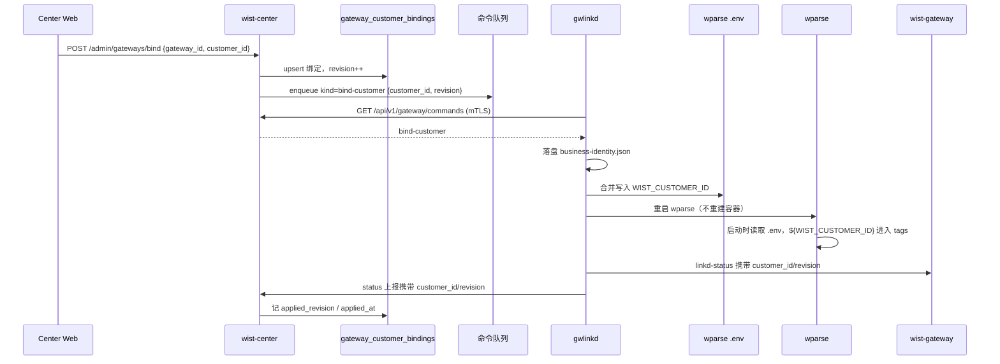

# Gateway 业务身份（customer_id）绑定与下发

> **状态**：**设计草案**（2026-10-22），**尚未实现**。
> **关联**：
> [`../center/warpstation-rule-publishing.md`](../center/warpstation-rule-publishing.md)（同一套 Center 命令队列 / gwlinkd 短轮询）、
> [`gateway-linkd-status.md`](gateway-linkd-status.md)（gwlinkd → 网关的环回心跳面）、
> [`gateway-status-report.md`](gateway-status-report.md)（gwlinkd → Center 的状态上报）。

## 1. 要解决的问题

一台 Gateway 可能服务于不同客户。今天 Center 已经有“绑定客户”的管理入口，但**绑定只落在 Center 的数据库里**：

- 网关不知道自己的业务身份；
- wparse 输出的数据不携带客户标识，客户侧下游无法按客户归属消费；
- Center 收到的上报也没有业务身份字段，外部订阅方只能靠 `gateway_id` 反查。

目标是让业务身份从 Center **一路下发到数据面**：

```
Center 绑定 customer_id
  → 命令队列下发给 gwlinkd
  → gwlinkd 本地持久化
  → 写入 wparse 工作根的 .env
  → wparse 输出记录带上 customer_id
  → gwlinkd / 网关自身的上报也带上 customer_id
```

## 2. 目标与非目标

### 目标

1. Center 绑定 `gateway_id ↔ customer_id`，并支持换绑。
2. 绑定结果能可靠下发到已接入的 Gateway；离线/重启后可补偿。
3. gwlinkd 本地持有业务身份，并在重启后保持。
4. wparse 输出（file / kafka / syslog / http 等所有 sink）携带业务身份。
5. gwlinkd 向 Center 的状态上报、向网关的 linkd-status 均携带业务身份。
6. 绑定状态可观测：未下发 / 已下发 / 已生效 / 失败。

### 非目标

1. **不把 `customer_id` 当凭据**：它不是密钥、不做鉴权、不参与 mTLS/Token 体系。
2. 不在 Agent 上报契约里新增 `customer_id`（Center 有 `gateway_id` 就能关联；避免扩大 Agent 契约）。
3. 不做客户信息的增删改查管理（Center 仍以外部客户系统/人工填写的 ID 为准）。
4. 不改变 wparse 的解析/富化逻辑，只增加输出元数据。

## 3. 现状盘点（代码事实）

### 3.1 已经有的

| 能力 | 落点 |
|---|---|
| Center 绑定接口 `POST /api/v1/admin/gateways/bind` | `wist-center/src/api/mod.rs`、`wist-center/src/api/admin_ops.rs` |
| 绑定存储（FileStore / PgStore 方法） | `wist-center/src/infra/store.rs`、`wist-center/src/infra/pg_store.rs` |
| 绑定模型 | `wist-control/src/control/gateway/supervision/gateway_customer_binding.rs` |
| Center 绑定页面 | `wist-center-web/src/components/GatewayCustomerBindPanel.tsx` |
| gwlinkd 命令通道（mTLS 短轮询 + 本地执行 + 回执） | `wist-center/src/wparse_proxy.rs`、`wist-gwlinkd/src/wparse_relay.rs` |

### 3.2 缺的

1. **绑定只写库，不下发**：`admin_bind_gateway_customer` 调完 `bind_gateway_customer` 就返回，没有入队命令，也没有任何网关侧字段。
2. **gwlinkd / 网关完全没有 `customer` 概念**：`wist-gwlinkd/src` 与 `wist-gateway/src` 中无 `customer` 引用。
3. **PgStore 的表没有建**：`gateway_customer_bindings` 在 `wist-center/docker/initdb/01_schema.sql` 中**不存在**，`PgStore` 直接 `INSERT/SELECT` 该表。新装的 PostgreSQL 上绑定会失败；FileStore（store.json）可用。
4. **接口不校验网关存在**：绑定一个不存在的 `gateway_id` 也会成功。
5. **没有下发状态**：中心不知道网关是否已经收到/生效。
6. **wparse 没有身份注入机制**：数据面只有静态 `tags`，没有“网关级业务身份”概念。

### 3.3 命令通道的现状约束

- 只认 `kind`：`proxy` / `diagnose` / `restart-gateway` / `restart-gwlinkd`；未知 kind 明确失败。
- 控制命令不带 `method/path/body`（`enqueue_control` 当前签名没有 body）。
- 只按 `kind` 去重：同 gateway + 同 kind 已有 pending/leased 时复用；**同 kind 不同 payload 会被误复用**。
- `pending` TTL 60s，过期即 `expired`；网关离线时命令会丢。
- 命令通道只在 `[wparse_relay] enabled` 时启动。
- 队列在 Center 的 PostgreSQL 里；Center 未启用 proxy 时没有该通道。

=> 业务身份下发**不能只依赖命令队列**，必须有补偿路径。

## 4. 身份模型

业务身份统一建模为：

```text
BusinessIdentity {
  customer_id: String,   // 机器可读 ID，进入 wparse tag / 上报字段
  revision:    i64,      // 单调递增；绑定/换绑时 +1
}
```

### 4.1 权威来源

- **Center 的 `gateway_customer_bindings` 是唯一权威**。
- 网关上报的 `customer_id` 只作为“已生效”的证据，**不参与鉴权、不参与路由**。
- Center 收到上报时与本地绑定比对：
  - 一致 → 记 `applied_revision` / `applied_at`
  - 不一致 → 记 `drift` / `reported_customer_id`，页面提示；不修改权威绑定。

### 4.2 为什么需要 `revision`

- 命令可能乱序/重放：只接受 `revision >= local.revision`。
- 换绑必须覆盖旧值，不能因为队列去重把新值吃掉。
- 页面需要区分“已下发”和“已生效”。

## 5. wparse `.env` 机制（已实测）

> 本节结论来自在运行中的 `warp-parse:0.32.1-alpha` 容器里的实测，不是推测。

### 5.1 读取位置

wparse 读取 **工作根** 下的 `.env`：

```
宿主：${WPARSE_RUN_WORK}/.env        （默认 ./data-plane-run/work/.env）
容器：/data/.env
```

实测：`cwd=/tmp`、`--work-root /data/.tmp-proj`，`.env` 在 `/data/.tmp-proj/.env`，变量正常生效
=> **按 work-root 解析，不依赖 cwd**。

### 5.2 变量替换

`${VAR}` 在 sink 配置的 `tags` 中生效：

```toml
[defaults]
tags = ["env:dev", "customer_id:${WIST_CUSTOMER_ID}"]
```

默认值语法是**单冒号**：

```toml
tags = ["customer_id:${WIST_CUSTOMER_ID:unbound}"]
```

- `.env` 有 `WIST_CUSTOMER_ID=cust-acme` → 记录字段 `"customer_id":"cust-acme"`
- `.env` 没有该键 → `"customer_id":"unbound"`
- 写成 `${VAR:-unbound}` 是**错的**，会得到 `-unbound`。

### 5.3 tag 会变成输出记录的字段

```json
{
  "sip": "...",
  "biz": "demo",
  "customer_id": "cust-acme",
  "env": "dev",
  "sink": "json"
}
```

因此业务身份对所有 sink（file / kafka / syslog / http / …）都可见，不需要逐个改 sink。

### 5.4 硬约束（来自 `wp-config` 的 `validate_tags`）

| 约束 | 值 |
|---|---|
| 每条记录合并后的 tag 总数 | **≤ 4**（实测第 5 个直接配置错误） |
| tag key 长度 | ≤ 32 |
| tag value 长度 | ≤ 64 |
| tag value 允许字符 | `[A-Za-z0-9_.:/=@+,-]` |
| 默认值 | `${VAR:default}`（单冒号） |

当前配置的 tag 预算：

```
env:dev        (defaults)
biz:<group>    (sink_group)
sink:<name>    (sink)
= 3 个
=> 只剩 1 个槽位给 customer_id
```

**这意味着一期只能加一个业务身份字段。** 如果以后还要 `tenant_id` / `environment_id`，必须：
- 只保留一个 tag（例如只加 `customer_id`），不再单独加其它身份字段；或
- 改用 OML 字段/其它机制，而不是继续加 tag。

### 5.5 不要用 `SEC_` 前缀

wparse 有独立的密钥机制（启动日志 `vars not value : SEC_xxx`）。业务身份不是密钥，
使用 `WIST_` 前缀（建议 `WIST_CUSTOMER_ID`），不要放进 `SEC_` 命名空间。

## 6. 总体方案



## 7. Center 侧设计

### 7.1 数据模型

`gateway_customer_bindings` 增列（FileStore 同结构，均用 `#[serde(default)]` 兼容旧数据）：

| 列 | 类型 | 说明 |
|---|---|---|
| `gateway_id` | TEXT PK | 不变 |
| `customer_id` | TEXT NOT NULL | 客户 ID |
| `status` | TEXT | `bound` / `applied` / `failed` |
| `revision` | BIGINT NOT NULL DEFAULT 1 | 绑定版本 |
| `bound_at` | TIMESTAMPTZ | 不变 |
| `applied_revision` | BIGINT NULL | 网关已生效的 revision |
| `applied_at` | TIMESTAMPTZ NULL | 生效时间 |
| `reported_customer_id` | TEXT NULL | 网关自报值（用于漂移检测） |
| `last_error` | TEXT NULL | 最近一次下发/应用失败原因 |

**必须补表**：`01_schema.sql` 增加 `CREATE TABLE IF NOT EXISTS gateway_customer_bindings`；
已有库用 `ALTER TABLE ... ADD COLUMN IF NOT EXISTS` 幂等升级。
（目前 PgStore 对新库直接失败，这是 P0 的阻塞项。）

### 7.2 绑定接口

`POST /api/v1/admin/gateways/bind`

调整：

1. 校验 `gateway_id` 存在（不存在 → 404）。
2. upsert 绑定，`revision = revision + 1`（换绑也递增）。
3. 记录 `requested_by`（目前只校验非空、未落库；建议写审计日志或加列）。
4. 已初始化网关 → 入队 `bind-customer` 命令。
5. 未初始化网关 → 不入队；写入 `GatewayInitialConfig`，首次 link-upstream 自带。
6. 返回体增加 `revision`、`applied_revision`、`applied_at`（可为 null）。

### 7.3 命令

新增 kind：

```text
kind = "bind-customer"
body = { "customer_id": "cust-acme", "revision": 3 }
```

`wparse_proxy::enqueue_control` 需要支持 body；去重键必须包含 `(customer_id, revision)`，
否则换绑会被“同 kind 复用”吃掉。

### 7.4 初次接入

`GatewayInitialConfig` 增加：

```rust
pub customer_id: Option<String>,
pub customer_binding_revision: Option<i64>,
```

`/api/v1/gateway/link-upstream`（已初始化路径与置备路径）都带出当前绑定。
gwlinkd 在 `link_upstream` 成功后落盘（`state::save_link_config` 同一时机），
这样首次接入不需要等命令。

### 7.5 状态上报接收

`ReportGatewayStatus` 增加可选字段：

```rust
#[serde(default)]
pub customer_id: Option<String>,
#[serde(default)]
pub binding_revision: Option<i64>,
```

Center 收到后：

- 与权威绑定比对；
- 一致 → 更新 `applied_revision` / `applied_at` / `status = applied`；
- 不一致 → 记 `reported_customer_id` 与漂移，**不覆盖** `customer_id`；
- `customer_id` 仍然只做标签，不参与鉴权。

### 7.6 管理视图

`AdminGatewayInstanceView` 或详情接口增加：

```
customer_id, binding_revision, binding_status, applied_revision, applied_at, last_error
```

Center Web 的 `GatewayCustomerBindPanel` 展示：
- 当前绑定
- 下发状态（未下发 / 已下发 / 已生效 / 失败 + 原因）
- 最近一次生效时间

## 8. gwlinkd 侧设计

### 8.1 本地持久化

新增 `business-identity.json`，落 `identity_dir()`（默认回落 `state_dir`）：

```json
{
  "customer_id": "cust-acme",
  "revision": 3,
  "applied_at": "2026-10-22T10:00:00Z",
  "wparse_applied": true
}
```

- 原子写（临时文件 + rename）
- 权限 `0600` 或 `0644`（不是密钥，`0644` 即可）
- 放 `identity_dir` 的理由：随 `contract` 备份、升级不覆盖；丢了也能从 Center 重新下发

### 8.2 命令处理

`wparse_relay::execute_control` 增加分支：

```rust
"bind-customer" => apply_customer_binding(config, command, task).await,
```

流程：

1. 解析 body，校验 `customer_id`（非空、字符集、长度）。
2. 读取本地 `revision`；`command.revision < local.revision` → 回执 `stale`（成功但忽略）。
3. 落盘 `business-identity.json`。
4. 写 wparse `.env`。
5. 触发 wparse 重启（见 §8.4）。
6. 回执 `{customer_id, revision, wparse_applied}`。

### 8.3 写 `.env`

目标文件：`<WPARSE_RUN_WORK>/.env`。

- 工作根来源：gwlinkd 配置新增 `wparse_work_dir`（绝对路径，显式配置最稳）；
  或从系统根读取栈根 `.env` 的 `WPARSE_RUN_WORK`。
- **合并写**：只增改 `WIST_CUSTOMER_ID`，保留其它键。
- 原子写：同目录临时文件 + rename。
- 权限：`0644`（容器内 wparse 以 uid 999 读）。
- 内容示例：

```dotenv
WIST_CUSTOMER_ID=cust-acme
```

未绑定时写空值或删除该键均可；配置侧有 `:unbound` 默认值兜底。

### 8.4 让 wparse 生效

已实测：`.env` 在 **wparse 进程启动时**读取。

因此应用步骤为：

```
写 .env → 重启 wparse（不重建容器）
```

- 发布态：
  ```
  docker compose --project-directory <system root> \
    -f <system root>/sys/docker-compose.yml restart wparse
  ```
- 开发态：`./dev/svc.sh restart wparse`

建议在 gwlinkd 配置里做成**可配置命令**（类似 `upgrader_program`），不要在 Rust 里写死 compose 路径：

```toml
wparse_apply_command = ""
wparse_apply_timeout_seconds = 60
```

空 = 只写 `.env`，回执 `pending_restart`；配置了则执行并等待结果。
`wpadm engine reload` 是否重读 `.env` 尚未验证；若验证通过，可改为 reload，实现零重启。

### 8.5 上报

- `GwlinkdStatus`（gwlinkd → 网关）增加 `customer_id` / `binding_revision`；
  网关页面可直接展示。
- `ReportGatewayStatus`（gwlinkd → Center）增加同样字段。
- 两者都用 `#[serde(default)]` / `skip_serializing_if`，保证旧版本兼容。

### 8.6 幂等与失败

| 场景 | 行为 |
|---|---|
| 重复命令（同 revision） | 幂等成功，不重复重启 |
| 旧命令（revision 更小） | 回执成功但 `ignored: stale` |
| 新命令（revision 更大） | 覆盖本地并应用 |
| wparse 重启失败 | 本地身份已落盘；回执 `error`，Center 标 `failed`；下次重试只重跑应用 |
| `.env` 写失败 | 回执 `error`，不修改内存态；保留旧文件 |
| gwlinkd 重启 | 从 `business-identity.json` 恢复；启动时确保 `.env` 与本地一致 |

## 9. wparse / 网关栈设计

### 9.1 配置占位

`topology/sinks/defaults.toml`：

```toml
[defaults]
tags = ["env:dev", "customer_id:${WIST_CUSTOMER_ID:unbound}"]

[defaults.expect]
basis = "total_input"
mode = "warn"
```

**注意**：`topology/` 会被 `[project_remote]` 从 **wp-infra** 仓库同步覆盖，
所以这个占位必须落在 **wp-infra**，不能只改本仓的种子。本仓 `sys/data-plane/` 的种子同步改一份，
用于开发态/首次安装。

### 9.2 工作根 `.env`

由 gwlinkd 写；不进入 `sys/`，也不被 `project_remote` 覆盖。
`data-plane-run/` 属于 `protect`（升级不覆盖）且不进备份；换机/重装后由 Center 重新下发。

### 9.3 首次启动的竞争

wparse 可能先于 gwlinkd 首次写入 `.env` 启动：

- 配置里的 `:unbound` 默认值保证不会出现空字段/启动失败；
- gwlinkd 写入后重启 wparse 即切到真实 ID。

### 9.4 下游消费者

记录中会出现：

```json
"customer_id": "cust-acme"
```

- 值为 `unbound` 表示尚未绑定；
- 字段名固定为 `customer_id`（tag key），不要在下游再用 `customer` 别名；
- 如果客户 ID 需要保留原始大小写/特殊字符，见 §9.5。

### 9.5 客户 ID 字符集

tag value 只允许 `[A-Za-z0-9_.:/=@+,-]`，长度 ≤ 64。建议：

1. **在 Center 绑定接口就校验**，不合法的 ID 直接 400；
2. 如果业务上必须支持中文/空格，增加 `customer_tag_value`（slug/hash）专供 tag，原值仍存 `customer_id`；
3. gwlinkd 再做一次校验（防御性，避免 Center 旧版本漏校验）。

## 10. 契约变更清单

| 契约 | 变更 | 兼容性 |
|---|---|---|
| `GatewayCustomerBinding` | 增 `revision` / `applied_revision` / `applied_at` / `last_error` | 新字段可选 |
| `ReportGatewayStatus` | 增 `customer_id` / `binding_revision` | `#[serde(default)]`，旧中心忽略 |
| `GwlinkdStatus` | 增 `customer_id` / `binding_revision` | 旧网关忽略 |
| `GatewayInitialConfig` | 增 `customer_id` / `customer_binding_revision` | 旧 gwlinkd 忽略 |
| `wist-center` store trait | 增 `update_customer_binding_applied(...)` / `get_customer_binding(...)` | FileStore + PgStore 双实现 |
| `wist-center` schema | 补 `gateway_customer_bindings` 表及列 | `CREATE/ALTER ... IF NOT EXISTS` |
| `wist-control` Jumo 模型 | 同步新增字段/实体 | 需 `jumo-model-align` |

## 11. 失败与补偿

### 11.1 命令丢失

命令 `pending` TTL 60s；网关离线会过期。补偿方式（二选一或都做）：

- **状态回执带期望值（推荐）**：`GatewayStatusAccepted` 增加
  `desired_business_identity {customer_id, revision}`；gwlinkd 每 30s 上报时发现本地落后就应用。
  这样不依赖队列、天然处理离线/重启/重放。
- **Center 侧检测漂移后重新入队**：状态上报显示 `binding_revision` 落后时，重新 enqueue。

### 11.2 应用失败

- 身份已落盘，`.env` 未写成功 / wparse 重启失败 → 回执 `error`；
- Center 标 `failed` 并保留 `last_error`；
- 管理员可重试；重试只重跑应用，不改变绑定。

### 11.3 换绑

- `revision` 必须递增；
- 旧命令不会覆盖新值；
- 已输出到下游的旧 `customer_id` 数据无法追溯（标签是写入时快照）。

### 11.4 中心不可达

- gwlinkd 使用本地身份继续运行；
- 恢复后状态上报会把 `binding_revision` 带给 Center；
- Center 发现落后则补偿（见 §11.1）。

## 12. 安全与权限

1. `customer_id` **不是凭据**：不参与 mTLS、Bearer、命令鉴权。
2. Center 以绑定表为准；网关自报值只做展示/漂移检测，**绝不用于授权**。
3. 不使用 `SEC_` 前缀，不写入密钥文件。
4. `.env` 权限 `0644`；不包含密钥。
5. `customer_id` 做字符集/长度校验，防止破坏 wparse tag 配置。
6. 绑定接口需要 admin bearer；审计至少记录 `gateway_id`、`customer_id`、`requested_by`、时间。
7. 命令通道本身已有 mTLS + 队列租约；业务身份复用该通道，不新增入站面。

## 13. 兼容与迁移

- 旧 gwlinkd：忽略 `bind-customer` kind（明确失败回执），Center 显示“未生效”；升级后补偿。
- 旧 Center：不会发送新字段；新 gwlinkd 正常使用本地身份。
- 旧网关：`linkd-status` 新增字段被忽略，不影响心跳。
- PgStore：补表 + 幂等 `ALTER TABLE`；FileStore：`#[serde(default)]` + 空 `customer_bindings`。
- 已有绑定数据（如果有）：`revision` 默认 1，`status` 保持 `bound`。

## 14. 分阶段落地

### P0：控制面（不碰 wparse）

- [ ] 补 `gateway_customer_bindings` 表 + `revision` / applied 字段
- [ ] 绑定接口校验网关存在、revision 递增、返回 applied 状态
- [ ] `bind-customer` 命令 kind + body + 去重键
- [ ] gwlinkd：`business-identity.json`、命令处理、幂等
- [ ] `GwlinkdStatus` / `ReportGatewayStatus` 增加字段
- [ ] Center 接收上报并更新 applied / drift
- [ ] Center Web 展示下发/生效状态

### P1：数据面（wparse）

- [ ] gwlinkd 写 `<WPARSE_RUN_WORK>/.env`（原子合并）
- [ ] gwlinkd 配置 `wparse_work_dir` / `wparse_apply_command`
- [ ] 本仓 `sys/data-plane/topology/sinks/defaults.toml` 加占位（开发态）
- [ ] wp-infra `topology/sinks/defaults.toml` 加同占位（生产）
- [ ] 验证 `docker compose restart wparse` 后新数据带 `customer_id`
- [ ] 验证/决定 `wpadm engine reload` 是否可替代重启

### P2：可靠性 / 体验

- [ ] 状态回执期望值补偿
- [ ] 漂移检测与页面提示
- [ ] 解绑 / 换绑审计
- [ ] 客户 ID 字符集校验与 slug 方案（如需）
- [ ] Jumo 模型同步

## 15. 测试计划

### 单元

- `revision` 幂等：旧命令忽略、同版本幂等、新版本覆盖。
- `.env` 合并：保留其它键、原子写、权限。
- `customer_id` 校验：空、超长、非法字符。
- 上报字段序列化键集（与契约测试同口径）。
- Center store 双实现：bind / applied / drift。

### 集成

1. Center 绑定 → 命令 → gwlinkd 落盘 → `.env` → 重启 wparse → 输出记录含 `customer_id`。
2. 网关离线时绑定 → 上线后补偿（状态回执或重新入队）。
3. 换绑：旧值被覆盖，旧命令不覆盖新值。
4. wparse 重启失败：Center 显示 `failed`，重试后恢复。
5. 旧版本兼容：旧 gwlinkd 收到未知 kind 明确失败；旧 Center 忽略新字段。

### 端到端验收

- `GET /api/v1/admin/gateways/{id}` 能看到 `customer_id` 和 `applied_at`。
- wparse 的 file sink 输出包含 `"customer_id":"cust-acme"`。
- Kafka/syslog sink 的 tag 中也包含同一字段（`attach_meta_tags` 场景）。
- 未绑定时输出 `"customer_id":"unbound"`，不报错。

## 16. 开放问题

1. **tag key** 用 `customer_id` 还是 `customer`？（本文按 `customer_id`）
2. **客户 ID 字符集**：是否强制 tag-safe？还是需要 slug/hash 作为 tag 值？
3. **生效方式**：接受 `restart wparse`，还是必须零重启（需验证 `wpadm engine reload` 重读 `.env`）？
4. **多身份字段**：目前 tag 预算只剩 1 个槽位；未来 `tenant_id` / `environment_id` 怎么表达？
5. **解绑语义**：解绑后 `customer_id` 是变 `unbound` 还是保留最后值？
6. **是否信任网关自报**：仅展示/漂移检测，还是允许它作为数据面标签的唯一来源？（本文建议 Center 权威）
7. **Center 未启用 proxy** 时是否要求该能力可用？若要求，需要把补偿路径（状态回执）做成主路径。

## 17. 参考

- `wist/wist-center/src/api/admin_ops.rs` — 绑定接口
- `wist/wist-center/src/infra/store.rs` / `pg_store.rs` — 绑定存储
- `wist/wist-center/src/wparse_proxy.rs` — 命令队列 / kind / 去重 / TTL
- `wist/wist-gwlinkd/src/wparse_relay.rs` — 控制命令本地执行
- `wist/wist-gwlinkd/src/state.rs` — 身份 / 实例 / 凭据落盘
- `wist/wist-gwlinkd/src/linkd_status.rs` — gwlinkd → 网关心跳载荷
- `wist/wist-control/src/control/gateway/supervision/` — 上报 / 初始配置 / 绑定契约
- `local-work/gateway-local/wist-gateway-stack/sys/data-plane/topology/sinks/defaults.toml` — wparse tag 种子
- wp-infra 仓库 `topology/sinks/defaults.toml` — 生产 wparse tag 源
- `wist-design/jumo/model/static/control/module/gateway/supervision/items.mju` — Jumo 模型
