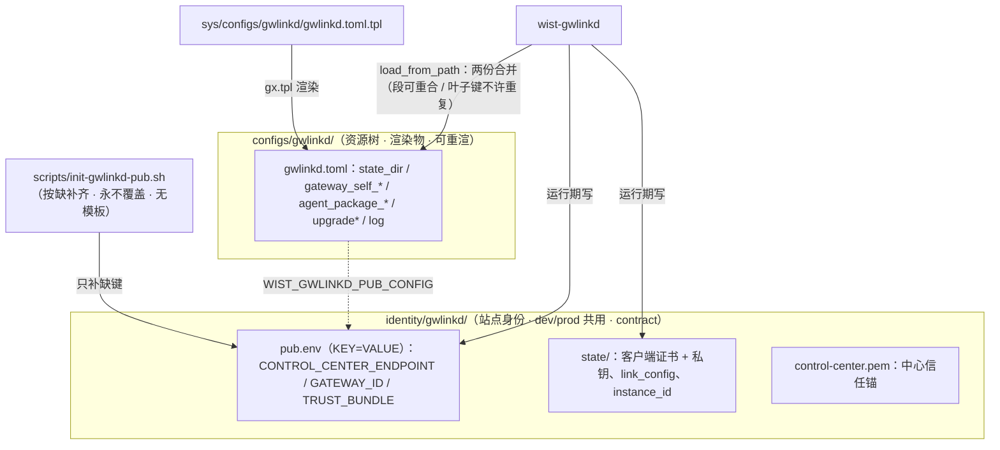

# gwlinkd 配置分层（渲染物 / 现场态 / 一次性券 / 身份）

> **状态**：**设计**（2026-10-12）。落地跟踪见 §12。
> **上游约定**：[`../foundation/config-and-state-layout.md`](../foundation/config-and-state-layout.md)
> （配置与运行数据的四类内容 / 落点 / 声明 / 加载 / 写入）—— 本文是它在 gwlinkd 上的实例。
> **关联**：[`gateway-onboard-request.md`](gateway-onboard-request.md)（接入物三样 / CA 落盘 / 券的一次性）、
> [`gateway-linkd-status.md`](gateway-linkd-status.md)（同一宿主侧常驻进程）、
> [`../center/gateway-secure-registration.md`](../center/gateway-secure-registration.md)（接入券与两级凭据）、
> [`../foundation/cross-repo-issues.md`](../foundation/cross-repo-issues.md) **CR-003**（宿主侧常驻 `wist-gwlinkd`）。
> **参照实现**：`wist-gateway` 的 impl/pub 两文件加载（`src/infra/config.rs` 的
> `PUB_CONFIG_ENV` / `resolve_pub_config_path` / `merge_disjoint`）与 `wist-gateway-stack/scripts/init-gateway-pub.sh`。

## 1. 要解决的问题

网关的运行配置已经分了层（`wist-gateway.toml` 渲染物 + `identity/gateway/public/wist-gateway-pub.toml` 现场态），
但**宿主侧的 `wist-gwlinkd` 没有**：它只有一份 `gwlinkd.toml`，把三种性质不同的东西混在一起 ——

1. **渲染物**（`state_dir` / `gateway_self_*` / `agent_package_*` / `upgrade*` / `log`）：
   由 `gops sys localize` 从模板渲染，升级/重渲**应该**被覆盖；
2. **现场接线**（`control_center_endpoint` / `gateway_id` / `trust_bundle`）：
   接入完成后**一直要**，升级/重渲**不该**被动；
3. **一次性接入券**（`link_token`）：用一次即废，**不该驻留**。

外加一层**不在任何声明里**的身份：客户端证书 + 私钥（`state_dir/`）与中心信任锚（`control-center.pem`）——
它们是不可再生、含私钥的现场事实，现在只落在 `configs/` 下，**既不在 `contract`，也不被"只带身份"的迁移通路带走**。

## 2. 现状：一份文件、两个写者

| 键 | 写者 A | 写者 B |
|---|---|---|
| `control_center_endpoint` | `gx.tpl` 渲染（值来自 `CENTER_ENDPOINT`） | gwlinkd `upsert_link_settings()` 运行期写回 |
| `gateway_id` | 同上 | 同上 |
| `trust_bundle` | 同上 | 同上 |
| `link_token` | —— | gwlinkd `upsert_link_settings()` 追加 |
| `state_dir` / `gateway_self_*` / `agent_package_*` / `upgrade*` / `log` | `gx.tpl` 渲染 | —— |

**为什么现在没炸**：中心下发的安装脚本（`wist-center/src/api/install.rs`）在 localize **之前**
把 `CENTER_ENDPOINT` / `GWLINKD_GATEWAY_ID` / `GWLINKD_TRUST_BUNDLE` 写进了 `values/sys_value.yml`，
于是重渲出来的值与页面写入的值**恰好一致**。这是**巧合的一致**，不是契约：

- 已经能看到翻动：页面路径写 `trust_bundle = <state_dir>/control-center.pem`（见 `gateway-onboard-request.md` §5），
  而渲染写 `$STACK_DIR/configs/gwlinkd/control-center.pem` —— 同一个键两个不同值来回换；
- 非脚本接入（手工 / 只走页面）时 `CENTER_ENDPOINT` 为空，重渲就会把 endpoint 打回 `""`；
- 券由页面追加、**没有任何东西在成功后被清理**（全仓只有 `unlink` 调 `remove_link_token()`），
  结果是一张**已作废的明文券长期躺在配置文件里**；抹掉它要靠"碰巧又跑了一次 localize"。

## 3. 关键事实：接入券是一次性的

设计落地时容易记岔，这里钉死（两侧口径一致）：

| 环节 | 位置 | 语义 |
|---|---|---|
| 生成/轮换 | `wist-center/src/api/admin_ops.rs` → `rotate_link_token` | 覆盖 `link_token_hash` + `expires_at` ⇒ **同一网关同时只有一张有效券**，旧券立即失效 |
| 使用 | `wist-center/src/api/gateway_ops.rs` → `consume_link_token` | 比对 hash + **未过期** + 网关处于 `Provisioned`，**成功即 `clear()`** |
| 时限 | `security.link_ttl_seconds`（缺省 **900s**） | 过期即拒，并顺手清掉 |
| 消费时机 | `gateway_ops.rs` | **先落库 RegistToken 再消费券** ⇒「券废了但 register 失败」不锁死 |
| 兜底 | `wist-gwlinkd` `onboard()` | `save_regist_token()` 持久化到 `state_dir`，下次启动**免券重试注册** |

⇒ 券是「**用一次即废 + 短 TTL**」。**正解不是"把它藏起来"，而是"用完即删"**：
gwlinkd 是宿主侧 systemd 服务，unit 只注入 `WIST_GWLINKD_CONFIG`（**没有 `EnvironmentFile`**），
"券走 env" 这条路要额外改 gwlinkd 的 service 渲染并重装 unit —— 收益为零。

## 4. 决策：按**生命周期**拆三层，身份归位到 `identity/`



| 层 | 键 | 落点 | 谁写 |
|---|---|---|---|
| **渲染物** | `state_dir`、`gateway_self_endpoint`、`gateway_self_ca`、`agent_package_*`、`upgrade*`、`log`、`renew_lead_seconds` | `configs/gwlinkd/gwlinkd.toml` | `gx.tpl`（不变） |
| **现场态** | `control_center_endpoint`、`gateway_id`、`trust_bundle` | `identity/gwlinkd/pub.env`（`.env` 形态） | ①`scripts/init-gwlinkd-pub.sh`（按缺补齐）②gwlinkd 接入时 upsert |
| **一次性** | `link_token` | 同上（临时） | gwlinkd upsert → **`onboard` 成功后删除** |
| **身份** | 客户端证书 + 私钥、中心信任锚 | `identity/gwlinkd/state/`、`identity/gwlinkd/control-center.pem` | gwlinkd 运行期写 |

## 5. 加载语义：两份合并，对齐网关先例

- **路径**：新增 `WIST_GWLINKD_PUB_CONFIG`（对齐 `WIST_GATEWAY_PUB_CONFIG`）；相对路径按**主配置目录**解析；
  未设则该 env 缺席 ⇒ **不读 pub**（向后兼容：老现场单文件仍能起）。
  主配置路径仍是 `WIST_GWLINKD_CONFIG`（systemd unit 已注入）。
- **合并**：抄 `wist-gateway/src/infra/config.rs` 的 `merge_disjoint()` ——
  **段（TOML table）可以两份都写；叶子键不许重复**（同一键两处 → 直接报错）。
  这就是"归属唯一"的硬保证，替掉现在靠加载顺序/巧合决定的模糊。
- **缺 pub 时的报错**：`control_center_endpoint` 加 `#[serde(default)]`，
  让它落回既有的"endpoint 为空 ⇒ 提示先接入上级"的清晰错误，
  而不是 serde 的 `missing field control_center_endpoint`。

## 6. 一次性券：保留写入 + 成功即删

**不放 env**（理由见 §3），保留"临时落盘"这个做法，但补上**清理**：

- 页面路径：`upsert_link_settings()` 仍把券写进 `pub.env` —— 它同时是
  「链接关系的持久记录」与「进程在 onboard 前崩掉的 resume 点」；
- `onboard()` **成功返回前**调用 `remove_link_token(pub)`；
- `unlink` 路径已有删除，不变；
- `doctor` 增加一条诊断：**已接入（有凭据）却仍残留 `link_token`** ⇒ 提示（并可选自动清）；
- 券已过期时也一并清掉（TTL 过后它必然无用）。

⇒ 稳态下**盘上没有明文券**；残留只可能出现在"接入进行中"这个短窗口内，且失败会在页面上可见。

## 7. 身份为什么必须归位、且必须落在 `identity/`

**必须进 `contract`**：`configs/gwlinkd/state/` 是 gwlinkd 的**客户端证书 + 私钥**（长期身份），
`control-center.pem` 是中心信任锚。丢了它们的后果**不可自愈**：

- `link-upstream` 对**已初始化**的 `gateway_id` 只认 mTLS（`gateway_ops.rs`），
  而本地已无客户端证书 ⇒ 无法重新置备；
- 中心**没有**「重置实例 / 重发凭据」的管理接口（`wist-center/src/api/mod.rs` 路由表里只有
  `POST /admin/gateways/instances`（**新建**实例）、`.../{id}/link-token`（只对 `Provisioned` 有用）、
  `POST /gateway/credentials:renew`（**需要现有证书**））；
- ⇒ **唯一出路是新建实例、换 `gateway_id`**（gwlinkd 自己的报错文案就是这么写的）。
  `gateway_id` 一换，中心侧的实例、绑定、历史全断。

**必须落 `identity/` 而不是留在 `configs/`**：`gops prj diagnose` 用
`covered_by(p, b) = p==b || b.starts_with("p/") || p.starts_with("b/")`
判 `contract.overlap`（`galaxy-ops/src/ops_prj/diagnose.rs`）。
`configs` 已在 `backup:` 里 ⇒ `configs/gwlinkd/**` 被 `configs` 覆盖 ⇒ **`configs/` 下任何路径都不能进 `contract`**。
挪进 `identity/` 后，既有的 `contract: - identity` **自动收编** ⇒ `sys-prj.yml` **一行都不用改**，
且与网关的既有口径（"站点身份不在资源树里，放 `identity/`，dev/prod 共用一份"）完全一致。

> ⚠ `identity/` 含私钥 ⇒ `gops prj contract export` 的归档是**密件**，落点需与整站备份同等级别（既有规程）。
> `.gitignore` 已有 `/identity/`，归位后不会误入库。

## 8. 改动清单

### 8.1 `wist-gwlinkd`（特征版本 `v0.9.0-alpha`）

| 文件 | 改动 |
|---|---|
| `src/config.rs` | 抄网关的 `PUB_CONFIG_ENV`（`WIST_GWLINKD_PUB_CONFIG`）/ `resolve_pub_config_path()` / `merge_disjoint()`；`load_from_path()` 合并两份；`control_center_endpoint` 加 `#[serde(default)]`；`upsert_link_settings()` / `remove_link_token()` 的**目标从主配置改为 pub** |
| `src/main.rs` | `onboard()` 成功路径调 `remove_link_token(pub)`（§6）；`init-config` 生成 pub 骨架（带注释的"接入这里"引导） |
| `src/service/{mod,systemd,launchd}.rs` | `ServiceSpec` 增 `pub_config: Option<PathBuf>` ⇒ unit / plist 注入 `WIST_GWLINKD_PUB_CONFIG`；CLI `service install --pub-config <path>` |
| `src/doctor.rs` | 增三项诊断：pub 缺席 / 与主配置叶子键交叠 / **已接入却残留 `link_token`** |
| `tests/` | 两份合并（叶子键重复须报错）；`upsert` 写 pub 而非主配置；`onboard` 成功后券消失 |

### 8.2 `wist-gateway-stack`

| 文件 | 改动 |
|---|---|
| `sys/configs/gwlinkd/gwlinkd.toml.tpl` | **删 3 个键**（`control_center_endpoint` / `gateway_id` / `trust_bundle`）；注释改为"这三项在 `identity/gwlinkd/pub.env`，由 `init-gwlinkd-pub.sh` 按缺补齐、永不被重渲" |
| `scripts/init-gwlinkd-pub.sh` | **新增**。**不做模板** —— 现场值本就来自环境变量，直接写成 `.env`：键名 = 配置键名大写（`CENTER_ENDPOINT`→`CONTROL_CENTER_ENDPOINT` / `GWLINKD_GATEWAY_ID`→`GATEWAY_ID` / `GWLINKD_TRUST_BUNDLE`→`TRUST_BUNDLE`），**按缺补齐**（键不存在或值为空才写；非空一律保留）；内容不变不碰 mtime |
| `sys/workflows/operators.gxl` | 在主配置渲染**之前**插一步：`init-gwlinkd-pub.sh`（按缺写入 `.env` 现场态）—— 与网关的 ①'' 对称 |
| `sys/setting/vars.yml` | `GWLINKD_STATE_DIR` → `./identity/gwlinkd/state`；`GWLINKD_TRUST_BUNDLE` → `./identity/gwlinkd/control-center.pem`；`CENTER_ENDPOINT` / `GWLINKD_GATEWAY_ID` 注释改为"由 pub 脚本消费，不进渲染物" |
| `sys-prj.yml` | **不改**（`contract: - identity` 已覆盖 `identity/gwlinkd/`） |
| `dev/svc.sh`、`dev/unlink-center.sh` | `init-config` 带 `--pub-config`；unlink 里对顶层键的 `sed` / `grep` 改指 pub；dev 的 impl 仍在 dev 目录，pub/state/CA 指向栈根 `identity/gwlinkd/`（dev 与发布态**共用一份身份**） |
| `CHANGELOG.md` | 迁移说明（§9） |

### 8.3 `wist-center`（`src/api/install.rs`）

- `GWLINKD_STATE_DIR` / `GWLINKD_TRUST_BUNDLE` 的 `set_value` → `identity/gwlinkd/…` 绝对路径；
- `service install` 追加 `--pub-config "$STACK_DIR/identity/gwlinkd/pub.env"`；
- `CENTER_ENDPOINT` / `GWLINKD_GATEWAY_ID` 的 `set_value` **保留**（pub 脚本从合并后的 env 读），
  注释改口径，避免"写了却不生效"的困惑。

## 9. 迁移（老现场，动私钥 ⇒ **先备份**）

```bash
# 1) 挪身份（含私钥）
mv configs/gwlinkd/control-center.pem identity/gwlinkd/control-center.pem
mv configs/gwlinkd/state              identity/gwlinkd/state

# 2) 把现场接线抠成 pub（并在主配置里去掉这三项）
#    control_center_endpoint / gateway_id / trust_bundle → identity/gwlinkd/pub.env（大写键名）

# 3) 重渲主配置（去掉那三项）+ 清掉已废的 link_token
gops sys localize

# 4) 重装宿主服务（**必须** —— 不改 unit 就没有 WIST_GWLINKD_PUB_CONFIG）
sudo wist-gwlinkd service install --system --run-as <user> \
  --bin /usr/local/bin/wist-gwlinkd \
  --config <stack>/configs/gwlinkd/gwlinkd.toml \
  --pub-config <stack>/identity/gwlinkd/pub.env --force
```

建议做成一次性 `scripts/migrate-gwlinkd-identity.sh`（带 `--dry-run`），并写进升级序（`foundation/upgrade-order.md`）。
**不重装 unit** 的表现：gwlinkd 起得来但读不到 pub ⇒ 报"未接入上级"（不会静默用错中心）。

## 10. 不变量与边界

1. **同一路径只写一处**：`identity/gwlinkd/**` 只由 `contract` 声明；`configs/gwlinkd/gwlinkd.toml` 只由 tpl 渲染。
2. **叶子键唯一**：同一键不得同时出现在主配置与 pub —— 出现即报错（不靠加载顺序、不靠巧合）。
3. **重渲不碰现场**：`gops sys localize` 可任意次执行；`pub.env` 内容与 mtime 都不变。
4. **券不驻留**：稳态下盘上无明文 `link_token`；残留只存在于接入进行中的短窗口。
5. **gwlinkd 仍无入站服务**（CR-003 R1 不变）：本设计不改它的网络形态。
6. **gwlinkd 仍不接 orion-sec**：本设计不需要它 —— 券不驻留后，pub 里没有任何机密。
   （将来若 pub 要承载别的密钥，再按网关同口径接 `${SEC_*}`。）
7. **身份缺失必须响亮**：`contract.missing` / `doctor` 都要报；不允许“静默回落系统根”或“静默换 id”。
8. **信任锚就地引用、不复制**：`gateway_self_ca` 指**网关自己**的 CA `identity/gateway/public/gateway-ca.crt.pem`
   （已在 `identity/` ⇒ 被 `contract` 覆盖：不进包 / 不重渲 / 必进备份），**不**在 `identity/gwlinkd/` 再放一份
   —— 同一信任锚只留一片，否则轮换 CA / 换域名重签时两处都要改、易漏。
   （对比：`identity/gwlinkd/control-center.pem` 是**中心**的 CA —— 外部信任根，才需要本地副本。）

## 11. 备选与否决

| 备选 | 否决理由 |
|---|---|
| 保持单文件，只把几个键挪出 tpl（"按缺补齐"写回同一文件） | 文件同时在 `configs/`（资源树、可重渲）与"现场态"，只能让 `protect`/`backup` 互相让步；且它仍进不了 `contract`（§7 的交叠判定） |
| 券走 env / 密钥文件 | 宿主侧 systemd unit 没有 `EnvironmentFile`，要改 service 渲染 + 重装；而券本就一次性，删掉即可（§3、§6） |
| 多给 gwlinkd 一个"重置实例"的管理接口 | 是有意的安全边界（同一 `gateway_id` 不能重接）。本设计改为**把身份带全**，不放松边界 |
| 把 `configs` 从 `backup` 拆细，好让 `configs/gwlinkd/state` 直接进 `contract` | 网关的 store 走整目录正是为了"原样回放"；为一个 gwlinkd 把整栈备份口径改细，代价大于挪一次目录 |
| dev 与 prod 各自一份 gwlinkd 身份 | 与网关的站点身份口径不一致（`identity/` 就是 dev/prod 共用一份）；两份身份意味着两套信任根 |

## 12. 落地清单（分期）

| 期 | 内容 | 依赖 |
|---|---|---|
| **P0** | `onboard()` 成功即删券（§6）。1 处调用 + 测试。**与分层解耦，可先单独落地** | 无 |
| **P1** | pub 拆分（tpl 删键 + `init-gwlinkd-pub.sh` 写 `.env` + gwlinkd 读两份 + upsert 改写 pub + `service --pub-config`） | 需发 `wist-gwlinkd` |
| **P2** | 身份归位（`state/` + `control-center.pem` → `identity/gwlinkd/`）+ vars / dev / 安装脚本同步 + 迁移脚本 + 升级序条目 | 需发 `wist-gwlinkd` + `wist-center`（路径与参数在 center 侧生成） |

- [ ] P0：`wist-gwlinkd` `onboard()` 成功即 `remove_link_token`；单测。
- [ ] P1：`wist-gwlinkd` 双文件加载 + `service install --pub-config` + `doctor`；发版。
- [ ] P1：stack `gwlinkd.toml.tpl` 删键 + `scripts/init-gwlinkd-pub.sh` + `operators.gxl` 插步。
- [ ] P2：`identity/gwlinkd/` 归位 + `vars.yml` / `dev/*` / `install.rs` 同步。
- [ ] P2：迁移脚本 + `upgrade-order.md` 条目 + 两栈 `CHANGELOG`。
- [ ] 验收：`localize` 连跑两次 pub 不动；接入后 pub 无 `link_token`；`diagnose` 无 `contract.overlap` / `missing`；
      `contract export` 的归档含 `identity/gwlinkd/state`。

## 13. 开放问题

1. **`trust_bundle` 的落点**：现口径是页面把 CA 落到 `<state_dir>/control-center.pem`。
   归位后 `state_dir = identity/gwlinkd/state`，那 `identity/gwlinkd/control-center.pem` 与
   `identity/gwlinkd/state/control-center.pem` 是**两份还是合成一份**？
   倾向：`trust_bundle` 直接指向 `state/control-center.pem`（少一份、少一个翻动点），
   安装脚本也不再另写一份。
2. **`gateway_self_ca` 的归属 —— 已定（2026-10-13）**：**不**搬进 `identity/gwlinkd/`；它渲染自
   `GATEWAY_SELF_CA`、就地指向网关 CA `identity/gateway/public/gateway-ca.crt.pem`（见 §10·8）。
3. **P0 是否要顺手清历史残留**：`doctor` 只报不删，还是要 `--fix`？
4. **是否把 `link_token` 的写入也去掉**（完全只在内存里转一手，放弃 crash-resume）？
   当前决定：**保留写入 + 成功即删**（保住接入进行中的 resume 点）。
