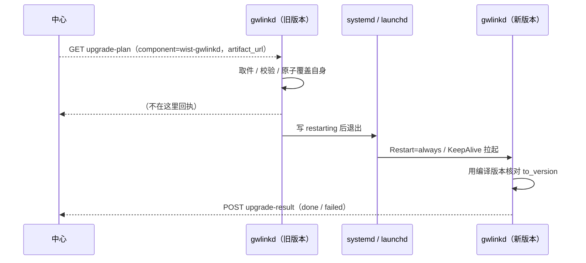

# 网关升级与制品发布（中心托管 → 网关取件）

> 参考 `agent-upgrade-and-packages.md`（gateway 托管 **agent 包**）的同款思路，把 **center 对 gateway
> 的升级**做成「制品由中心托管、地址由中心**派生**」。本页是**第一步（接线）**；第二步（内容寻址 + 摘要
> 校验 + 抽共享内核）见 §7。

## 1. 要解决的问题

center 其实**已经有**发布与升级的全套件，但**镜像下来的制品地址没有进升级链路**：

| 能力 | center 现状 | 消费方 |
|---|---|---|
| 发布（镜像制品） | `POST /api/v1/admin/releases/:component`（`admin_publish_release` → `ArtifactStore::store`） | — |
| 列历史 | `GET /api/v1/admin/releases/:component` | 升级计划创建页 |
| 下发地址 | `/api/v1/releases/artifact/:component/:version/:filename`（镜像后的**绝对** URL） | — |
| 升级计划 | `POST /api/v1/admin/rollout-plans`（`Control.Rollout.RolloutPlan`）+ 批准/推进；`spec` 存 `{"targets":[{component, target_version}]}` | — |
| 网关拉目标 | `GET /api/v1/gateway/upgrade-plan` → `GatewayUpgradePlan`（原只有 `to_version`） | gwlinkd |
| 执行 | gwlinkd `UpgradeDriver` → `gops prj upgrade --to <版本|URL|路径>` | — |

缺口：`gops --to` 拿到的是**计划里的 `to_version` 字符串**，而中心镜像好的制品地址**没被用上** ——
于是运维要么手输一个远端/本机路径（会漂到别的机器上，与 `agent-upgrade-and-packages.md` §1 同款坑），
要么依赖外部源直连。

**校验（2026-10-18）**：已知动作（`upgrade` / `push-agent-package` / `push-knowledge-package`）创建计划时，
每个 target 必须带非空 `target_version` —— 版本是派生制品地址的**唯一输入**，留空则计划永远发不出去。
服务端直接 400（`invalid_spec`），前端禁用提交并点名缺版本的组件；
旧 gwlinkd 对存量空版本计划会回执 `failed` 并落游标（不再静默跳过）。

## 2. 方案：地址由中心**派生**，不让运维手输

1. **拉取时反查**：`GET /api/v1/gateway/upgrade-plan` 里，中心按计划的 `(component, target_version)`
   反查该组件**已发布的 release 记录**，把其 `artifact_url`（镜像后的绝对地址）放进
   `GatewayUpgradePlan.artifact_url`。**不新增存储**：release 记录就是唯一真源。
   多平台组件（`galaxy-ops` / `galaxy-flow` 一次发 macOS-ARM + Linux x86_64/ARM64 三平台）
   **必须按平台挑**：网关在拉取时用 `platform=<target-triple>` 自述本机平台，中心据此命中
   完整三元组 ＞ 同平台家族（忽略 gnu/musl 等 abi）＞ 无平台概念的包。挑不到就**不带**地址
   （回落用版本，不把错平台制品派给主机 —— 错平台二进制覆盖上去不报错、只会让工具静默报废）。
2. **执行器取件用它**：gwlinkd 把 `artifact_url` 交给驱动作为执行器的取件目标
   （`gops --to <url>`）；**台账与回执仍记 `to_version`（版本）**——回执语义要的是版本，不是 URL。
3. **无 release 时回落**：没发布过该 `(component, version)` → `artifact_url` 缺省 → 执行器回落用
   `to_version`（兼容旧行为，不阻断）。

## 3. 边界与取舍

- **派生而非手输**：地址永远由中心按发布记录给；运维在计划里只选**版本**。手输的地址一旦是某台机器上的
  路径，就会在每台目标机上被逐台解释 —— 这正是 agent 包那条路踩过的坑。
- **多平台按网关自述平台挑**：平台不是运维在计划里选的，而是**网关本机自述**（`HostTarget::target_triple()`
  → query `platform=`）。同一 `(component, version)` 下多平台制品，中心不做「随便挑一个」——挑不准就不给地址，
  宁可让执行器回落版本。
- **不新增存储字段**：`artifact_url` 在拉取时计算（release 记录为准）；计划本身仍只存目标版本。
  好处是「中心换了存储后端（本地 ↔ 对象存储）」不影响历史计划。
- **台账/回执记版本**：`UpgradeRecord.to_version` 与 `ReportGatewayUpgradeResult.to_version` 保持版本语义；
  URL 只出现在「执行器取件」这一个位置。
- **制品下载端点当前无鉴权**（既有行为）：地址是中心 `public_url` 下的固定路径。这与「安装包下发地址」
  同口径（包本身不是秘密），但**是待收紧项**，见 §7。

## 4. 代码对应

| 侧 | 位置 |
|---|---|
| 模型 | `jumo/model/static/control/module/gateway/supervision/items.mju`（`GatewayUpgradePlan.artifact_url`） |
| 契约 | `wist-control` `gateway_upgrade_plan.rs` |
| 中心派生 | `wist-center` `api/gateway_ops.rs`（`upgrade_plan_for` → `resolve_release_artifact_url`，含平台匹配） |
| 平台自述 | `wist-gwlinkd` `target.rs`（`HostTarget::target_triple`）→ `center.rs`（`get_upgrade_plan(platform=)`） |
| 执行器取件 | `wist-gwlinkd` `upgrade.rs`（`UpgradeDriver::start` 新入参 → `ExecutorInvocation.to_version`）、`main.rs` |
| 发布（既有） | `wist-center` `api/admin_ops.rs`（`admin_publish_release`）、`infra/artifacts.rs` |

## 5. 验收

1. 中心发布一条 `wist-gateway-stack@X` 的 release（镜像成功）→ 建计划（目标 `wist-gateway-stack` / `X`）并审批 →
   网关拉 `GET /api/v1/gateway/upgrade-plan` → `artifact_url` = 那条记录的下发地址。
2. 计划里的版本**没发布过** → `artifact_url` 缺省，网关仍能按 `to_version` 走旧路（不阻断）。
3. gwlinkd 侧：计划带地址 → `gops` 参数是 `--to <url>`；台账/回执的 `to_version` 仍是**版本**。
4. **多平台组件**（`galaxy-ops` 发三平台）：macOS-ARM 网关拉到的是 `aarch64-apple-darwin` 制品
   （不是 Linux 制品）；Linux x86_64 网关拉到 musl 制品。声明平台对不上 / 老网关不声明 → 不带地址。

## 6. 相关

- [`agent-upgrade-and-packages.md`](./agent-upgrade-and-packages.md)：同款教训（来源 → 托管 → 派生下发地址）。
- [`gateway-status-report.md`](./gateway-status-report.md)：网关自述面 / 状态上报（另一条接缝）。
- `foundation/upgrade-order.md`：发布序 vs 升级序。

## 7. 第二步：升级包管理向 gateway 对齐

### 7.1 安装包有哪几类（身份从哪读）

四类**各自独立**（`component` 即后端 `:component`）：

| 组件 | 包 | 包装目录 | 身份来源 |
|---|---|---|---|
| `wist-agentd` | `wist-agentd-<version>-<triple>.tar.gz` | 一层同名目录（带 version+triple） | 包内目录名 |
| `wist-gateway-stack` | `wist-gateway-stack-<version>.tar.gz` | 无（git archive，顶层是 `sys/…`） | **文件名**（目录名读不出） |
| `galaxy-ops` | `gops-<version>-<triple>.tar.gz`（文件名待确认） | 一层同名目录（或同名二进制） | 包内目录名（无则回落文件名） |
| `galaxy-flow` | `gx-<version>-<triple>.tar.gz`（文件名待确认） | 一层同名目录（或同名二进制） | 包内目录名（无则回落文件名） |
| `wist-gwlinkd` | `wist-gwlinkd-<version>-<triple>.tar.gz` | 一层同名目录 | 包内目录名（无则回落文件名） |

所以身份解析**先看包内首条目目录名、读不出再回落来源文件名**，且**不写死组件名**——否则 gateway-stack
包永远读不出、加一类包就得改一次代码。

**已做（本轮）**

- center 发布的**来源**既接 https URL 也接**本机绝对路径**（与 gateway 的 agent 包来源同口径）。
- 读到的内容算 **sha256** 并落库（`release_records.package_sha256`；`01_schema.sql` 幂等补列）；
  可带可选 `expected_sha256` **核对**（不符 → 502 且不落记录）。
- 同一 `(component, version)` 的**同一份内容**重复发布 → **幂等**返回（不重复下副本）。
- **从包里读身份 / 版本不再手输**（`read_package_identity`）：解 gzip+tar 取首条目目录名，**不写死组件名**
  （以「已知架构名」定位 target-triple、以「像版本号的段」定版本起点）切出 `(version, arch)`；目录名读不出
  （gateway-stack 包顶层是 `sys/…`）则**回落用来源文件名**。发布的 `version` **可选**：不传就用解析值，
  传了才与解析值**核对**（归一化 `v` 后不符 → 400）；两边都解析不出 → 400。覆盖五类包：
  agentd / gateway-stack / galaxy-ops / galaxy-flow / gwlinkd（各自独立）。
- **落盘 / 下发用来源原名**：镜像后的文件名取来源末段（`galaxy-flow-…-musl.tar.gz`），URL 末段就是原名、
  人看着清楚、下载即得可用文件。内容寻址不再靠文件名，而在 DB：`package_sha256` +
  `(component, version, sha)` 幂等去重；名字取不到 / 危险（`.` `..`）则回落 `{component}-{version}.bin`。
- **包管理页**（`/packages`）：四个**分开**的组件（`wist-gateway-stack` / `wist-agentd` / `galaxy-ops` /
  `galaxy-flow`），共用同一个通用面板（`PackagePanel` + `PackageTarget`）；表单只填**产物地址**（+ 可选期望摘要），
  版本从地址实时预览（真解析在中心侧）。
- **多平台组件一次录满三平台**：`wist-agentd` / `galaxy-ops` / `galaxy-flow` 是**多平台**（一次必须录满
  macOS-ARM + Linux x86_64 / ARM64 的 musl 版，与网关侧 `install_package.rs` 的 `PLATFORM_*` 是**同一份矩阵**
  —— agentd 的包按平台分别托管，少一个平台就有主机装不上）；录入页给出三个平台槽位 + GitHub Release
  一键填充，`POST /api/v1/admin/releases/:component/batch` 少任何一个平台即**整体拒绝、不落记录**
  （中心侧 `required_platforms`）。`wist-gateway-stack` 是**单制品**包（包名里没有 target-triple），走单条录入。
- 内核已收进**共享 crate `wist-release`**（`package` 模块）：`sha256` / 来源读取 / 摘要校验 / 内容寻址 id /
  身份解析 / 制品命名，中心与网关**共用一份**。中心侧 `wist-center/src/infra/package.rs` 只剩薄适配
  （别名导出），网关侧 `install_package.rs` 同理。**不含存储/端点/鉴权** —— 那三样各自保留。
- 身份解析分**两套严格度**（`wist-release::package`）：宽松 `read_package_identity`（先看包内目录名，
  读不出**回落来源文件名** —— 中心托管任意包）与严格 `read_binary_package_identity`（**只认**包内目录名、
  且必须切出**已知 target-triple**，读不出架构就整体留空 —— 网关的 agent 二进制包）。此前这两套口径
  分别散落在中心与网关各自的实现里。
- 发布计划的**灰度阶梯**（1 个金丝雀 → 10% → 30% → 70% → 全量）也收在同一 crate 的 `rollout` 模块：
  中心（发布①）与网关（agent 升级）由「目标 + 阶段数」切出互不重叠的阶段，运维只选阶段数。
- **路径段把关**（同 crate 的 `is_safe_path_segment`）：`component` / `version` / `filename` 会拼进
  `{artifact_dir}/{component}/{version}/{filename}` 与对象存储 key，必须是**真的只有一段**。管理面
  发布对 `component` / `version` 直接 400；**未鉴权**的制品下载路由对三段一律当 404；存储层再兜一道。
  （此前 `component = ..` 可逃出制品目录 —— 下载侧等于任意文件读。）

**仍待做**

- **② Agent 包下发的后端**：见 [`agent-package-push-to-gateways.md`](./agent-package-push-to-gateways.md)。
  结论：**不**让中心直推网关管理面（中心是 pull-based、网关在内网/NAT 后）；改走「gwlinkd 环回把包写进网关包管理」
  —— 在网关补一个 **loopback-only** 端点，gwlinkd 拉中心的发布计划后环回调用它。
  **不需要中心持有网关管理凭据**（绕开「admin token / mTLS」这个缺口）。
- **制品下载鉴权**：`/api/v1/releases/artifact/...` 当前无鉴权。

## 8. 中心侧页面：包管理 vs 发布

「包管理」与「发布」是两件事（对齐 gateway-web 的「安装包 / 升级」）：

- **包管理**（`/packages`）：中心**托管**的包 —— 录入来源（镜像制品）、当前与历史。
- **发布**（`/release`）：把**已托管的包**装出去，两种（区别在「谁决定升级」）：

| # | 发什么 | 去向 | 谁决定 | 现状 |
|---|---|---|---|---|
| ① 升级安装 | `wist-gateway-stack` / `galaxy-ops` / `galaxy-flow` / `wist-gwlinkd` | 推到网关（宿主侧）升级安装 | **中心** | 走升级计划（建计划 → 批准 → 网关拉取 → gwlinkd 执行），已通；**灰度阶段按阶梯自动生成**（只选阶段数） |
| ② Agent 包下发 | `wist-agentd` | 推到**gateway 的包管理** | **gateway** | 页面已出，**后端设计见 [`agent-package-push-to-gateways.md`](./agent-package-push-to-gateways.md)** |

关键点：**① 平推的组件不含 `agentd`** —— agentd 走 ②，中心只负责把包交给网关，升不升由网关决定。
因此 `UpgradeTarget`（升级计划目标）取 ① 的四个组件（含 `wist-gwlinkd`）。

### 8.0 gwlinkd 自身升级（自更新）

gwlinkd 是**宿主侧常驻**，升级它不能靠 gops 工程，也不该让中心直连：计划里 `component = "wist-gwlinkd"`
时，gwlinkd **自己**完成安装（进程内取制品 → 摘要 / 架构护栏 → 原子覆盖服务定义指向的二进制），
然后退出让服务管理器拉起：

> 摘要来源：中心对**所有** ① 升级计划都带 `artifact_sha256`（发布记录里有就带）——
> `wist-gwlinkd` 自更新与 `tool-copy` 宿主工具都要它做内容校验；gwlinkd 覆盖前校验，失败就拒装。



前置（缺一即**发请求前**失败）：① 已装服务定义；② 服务定义里的二进制 = 当前进程；
③ 运行用户对二进制**目录**可写（原子 rename 需要目录可写）。

**不做自动回滚**：新二进制起不来时，旧版备份在 `state_dir/tool-backups/`，人工恢复后重启服务；
中心会因收不到回执停在「已下发」，需人工重派。

因此安装布局把真实二进制放 `/usr/local/lib/wist-gwlinkd/wist-gwlinkd`（**目录与文件都归运行用户**），
`/usr/local/bin/wist-gwlinkd` 只是符号链接；`id -u == 0` 的安装两者本来就都可写。
旧部署（root 拥有 `/usr/local/bin` + 非 root 运行）重跑一次中心「只装 gwlinkd」命令即完成迁移。

> **首次启用自更新要先换本体**：旧版 gwlinkd 不认识 `component = "wist-gwlinkd"`（会落到 gops 并失败）。
> 先重跑「只装 gwlinkd」命令装上新版（同时完成布局迁移），之后才能用升级计划。

### 8.1 发布执行页与「重试」

「发布执行」（`/release/execute`，`AdminApproveUpgradePlan` / `AdminAdvanceUpgradePlan` /
**`AdminRetryUpgradePlan`**）：批准进入第一阶段、按闸门人工推进，以及**重试失败项**。

- **重试 = 重派（新建补跑计划）**：`POST /api/v1/admin/rollout-plans/retry`
  （body `{plan_id, target_ids?}`，省略/为空 = 该计划里所有失败目标）为失败目标新建一份
  **新 `plan_id`、单阶段、直接放行** 的计划；原计划**原样留作历史**（它是那次尝试的记录）。
- **为什么不能原地重开**：gwlinkd 对每份计划**只驱一次**（落盘游标 `last_plan_id`，② 连失败也落）——
  同一 `plan_id` 改状态在网关看来还是那份计划 → 被静默跳过（中心显示待派、网关永不重跑）。
  新 id 才真的重驱；「需要重来由管理面**重派**计划」也是网关侧注释里的既定口径。
- **只受理 `failed`（已终结且失败）的计划**：滚动态先「推进」把当前阶段了结（失败也算了结），
  到终态再重试 —— 否则重派后网关仍可能回头再驱那份原计划一次（重复升级）。
- 粒度与 gateway-web 对齐：计划级「重试失败项」+ 逐台失败条目的「重试」（`target_ids: [id]`）。
- 代码：中心 `src/api/rollout.rs`（`build_retry_plan` / `retry_plan_id`）、`src/api/admin_ops.rs`
  （`admin_retry_upgrade_plan`，含目标存在性校验与失败项筛选）；页面 `UpgradePlanApprovePage` +
  `UpgradePlanEntries`。

### 8.2 建计划时的「目标」从哪来（与 Agent 升级同一口径）

两个发布面板（① 升级安装 / ② Agent 包下发）不再让人逐个勾网关，**目标自动确定**：

| 环节 | 口径 | 理由 |
|---|---|---|
| 机队 | 中心状态视图 = **已接入并上报过**、且**未归档**的网关 | 「没成功接入」的实例留在实例页「待接入」组里 —— 派活给它只会永不命中；归档的是运维已经收起来的 |
| 目标 | 机队里**排除明确离线**（`status = offline`）的，其余全部自动成为目标，按 `gateway_id` 排序 | 与 gateway-web `selectUpgradeTargets` 同一条：离线的拉不到计划，排进金丝雀 / 批次只会把阶段卡死（永远不了结） |
| 「未知」怎么办 | **保留**（只排 `offline`，不要求 `online`） | 未知 ≠ 离线：一次状态字段异常不能把整队目标筛空 |
| 示例数据 | 机队或版本只要有一头回落到内置示例 → **红字告警 + 禁用提交** | 示例里的 `gateway_id` / 版本在中心并不存在，建出来的计划要么被拒、要么永远解析不出制品 |
| 状态条标识 | 按接口真实 `source` 计数（`示例数据 ×N` / `自动刷新 5s`） | 旧标识按「浏览器有没有手填 token」判：dev 代理在服务端补 token 时会把**真机队谎报成示例**，反向也会（示例说成真的） |

代码：`wist-center-web` `src/components/gatewayUpgradeTargets.ts`（选目标，纯函数）、
`GatewayTargetBlock.tsx`（两个面板共用的目标块：机队清单 / 被排除项 / 示例告警）、
`UpgradePlanCreatePanel.tsx` / `AgentPackagePushPanel.tsx`、`AppStatusBar.tsx`（数据来源标识）。

### 8.3 单台手动升级（网关详情页，生成 curl | bash）

`/gateways/:id` 新增「手动升级」面板：选 `wist-gwlinkd`（gwlink）或 `wist-gateway-stack`，
填 / 选版本命名后，中心生成一条**可在网关宿主执行的一行命令**（不建计划、不下发任务）：

```bash
curl -fsSLk '<center>/api/v1/gateway/upgrade-script?gateway_id=..&component=..&version=..&expires=..&signature=..' | bash
```

- **管理面**：`POST /api/v1/admin/gateways/{gateway_id}/upgrade-script`（Admin Bearer）返回
  `command` + 预览用 `script`。URL 里**不塞 admin token**；`expires + HMAC-SHA256` 短命签名
  （默认 30 分钟）绑定网关 / 组件 / 版本。
- **网关面**：`GET /api/v1/gateway/upgrade-script` 验签 + 验过期后直接回 shell 脚本
  （`curl ... | bash` 打开的就是它）。
- **命名**：`gwlink` / `gateway-stack` 是 `wist-gwlinkd` / `wist-gateway-stack` 的别名；
  版本可带 `v` 前缀，发布记录与请求两边归一后匹配。
- **gwlinkd**：复用首次安装的下载 / 摘要 / 架构 / 服务安装逻辑，但制品固定为请求的版本；
  脚本仍要求已部署的 gops 工程（要 `gops sys localize` 重渲配置）。
- **gateway-stack**：脚本按平台下载指定版本 tarball、校验 sha256，再执行
  `gops prj upgrade --to <本地制品> --on-failure rollback-all --json`（与 gwlinkd 的升级驱动同一命令）。
- **不依赖中心推送**：命令可离线保存（在有效期内）/ 执行时机由运维控制。
