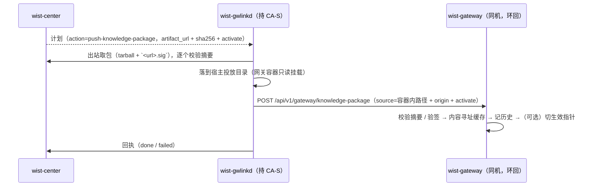

# 知识库包下发：中心管理 + 推送到网关

> **状态**：**已实现**（2026-10-18）。
> **关联**：
> [`center-content-delivery.md`](./center-content-delivery.md)（取包下沉到 gwlinkd 的分层）、
> [`agent-package-push-to-gateways.md`](./agent-package-push-to-gateways.md)（同一条通道的第一个落地）、
> [`../../center/collection-family-capability-contract.md`](../center/collection-family-capability-contract.md)（采集面 / 采集能力契约）、
> 网关侧 `wist-gateway/src/api/knowledge_ops.rs`（录入 / 激活内核）。

## 1. 缺什么

在此之前，知识库包只能在**单台网关**的管理面上人工录入（贴 URL / 本机路径 + 摘要），
再由人点激活。中心（`wist-center`）与中心前端（`wist-center-web`）**既没有知识库的托管，
也没有下发通道** —— 一个机队的知识版本只能逐台手工维持，且没有「这一版发到过哪些网关」的记录。

## 2. 设计取舍

### 2.1 管理：复用「发布记录」，不新建知识库子系统

知识库包是一个**单制品 tar.gz**（无平台概念），与 `wist-gateway-stack` 同形。中心已有的
发布记录通道（`POST /api/v1/admin/releases/:component`）已经具备本特性需要的全部能力：

| 需要 | 已有能力 |
|---|---|
| 托管版本 / 摘要 | 录入时读来源字节、核对期望 sha256、落 `ReleaseRecord` |
| 镜像（不依赖外网） | 制品复制到中心 `artifact_store`，派发地址由中心派生 |
| 历史 / 下架 | `GET /api/v1/admin/releases/:component`、`status = expired` |
| 版本自报 | 从包名 / 包内目录名解析（`wist-knowledge-0.3.0` → `0.3.0`） |

所以中心侧**只把组件名定为 `wist-knowledge`**，不新增存储 / 端点 / 迁移。
center-web 也复用「安装包管理 / 录入」页，只加一个组件目标。

> 为什么不建独立的「知识库表」：两套记录会漂移（同一版本两份摘要、两种下架语义），
> 而知识库并不需要发布记录之外的状态。

### 2.2 下发：复用灰度计划，新增一个动作

下发复用通用灰度计划（`Control.Rollout`），与 Agent 包下发同一套批准 / 推进 / 逐台进度：

```
action = push-knowledge-package
spec   = {"targets":[{"component":"wist-knowledge","target_version":"0.3.0"}],"activate":true}
```

- `activate`：录入后是否**立即激活**。缺省 `false` —— 知识库**录入 ≠ 生效**（设计 I2），
  批量铺机队时可以先只录入、验证后再由网关侧切指针。
- 其余字段（`phase_count` / `deadline_at` / `timeout_seconds` / `batch_size`）与 ①/② 完全一致。

中心在网关取计划时（`GET /api/v1/gateway/upgrade-plan`）从**已发布的 release 记录**派生
`artifact_url` 与 `artifact_sha256`（知识库是单制品，不带 `artifacts` 多平台清单），
并把 `activate` 一并下发。

### 2.3 取包与落地：与 Agent 包同一条通道

严格遵循 [`center-content-delivery.md`](./center-content-delivery.md)：



- **gwlinkd 取包**：它持中心信任（CA-S / 客户端证书），网关不持；
- **签名旁文件**：发布侧 `wist-knowledge` 的包带 `<tarball>.sig`（Ed25519，签的是 sha256 十六进制文本）。
  配了验签公钥的网关会按 `<本地包>.sig` 验签，所以 gwlinkd **把 `.sig` 一起落到投放目录**；
  中心发布时也会把 `<来源>.sig` 镜像到制品存储，使 `<镜像地址>.sig` 可取。
  取不到 `.sig` 只告警不阻断（未配公钥的网关本来就只校验摘要）。
- **网关只做托管**：与 admin 录入**同内核**（`record_package` + `activate_loaded`），
  区别只有鉴权口径（环回）与载荷来源（中心推送）。

### 2.4 协议形状

`POST /api/v1/gateway/knowledge-package`（loopback-only）：

```json
{
  "source": "/packages/wist-knowledge-0.3.0.tar.gz",
  "sha256": "780d6375…",
  "origin": "https://center.example/api/v1/releases/artifact/wist-knowledge/0.3.0/wist-knowledge-0.3.0.tar.gz",
  "activate": true,
  "requested_by": "wist-gwlinkd"
}
```

- `source` 是网关**能取**的路径（容器内），`origin` 只作 provenance（网关不用它取包）；
- 非环回请求一律 403（`knowledge_package_loopback_only`）；
- 返回 `{package_id, version, active}`。

## 3. 失败可见性

| 失败点 | 表现 |
|---|---|
| 中心没发布该版本 | 计划里 `artifact_url` 为空 → gwlinkd 报「中心未派生制品地址」，条目 `failed` |
| 取包 / 摘要不符 | gwlinkd 报错（含期望 / 实得摘要），不落盘、不交付 |
| 签名不符 | 网关 422（`signature_invalid`），条目 `failed`，原始包不进入托管 |
| 词典非法 / 删面 | 网关 422 / 409（同 admin 录入与激活的判定） |
| 已录入同一摘要 | 幂等：直接返回同一 `package_id`；`activate=true` 时仍会切指针 |

## 4. 升级顺序（硬约束）

```
wist-gateway（新增环回端点） → wist-gwlinkd（新动作 + 取包） → wist-center → wist-center-web
```

- 旧网关没有 `/knowledge-package`：gwlinkd 交付 404，计划条目 `failed`（不会误装）；
- **旧 gwlinkd 不认识 `push-knowledge-package`**：它会走 `upgrade` 分支，把知识库包当网关包去跑 gops。
  因此 **gwlinkd 必须先升**，且本版 gwlinkd 起，未知动作一律**跳过并留痕**
  （`event=UnknownPlanActionSkipped`），不再回落 `upgrade`；
- 中心在所有人就位后再创建计划（计划可以慢慢批准，但不要提前派发）。

## 5. 边界

- **standalone 网关**（无中心）仍用管理面人工录入 —— 本特性不改它；
- 中心不下发「回滚」这个动作：回滚是网关侧的既有能力（把指针指回上一版），
  需要批量回滚时选择目标版本重新下发即可（同一通道）；
- 中心不感知网关的「世代号」与锁在旧版的工作：那属于网关本地读模型。
