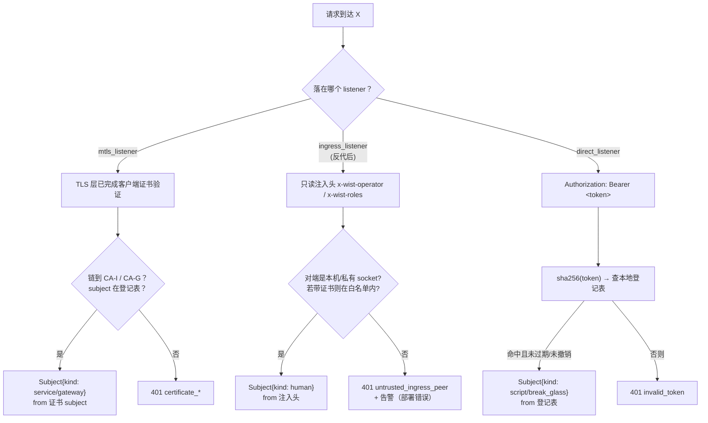
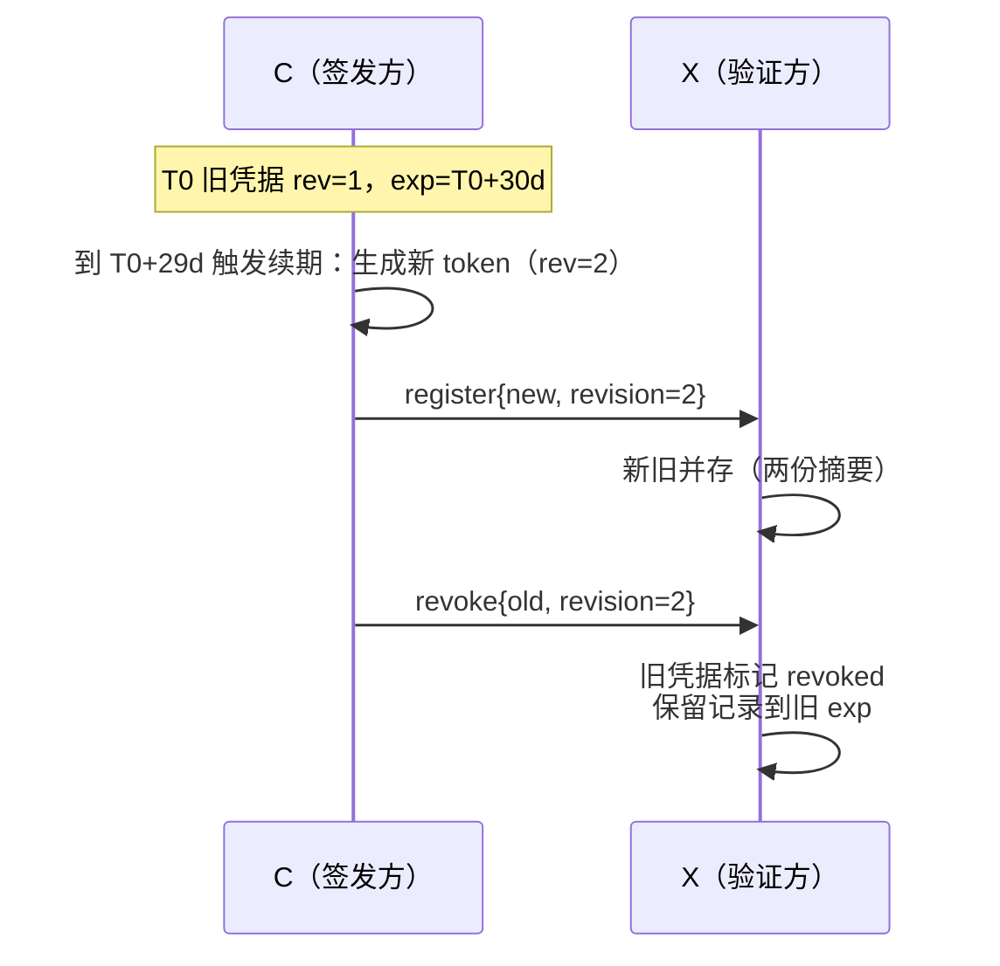
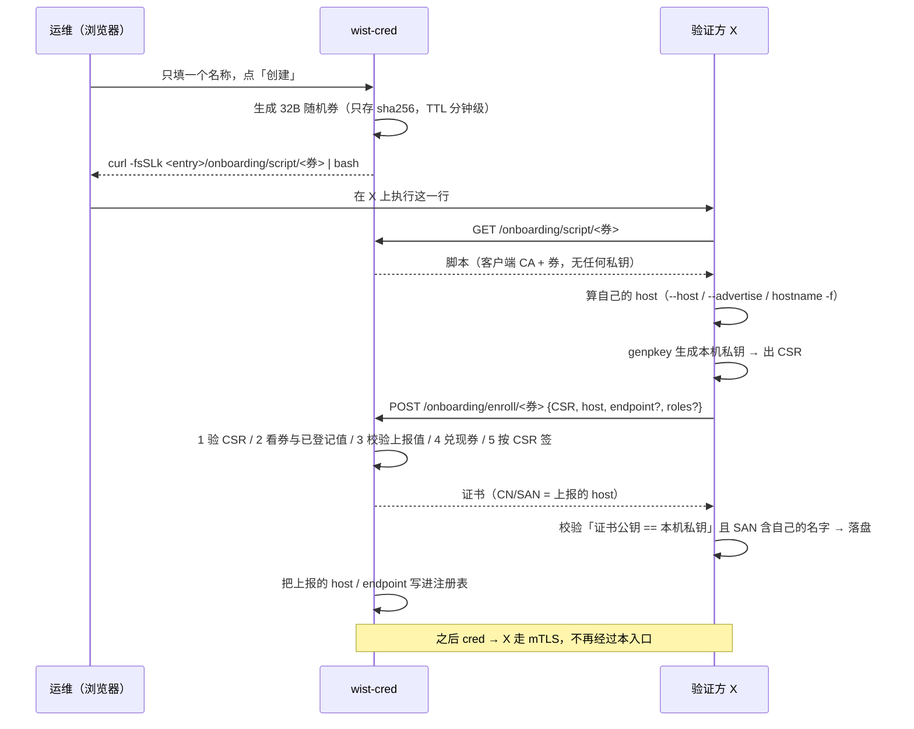

# 访问凭据的签发、分发与验证（`wist-auth` 接入侧）

> 状态：**接口定稿草案**（2026-11-02，替换 2026-11-01 的 JWT/JWKS 版）。
> 上游：[`center-open-api.md`](../center/center-open-api.md) §3.2 / §8.1（三类调用方的身份锚点）、
> [`center/evidence-service.md`](../center/evidence-service.md)（服务身份与 scope）。
>
> 本文只定**接入侧**：谁拿什么凭据、X 怎么在本地验证、token 摘要怎么到 X。
> **签发（C）是独立服务 `wist-cred`，置计算区；center 只是 X（见 §1、D15）。**
> 本期不做 SSO / IdP / 用户目录（`wist-cred` 自带页面 + **页面自带口令登录**，人机面的验证在服务里；将来接用户中心 / 钉钉见 D17）。
> 与 JWT/JWKS 的**成本 / 安全性逐项对比**见 §14；接 SSO 的做法见附录 A。

---

## 1. 目的与边界

五个服务要认同一套身份，而且**跨两个区**：

| 服务 | 区 | 角色 |
|---|---|---|
| `wist-cred`（**凭据服务**，新增） | 计算区 | **签发方 C**：自带管理页面，为**程序**签发脚本 / break-glass token；只存摘要，不验任何业务请求 |
| `wist-center` | 接入区 | **验证方 X**：管理面（反代注入）、内部 / 网关面（证书）、脚本直连面（token） |
| `wist-ingest-ctrl` | 计算区 | 验证方 X |
| `wist-console` | 接入区 | 验证方 X + 人访问 center 的 BFF |
| `wist-evidence`（未建） | 计算区 | 验证方 X（站点 token） |

**签发能力不放在 center。** center 在互联网区、是攻击面最大的那个服务；能造身份的组件不该长在那里。
center 只持 token 的**摘要**（不可反推、不能签新的），被攻破也发不出凭据（D15）。

本文回答两个问题，顺序不能颠倒：

1. **一个需要登录认证的系统 X，使用方要输入什么，X 怎么验？**（§3，先看这节）
2. **凭据/摘要怎么自动到 X？X 和 C 的信任怎么建立？**（§6）

明确不做：**introspection**（每请求回调签发方）——那是把认证做成远程调用，与 D6 冲突。

---

## 2. 结论

| 编号 | 决定 | 为什么 |
|---|---|---|
| **D1** | **三种凭据来源，不混用**：机器 = CA-I 证书；人 = 反代注入；脚本 = C 签发的 token | 三类主体的失效方式不同（证书到期 / 会话失效 / 可撤销），混成一种就要在一处塞三种语义 |
| **D2** | **人不在浏览器里持凭据** | 浏览器存 token = 任何人打开 devtools 都能读，且没法归因到具体人。center-web 现在的 admin token 存 sessionStorage，就是要修的问题 |
| **D3** | **机器身份不用 token**：服务互调、网关/agent 全走 CA-I / CA-G 客户端证书 | 机器没有"登录"，只有"部署时放置"；证书自动过期、可吊销、握手即验 |
| **D4** | **token 只给两种场景**：脚本自动化、break-glass | token 是唯一需要"分发摘要"的东西，能用证书的地方就别引入分发链路 |
| **D5** | **C 只存 token 的哈希**（`sha256`），明文只在签发那一刻交给调用方一次 | 库被读走 ≠ 凭据泄露；也避免"我们能替你找回 token"这种谎 |
| **D6** | **摘要用推，不用拉**：签发 / 吊销时 C 各推一次给 X | 接入区的 X 出站到计算区常被禁（反方向通）；且拉模式让"新凭据何时可用"变成不确定 |
| **D7** | **先登记、后交付**：X 的 `register` 成功返回后，C 才把明文交给调用方 | 否则会出现"token 已经在手、X 还不认"的黑洞窗口，排障时无法自证 |
| **D8** | **X 的信任来自部署期预置 + 通道身份**，不是首次连接 | 首次连接即信任（TOFU）在接入区就是"谁先到谁当签发方" |
| **D9** | **X 裁剪 C 的提议**：角色取交集、TTL 取 min、资源范围取交集 | C 的库被攻破时，损失被 X 的本地上限止住；权限上限不该由签发方单方面决定 |
| **D10** | **改范围 = 换新凭据**，不原地改 | 原地改会让"同一个 token 前后权限不同"，审计无法解释 |
| **D11** | **续期 = 发新撤旧，带重叠窗口** | 避免在飞的请求因为换凭据而 401 |
| **D12** | **撤销靠推送 + TTL 兜底**；撤销记录留到 `expires_at` | 推送会丢；但把窗口收敛到 TTL 就把"永久后门"变成"最多 N 小时" |
| **D13** | **break-glass 使用即告警**，审计标 `source = token` 且单独打点 | 应急通道长期开着就等于没有认证 |
| **D14** | **机器身份不上 JWT/JWKS**；人的 SSO 若引入 Keycloak，JWT+JWKS 只作为人侧的桥（§16.3(a)），不改变机器的 T 路径 | 没有第三方 IdP、没有跨组织验签需求；引入它是纯负担（见 §14）。将来接 Keycloak 时按 §16 的单点例外处理 |
| **D15** | **签发独立成 `wist-cred`，放计算区**；center 只是 X | 「能签出任意身份」是平台里权限最高的一项能力，不能长在互联网区最暴露的服务上；它也不属于任何业务路径 |
| **D16** | **凭据由人（或审批系统）在凭据服务的管理页面上为程序创建**，程序不得自助申请 | 自助申请 = 审批、归因、配额全部失效；也避免明文多经一道手；同 GitHub PAT——建在你手里，用在程序里 |
| **D17** | **凭据服务自带管理页面**（`wist-cred-web`），且**页面自带登录**：页面输口令 → `Authorization: Bearer` → **`wist-cred` 自己验**（`mode = "token"`，配置里只存 `sha256`），**永不建本机用户表**；`mode = "ingress"` 只留给开发态 | 好的产品体验不可能由反代提供（浏览器原生弹窗、无登录框/登出/错误提示）。将来接用户中心 / 钉钉时，只把口令校验换成 OIDC 回调，页面与授权逻辑不动 |

一句话：

> **人的身份由产品自己验（页面输口令），机器身份由证书证明，脚本身份由 C 签发、摘要推到 X、X 本地比对。**

> 演进方向（**租约 + 短期凭据 + 标准词汇对齐**）见 §16；**当前不开发**。

---

## 3. 先回答最小问题：X 要验什么

### 3.1 三类使用方，输入的东西不一样

| 使用方 | 它"输入"什么 | 谁产生 | 有效期 |
|---|---|---|---|
| 人（浏览器打开 center-web / console） | 用户名 + 口令（或 SSO） | 人自己 | 会话 |
| 机器（console / ingest / gateway 调 center） | 客户端证书（文件在磁盘上） | 部署 / 登记流程放置 | 证书有效期 |
| 脚本（CI、运维脚本、应急） | 一串 token | C 签发 | C 提议、X 裁剪 |

**关键点：人根本不"输入 token"。** 人在浏览器里输入的是口令，浏览器拿到的是 HttpOnly 会话 cookie；
token 这一层只存在于"反代 / BFF / X"之间，浏览器看不见也拿不到。这是 D2。

> 例外：网关首跑的**一次性接入券**（`link_`，15 分钟、只用一次）是**准入**凭据，
> 不是运行期身份，用完即换证书；见 [`gateway-secure-registration.md`](../center/gateway-secure-registration.md)。

### 3.2 X 怎么验：只有三条路，按 listener 分，不按头分



一条纪律：**凭据类型由 listener 决定，不由请求内容决定。** 反代注入面**不会**读 `Authorization`；
证书面**不会**读注入头。否则攻击者可以用一种凭据绕到另一条判定路径上（降级攻击）。
其余（头剥离、peer 校验）见 §3.4 的 S1–S4。

### 3.3 一张表收口：谁在什么面、带什么、X 看到什么

| 面 | 校验方式 | X 得到的 `Subject` | 失败码 |
|---|---|---|---|
| 服务面 `/api/v1/internal/**` | mTLS，链到 CA-I，`subject` 在服务登记表 | `{ kind: service, id: "wist-atlas", roles: ["write:investigation"] }` | `service_certificate_required` / `service_not_registered` |
| 网关面 `/api/v1/gateway/**` | mTLS，链到 CA-G，证书 vs 报文 `gateway_id` 比对 | `{ kind: gateway, id: "gw-001" }` | `certificate_mismatch` / `certificate_not_registered` |
| 管理面 `/api/v1/admin/**`（反代后） | 注入头（+ 可选 CA-I 证明对端是 console） | `{ kind: human, id: "alice", roles: ["operator"] }` | `untrusted_ingress_peer` / `missing_operator` |
| 直连面（脚本） | `Authorization: Bearer` → 摘要查表 | `{ kind: script, id: "svc-atlas-job", roles: [...] }` | `invalid_token` / `token_expired` |

> 服务来源时 `roles` 里装的是 scope 串；角色 / scope → 权限的映射在各服务本地（D9）。

### 3.4 这套模型的硬约束（S1–S7，必须可验收）

T 的安全性不是密码学给的，是「配置正确 + 拓扑正确」给的。这一条必须**在代码与测试里兑现**，
否则它会以**静默放行**的方式失守——比 JWT 失败得更难发现（详见 §14.3）。

| # | 约束 | 为什么 | 验收 |
|---|---|---|---|
| **S1** | `mode = "ingress"` 且 listener 绑非回环 / 非私有地址 → **拒绝启动** | 同一份代码绑到 `0.0.0.0` 就是后门 | 配错**起不来**（不是告警） |
| **S2** | 反代显式剥离：`proxy_set_header x-wist-operator "";` | 外部同名头不剥 = 内网任意 pod 可冒充 | 集成测试：外部带同名头 → X 拿到的是反代写的值 |
| **S3** | 非白名单 peer 到达注入面 → **拒绝 + 告警** | 拓扑漂移的唯一可观测信号 | T8 |
| **S4** | 注入头在、但 peer 不对 → 告警而不只是拒绝 | “头在不在”不等于“可信” | 日志断言 |
| **S5** | 配置只读挂载 + 文件 hash 变更打点 | 摘要表 / 白名单被改要能被发现 | 改配置触发告警 |
| **S6** | 定期对账：实际 peer 集合 ⊆ 白名单，差集告警 | 长期运行的漂移 | 周报 / 指标 |
| **S7** | 面不混身份的守门测试常驻（T18 / T19） | 重构最容易悄悄破坏 | 改动即红 |

---

## 4. 类型与接口

### 4.1 `Subject`（唯一出口）

```rust
#[derive(Debug, Clone)]
pub struct Subject {
    /// 稳定标识：服务名 / gateway_id / 用户名 / 脚本凭据 id。
    pub id: String,
    pub kind: SubjectKind,
    /// 原样运输，映射在服务本地。证书来源时由服务登记表给出。
    pub roles: Vec<String>,
    /// 能对谁（agent / gateway / tenant 的前缀或 id）。空集合 = 无权限。
    pub resources: ResourceScope,
    /// 这张凭据只对哪个服务有效。X 必须比对，防跨服务重放。
    pub audience: String,
    /// Unix 秒。证书来源为证书到期时间；注入来源为会话到期时间。
    pub expires_at: i64,
    pub source: AuthSource,
}

#[derive(Debug, Clone, Copy, PartialEq, Eq)]
pub enum SubjectKind { Service, Gateway, Human, Script }

#[derive(Debug, Clone, Copy, PartialEq, Eq)]
pub enum AuthSource { Certificate, Ingress, Token }
```

服务侧只依赖 `Subject`。将来换 SSO，反代那一侧改了，handler 一行不用动（附录 A）。

### 4.2 验证入口

```rust
/// 每种 listener 只构造一种 verifier；不要做成"挨个试"。
pub trait CredentialVerifier: Send + Sync {
    fn source(&self) -> AuthSource;
    async fn verify(&self, req: &RequestContext) -> Result<Subject, AuthError>;
}

pub struct CertificateVerifier { /* 服务登记表 + 允许的 CA */ }
pub struct IngressVerifier     { /* 允许的 peer 集合 + 头名 */ }
pub struct TokenVerifier       { /* 摘要表 + 角色上限 */ }
```

`RequestContext` 带：实际 peer 地址、TLS 客户端证书（若有）、头、路径。
**把 peer 地址传进来是刻意的** —— 注入面的安全性完全依赖它。

### 4.3 错误与 HTTP 投影

```rust
pub enum AuthError {
    MissingCredential,       // 401 missing_credential
    InvalidToken,            // 401 invalid_token（不细分，防探测）
    TokenExpired,            // 401 token_expired
    TokenRevoked,            // 401 token_revoked
    CertificateRequired,     // 401 certificate_required
    CertificateInvalid,      // 401 certificate_invalid
    UntrustedIngressPeer,    // 401 untrusted_ingress_peer（+ 告警）
    MissingOperator,        // 401 missing_operator
    ScopeDenied,             // 403 scope_denied
    StoreUnavailable,        // 503 credential_store_unavailable
}
```

两条纪律：

- 对外**不区分**"摘要不匹配 / 已过期 / 已撤销"以外的细节；`invalid_token` 兜底，细节只进日志。
- `StoreUnavailable` 用 **503** 而不是 401：表示"我现在验不了"，不是"你的凭据错了"。

---

## 5. 三种来源怎么验（展开）

### 5.1 证书（机器）

1. TLS 层完成链验证（`client_ca` 指向 CA-I 或 CA-G，二者不共用）。
2. 取证书 subject / SAN，得到 `service` 或 `gateway_id`。
3. 查**本地登记表**（服务名 → scopes / enabled / revoked_at）。吊销是登记表拒绝，不等证书过期。
4. 输出 `Subject { kind: Service, source: Certificate }`。

证书轮换 = 签发新证书 + 更新登记表 + 重启 / 热加载；重叠窗口由"新旧证书同时在登记表"提供。

### 5.2 反代注入（人）

1. 反代负责认证（口令 / SSO / 会话 cookie），得到 `username`。
2. 反代剥离外部同名头，写入 `x-wist-operator: alice`、`x-wist-roles: operator`、
   `x-wist-session-exp: <unix>`。
3. X 在**注入面**上读取，校验 peer 在白名单内（unix socket / 本机回环 / 指定网卡）。
4. 输出 `Subject { kind: Human, id: "alice", roles: [...], source: Ingress }`。

会话 cookie 是 `HttpOnly` + `SameSite`；反代是自己签的还是接 IdP 的，X 不关心（隔离点，见附录 A）。

### 5.3 token（脚本 / break-glass）

1. 从 `Authorization: Bearer` 取值。
2. `sha256_hex(token)` → 查本地登记表（内存 + 落盘），**常数时间比较**。
3. 校验 `expires_at` / `revoked_at` / `audience`。
4. 输出 `Subject { kind: Script, id, roles, resources, source: Token }`。

X 的登记表落盘（`0640`），冷启动即可验，不依赖 C 在线。表大小是"脚本条数"不是用户数；
线性扫够用，但要常数时间比较防计时侧信道。

---

## 6. 分发：token 摘要怎么到 X

角色：**C = `wist-cred`（计算区，签发方）**，**X = center / ingest-ctrl / console / evidence（验证方）**。
C 只出现在这一节——它不参与任何业务请求的验证。

**这就是 GitHub PAT 模型**：在 **C 自带的页面上**为**某个程序**创建一条凭据（选 roles / 有效期 / 受众），
明文只展示一次，你把它交给那个程序（放进它的 secret 配置），程序当 Bearer 用，到期或撤销即失效。
注意「为程序创建」仍然是一个**人的动作**——程序不会调这个端点自批自用（同 GitHub：PAT 是你在设置页建的）。

与 GitHub 的两处必要差异：

- **验证在 X，不在 C**：GitHub 撤销立即生效，因为签发方就是验证方；我们的 X 是分布式的，
  所以要把摘要推过去（D6），并以 TTL 兜底（D12）。这是 PAT 模型在本仓唯一的额外机制。
- **要绑 `audience`**：GitHub 一条 PAT 能打全部 API；我们不能——center 的 `command:dispatch`
  与 evidence 的 `evidence:read` 权限差异太大，一条凭据跨服务通用会直接废掉最小权限。

### 6.0 全链路（先看这张）

```mermaid
sequenceDiagram
  autonumber
  participant H as 运维
  participant C as 签发方 C（wist-cred，计算区）
  participant S as 脚本 / CI
  participant X as 验证方 X（center / ingest）
  participant D as X 本地登记表<br/>（落盘 0640）

  Note over C,X: ⓪ 部署期（一次性，人工）：X 预置 CA-I 公钥 + 允许的签发方白名单
  Note over H,C: ① 创建：在它自己的页面上
  H->>C: 为程序创建凭据（operator 由内网反代注入）
  C->>C: 生成 token，存 sha256(token) + 元数据
  C->>X: register{credential_id, digest, subject, roles[], resources{}, audience, expires_at, issued_at, revision}<br/>（mTLS，客户端证书 = C）
  X->>X: 验链 + 签发方白名单 → 裁剪角色/TTL/范围
  X->>D: 落盘（先落盘，后生效）
  X-->>C: 200 { accepted, effective{roles, expires_at, resources} }
  C->>C: 记录 revision + X 的实际裁剪结果
  C-->>H: 200 { token }（明文只此一次）

  Note over S,X: ② 使用：脚本带 Bearer，X 本地比对
  S->>X: 请求 + Authorization: Bearer &lt;token&gt;
  X->>D: sha256 → 查表 → 校验 exp/revoked/audience
  X-->>S: 200 / 401

  Note over C,X: ③ 撤销 / 续期：再推一次
  C->>X: revoke{credential_id, revoked_at, revision}
  X->>D: 标记 revoked（保留到 expires_at）
```

比例感：**① 每次签发/撤销一次推送；② 每个请求一次纯本地比对。**

> 明文的**第一手就是运维自己**，中间不过任何其他服务（不落库、不写日志）；
> 创建这一步与 GitHub 在设置页点“Generate new token”完全对应。

### 6.1 `register`（登记）

```json
{
  "credential_id": "cred_01J9ZB7",
  "digest": "sha256:9f86d0…",
  "subject": { "id": "svc-atlas-job", "kind": "script" },
  "roles": ["investigation:run"],
  "resources": { "agents": ["agent-7f3", "agent-9a1"] },
  "audience": "wist-center",
  "expires_at": 1767225600,
  "issued_at": 1767222000,
  "revision": 1
}
```

X 的处理顺序（**先落盘、后生效**）：

```
1) 通道：客户端证书链到 CA-I，且 subject ∈ 允许签发方白名单   → 否则 403 not_trusted_issuer
2) revision 必须 ≥ 本地该 credential_id 的 revision            → 否则 409 credential_revision_stale
3) audience 必须等于 X 自己的名字                              → 否则 400 audience_mismatch
4) 裁剪：roles ∩ X 认识的角色；expires_at = min(C 提议, X 的角色上限)
        resources ∩ X 自己可见的资源集合
5) 落盘 → 原子替换内存
6) 审计一条：by=credential_id, issuer=C, revision, effective{...}, at
7) 返回 accepted + effective（把 3–4 步的裁剪结果**回告 C**）
```

> 第 7 步的 `effective` 回告很重要：C 必须知道自己"实际签出了什么"，否则审计里记录的权限
> 和 X 实际认的权限会不一致。

### 6.2 `revoke`（撤销）

```json
{ "credential_id": "cred_01J9ZB7", "revoked_at": 1767223000, "revision": 2 }
```

- `revision` 必须**严格大于**本地记录，否则 `409 credential_revision_stale`；
- 撤销记录**保留到 `expires_at`**，防止一个迟到的 `register`（低 revision）把凭据复活；
- 幂等：同一 `revoke` 重放返回 200，不改状态。

### 6.3 顺序保证：为什么必须"先登记、后交付"

```
C: 生成 token → 存摘要 → 推 register → 等 X 的 200 → 才返回明文给调用方
                                   └─ 失败：重试（指数退避）；超过预算 → 500 credential_delivery_pending
```

- 反过来（先给明文再推）会出现"调用方已经能用、X 还 401"的窗口，排障时两边各说各话（D7）。
- 推送失败**不回滚**已生成的凭据，而是标记 `pending`/`revoked`；调用方拿到的是确定的失败，
  不会拿到一张"可能生效"的 token。

### 6.4 C 与 X 的信任怎么建立（四层）

| 层 | 内容 | 失效后的后果 | 谁来配 |
|---|---|---|---|
| **L1 部署期预置** | X 的配置里写死：CA-I 公钥、允许的签发方 `C` 的证书 subject | 这层不做，后面全是空话 | 部署（配置/密钥文件） |
| **L2 通道身份** | 每次推送带客户端证书，X 验链 + 校验 subject 白名单 | 内网任意 pod 都能推"假凭据" | 证书登记 |
| **L3 本地裁剪** | X 不照单全收：角色取 X 自己认识的、TTL 取 min、资源取交集 | 库被攻破 = 权限无限 | X 的静态配置 |
| **L4 审计** | 每次推送记一条（issuer / revision / effective / at） | 出了事无法回溯是哪次推送改的 | 应用 |

### 6.5 传输形态

| 形态 | 适用 | 备注 |
|---|---|---|
| `POST /api/v1/internal/credentials`（push） | 默认 | 与 center 现有的内部服务面同 listener（CA-I） |
| 落盘文件同步（部署/离线） | 隔离网、冷启动种子 | 与 push 同格式，`revision` 仍然生效 |
| ~~pull（X 主动拉）~~ | 不用 | 出站常受限；且"何时生效"不确定（D6） |

推送端点只对 CA-I 开放，端点本身不需要额外的共享密钥 —— 通道已经证明了"我是 C"。

---

## 7. 有效期与作用范围

### 7.1 三个字段各自管什么

| 字段 | 管什么 | 谁提议 | 谁裁剪 | 举例 |
|---|---|---|---|---|
| `roles` | **能做什么**（动作） | C | X 取交集（X 不认识的角色直接丢） | `["investigation:run"]` |
| `resources` | **能对谁**（对象） | C | X 取交集（X 看不见的资源直接丢） | `{"agents": ["agent-7f3"]}` |
| `audience` | **只给哪个服务**（防跨服务重放） | C | X 必须等于自己，否则拒 | `"wist-center"` |

规则：

- **`resources` 为空集合 = 无权限**，不是"全部"。空集合写成 `[]`，不允许"省略即全量"。
- **角色名是 X 的词汇表**，不是 C 的。C 提议一个 X 不认识的 `security:contain`，X 丢掉并回告。
- **改范围 = 换新凭据**（D10）。不允许 `PATCH /credentials/{id}` 改 roles。

### 7.2 有效期

```
effective_expires_at = min(
    C 提议的 expires_at,
    现在 + X 对该角色的 TTL 上限,
    凭据类型上限            # 脚本 30d / break-glass 90d（示例）
)
```

| 类型 | 建议上限 | 理由 |
|---|---|---|
| 脚本 token | 30 天 | 足够跑完一批任务，又逼着周期性换 |
| break-glass | 90 天 | 应急通道，长但**使用即告警**（D13） |

### 7.3 续期：发新撤旧 + 重叠窗口



- **先 register 新的，再 revoke 旧的**，中间至少留一个 `overlap_seconds`（默认 300s，≥ 最长请求耗时）；
- 反过来会出现"在飞请求 401"；
- 重叠期内两份摘要都有效，审计按 `credential_id` 能分清是哪一张。

### 7.4 撤销的时效

| 路径 | 时效 | 覆盖什么 |
|---|---|---|
| `revoke` 推送 | 秒级（重试至成功） | 常规吊销、续期换旧 |
| TTL 自然到期 | 到期即失效，无需推送 | 推送丢失的最后兜底（D12） |
| break-glass 强制轮换 | 人工 | 怀疑泄露、人走了没交接 |

> 不做"全局撤销清单广播"：撤销是**按 credential_id 点对点**的，X 只需要关心自己收过的那些。
> 这样 X 的登记表大小 = 它实际见过的凭据数，不会随平台规模膨胀。

### 7.5 投递失败与重新投递

`create` 的语义是**先登记、后交付**：摘要没被 X 接受，就把明文丢掉（`502 credential_delivery_pending`）。
这样不会出现"页面拿到了一把 X 永远验不过的钥匙"，代价是**凭据已经在 C 落库**。

补回来的唯一入口是 `POST /api/v1/credentials/{id}/redeliver`：

| 属性 | 取值 |
|---|---|
| 推给谁 | 只推 `audience` 那**一个**系统（不是广播；广播只在撤销时用） |
| 改什么 | **什么都不改**（摘要 / revision / 有效期 / 角色原样） |
| 已撤销的 | 拒（`400 credential_revoked`）—— 墓碑由撤销的广播负责 |
| 受众没有地址 | 拒（`409 no_delivery_target`），手工分发没有"重试"这回事 |
| 本部署没有 `[push]` | 拒（`409 push_disabled`） |
| X 已经有同一条 | 视为成功（X 对不前进的 `revision` 回 409，目标状态已经达成） |

同上一条口径，**签发**也会在落库之前拒：受众有收数地址、而本部署没配 `[push]` 时
直接 `409 push_disabled`，不存一条“看起来发了”的记录。（没有地址的系统 = 手工分发，照常签发。）

页面上只有**配了收数地址**的认证系统才出现「重推」按钮；`credential_delivery_pending`
返回时列表会立即刷新，所以那条“存了但没交付”的记录不会消失。

> 它不是续期：续期是「register 新的 → 重叠期 → revoke 旧的」（§7.3）。

---

## 8. 各服务的接入点

| 服务 | 区 | 角色 | 面 | 来源 |
|---|---|---|---|---|
| `wist-cred`（新增） | 计算区 | **C** | `/api/v1/credentials`（**人机面**，页面 = `wist-cred-web`） | token（页面口令，`Authorization: Bearer`，cred 自验；dev 可用 ingress） |
| | | | `/api/v1/credentials`（可选服务面，默认关） | certificate（CA-I），留给审批系统 |
| `wist-center` | 接入区 | X | `/api/v1/admin/**` | token（wist-cred 签发的凭据，`admin` 角色）；break-glass 口令兜底 |
| | | | `/api/v1/internal/credentials`（mTLS listener，3103） | certificate（CA-I） |
| | | | `/api/v1/gateway/**` | certificate（CA-G）；运行期 bearer 已删，见 [`gateway-secure-registration.md`](../center/gateway-secure-registration.md) |
| `wist-ingest-ctrl` | 计算区 | X | `[ctrl.auth]` 对应的 listener | certificate + token |
| `wist-console` | 接入区 | X + 反代下游 | 自己的入站 | ingress（`x-console-operator`，现有做法） |
| `wist-center-web` | 接入区 | — | 无后端 | 不持凭据，全部走反代（**本次要修的现状**） |
| `wist-evidence`（未建） | 计算区 | X | 读端点 | certificate（CA-I）+ 站点 token |

---

## 9. 配置骨架

### 9.1 `wist-cred`（C 侧，计算区）

```toml
[server]
listen_addr = "10.0.20.11:8443"        # 私网地址（S1 会拒绝 0.0.0.0）
# 人机面（页面）的验证由**本服务自己做**：页面输口令 → Authorization: Bearer <口令>。
# 配置里只写占位符，真值在密钥文件（`.wist/sec-value.yml` 的 cred_web_password），
# 加载时展成 sha256、明文当场丢掉（与 gateway / center 的管理面同一个形状）。
mode = "token"
admin_password = "${SEC_CRED_WEB_PASSWORD}"
# 第二道锁（可选）：只允许反代这个地址进人机面。
trusted_peers = ["10.0.20.10/32", "127.0.0.1/32"]

# 开发态 / 已经有入口认证的场合：人身份由内网反代注入（浏览器原生弹窗，不在产品里）。
# mode = "ingress"
# ingress_header = "x-wist-operator"

# 阶段二（**现在不做**）：接用户中心 / 钉钉 OIDC。页面与授权逻辑不变，只换“口令从哪来”。
# mode = "oidc"
# issuer = "https://sso.internal"
# client_id = "wist-cred"

# 可选：留给审批系统 / 自动化。默认不开（D16：程序不自助申请）
# [service_face]
# listen_addr = "127.0.0.1:8444"
# client_ca = "${SEC_CA_I_BUNDLE}"
# allowed_callers = []

[storage]
# 自己的小表。**不复用 center 的 PG** —— 那个库在接入区，跨区依赖会把两边一起拖下水
path = "state/credentials.db"        # 0600

[issue]
digest = "sha256"
max_ttl_seconds = 2592000             # 30d（脚本）
break_glass_max_ttl_seconds = 7776000 # 90d
overlap_seconds = 300

# 推送目标（每个 X 一条；失败重试 + 超预算则签发失败）
[[issue.targets]]
name = "wist-center"
endpoint = "https://center:3103/api/v1/internal/credentials"
audience = "wist-center"
client_cert = "/etc/wist/cred/push.pem"
client_key  = "/etc/wist/cred/push.key"
# 两个方向不是同一个 CA：client_* 是 CA-I（证明“我是 cred”），
# ca 是 CA-S 信任锚（校 X 的服务器证书）——一把 CA 只干一件事。
ca = "${SEC_CA_S_BUNDLE}"

[[issue.targets]]
name = "wist-ingest"
endpoint = "https://ingest.internal/api/v1/internal/credentials"
audience = "wist-ingest"
```

`[[issue.targets]]` 的 `name` 要与下面的 onboarding peer 同名，否则启动时会告警
（说明清单与材料对不上）。

### 9.2 `wist-center`（X 侧，接入区）

已实现（`wist-center` 0.28+，配置段 `[credentials]`，代码 `src/credentials.rs` +
`src/api/admin_auth.rs`）：

```toml
[server]
admin_addr = "0.0.0.0:3102"                # 管理面：内网 listener（浏览器经 web 反代）
admin_token = "${SEC_CENTER_ADMIN_TOKEN}"  # break-glass；cred 正常时不该被用到

[credentials]
enabled = true
listen_addr = "0.0.0.0:3103"        # 独立的内网 mTLS listener（不是管理面端口）
store_path = "state/credentials.json" # 只存 sha256；不进 PG
audience = "wist-center"              # 必须等于 cred 侧的认证系统名
allowed_issuers = ["wist-cred"]       # 客户端证书（CA-I）的身份
known_roles = ["admin", "read"]
admin_roles = ["admin"]               # 空 = 不按角色卡；read 能认证但进不了管理面
server_cert_path = "/wist-center/ca/cred/server.crt"   # 由 cred 的 CA-S 签
server_key_path = "/wist-center/ca/cred/server.key"
client_ca_path = "/wist-center/ca/cred/client-ca.pem"   # CA-I 公钥证书
# 授权记录的 Ed25519 验签（收到时 + 从磁盘加载时各一次）
require_signature = true
issuer_public_key_path = "/wist-center/ca/cred/issuer-signing.pub"
```

**授权记录必须由签发方签名。** 登记表落盘后可被改，没有签名的话改 `roles` / 延长
`expires_at` / 清掉 `revoked_at` 就能凭空提权。签名覆盖：凭据指纹、主体、角色、资源、受众、
有效期、版本号、撤销状态；规范字节由 `wist-auth::signing` 统一（签发与验证同一份）。
验不过的记录：`register` 直接拒收，磁盘加载时直接丢弃（`rejected_on_load` 可观测）。

> 签名挡不住的是**回放**：把旧的、签名仍然有效的记录恢复回来。处置靠撤销墓碑（不删行）
> 与单调 `revision`；整目录回滚检测需要外部锚点（cred 的当前版本），不在本期。
> 验证方只拿**公钥**（随接入包 `issuer-signing.pub` 下发），私钥永远在 cred。

实现口径：

- 管理面鉴权是**两级**：先 `wist_cred_peer::Peer::verify(token)`（本地摘要表），通了再看
  `admin_roles`；没通过再回落 `admin_token_hash`（D4，命中即 `warn`）。两者都没配才保持 dev 直通。
- 凭据 listener 与网关面**分开**：不同端口、不同服务器证书（cred 只信任自己 CA-S 签的证书，
  中心自己的 `control-center.pem` 不在信任锚里）、客户端证书严格校验（CA-I）。
- `register` / `revoke` / `/healthz` 由 `wist-cred-peer` 提供；中心只负责装配与鉴权接线。

> 尚未做（后续）：反代注入面（`mode = "ingress"`）与 `trusted_peers` 仍是设计稿；当前管理面只认
> 凭据 token / break-glass token。反代层做认证不符合本平台的产品体验，不能拿 nginx 代替。

### 9.3 `wist-ingest`（X 侧，接收）

```toml
[ctrl.auth]
mode = "certificate"                 # 服务面走 CA-I
admin_token = "${SEC_INGEST_CTRL_ADMIN_TOKEN}"   # break-glass，可选
allow_anonymous = false

[ctrl.auth.certificate]
client_ca = "${SEC_CA_I_BUNDLE}"
allowed_issuers = ["wist-cred"]    # L1：只信签发服务推来的凭据
require_audience = "wist-ingest"

[ctrl.auth.credential_store]         # X 侧的 token 摘要表
enabled = true
path = "state/credentials.json"      # 0640，冷启动即可验
max_ttl_by_role = { "investigation:run" = 86400, "read" = 604800 }
known_roles = ["read", "investigation:run", "pipeline:write", "link:issue"]
```

### 9.4 `wist-console`（X + 反代下游）

```toml
```markdown
[auth]
mode = "ingress"
ingress_header = "x-console-operator"
trusted_peers = ["unix:/run/wist/console.sock", "127.0.0.1/32"]

[auth.credential_store]
enabled = true
path = "state/credentials.json"
known_roles = ["read", "operator", "admin"]
```

### 9.5 一键接入：`wist-cred-stack` 的 onboarding

mTLS 两个方向各要一份材料，而**搬 PEM 是整条链路里最容易搬错的一步**：搬错的表现是
`certificate verify failed`，看不出是哪一半错了。所以接入做成「页面上点一下，把一行命令贴到 X 上跑一次」。

这一节的口径**不是新发明的**，是把 `wist-center` ↔ `wist-gwlinkd` 的入场流程移植过来
（`api/gateway_ops.rs::register_gateway` + `infra/gateway_ca.rs` + `wist-pki`）。

#### 移植什么、不移植什么

| 点 | center ↔ gwlinkd | 本方案 | 说明 |
|---|---|---|---|
| 私钥位置 | gwlinkd **本机**生成，永不上送 | 同 | 这是整件事的核心 |
| 交什么 | CSR（只含公钥） | 同 | 用 `wist-pki::ca::validate_csr` |
| 谁签 | center 持 CA-G 私钥，运行期签 | cred 持 CA-S 私钥，运行期签 | 签发方持有 CA 私钥是惯例，不是破例 |
| 证书主体 | CA 按 `gateway_id` 填，CSR 声明忽略 | CA 按 `peer.json.host` 填 | 不能自己给自己申请别人的名字 |
| 证书形态 | `CA:FALSE` / `digitalSignature` / `EKU=clientAuth` / URI SAN | `CA:FALSE` / `digitalSignature+keyEncipherment` / `EKU=serverAuth` / DNS SAN | 方向不同：X 是服务端 |
| 时钟 | `notBefore` 回拨 300s、随机序列号 | 同（`wist-pki` 统一） | 容忍两端时钟偏差 |
| 轮换 | 当前证书证明身份 + 新 CSR | **未实现**（见 §13） | |
| 券形态 | `HMAC(secret, gw:id)` 派生 | **32 字节随机** | 派生 + 每次插新行 ⇒ 同一 hash 多行，一次性语义变脆 |
| 券有效期 | enrollment token 30 天 | 与链接同量级（分钟） | 一次性凭据不该有长窗口 |
| 第二因子 | `X-Gateway-Identity-Token`（只当 HMAC 盐，从不与期望值比对） | **不引入** | 看着像第二因子，实际只是盐 —— 不如不写 |
| 对象解析 | 先消费券、再查网关是否存在 | peer **绑在券里** | 消除「券有效但对象不存在」的枚举面 |
| 失败响应 | 多个错误码 | 统一 `enrollment_rejected` | 公开端点不该可枚举 |

#### 谁签证书、私钥在哪

- **X 在自己机器上生成密钥对**，私钥永不出本机；只把 **CSR** 交上来。
- **cred 持有 CA-S 私钥**（只读挂进容器），运行期按 CSR 签 —— 和 center 持 CA-G 同构。
- **cred 的客户端身份**由 CA-I 签（`cred-client.crt/.key`），X 只拿到 CA-I 的**公开证书**当信任锚。
- 因此：**任何地方都不出现「别人的私钥」**。cred 能签发一段可信的验证方身份（它持 CA-S），
  但冒充不了验证方（没有对方私钥）；X 能证明自己是谁，但拿不到 cred 的私钥。

#### 材料布局

```
identity/cred/
  ca-s.crt / ca-s.key       签发方：按 X 的 CSR 签它的服务器证书（私钥只挂进 cred）
  ca-i.crt / ca-i.key       内部服务 CA：签 cred 自己的客户端证书（私钥**不**挂进容器）
  cred-client.crt / .key    cred 的客户端证书（CN=wist-cred）
  onboarding/<peer>/
    peer.json               {name, host, audience}
    client-ca.pem           = ca-i.crt，公开材料，交给 X 当 client_ca
```

⚠ 这里**没有 X 的任何私钥**。旧版本曾把 X 的私钥预签好放在这个目录并塞进链接，那是错的；
`gen-pki.sh` 发现遗留的 `onboarding/<peer>/server.key` 会删掉并提示重新接入。

```toml
[push]
# 一套身份，所有认证系统共用；只有 URL 不同。
client_cert = "/wist-cred/identity/cred-client.crt"
client_key  = "/wist-cred/identity/cred-client.key"
ca          = "/wist-cred/identity/ca-s.crt"
timeout_seconds = 10
# 注：`ca` 是**唯一**信任锚（reqwest `tls_certs_only`），不是与系统根 "合并"。
# 用 `add_root_certificate` 的话，任何公信 CA 签的站点证书都能接过 cred 的
# 客户端证书与摘要 —— 那等于把 mTLS 降级成普通 HTTPS。

[onboarding]
# 部署态种子（启动时导入一次；注册表里已有的不覆盖）
dir = "/wist-cred/identity/onboarding"
# 注册表本体：**运行期可写**，页面新建认证系统就落这里
store_path = "/wist-cred/state/peers.json"
script_ttl_seconds = 900                 # 加载期硬上限 3600
ca_cert = "/wist-cred/identity/ca-s.crt"
ca_key  = "/wist-cred/identity/ca-s.key"
client_ca = "/wist-cred/identity/ca-i.crt"  # 交给 X 当信任锚（公开证书）
peer_cert_ttl_seconds = 7776000          # 签给 X 的服务器证书有效期（90d）
heartbeat_seconds = 30                   # 0 = 关闭心跳
```

加载期还有一条一致性检查：`onboarding.ca_cert` 必须与 `[push].ca` 是同一把 CA，
否则本服务会签出自己认不了的证书 —— 直接拒绝启动。

#### 流程



**校验顺序是刻意的**（`enroll` 里每一步都不能调换）：

| 次序 | 做什么 | 为什么在这个位置 |
|---|---|---|
| 1 | 验 CSR（无状态） | 坏 CSR 不该烧掉一张一次性券 |
| 2 | 看券与已登记值（主机名不一致） | 同样属于“输入错”，不烧券 |
| 3 | **校验上报值**（`host` / `endpoint` / `roles` 的字符集与一致性） | 这一步以前缺失：拼错一个主机名就会把券烧掉 |
| 4 | 兑现券（原子） | 两个并发请求不能都拿到证书 |
| 5 | 按 CSR 签（主体由 C 填） | 对方不能给自己申请别人的名字 |

**`/onboarding/*` 的唯一门槛就是那张券。** 入口 nginx 对这两条关掉了 basic auth，
而 cred 看到的对端 IP 永远是 nginx —— `trusted_peers` 在这一跳只能证明“请求确实
来自这个入口”，拦不住任何能访问入口的人。所以券的强度（32 字节随机、分钟级 TTL、
兑现即废）**就是全部安全性**，不能当成“还有一层 IP 白名单兑底”。

#### 页面：两个页，不要揉在一起

管理页面拆成两页（hash 路由：`#/credentials`、`#/systems`），因为它们回答的是两个不同问题：

| 页 | 回答 | 内容 |
|---|---|---|
| **认证系统** | 谁可以来校验我签的东西？ | **新建（只填名称）** + 已接入列表（含**可联通**状态、**已登记角色**、地址可就地编辑）+ 生成接入命令 |
| **访问凭证** | 哪个程序拿什么权限、给谁用？ | 签发 / 撤销 / 列表 |

有效期用**预设**（10 分钟 / 1 小时 / 4 小时 / 1 天 / 1 周 / 1 个月 / 3 个月 / 1 年 / 永久），
直接摆成一行可点的选项，**不用手填秒数、也不用下拉**。
超出 `max_ttl_seconds` 的选项**置灰并标注原因**，而不是选完被静默压到上限——
否则用户会以为拿到了一年的钥匙，实际只有 30 天。上限由 `GET /api/v1/policy` 提供，
勾「应急凭据」时换成 `break_glass_max_ttl_seconds`（项目默认 30d / 90d）。

两边靠一个名字对齐：**认证系统的名称 = 凭证的受众**。它们**不是两个字段**——注册表里只存 `name`，
凭证里那列叫 `audience`（表达“在哪验”）。

创建凭证的页面只有三件事要填：**认证系统、角色、有效期**（加一句用途）。
之前还有一个“程序名”（`subject`）输入框，现在去掉了：它和受众并排摆着、都不解释，没人能区分。
字段本身没删（`wist-auth` 侧要求非空，它是 X 验完之后记录的身份），**不给就写 `"default"`**；
脚本 / 自动化仍然可以显式传。

**角色是认证系统在注册时写入的，不是发凭证时手填的。** X 登记时带上 `--roles a,b,c`
（`enroll` 体里的 `roles`，或种子 `peer.json` 里的 `roles`），cred 存进注册表；
之后发凭证**只能从这张表里选**（可多选），越界服务端直接拒：
`400 role_not_supported`，错误信息里带上对方实际支持的角色。
一个角色都没登记的系统**发不出凭证**（`400 roles_not_registered`）：它没说自己认什么，
签出去的钥匙在那边永远验不过。页面把「创建」置灰，并指回认证系统页用 `--roles` 补登一次。

**写角色的永远是 X，不是控制台。** 改动角色的唯一动作是「重新生成接入命令 → 在 X 上带
新的 `--roles` 重跑一次」，上报**非空就覆盖**（空 = 这次没说，不当清空）。
不给控制台开一个“改角色”的输入框，是因为那能声明一个 X **根本没实现**的角色 ——
签出去、X 验的时候静默丢掉，正好退回到上面那个失败模式。
`host` / `endpoint` 相反：它们仍然只补空，因为操作者可以在页面上就地改地址。

`audience` **只能选不能填**：手填的值服务端会拒（`400 audience_not_configured`），
候选列表与服务端注册表同源，不会出现「页面能选、服务端不认」。

#### 认证系统是**运行期实体**，不是配置项

接入一个验证方是运维日常动作，不该每次改 `vars.yml` 再 localize。所以它落在
`state/peers.json`（可写），三个来源按优先级从低到高：

| 来源 | 写什么 | 什么时候 |
|---|---|---|
| **PKI 种子** `onboarding.dir/*/peer.json` | 部署阶段由 `gen-pki.sh` 写 | 启动时导入一次，**已有的不覆盖** |
| **API** `POST /api/v1/onboarding/peers` | 人在页面上建（**只填名称**） | 立即生效，不需要重启 |
| **登记上报** `enroll` 体里的 `host` / `endpoint` | X 自己报的 | 只补空，不覆盖已有值 |

**操作者只填一个名称。** 主机名（证书 SAN）和收数地址都是**对方自己知道的**——
它比我们清楚自己叫什么、在哪里听。建的时候界面上看不到这两个字段，
X 跑接入脚本时本机算出 `host`（`--host` > 从 `--advertise` 推导 > `hostname -f`），
连同 `endpoint` 一起在登记时上报，`state/peers.json` 里就有了。

这样也顺带堵住了一个“证书签给谁”的口子：**SAN 必须与推数时连的地址一致**，
否则握手必然失败——所以 `host` 与 `endpoint` 同时上报时两者必须相符（`host_mismatch`），
而 `host` 只补空、不覆盖已登记的值（`host_mismatch` 同样拒掉）。失败都不消耗那张券。

收数地址后续也能改（`POST /api/v1/onboarding/peers/{name}/endpoint`，传 `null` 清空）：
建的时候没上报、或者对方换了端口，都在页面上就地改，下一轮心跳即生效。

#### 心跳：只有能握手，推送才有意义

cred 按 `onboarding.heartbeat_seconds`（默认 30s）用**自己的客户端证书**去敲每个系统的
`probe_url`（缺省 = `endpoint` 同源 + `/healthz`），2xx 算在线。

为什么不用普通 TCP ping / 无认证 GET：证书过期、链不对、时钟偏、`allowed_issuers` 配错 —— 
这些都会导致**推送失败但网络能通**，只有真握手能提前暴露。

| 状态 | 含义 | 页面显示 |
|---|---|---|
| `unknown` | 还没探过（刚启动 / 没配地址 / 心跳关） | 未探测 |
| `up` | 2xx，同时给出 `latency_ms` | 可联通 34ms |
| `down` | 握手或请求失败，带 `last_error` | 不通 + 原因 |

状态**不落盘**：十分钟前那次“在线”并不代表现在在线，重启后就应该老实显示“未探测”，
等第一次探测给结论。

#### 推送闸门

| 系统有 endpoint | `[push]` 已配 | 行为 |
|---|---|---|
| 否 | — | 手工分发模式：凭据照发，不推 |
| 是 | 否 | 也不推（没有 mTLS 身份），启动时告警 |
| 是 | 是 | **先登记、后交付**：推送失败则返回 `500 credential_delivery_pending`，**不给明文** |

心跳与推送是两件事，但能互相印证：`down` 却还能推送成功，说明 `probe_url` 配错了；
`up` 但推送失败，多半是对方业务端点或 `allowed_issuers` 的问题。

#### 签发端的三条顺序约束

1. **先验 CSR（无状态），再兑现券**：坏 CSR 不白白烧掉一张一次性券。
2. **兑现券是原子的**（`Pending → Consumed`）：两个并发请求不会都拿到证书。
3. **peer 从券里取**，不信任请求体里任何身份声明；券不存在 / 过期 / 已兑现 / peer 消失，
   对外同一个响应，不给枚举留口子。

#### 脚本侧的补偿：为什么 `-k` 可以接受

入口的 TLS 证书通常是自签的（平台部署惯例，center 的安装脚本同样用 `curl -fsSLk`）。
所以脚本**不靠 TLS** 保证返回物的真伪，而是两条硬校验：

1. 返回证书的**公钥必须等于本机私钥的公钥** —— 中间人没有私钥，换不了证书；
2. 证书 **SAN 必须含 `peer.json.host`** —— 名字也换不了。

`--cacert <pem>` 可以关掉 `-k`（入口换成正式 CA 时用）。

#### 脚本行为

```sh
curl -fsSLk <url> | bash                                    # 只落材料 + 打印片段
curl -fsSLk <url> | bash -s -- --config /etc/x/ctrl.toml     # 顺带写进配置
curl -fsSLk <url> | bash -s -- --config /etc/x/ctrl.toml --restart 'systemctl restart x-ctrl'
```

- 默认装到 `/etc/wist/<peer>/`（`--dir` 可改）；`server.key` 0600，`server.crt`/`client-ca.pem` 0644；
- **已有私钥不覆盖**：换钥会打断已经生效的 mTLS；
- `--config` 用 `# >>> wist-cred mTLS >>>` 标记块**原位替换**，重跑不叠加；
- 券在 `enroll` 时就作废了，所以「第一次只落材料、第二次再带 `--config`」需要重新生成一条命令。

#### 验收

```sh
# X 侧：只认 CA-I 签的客户端证书（用 enrol 到手的 server.crt/key）
openssl s_server -accept 19443 -cert server.crt -key server.key \
  -CAfile client-ca.pem -Verify 1 -verify_return_error -naccept 1
# cred 侧：只认 CA-S 签的服务器证书
openssl s_client -connect <x>:19443 -cert cred-client.crt -key cred-client.key \
  -CAfile ca-s.crt -verify_return_error
```

期望：客户端 `Verification: OK`（`CN=<host>`），服务端 `depth=0 CN=wist-cred / verify return:1`；
不带客户端证书时握手失败。`dev/check-onboarding.sh` + `dev/check-mtls.sh` 把这两步串成一条命令。

## 10. 故障与降级

| 场景 | 会发生什么 | 处置 |
|---|---|---|
| **C（`wist-cred`）挂了** | X 用已落盘的摘要继续验；**新签发不可用** | 已存在的脚本不受影响；break-glass 兜底 |
| **签发服务区不可达** | 同上；凭据服务的管理页面也不可达 → 创建 / 撤销不可用 | 签发不在业务热路径上，允许失败 |
| 推送失败 | C 重试（指数退避）；超预算 → `500 credential_delivery_pending`，不交付明文 | 排 C→X 的通道，不是排 token |
| X 重启 | 先读 `state/credentials.json`，立即可用 | 落盘缺失时该 X 对 token 路径返回 503 |
| 撤销推送丢了 | 凭据活到 `expires_at`（D12） | 这是可接受的；要更快就缩短 TTL |
| 反代挂了 | 人全部进不来；机器/脚本不受影响 | 应急：break-glass token 直连面 |
| peer 不在白名单 | 拒绝 + 告警（视为部署错误或横向移动） | 不要 "临时全放开" |
| 时钟漂移 | 可能提前或推迟失效 | 所有 X 与 C 走 NTP |
| 一个 X 的 known_roles 落后 | C 提议的角色被丢掉，`effective` 回告里可见 | 先升级 X 的配置，再发凭据 |

**降级纪律**：任何一条凭据路径验失败，**不得**自动尝试另一种路径（防降级攻击）。

---

## 11. 测试矩阵

| # | 场景 | 期望 |
|---|---|---|
| T1 | 脚本 token，摘要命中，`exp` 未到 | `Subject{kind: Script}` |
| T2 | `audience` 不匹配 | 401（不泄露是哪一项） |
| T3 | 已 revoke | 401 `token_revoked` |
| T4 | 过期 | 401 `token_expired` |
| T5 | 摘要不匹配 / 长度不同 | 401，且耗时与命中时一致（常数时间） |
| T6 | 证书链到错误 CA | 401 `certificate_invalid` |
| T7 | 证书链对，但服务不在登记表 | 401 `service_not_registered` |
| T8 | 注入面收到非白名单 peer | 401 `untrusted_ingress_peer` + 告警 |
| T9 | 外部请求自带 `x-wist-operator` | 反代剥离后重写；X 看到的是反代写的值 |
| T10 | `register` 的 revision 更小 | 409，本地不变 |
| T11 | `register` 的 roles ⊄ known_roles | 200，`effective.roles` 是交集 |
| T12 | `register` 的 `expires_at` 超过 TTL 上限 | 200，`effective.expires_at` 被压到上限 |
| T13 | 落盘失败 | 内存不替换，返回 500 |
| T14 | `revoke` 重放 | 200，状态不变 |
| T15 | 迟到的低 revision `register`（撤销之后） | 409 / 被撤销记录挡住，凭据不复活 |
| T16 | 续期：register 新的 → revoke 旧的 | 重叠期内两张都能验 |
| T17 | 冷启动无网络、有落盘 | 启动即可验 |
| T18 | 反代注入面收到 `Authorization` 头 | 忽略，不走 token 路径 |
| T19 | 直连面收到注入头 | 忽略，不走 ingress 路径 |
| T20 | S1：`mode="ingress"` + listener 绑 `0.0.0.0` | **启动失败**（不是告警） |
| T21 | S2：渲染出的 `nginx.conf` 静态断言 | 每个注入头都有对应的 `proxy_set_header <hdr> "";` 清空指令（T9 验行为，这里验配置本身） |
| T22 | S5：摘要表 / 白名单文件 hash 变化 | 触发告警（不静默） |
| T23 | 非 `allowed_callers` 的服务拿 CA-I 证书调 `wist-cred` | 403，且签发不落库 |

> T18 / T19 是「面不混身份」的守门测试；T20 / T21 是 S1 / S2 的守门测试。
> 这四条最容易在重构与部署调整里被悄悄破坏，要长期存在。

---

## 12. 分阶段落地

> 本节是**最初**的分阶段计划，保留作历史参照。
> 当前已实现的是「推摘要 + 离线验签 + 撤销」（见 §8 / §9.2）；
> 「租约 + 短期凭据」的演进见 §16，**暂不实施**。

四步，每一步都能独立交付、独立回退。**不要跳步**：P0 定下的 `Subject{kind: Human}` 形状，
P1/P2 都复用。**P0 / P1 都不需要新建服务**，签发服务只在 P2 出现。

| 阶段 | 内容 | 前置依赖 | 验收 | 可回退性 |
|---|---|---|---|---|
| **P0 人身份** | nginx 注入 + center `ingress` verifier + peer 白名单 + center-web 删 token | 入口能区分人（VPN / 堡垒机 / 登录页） | S1/S2 + T8/T9/T20/T21；devtools 里搜不到凭据 | `mode` 切回 `token` |
| **P1 机器身份** | CA-I + 服务登记表（第三 listener） | CA-I 签发流程 | T6 / T7；换证书后旧证书立刻失效 | 登记表设空 = 全拒 |
| **P2 脚本 token（本地）** | **新建 `wist-cred`**：自带管理页面（创建 / 撤销 / 一次性展示）+ `credentials` 表；X 侧摘要表（**无推送**，靠部署 / 人工分发）+ **一键接入（onboarding）**：按 X 的 CSR 签它的服务器证书 | CA-S / CA-I（与 P1 共用） | T1–T5 / T13 / T17；`curl … \| bash` 跑完两端握手通过，且命令里搜不到私钥 | 表清空 = 只能走 break-glass；接入包目录清空 = 只能手工接入 |
| **P3 分发闭环** | `register` / `revoke` 推送 + `revision` 单调 + 重试 | P2 + 计算区→各 X 的通道 | T10–T12 / T14–T16 / T22 | 推送关掉 = 退回 P2 |

三条纪律：

1. **P0 的判据是「入口能区分人」。** 做不到就先做入口（登录页），不要用固定值糊过去——
   那是把 admin token 换个地方放，归因仍然是假的。
2. **P2 故意不做推送。** 脚本只有一个消费方时，人工分发摘要就够用；把推送留到有第二个 X 的时候再做，
   这样 P3 的契约能用真实需求定型，而不是猜。
3. **每一步都要能回退到一个「仍然可用」的状态**，所以 `admin_token*` 字段全程不删（D4）。

---

## 13. 开放问题

1. **break-glass 的粒度**：现在是一张长 token。要不要按服务各一张（泄露时影响面更小）？
2. **`resources` 的表达**：现在是 `{"agents": [...], "gateways": [...]}` 的扁平前缀匹配。
   租户维度加进来后要不要换成 `tenant/*` 通配？先不做通配，等有真实需求。
3. **X 的 `known_roles` 演进**：C 侧发了一个新角色、X 还没升配置 → 角色被丢。
   要不要让 X 对"未知角色"回报 `warning` 而不是静默丢？倾向要（可观测性）。
4. **撤销的传播延迟**：`revoke` 到 X 生效是秒级，但**没有**跨 X 的一致性保证。
   高危操作是否要在 X 本地再查一次 `revoked_at`（即每 N 秒重读落盘文件）？先按"重启才重读"。
5. **`last_used_at` 要不要回传**：X 本地验，C 不知道一条凭据是否还在用（GitHub 有这个列）。
   要不要让 X 低频回传（比如每天一条汇总）？否则运维永远不敢撤一条"看起来没用"的 token。
   表里已预留该列，先不填。
6. **工单号要不要单独成列**：`purpose` 已定为必填（进审计），但“工单号”目前只能写在 purpose 里。
   要不要拆成独立字段？
7. **验证方证书的轮换与吊销（TODO）**：现在只在签发时记一条日志（peer / serial / 指纹 / 到期），
   没有落库也没有撤销入口。**待办**：
   - `peers.json` 记下当前证书的 `serial` / `not_after` / `fingerprint`，页面能看；
   - 到期前提醒（现在只有心跳变红这一个信号，而它要到期那一刻才会红）；
   - 轮换照 center 的做法：「当前证书 + 新 CSR」双跑一段时间；
   - 吊销要不要阻断推送（推送本来就走 mTLS，证书被吊销时握手自然失败）——先不做，
     等有真实的换证需求再定。

> **已定（2026-11-02，已进表）**：`owner` 取自注入头、**不接受请求体覆盖**；`purpose` 必填。

---

## 14. 选型评估：T 与 JWT / JWKS

上一版（2026-11-01）是「console 签 JWT + JWKS 分发公钥 + 各服务本地验签」（下称 **J**），
本文是 **T**。这一节把两套方案的**成本**与**安全性**逐项摆开：既是选 T 的依据，
也是将来「何时该改口」的判据。

### 14.1 两者的真正分界

| | **J：JWT + JWKS** | **T：三种来源** |
|---|---|---|
| 身份从哪来 | 一张**自证的票**（密码学证明） | **通道 / 入口 / 登记表**（环境证明） |
| 隐含假设 | 验证方不认识签发方，只能靠公钥认 | 验证方与签发方在同一部署、共享 CA-I |
| 签发在哪 | console（面向浏览器的服务） | `wist-cred`（计算区、不对外） |
| 一句话 | 「你给我一张我信得过的票」 | 「你从哪个门进来、门卫说你是谁」 |

一个容易被忽略的事实：**J 方案里人的认证其实也是靠会话 / 反代**
（浏览器登录 console → console 校验会话 → 再签一张 JWT 给 center）。
JWT 并没有让人身份变得更可信，它只是把**已经存在的信任结论**转写成了一张票据；
代价是新增一个签发单点、一套密钥运维，换回来的是失去撤销能力。

### 14.2 成本

先看仓库现状——它直接决定「要写多少新代码」：

| 件 | 现状 |
|---|---|
| `wist-auth` 依赖 | `axum / http / serde / serde_json / sha2`；**没有 `jsonwebtoken`，没有 `reqwest`** |
| 人的身份 | `wist-console` 已有完整 `AuthMode::Ingress` + `operator_header` + `missing ingress operator header` |
| 机器身份 | `wist-center` 已有 `authorize_gateway_certificate` + `VerifiedGatewayIdentity` + CA |
| token 原语 | `bearer_token` / `sha256_hex` / `constant_time_eq` / `FailureLimiter` 全在 |
| 反代 | `wist-center-stack` 的 nginx 已在 443 上把 `/api` 反代到 `center:3102` |
| 签发服务 | **没有**。现状是 center 一张 `admin_token`，没有“签发”这个概念 |

逐件对比：

| 件 | **T** | **J** |
|---|---|---|
| 人的身份验证 | 照抄 console 现成实现 | 0（但也没有） |
| 登录入口（nginx 注入） | 现有 `nginx.conf.tpl` 加 2 行 | 同左 |
| 机器身份（证书） | 复用 CA-G 那套，换 CA-I | **同样要做**（J 也得有 mTLS 通道） |
| 登录 / 会话 | 复用入口 | **同样要做**（console 得先认证人才能签票） |
| token 验证 | 复用现有原语 + 一张摘要表 | `jsonwebtoken` 全新引入 + JWK 解析 |
| 签发 | **新建服务**（骨架 + 表 + 端点 + 推送 client + 管理页面）≈ 800 行 + 部署 | 复用 console 加端点 ≈ 200 行（**但签名私钥落在前端服务**） |
| 分发 | 推送 client + X 接收 ≈ 400 行（**自定义 wire**） | JWKS 发布 + cache ≈ 600 行（**标准件**） |
| 撤销 | `revoke` 推送 ≈ 80 行 | **做不到**；要另造撤销清单 ≈ 200 行，且破坏「离线验签」前提 |
| 新依赖 | **0** | `jsonwebtoken`（+ `reqwest` 若走 pull） |
| 新增服务数 | **+1**（`wist-cred`） | 0（复用 console） |
| 验证路径数 | **3 条**（代码 + 测试 + 培训） | **1 条** |
| 运维负担 | 无新密钥 | 密钥轮换、kid、alg 白名单、时钟 |

下面三条比行数重要：

**（1）J 的签发端更便宜，但它把风险放在了错的地方。**
J 可以复用 console 加一个签发端点（≈200 行），不用新建服务——这是 J 真实的成本优势。
代价是**签名私钥落在一个浏览器前置服务里**（泄露 = 能给全世界签票）。
T 要新建一个服务，换回来的是：签发能力待在计算区、私钥不出区、撤销可用。

> **J 把「撤销」换成了「密钥轮换」，把「推送摘要」换成了「发布 JWKS」。**
> 前者是我们需要的，后者是我们不需要的。

**（2）真正的差别是能否分期交付。**

| | 能不能只做一块 |
|---|---|
| **T** | 能。P0 人身份（≈200 行 + 配置）、P1 机器身份都**不需要**签发服务；P2 才新建 `wist-cred`，而且可以先不做推送，**推送链路能无限期推迟** |
| **J** | 不能。只做验签 → 票从哪来？只做签发 → 验证方怎么验？**必须一次付清** |

**（3）分阶段看谁便宜。**

| 阶段 | 谁便宜 | 为什么 |
|---|---|---|
| 首期（到「能用」） | **T** | 一半是复制现成实现 |
| 完整形态（含脚本凭据分发） | 约等 | T 省依赖与密钥运维；J 省验证路径 |
| 长期运维 | **T** | 不需要维护签名私钥 / 轮换 / kid |
| 扩展（外部 IdP、N 个验证方） | **J** | 标准件 + 拉模式天然扇出 |

所以选 T 不是因为「代码更少」，而是因为：**它能分期交付，且每一期都对应一个现在就在漏的洞。**

### 14.3 安全性

| # | 威胁 | **J：JWT/JWKS** | **T：三种来源** | 赢 |
|---|---|---|---|---|
| 1 | 凭据泄露后止血 | 只能等 `exp` | token 秒级 `revoke`；证书走 CRL；会话踢掉 | **T** |
| 2 | 泄露面（人） | 前端要持票，票还会进 access log、APM | 浏览器**零凭据**；只有反代→X 这一跳有明文头 | **T** |
| 3 | 重放（机器） | bearer 性质，拿到就能重放 | mTLS 绑私钥，重放需要私钥 | **T** |
| 4 | X 配置被改 | 攻不破：公钥只能验不能签 | **能伪造任何人**：改白名单或摘要表即可 | **J** |
| 5 | 算法混淆（`alg:none` / `kid` 注入 / HS-RS） | 需持续防；JWT 生态的漏洞高发区 | 没有这一整个面 | **T** |
| 6 | 注入头伪造 | 无此类面 | **头号风险**；反代没剥离同名头 = 内网任意 pod 可冒充 | **J** |
| 7 | 降级（一面多凭据） | 多路径并存，靠代码判断先试哪种 | 结构性排除：由 listener 决定 | **T** |
| 8 | **C 被攻破的爆炸半径** | C 在 console 里，能签任意 roles，X 不裁剪 → **无界** | C 是独立服务、在计算区、只签 token；即使被攻破，X 仍按本地上限裁剪 → **有界** | **T** |
| 9 | 新增高价值密码学资产 | 新增签名私钥：泄露 = 能给全世界签票 | 不新增（CA 那套本来就在） | **T** |
| 10 | 信息泄露 | payload 是 base64 明文，roles / 资源范围可读 | opaque token，一串随机字符 | **T** |
| 11 | 故障域 | 签发方是全局单点 | 三种来源互相隔离 | **T** |
| 12 | 审计归因链 | 靠 `sub`，票被转借就记错人 | 靠 peer + 头，链更短、可验证 | 平 / 微 T |
| 13 | **互联网区服务被攻破后能否签发新凭据** | 能（签发能力就在面向浏览器的服务里） | **不能**：center 只持摘要，签发在计算区 | **T** |

T 赢 10 项，J 赢 2 项（#4、#6）——但这两项都是「配置错误」类，而且 **T 在这两处是静默失守**。

第 8 / 13 项是这次把签发移出 center 的直接结果：**能造身份的组件只有一份，而且它待在计算区**。
J 方案里这个组件就是给浏览器服务的 console；一旦它被攻破，平台里任何身份都可以被伪造，X 也拦不住。
T 方案里两件事分开：center（最暴露）只能持摘要，C（`wist-cred`）能签但 X 会裁剪——
**把「一个服务被攻破」的爆炸半径从无界压到有界**。
J 没有对应机制：原设计明确写的是「`roles` 原样携带，不做白名单过滤」。

### 14.4 分界线与 T 的硬伤

> **J 强在「防内部篡改配置」，T 强在「防凭据盗用」。**

| 威胁 | 谁更怕 | 谁防得住 |
|---|---|---|
| 外部攻击者偷到一个 bearer token | 我们（center 在互联网区） | **T**（能 revoke；J 只能等） |
| 攻击者进了内网，能改某个 X 的配置文件 | 我们（渲染出来的 conf） | **J**（公钥无用） |

我们的五条现实约束——center 在互联网区、签发不能长在互联网区、脚本会进 CI、封堵能断网、
人的操作要合规归因——**全部落在左边那一行**。所以选 T。

但 T 有三条必须承认的硬伤（对应 §3.4 的 S1–S7）：

1. **注入头是明文信任。** 反代漏了剥离，攻击者就能直接写 `admin`。J 没有这个面。
2. **失败不响。** 白名单配错不是「报错」，是「所有人都能进」——它不会像验签失败那样留下 401。
3. **安全性耦合部署形态。** 同一份代码在反代后是安全的，绑到 `0.0.0.0` 就是后门；
   安全属性从代码里跑到了配置 / 拓扑里。

第 4 项（X 配置被改）不能当没看见：center-stack 现在是 `:ro` 挂载 + 部分容器 `read_only: true`，
所以「改配置」需要先攻破渲染 / 发布链路。这是缓解，不是消除。

### 14.5 净判断与「何时该改口」

| | |
|---|---|
| 抗凭据盗用 | **T 明显强** |
| 抗内部配置篡改 | **J 明显强** |
| 抗 C 被攻破 | **T 明显强**（C 在计算区、X 还会裁剪） |
| 代码级攻击面（算法混淆等） | **T 明显小** |
| 配置错误容错 | **J 明显强** |
| 我们对风险的容忍度 | 凭据盗用每天都在发生；配置篡改要先攻破内网与发布链路 |

**结论：T 更适合，前提是 §3.4 的 S1 / S2 必须落地。**
如果部署形态保证不了「反代是唯一入口」，J 的「不依赖拓扑」反而是更稳的选择——那种情况下应该改口回 J。

不选 J 的逐条理由：

| # | 理由 |
|---|---|
| J1 | **没有第三方 IdP**。JWT 的价值在于「签发方和验证方互不信任、靠公钥解耦」，我们的 C 和 X 都是自家服务 |
| J2 | **撤销做不到**。离线验签 = 只能等 TTL，而我们要的恰恰是「这个人走了，立刻停」 |
| J3 | **多一条密钥分发链路**。JWKS 拉/推、kid、轮换重叠、硬过期——全是 token 之外的额外机制 |
| J4 | **人根本不该有 token**。J 的流程是「console 代用户签票」，等于在反代已经证明过身份之后再造一层票据 |
| J5 | **成本不对称**。省下的是「X 不用连 C」，但我们本来就有 CA-I 的 mTLS 通道 |

J 里成立、T 仍然保留的四条：验证在本地零回调、冷启动离线可用、`audience` 必校、
推送载荷带单调版本号（分别对应本文的落盘摘要表、`audience`、`revision`）。

**将来真要接 J 的触发条件**：出现「验证方不受我们控制」的调用方
（客户自带 IdP 直连 API、跨组织验签）。那时按签发方逐条加，不动现有三条路径。

---

## 15. 相关

- [`center-open-api.md`](../center/center-open-api.md)：三类调用方、权限矩阵、`actor` 落点
- [`../center/evidence-service.md`](../center/evidence-service.md)：另一个需要服务身份验证的组件
- [`api-seam-inventory.md`](./api-seam-inventory.md)：seam 的单一所有权与版本策略
- `wist-auth`：现有 `bearer_token` / `token_matches` / `constant_time_eq` / `sha256_hex` / `AuthPolicy` / `FailureLimiter`
  —— 本文的 token 路径就是在这套原语上加一张登记表

---

## 16. 演进提案：租约 + 短期凭据（标准词汇对齐，**暂不实施**）

> **状态：提案，不开发。**
> 当前实施只到“推摘要 + 离线验签 + 撤销”：一条凭据一个 TTL（cred 的
> `max_ttl_seconds`，默认 30 天），没有调度器、没有轮换、没有租约、没有 BFF/JWKS。
> 本节记录**将来**怎么做，以及它对应的标准范式；**不要**据此提前改代码。

### 16.1 要解决的问题

| 问题 | 现状 | 后果 |
|---|---|---|
| 验证方本地状态被回滚 | 签名只挡“改内容”，不挡“恢复旧文件” | 回滚窗口 = 剩余 TTL（默认 30 天） |
| 撤销是尽力而为 | 推不到目标就等 TTL | 撤销延迟不可控 |
| 人的 TTL 与机器不同 | 人直接持 token，短 TTL 不可用 | 要么天天领 token，要么用 30 天 token |
| 多客户 / 离线 | 自研推送 | 需要一个不依赖 IdP 的验证方 |

### 16.2 标准词汇对齐

这套模型在业界有成熟名字，**不要自造概念**：

| 我们的说法 | 标准词汇 | 出处 |
|---|---|---|
| 30 天授权窗口 | **lease** | HashiCorp Vault（`ttl` / `max_ttl` / `renew` / `revoke`） |
| 每天一张的短凭据 | **short-lived credential / access token / service ticket / dynamic secret / SVID** | OAuth 2.0、Kerberos、Vault、SPIFFE |
| 稳定 key | **refresh token / TGT / workload identity / client certificate** | OAuth 2.0、Kerberos、SPIFFE/SPIRE |
| 用 key 换当前凭据 | **token exchange / refresh grant / AssumeRole / SVID rotation** | RFC 8693、RFC 6749 §6、AWS STS |
| 旧 key 再用就整族撤销 | **refresh token rotation + reuse detection** | OAuth 2.0 Security BCP（RFC 9700） |
| key 绑定一把私钥 | **sender-constrained / proof-of-possession** | DPoP（RFC 9449）、mTLS-bound（RFC 8705） |
| 人只拿会话、后端持 token | **BFF（Backend for Frontend）** | OAuth 2.0 for Browser-Based Apps |
| 人登录 | **OIDC / SSO** | Keycloak / Zitadel / Ory |
| 机器身份 | **workload identity** | SPIFFE/SPIRE、K8s projected SA token、云 STS |

一句话：**lease + short-lived credential + rotation + proof-of-possession + BFF**。

### 16.3 目标架构（人 / 机器两条路）

```text
人：
  浏览器 → console/BFF → Keycloak 登录（OIDC）
              │  后端持有短效 access token
              ↓
            center  ← JWKS 验人的 JWT（admin / read）

机器：
  lease（30 天）→ cred 按周期物化短凭据 → 推摘要给 center
              │
              └─ 程序用稳定 key 向 cred 取当前明文
                         ↓
                      调 center（离线验摘要）
```

边界：

| | Keycloak | wist-cred |
|---|---|---|
| 主体 | 人 | 服务 / 程序 |
| 负责 | 登录、MFA、钉钉联邦、密码找回、会话 | 租约、签发/轮换/撤销、推摘要、离线验证 |
| 目标怎么验 | JWT + JWKS | 本地摘要 + 签名 |
| 不碰 | 机器凭据、推摘要 | 用户表、密码、MFA |

多租户：建议 **per-customer realm**（或 per-customer IdP），与“一客户一 center、一份
credential store”对齐；共享 realm + tenant claim 省运维，但爆炸半径大。

人这条路的**两种接法**（二选一，不要把 Keycloak token 直接交给浏览器）：

- **(a) JWKS 直验**：BFF 持有 Keycloak 的短效 access token，center 用 JWKS 验 JWT。
  标准、少写代码；代价是 center 对 Keycloak JWKS 有弱依赖（缓存可撑短时故障）。
- **(b) 服务凭据 + 用户断言**：BFF 用 wist-cred 的服务凭据调 center，另带一份由 BFF
  签名的短效用户断言（`sub` / `roles` / `exp`）。center 保持完全离线，代价是多一层内部断言
  的格式与验签。

选 (a) 还是 (b)，取决于“center 能不能接受一次 JWKS 依赖”；**两条都不改变机器那条路**。

### 16.4 实施时必须守住的约束

1. **稳定 key 只能“取”，不能“改”。** 取到的角色 / 受众 / TTL 由 lease 决定，不接受
   请求里指定——否则 key 泄露即可提权。
2. **先登记、后给明文。** cred 必须先把短凭据的摘要成功推到目标，再把明文交给持有人；
   推失败就拒绝发放（fail-closed）。
3. **轮换 + 重用检测。** 每次取用轮换稳定 key；旧 key 再次出现 → 撤销整条 family
   （RFC 9700）。这是“旧凭据被回放”的标准答案。
4. **稳定 key 用 proof-of-possession**（机器：per-program mTLS 证书；人：passkey 或 BFF
   会话），不做裸 bearer，更不放 `localStorage`。
5. **交付要留 lookahead。** 目标手里保留 1–2 张：1 张窗口最小、但零容错；2–3 张能扛
   短时故障，代价是回滚窗口同步变长。
6. **取消 = 停发 + 可选 revoke。** 停发管长期（≤ 一个周期自然断）；立即生效仍需对当前
   那张发一次 revoke。
7. **单张 TTL ≥ 周期 + 重叠，且 ≤ 目标侧的角色上限。** 否则会出现“下一张没到、上一张
   已死”或“cred 说还有 30 天、center 1 小时就拒”。
8. **离职联动。** Keycloak 停用只挡“发新”；必须同时撤销该 subject 名下的 lease / 凭据，
   否则“人走了 token 还在”。
9. **过期记录清理 + 可观测。** 到期清理；监控交付失败、逾期未签发、lookahead 耗尽、
   以及“已撤销的 `credential_id` 再次出现”。

### 16.5 已知残留风险（不因签名而消失）

- **验证方本地状态回滚**：短 TTL 只限定窗口，不检测回滚；要检测需外部锚点
  （与 cred 对账 / 单调版本 / 审计）。
- **稳定 key 泄露**：可一直换新凭据，直到 key 被撤销。控制点是 key 的保护强度与撤销延迟。
- **交付依赖**：调度器 / 网络故障会让目标在最后一张过期后失联；用 lookahead 换容错。
- **撤销仍是尽力而为**：推不到时靠 TTL 兜底。
- **签名不防回放**：它只防“改内容”；回放由 TTL 与轮换/reuse detection 处理。

### 16.6 明确不做（scope guard）

- **现在不实现**：租约、调度器、轮换、reuse detection、BFF、JWKS、Keycloak 接入。
- **不改 wire**：仍是 `register` / `revoke` + Ed25519 签名。
- **不先降 TTL**：没有续期通道时改短 TTL，会让机器每小时断一次。
- **不把 Keycloak 用来发机器凭据**：那会把“离线 + 立即撤销”两个优势换掉。

### 16.7 真要做时的顺序

| 阶段 | 内容 | 前置 |
|---|---|---|
| 0 | 角色 TTL 上限（`max_ttl_by_role`）+ 过期/撤销错误码分开 | 无 |
| 1 | **lease + 周期签发 + lookahead**（cred） | 0 |
| 2 | **稳定 key + exchange 端点**（先机器；mTLS 证书或长期 key） | 1 |
| 3 | Keycloak OIDC：cred-web 登录换 OIDC + console BFF（人） | 无（可与 1 并行） |
| 4 | rotation + reuse detection + 离职联动 | 2、3 |
| 5 | 可选：JWT 模式 + JWKS（接标准生态；推摘要仍作即时撤销层） | 2 |

阶段 0 是低成本的；1 之后才真正改变“回滚窗口”。

### 16.8 待决策

- 机器稳定 key：**per-program CA-I 证书** 还是 **cred 签发的长期 key**？
- 人的稳定 key：**Keycloak 会话** 还是 **passkey**？
- 每个角色的 `period` / `lookahead` / `max_ttl` 取值。
- 多租户：per-customer realm 还是共享 realm + tenant claim。
- 是否要在阶段 5 引入 JWT 作为标准生态桥。

### 16.9 与现有章节的关系

- §7.3「续期：发新撤旧 + 重叠窗口」是本文提案的**手工版**；租约是把它自动化。
- §14（T vs JWT/JWKS）不被推翻：机器仍走 T，JWT 只在人 / 第三方场景作为桥。
- 附录 A（接 SSO）是本文人侧的最小版本；本文补上了 lease / BFF / 离职联动的边界。

---

## 附录 A：将来接 SSO 时怎么加

两条路，都不改业务代码：

- **X（center / console）**：只改**反代**。IdP 只产生"这个人是谁"（`sub` / `groups`），不产生任何给 X 的凭据；
  `groups → roles` 的映射放在反代配置里，X 的 `known_roles` 不变。
- **凭据服务**：它自带页面，直接当 OIDC 客户端（`mode = "oidc"`，见 §9.1 注释），不绕反代。
  职责仍然只是"证明是谁"，**不建本机用户表**（D17）。

只有在"需要跨组织、X 不受我们控制"时才考虑回到 JWT —— 那时候本文的 `Subject` 形状可以直接复用。
