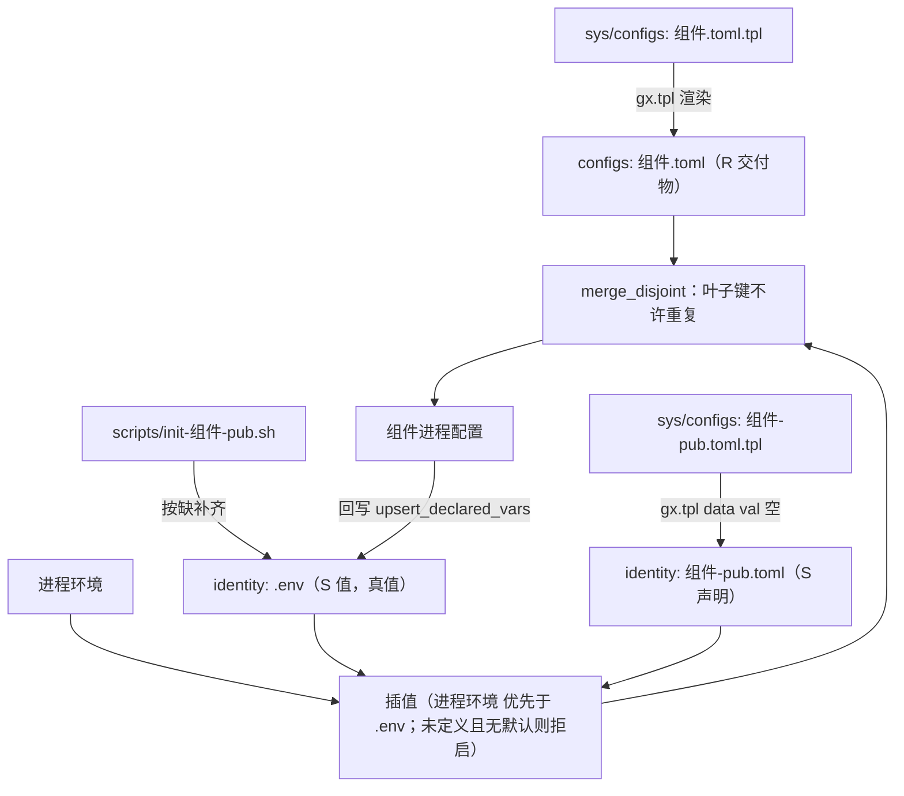

# 现场态配置：把一份 toml 模板，处理成 `toml`（声明）+ `.env`（值）

> **状态**：**约定**（2026-10-12）。
> **本文怎么用**：这是一份**做法**（recipe）—— 什么时候用、三个文件各是谁、栈侧怎么渲染、运行期怎么加载与回写、
> 加一个新组件/新字段怎么落地。**模式（为什么）**见 [`config-and-state-layout.md`](./config-and-state-layout.md) §5；
> **首个实例（gwlinkd 的落地过程）**见 [`../edge/gateway-linkd-config-layers.md`](../edge/gateway-linkd-config-layers.md)。
> **实现**：共享 crate `wist-config`（API 见其 `README.md`）。
> **不适用**：纯内存态、日志正文、可丢弃缓存 —— 与 §11 同界。

## 0. 一句话

把「一份随部署环境而变的配置」拆成 **三个文件、三个写者、一条加载链**：

```
sys/configs/组件/组件.toml.tpl ──gx.tpl──▶ configs/组件/组件.toml        （R：交付物，渲染物）
sys/configs/组件/组件-pub.toml.tpl ─gx.tpl▶ identity/组件/组件-pub.toml  （S：声明，只写 ${VAR}）
                                          identity/组件/.env            （S：值，真值）
运行期：读主配置 + 声明 → `${VAR}` 用「进程环境 > 同目录 .env」插值 → 两份**无重复叶子**合并。
```



## 1. 三个文件、三个写者

| 文件 | 类 | 内容 | **谁写** | 随版本？ |
|---|---|---|---|---|
| `configs/组件/组件.toml` | R | 交付物项（运行态目录 / 回环面 / 投放目录 / 升级参数 …） | **模板渲染**（`gx.tpl`） | **该被覆盖**（升级/重渲） |
| `identity/组件/组件-pub.toml` | S | **只有 `${VAR}` 引用，不含任何现场值** | **同一套模板渲染**（`gx.tpl`） | **随版本**（可入库、可覆盖） |
| `identity/组件/.env` | S | 真值（`KEY=VALUE`） | **脚本按缺补齐** + **运行期回写** | **不随版本**（现场唯一写者） |

三个**不变量**：

1. **声明不含值** ⇒ 它可以入库、可以随版本被覆盖 —— 于是**不再需要「哪一层永不重渲」的例外**。
2. **值不随版本** ⇒ 升级 / 重渲 / 覆盖声明都动不到现场；它只由脚本和组件进程写。
3. **两文件键不相交** ⇒ 合并时叶子键重复即拒（唯一属主的运行时证明）。

## 2. 栈侧：模板与渲染

**落点**（入库的源）：`sys/configs/<组件>/<组件>-pub.toml.tpl` —— 与同目录的主配置 `.toml.tpl` 并列。

**渲染**（`sys/workflows/operators.gxl` 的 `localize`）：

```gxl
gx.tpl (
  tpl  : "./sys/configs/组件/组件-pub.toml.tpl",
  dst  : "./identity/组件/组件-pub.toml",
  data : "{}"
);
gx.cmd ( "./scripts/init-组件-pub.sh identity/组件" );   // 只写 .env
```

- **为什么走 tpl**：与其它交付物同一套机制（模板入库、重渲覆盖）。声明**不含现场值**，所以「覆盖」无害。
- **`data : "{}"`**：声明里只有 `${VAR}`（handlebars **不管** `${…}`），没有 `{{ }}` 占位 ⇒ 不需要 value.json，
  给一份**空内联 JSON** 即可。**注意：模板（含注释）里不要再出现 `{{ }}`**，否则会被 handlebars 当占位替换或报错。
- **值走脚本**（`scripts/init-组件-pub.sh <现场根>`）：把该组件需要的键**按缺**（键不存在或值为空才写）
  写进 `<现场根>/.env`，**非空一律保留**、幂等（内容不变不碰 mtime）。**脚本只写 `.env`，绝不改 `.toml`**。
- **现场根落在 `identity/` 之下**：随 `sys-prj.yml: contract` **自动**获得「不进包 / 不重渲 / 必进备份」，
  无需改 `sys-prj.yml`。

> 变体：若某组件的现场态**没有变量引用**（例如直接写对外域名的字面量），可以不走 tpl，由脚本直接**按键补齐**该
> `-pub.toml`（见 `scripts/init-gateway-pub.sh`）。但只要有 `${VAR}` 引用，就按上面的 tpl 做法。

## 3. 运行期：加载与回写（`wist-config`）

组件只声明**约定**，其余交给共享 crate：

```rust
const LAYER: LayerSpec = LayerSpec {
    overlay_file: "组件-pub.toml",           // 声明文件名（与主配置同目录，或由 env 指定）
    overlay_env:  "WIST_组件_PUB_CONFIG",     // 显式指定声明落点（相对按主配置目录解析）
    values_file:  ".env",                     // 值文件名（与声明同目录）
    values_env:   "WIST_组件_ENV_FILE",       // 显式指定值落点（相对按声明目录解析）
};
```

**加载**：`let doc = wist_config::load_layered_toml(main, &LAYER)?;` 随后 `doc.try_into::<Config>()`。

- 读主配置 + （存在才用）声明；声明里字符串逐条插值；再 `merge_disjoint`。
- **插值**：`${VAR}` / `${VAR:-默认值}`；来源「**进程环境 > 同目录 `.env`**」；
  **未定义且无默认值 ⇒ 拒启**，报错**指向那个 `.env`**（不是静默变空）。
- **合并**：段（table）可两处都写；**叶子键不许重复**，重复即拒，报错**可执行**。

**回写**（页面/接口把现场值落盘）：

- `upsert_declared_vars(overlay, &LAYER, &[(键, 值)…])` —— **写哪个变量名由声明里的 `${VAR}` 决定**；
  返回「声明里没写引用、写不进去」的键（供调用方提示）。
- `remove_declared_var(overlay, &LAYER, 键)` —— 删掉该键对应的那一行（幂等，缺文件/未声明返回 `false`）。
- 纯路径工具：`overlay_path` / `values_path`（读 env 覆盖）与 `overlay_path_with` / `values_path_with`
  （**显式**覆盖，不碰进程环境 —— 嵌入方/测试用）。

**关键取舍**：**变量名与配置键解耦**。声明写 `gateway_id = "${GWLINKD_GATEWAY_ID}"` 还是 `"${GATEWAY_ID}"`
由部署方选；组件**回写时读声明里的名字**，不猜。

## 4. 加一个新组件 / 新字段（配方）

1. **sys 里加模板**：`sys/configs/<组件>/<组件>.toml.tpl`（若有交付物项）与 `<组件>-pub.toml.tpl`
   （现场项，**只写 `${VAR}`**）。
2. **接进 `localize`**（`operators.gxl`）：`init-<组件>.sh`（备渲染值）→ `gx.tpl` 主配置 →
   `gx.tpl` 声明（`dst=identity/<组件>/<组件>-pub.toml`, `data:"{}"`）→ `init-<组件>-pub.sh`（种子 `.env`）。
3. **现场根放 `identity/<组件>/`**（`contract`：不进包 / 不重渲 / 必进备份）。
4. **组件侧**：定义 `LayerSpec` 常量，`load_layered_toml` 加载；回写走 `upsert_declared_vars` / `remove_declared_var`。
5. **键名对齐**：脚本种子的键名 = 声明里 `${VAR}` 的变量名。
6. **备份**：把 `identity/<组件>/{<组件>-pub.toml,.env}`（+ 身份材料）纳入备份条目。

## 5. 踩坑（都踩过）

- **模板注释里别写 `{{ }}`** —— handlebars 会替换/报错；只写 `${VAR}`。
- **`${VAR}` 无默认值 = fail-closed** ⇒ 初始化时**先种骨架键、值留空**，否则「忘写 `.env`」直接拒启。
- **`.env` 必须挨着声明**；要换位置用 `LayerSpec::values_env`（`--env-file` 对应物）。
- **相对路径按「文件所在目录」解析**（不是 cwd）；系统服务（systemd/launchd）务必给**绝对路径**。
- **值文件是现场唯一写者** ⇒ 脚本/回写要**幂等**（非空保留、内容不变不落盘），否则会冲掉现场改动。
- **不要把 `E`（锁/簿记）混进 `identity/`** —— 那是把可重建的冒充成不可重建（见 `config-and-state-layout.md` §3）。

## 6. 参考

- 模式（为什么）：[`foundation/config-and-state-layout.md`](./config-and-state-layout.md) §3–§6。
- 实例（gwlinkd 落地 + 迁移）：[`edge/gateway-linkd-config-layers.md`](../edge/gateway-linkd-config-layers.md)。
- 实现（API / 语义 / 测试）：`wist-config`（crate `README.md`）。
- 栈侧实物：`sys/configs/gwlinkd/gwlinkd-pub.toml.tpl`、`scripts/init-gwlinkd-pub.sh`、
  `sys/workflows/operators.gxl` 的 `localize`。
