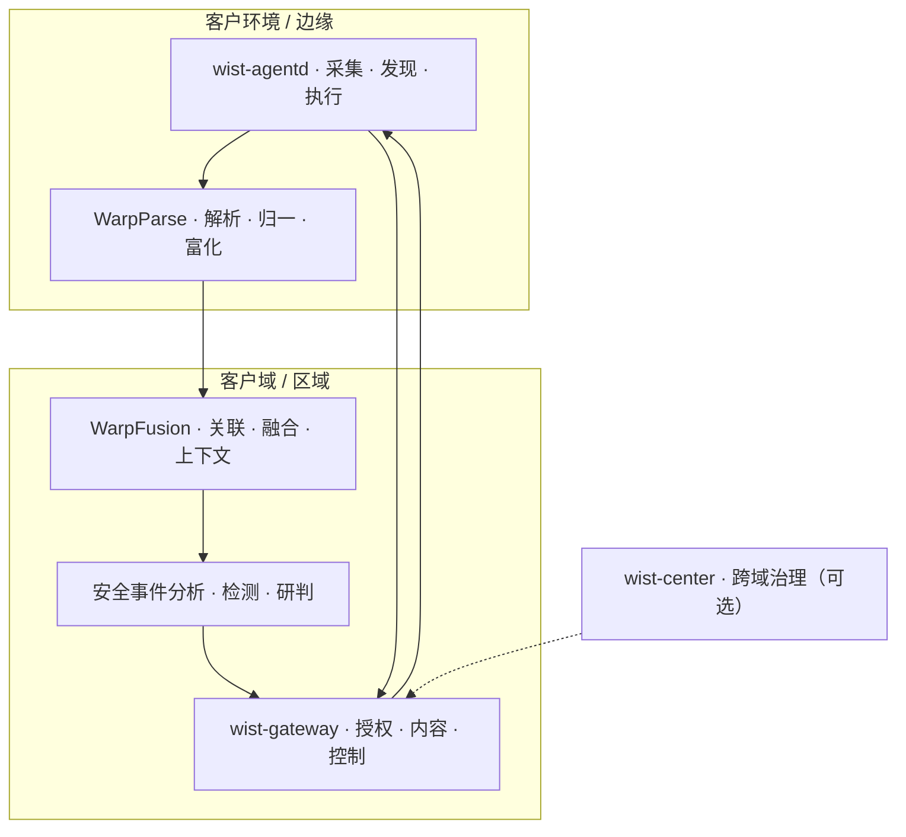

# wist 平台定位与竞争格局

> 本文是平台级文档：回答「这套东西整体是什么、各层怎么分工、和谁竞争、靠什么赢」。
> Agent 层的细节对比见 [`vs-agent-systems.md`](vs-agent-systems.md)；`standalone` 的运行口径见
> [`standalone-convergence-checklist.md`](standalone-convergence-checklist.md)。

## 1. 一页看懂

整体平台由四层能力组成，Wist 是其中的「采集 / 控制 / 执行」层，其余两层分别负责「解析归一」与「关联融合 + 安全研判」。



一句话定位：

> **一个平台，四层能力：采集（Wist）→ 解析（WarpParse）→ 融合（WarpFusion + 安全分析）→ 响应（Wist）。**

三条不变式：

1. **数据面与控制面分离**：采集/解析是数据通路，授权/升级/执行是控制通路；
2. **AI 不进边缘热路径**：边缘保持确定性，AI 产出草稿，不直接改状态；
3. **闭环必须可审计**：谁授权、做了什么、能否回滚，全链路留痕。

---

## 2. 平台形状

### 2.1 四层与组件

| 层 | 组件 | 负责 | 不负责 |
|---|---|---|---|
| **采集 / 发现 / 执行** | `wist-agentd` + `wist-exec` + `wist-upgrader` | 文件日志、指标、资产发现、受控执行、升级与回滚 | 解析规则、关联分析、检测判断 |
| **授权 / 内容 / 控制** | `wist-gateway`（+ `wist-center`） | 入网、授权快照、知识包、升级计划、审计 | 真正采集；不替代 agentd 的执行判定 |
| **解析 / 归一 / 富化** | `WarpParse` | WPL 规则解析、OML 富化、字段提升、路由 | 跨源关联、检测研判 |
| **关联 / 融合 / 研判** | `WarpFusion` + 安全事件分析 | 多源事实关联、上下文补全、检测、事件叙事 | 直接执行动作（必须回到 Wist 的授权链） |

> `WarpFusion` 的准确职责边界以产品文档为准；本文按「把解析后的多源事实做关联、融合与上下文补全」理解。若职责不同，只需改本节职责表，不影响分层结论。

### 2.2 两条闭环

**观测闭环**

```
采集 → 解析 → 融合 → 检测/异常 → 展示/告警
```

**安全运营闭环**

```
采集 → 解析 → 融合 → 检测/研判 → 人授权 → 受控执行 → 验证 → 回传
```

第二条是差异化的核心：大多数平台停在「检测/告警」，响应靠外挂 SOAR；这套栈把「手」长在了自己身上。

### 2.3 数据与身份贯通

已有契约基础：`doc/data-format/`（`warp-insight` 输出信封 → warp-parse → 内部输入格式）。

需要全链路钉住的三件事：

| 项 | 要求 |
|---|---|
| **身份** | `agent_id` / `instance_id` / `event_id` 跨层稳定，回放可去重 |
| **版本** | 解析规则、采集内容、检测规则的版本可追溯、可回滚 |
| **幂等** | 上送、解析、融合、事件生成各段都按至少一次 + 去重键设计 |

---

## 3. 部署形态

| 形态 | 放什么 | 适用 |
|---|---|---|
| **单域自治** | agent + 轻解析 + gateway（+ fusion） | 单机房 / 单 VPC / 离线环境 |
| **区域汇聚** | 边缘 agent，区域 WarpParse / WarpFusion / 安全分析，区域 gateway | 多云单区域、分支机构汇聚 |
| **多域治理** | 每域一套 gateway；center 只做发布、升级计划、跨域汇总 | 混合云、多 region、多租户 |

三条约束：

1. **gateway 是“域”的单位**：一个 domain 一个 gateway，跨域链路断了不影响本地；
2. **数据默认不跨域**：解析与融合尽量在客户域内完成；
3. **center 可选**：没有 center 时，gateway 仍能自治运行（只是少了跨域治理与集中发布）。

---

## 4. AI 放在哪

| 层 | AI 做什么 | 理由 |
|---|---|---|
| **agentd** | 不做（热路径）；可选、离路径、默认关闭的脱敏/降噪 | 确定性、资源上限、供应链安全 |
| **gateway** | 采集建议、规则草稿、诊断解释、授权预检 | 客户域内、上下文完整、离线可用 |
| **WarpFusion / 安全分析** | 跨源关联、异常检测、事件叙事、研判建议 | 结构化事件 + 上下文，才是 AI 的有效输入 |
| **center** | 训练、评测、模型版本化与分发 | 跨域学习与模型供应链 |

一句话：

> **WarpParse 给 AI 结构，WarpFusion 给 AI 上下文，Wist 给 AI 手，授权给 AI 刹车。**

AI 产出一律是**草稿**：`CollectionUnitDraft` / `WorkGrantDraft` / `ActionPlanDraft` / `DiagnosisExplanation`。
批准仍走现有审批链，执行仍走 `ActionPlan` 的签名与本地校验。

---

## 5. 竞争格局

### 5.1 分层对位

| 层 | 你们 | 主要对手 | 谁更强 |
|---|---|---|---|
| 采集 / 执行 | Wist | Datadog Agent、Elastic Agent、云助手 / SSM / TAT | 对手强在开箱即用与观测深度；你们强在云中立、私有化、执行闭环 |
| 解析 / 归一 | WarpParse | Cribl、Logstash、Fluent Bit | 对手强在生态与算子丰富度；你们强在内容化与轻量部署 |
| 关联 / 融合 | WarpFusion | Splunk ES、Elastic Security、SIEM 关联引擎 | 对手强在检测内容与检索规模；你们强在闭环与数据驻留 |
| 检测 / 研判 | 安全事件分析 | SIEM、SOC 平台、国内安全厂商 | 对手强在规则库、威胁情报、误报治理 |
| 响应 | Wist exec | SOAR、Ansible、Rundeck | 对手强在集成与 playbook 生态；你们强在原生 agent 与授权审计 |

### 5.2 四类对手

**云厂商主机 Agent（云助手 / SSM / TAT）**

- 强：免费、云内开箱即用、与云产品深度集成；
- 弱：跨云与私有化弱，观测深度有限，控制面不可自持；
- 你们赢在：云中立、数据驻留、授权与执行闭环。

**可观测厂商（Datadog / Elastic / Grafana）**

- 强：观测深度、开箱即用、生态；
- 弱：控制面多在 SaaS；Elastic Fleet 可自托管，但没有“人签授权 + 受控执行”；
- 你们赢在：私有化、数据去向可控、受控执行。

**SIEM / SOC（Splunk / Elastic Security / QRadar / 国内安全厂商）**

- 强：检测内容、威胁情报、检索与分析规模；
- 弱：响应靠外挂 SOAR；采集端通常不是自己的；
- 你们赢在：采集 → 解析 → 融合 → 响应同栈，授权与审计贯通。

**SOAR / AIOps（XSOAR / Splunk SOAR / Moogsoft / BigPanda / 必示 / 云智慧）**

- 强：编排与算法；
- 弱：没有自己的采集与资产事实，执行依赖外部系统；
- 你们赢在：原生 agent 事实 + 原生执行 + 客户域内闭环。

### 5.3 差异化：四条护城河

1. **闭环**：检测 → 授权 → 执行 → 验证 → 留痕；
2. **授权对象**：谁批的、批了什么、能不能撤、能否对照实际；
3. **内容驱动**：采集面、解析规则、检测规则都是内容，扩展不靠发版；
4. **云中立 + 数据驻留**：同一套栈进多云、混合云、离线环境。

### 5.4 不正面竞争的地方

- APM / Profiling / RUM 深度——用 OTLP 收编应用侧数据，不自己造所有语言的探针；
- 通用 SIEM 的超大规模检索与报表——需要时对接客户既有 SIEM；
- 威胁情报与规则库的广度——优先合作/采购，不从头造；
- 云原生补丁、配置、合规基线——与云厂商能力集成，不替代。

---

## 6. 客户与场景

| 场景 | 客户诉求 | 你们的切入 |
|---|---|---|
| **受监管 / 关基 / 等保** | 日志留存、审计、数据不出域、谁批的可查 | 一条完整闭环 + 授权台账 |
| **私有云 / 混合云** | 多云统一治理、每域自治、无外网 | gateway 分域 + center 可选 + 离线包 |
| **已有 SIEM** | 不想换分析层，但缺采集与执行 | 作为数据底座 + 执行层接入 |
| **没有 SIEM** | 想一体化，但不想养三套系统 | 四层一体，按域交付 |
| **已有 AIOps** | 分析有了，自动修复不敢上 | 提供“授权 + 执行 + 回滚”的信任层 |

**建议的 beachhead**：受监管行业的「日志/审计采集 + 安全事件闭环 + 受控响应」。
不要一上来讲“全能平台”——SIEM/SOAR 是红海，先用一个行业把闭环跑通。

---

## 7. 风险与待决

| # | 风险 / 待决 | 影响 | 建议 |
|---|---|---|---|
| 1 | **检测内容**（规则库、威胁情报、误报治理） | 决定安全平台能不能卖 | 合作/采购优先，自研只做差异化面 |
| 2 | **WarpFusion 的职责边界** | 影响分层与对外叙事 | 先钉死：是关联引擎、融合存储，还是两者都有 |
| 3 | **产品叙事** | 三个名字容易被当成三个产品 | 对外只讲“一个平台、四层能力”，组件名留给架构图 |
| 4 | **运维复杂度** | 三引擎 + 双控制面，交付成本高 | 一体化安装包 + 一键升级 + 自带诊断 |
| 5 | **数据面安全** | 明文 TCP 过不了评审 | 见 issue `dayu-sec/wist-agentd#26` |
| 6 | **平台覆盖** | 无 Windows，混合云受限 | 优先补 Windows |
| 7 | **商业化口径** | 按主机计费会劝退多云客户 | 按“域 / 网关”计费，主机数做容量档 |

---

## 8. 速查

- **是什么**：一个平台，四层能力；Wist 是采集/控制/执行层。
- **靠什么赢**：闭环 + 授权 + 内容驱动 + 云中立/数据驻留。
- **不做什么**：不拼 APM 深度、不做通用 SIEM 超大规模检索、不从头造威胁情报。
- **AI 在哪**：gateway 做本地草稿，WarpFusion/安全分析做分析，center 做模型供应链，agentd 不碰热路径。
- **先打哪**：受监管行业的日志/审计 + 安全事件闭环 + 受控响应。

---

## 9. 证据索引

| 结论 | 出处 |
|---|---|
| 四层能力与数据流 | 本文 §1 / §2；`doc/data-format/`（warp-insight 输出信封 → warp-parse → 内部输入） |
| 采集面是内容、轨道 A/B | `doc/design/center/collection-family-capability-contract.md` §1、§13 |
| 授权对象与双视图 | `wist/wist-gateway/src/api/admin_ops.rs`（`GrantWorkRequest`、`AgentWorkView`） |
| 执行与升级闭环 | `wist/wist-agentd/docs/design/agentd-architecture.md` §2、§11 |
| 运行模式口径 | `doc/design/foundation/architecture.md` §4.3；`standalone-convergence-checklist.md` |
| 云厂商 / 可观测厂商对比细节 | `vs-agent-systems.md` |
| gateway 单副本 + SQLite | `wist/wist-gateway/README.md`（Storage） |
