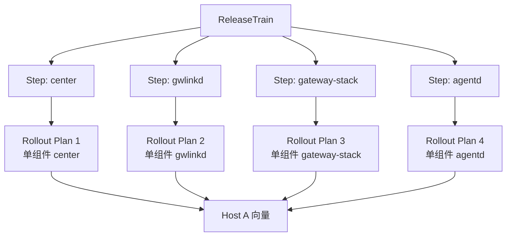
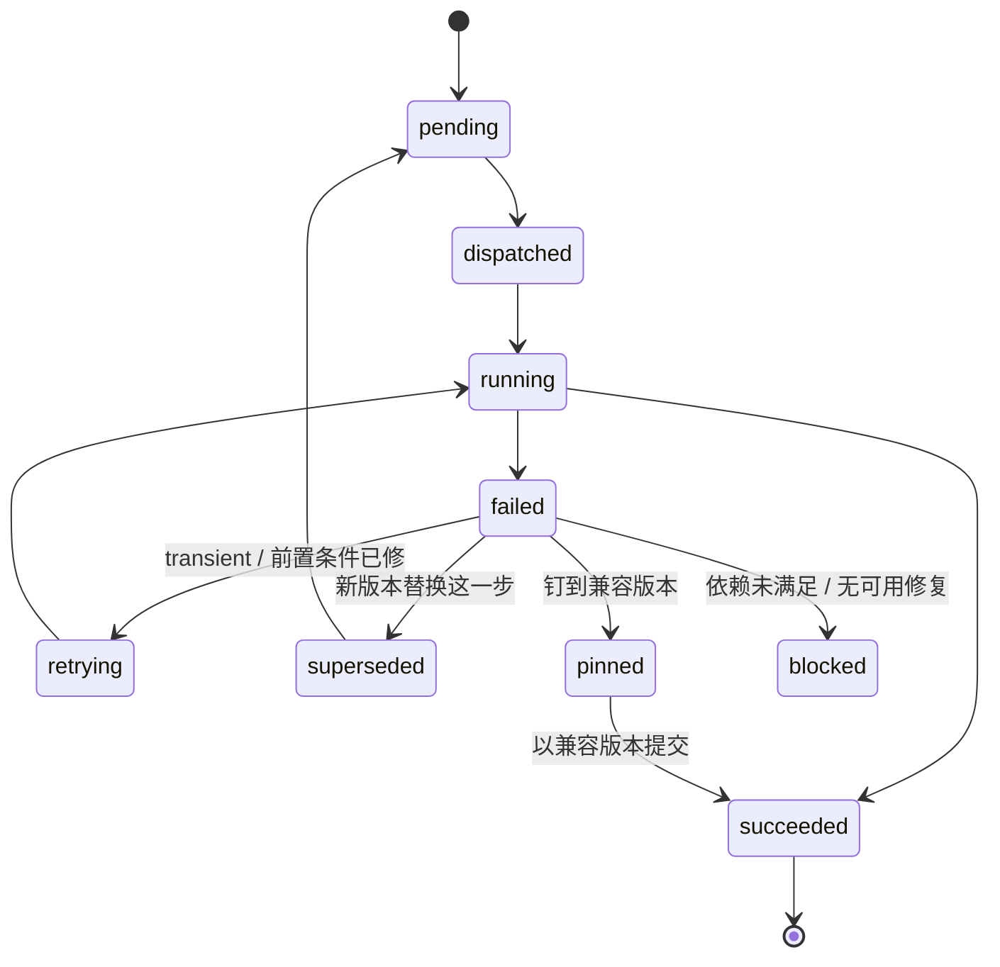
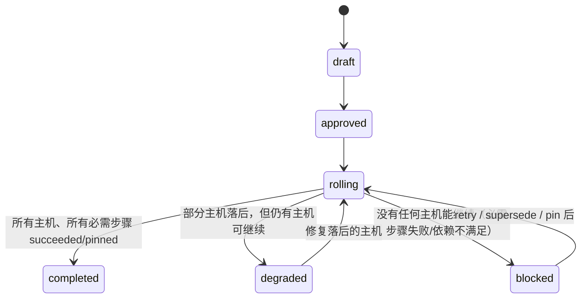

# 可续跑升级（Resumable upgrade）

> **状态**：设计（2026-10-28）
> **目标**：多组件、跨多版本的升级，**不会因为中间某一步失败而整体卡死**；已成功的步骤保留，失败的步骤修好后从该步继续。
>
> **一句话**：不要假设“回退”。把升级从“一个原子事务”改成“一串可独立提交、可续跑的步骤”。
>
> **关联**：
> [`upgrade-order.md`](./upgrade-order.md)（发布序 vs 升级序）、
> [`../edge/gateway-upgrade-and-releases.md`](../edge/gateway-upgrade-and-releases.md)（中心 → 网关升级）、
> [`../edge/agent-upgrade-and-packages.md`](../edge/agent-upgrade-and-packages.md)（网关 → agentd 升级）、
> [`../edge/knowledge-package-push-to-gateways.md`](../edge/knowledge-package-push-to-gateways.md)（知识包下发）。

## 0. 先纠正问题定义

跨多个组件、每个组件跨多个版本时：

- 已升级的组件可能已经做了**不可逆迁移**（DB schema、状态格式、协议）；
- 即使能回退，回退多个组件等于把整个机队再冒一次险；
- “第一个成功、第二个失败”时，**真正需要的是继续把能修的修好、能走的走完**，不是把第一个也退回去。

所以：

> **回退不是主路径。主路径是：部分成功是合法状态；失败被隔离在一个步骤；修好后从该步骤继续。**
>
> 如果业务上必须**先升某个组件**（例如 A 1.1 / B 1.2 / C 0.3 / D 2.2 里先升 B），还要看 B 的新版本是否能在
> `compat=mixed` 下与旧 A/C/D 共存；这是另一个独立机制，见
> [`upgrade-compat-mode.md`](./upgrade-compat-mode.md)。

回退只保留为**单步的可选能力**：只有该步骤声明 `rollback_compatible=true` 且本机有可用 LKG 时才允许；否则只允许前向修复（supersede / pin / bridge）。

## 1. 现场是怎么卡的（代码级）

| # | 位置 | 现状 | 后果 |
|---|---|---|---|
| C1 | `wist-center/src/api/gateway_ops.rs::upgrade_plan_for` | `spec.targets` 可以写多个组件，但只取 `first_upgrade_target`（注释原话：“多组件计划这里取第一个”） | **第二个组件永远不会被派发**；计划里写 5 个组件，实际只升第 1 个 |
| C2 | `UpgradePlanEntryRecord` | 条目是 `gateway_id` 一条，没有 `component` / `step_id` | 无法表达“网关 A 的 center 成功、gwlinkd 失败”；一个网关只有一个状态 |
| C3 | `wist_release::rollout::phase_settled` / `phase_should_advance` | 阶段按**网关**的单一状态判定；`all_succeeded` 要求全成功 | 一个组件失败 → 整个阶段卡住；末段直接 `failed` |
| C4 | `wist-gwlinkd` 游标 `UpgradeCursor.last_plan_id` | 一份计划只驱一次；同一计划不会“继续下一步” | 多组件/多版本必须新建计划；重试只能整份重派 |
| C5 | `wist-center/src/api/rollout.rs::build_retry_plan` | 重试复制原 `spec`，单阶段 | 原 `spec` 有多个 target 时，重试**仍然只做第一个** |
| C6 | 全局 | 没有 `(gateway, component, from, to, requires, status)` 的持久“步骤”对象 | 无法断点续跑；无法判断哪些组件可以并行、哪些必须等 |
| C7 | 全局 | 没有兼容矩阵 | “center 新 + gwlinkd 旧”到底能不能继续，没人能回答；只能整体停 |
| C8 | `wist_release::rollout::entry_status_for` | 只把单个 work 状态归一化成单一 `succeeded/failed` | 失败原因/阻塞关系丢失，无法做“只阻塞下游” |

> 结论：**当前模型的最小单位是“一份计划 × 一个网关”，而不是“一个组件的升级步”**。多组件、跨版本场景缺的不是回退，而是**步骤对象 + 每步进度 + 续跑语义**。

## 2. 核心模型

### 2.1 三个对象

| 对象 | 含义 | 关键字段 |
|---|---|---|
| **Release Train（发布列车）** | 一次发布要落地的组件版本集合，以及它们之间的依赖/兼容关系 | `train_id`、`components{target, requires}`、`compatible[]`、`bridge[]` |
| **Upgrade Step（升级步）** | **最小可派发、可回执、可重试、可替换的单位**；P0 物化成**一份现有的单组件 rollout plan** | `step_id`、`train_id`、`component`、`from`、`to`、`requires[]`、`optional`、`rollback_compatible`、`plan_id` |
| **Host Version Vector（主机版本向量）** | 一台主机上各组件**实际**版本 + 每步终态 | `{component: version}`、`steps{step_id: status}` |

中心视图是投影；**主机账本是事实**。



> **P0 的关键取舍**：不急着把 `GatewayUpgradePlan` 扩成 `steps[]`。Train 负责“组件顺序 + 每步计划”，每个 step 仍用现有**单组件**计划下发。
> 这样 gwlinkd 的“一份计划驱一次”语义不用改，也不会引入新的自举死锁。

### 2.2 状态机

单个 step：



Train：



### 2.3 七条硬规则

1. **步骤独立提交**：一步成功即 `succeeded`，后续步骤失败**不回滚**它。
2. **依赖只阻塞下游**：`requires` 未满足 → 下游 `blocked`；无关组件/主机继续走。
3. **部分成功合法**：`degraded` 是正常终态，不是“整单失败”。
4. **按主机推进，不按整批推进**：主机 A 的 step 2 失败，不妨碍主机 B 进入 step 3。
5. **前向修复优先**：失败步可以被新版本 `superseded`，或钉到矩阵内兼容版本 `pinned`；不需要回退。
6. **按步回退是可选能力**：`rollback_compatible=false` 时，回退请求直接拒绝并说明原因；“只能前向修”。
7. **多版本跳必须显式桥接**：`1.0 → 1.3 → 1.6 → 1.9`，每一跳是独立 step；失败停在那一跳，不会把整列火车打回起点。

### 2.4 谁定义 Release Train：不是人，是约束 + 求解

> 这一节是整套机制能否成立的前提。**如果 Train 需要一个人手工维护一份全局组件版本清单，它一定会腐烂。**

正确分工：

| 谁 | 定义什么 | 何时 |
|---|---|---|
| **组件团队 / CI** | 只声明**本地事实**：协议版本、依赖范围、可升级起点、bridge、是否可回退、迁移方式、探针、回退制品 | 每次发布时 |
| **resolver**（CI 或中心） | 把已发布组件的约束 + 目标主机的**当前向量**求解成一条可行路径 | 发布时预检 + 建计划时 |
| **运维** | 只选**通道 / 目标 / 例外**，并批准求解结果 | 建计划时 |
| **主机** | 实际版本向量 + 探针证据 | 运行时 |

要点：

- **组件团队只对自己负责**：不需要知道别人的发布节奏，也不需要维护全局清单；
- **resolver 是确定性的**：同一组已发布约束 + 同一台主机向量 → 同一条路径，可复现；
- **Train 是 resolver 的输出（类似 lockfile）**，不是真源；真源是各组件的约束；
- **per-host 求解**：0.16 的主机和 0.22 的主机走不同的 bridge，不存在一份“全局 Train”；
- `compatible[]` 只是 resolver 的**证据缓存**（可选的显式允许列表），不是人工维护的事实。

组件发布时随制品带一份签名 manifest（升级相关的事实都在这里，而不是散在文档里）：

```json
{
  "component": "wist-gwlinkd",
  "version": "0.20.1",
  "protocol": { "control": 2, "gateway-api": 1 },
  "requires": { "wist-center": ">=0.22.0" },
  "upgrade": {
    "from": ">=0.16.0",
    "bridge": ["0.18.4"],
    "reversible": true,
    "migration": "none"
  },
  "probe": { "http": "https://127.0.0.1:3102/api/v1/version", "timeout_seconds": 30 },
  "rollback": { "artifact": "…", "sha256": "…" }
}
```

CI 门禁（发布前，不是现场）：

- manifest schema + 签名；
- `from` 范围至少验 `min → N` 与 `N-1 → N`；
- `reversible=true` 才允许 `N → N-1`，并且必须实测；
- 按 `requires` 的 min/max 各跑一次混版；
- 探针在 canary 上真实通过。

### 2.5 没有 Train 也能升级（fallback）

**整套机制不能依赖“Train 一定存在/一定正确”。** 缺 manifest 时：

- resolver 按缺省处理：`requires: []`、`bridge: []`、`reversible: false`、仅探针门禁；
- 顺序退化为**依赖图顺序**（没有声明就用 `center → gwlinkd → gateway-stack → agentd`）；
- 每一步仍然独立提交/隔离；失败进修复队列；
- 结果标记为 `unverified`（“没声明过兼容性”），**不谎报 `succeeded`**；
- 这仍然保留了“继续升级 + 远程修复”的能力，只是少了提前的兼容性保证。

> 一句话：**Train 是加速器和护栏，不是前置条件。** 没有它，升级仍然可续跑；有它，失败更早被发现。

## 3. 失败后到底能不能继续：约束求解

Train 的路径由约束求解得到；下面的 `compatible[]` 是**可选的证据缓存**，不是手工真源：

```json
{
  "train_id": "2026-10-28",
  "components": {
    "wist-center":        { "target": "0.22.3", "requires": {} },
    "wist-gwlinkd":       { "target": "0.20.1", "requires": { "wist-center": ">=0.22.0" } },
    "wist-gateway-stack": { "target": "0.9.4",  "requires": { "wist-center": ">=0.22.0", "wist-gwlinkd": ">=0.20.0" } },
    "wist-agentd":        { "target": "0.1.20", "requires": { "wist-gateway-stack": ">=0.9.0" } }
  },
  "compatible": [
    { "wist-center": "0.22.3", "wist-gwlinkd": "0.18.4", "wist-gateway-stack": "0.8.9", "wist-agentd": "0.1.18" },
    { "wist-center": "0.22.3", "wist-gwlinkd": "0.20.1", "wist-gateway-stack": "0.9.4", "wist-agentd": "0.1.20" }
  ],
  "bridge": {
    "wist-agentd": { "0.1.4 -> 0.1.20": ["0.1.10", "0.1.16"] }
  }
}
```

> `compatible[]` 可由 resolver 生成，也可由人显式覆盖（例外）；**显式覆盖要进审计，且不能替代组件 manifest**。
> 没有 `compatible[]` 时，就用各组件的 `requires` + 运行时探针判定。

失败时中心只做三选一：

1. **当前主机向量仍在 `compatible` 里** → `degraded`：继续无关步骤，不碰已成功的组件。
2. **只改失败组件就能到最近兼容向量** → 生成 `pin` 或 `supersede` 步骤。
3. **怎么改都不兼容** → `blocked`：停依赖它的下游，保留已成功组件，开修复任务。

> **不做“为了满足矩阵而全局回退”**。优先最小前向改动。

## 4. 执行侧：Train 驱动现有单组件计划

### 4.1 P0 不下发多目标计划

- Train 为每个 step 创建一份**单组件** `rollout plan`（`spec.targets` 只有一个元素）。
- **同时把“多目标计划”改成显式拒绝**（`400 multi_target_not_supported`），或者修好 `upgrade_plan_for` 让它按 step 逐个下发。
  **不能继续 silently 只取第一个** —— 这正是“第二个组件永远不动”的来源。
- `GatewayUpgradePlan` / `ReportGatewayUpgradeResult` / gwlinkd 的 `last_plan_id` 游标**P0 都不改**：每个 step 是新 `plan_id`，gwlinkd 自然只驱一次。
- **自举**：train 的第一步只能是单个既有组件（通常 center 或 gwlinkd），确保旧 gwlinkd 也能完成这一步。

> P1 若要把多个 step 合并进一份计划，再给 `GatewayUpgradePlan` 加 `steps[]`；那是优化，不是 P0 的前提。

### 4.2 每步的“从哪来、到哪去”

- `from` 取该主机**实际版本向量**里的当前值，不取上一份计划的 `last_to_version`。
- 目标版本由 train 的 step 给出；制品地址/摘要仍由中心按 `(component, version, platform)` 派生。
- 若主机当前版本已经在目标（幂等）→ 该 step 直接 `succeeded`，不再派发。
- 若主机当前版本低于 bridge 起点 → 先派 bridge 中最靠前的一步。

### 4.3 本机执行

- 本机账本以 `(train_id, step_id, component)` 为单位：`intent → result`，掉电/重启后按 step 收敛。
- **一个 step 内部可以是原子的**（例如 `gops prj upgrade --on-failure rollback-all` 把该组件的多个系统一起提交/回滚）；
  但 **step 之间不共享事务边界**：前一步成功就提交，后一步失败不会回滚前一步。
- 一步失败：该组件保持原版本；**已成功组件保持新版本**。
- `wist-bootguard` 仍然保留，但职责收窄为**执行器自保**：执行器进程死了、卡在中间态时，保证本机不留下“装了一半”的组件；它不再承担“把整列火车退回去”。
- `wist-recover step retry|supersede|pin` 用于无中心时的本机处置。

## 5. 中心编排

### 5.1 Train 控制器

Train 不是“再写一套阶段引擎”，而是**在现有 rollout plan 之上做一层推进**：

```text
approve(train)
  -> 选所有主机都满足 requires 的第一个 step
  -> 为这个 step 创建一份单组件 rollout plan（含既有灰度阶段）
  -> 等这份 plan 进入终态
  -> 逐主机收敛版本向量：
       succeeded -> 该主机进入下一步的候选
       failed    -> 该主机进入该 step 的修复队列（不阻塞其他主机）
  -> 若还有主机能继续 -> 创建下一个 step 的 plan（只包含满足 requires 的主机）
  -> 若没有任何主机能继续 -> train = blocked
  -> 全部主机完成 -> train = completed / degraded
```

关键点：

- **step 的 plan 只包含“该 step 的候选主机”**，不是全体主机。失败的/落后的主机不会被强行带上。
- **修复队列与前进队列分离**：`repair(step, host)` 生成新的单组件 plan，targets 只含失败主机；`advance(step+1, hosts)` 生成下一步 plan，只含已就绪主机。
- **两份 plan 的主机集合必须互斥**：`active_plan_for_gateway` 取最新 rolling 计划；同一主机同时落在两份 rolling 计划里会打架。

### 5.2 step 状态与计划状态的映射

| Train step 状态 | 来源（单组件 plan） |
|---|---|
| `pending` | 还没创建 plan |
| `running` | plan 为 `rolling` |
| `succeeded` | plan `completed` 且本 step 所有目标主机 `succeeded` |
| `degraded` | plan `completed/failed`，部分主机 `succeeded`、部分 `failed` |
| `failed` | plan `failed` 且没有主机成功（或可重试的失败） |
| `blocked` | `requires` 不满足，或上游 step 未就绪 |
| `superseded` / `pinned` | 由修复动作产生的新 step 替代 |

> 现有 plan 的 `failed`（末段有失败）**不再等于 train 失败**：它只表示“这一步这批主机里有失败”。train 看的是逐主机结果。

### 5.3 选下一批主机（伪代码）

```rust
fn hosts_ready_for_step(train: &Train, step: &Step, hosts: &[HostState]) -> Vec<String> {
    hosts.iter()
        .filter(|h| step.requires.iter().all(|req| h.vector.satisfies(req)))
        .filter(|h| !h.steps.contains_key(&step.step_id)) // 没做过/没被修复过
        .map(|h| h.id.clone())
        .collect()
}
```

- 返回空 ≠ 失败：可能是全部完成，也可能是被上游 `blocked`；调用方必须区分并把“被谁挡住”写进条目说明。

### 5.4 四种修复动作

| 动作 | 语义 | 动已成功的主机/步骤？ |
|---|---|---|
| `retry` | 同一 step、同一版本、新 `plan_id`（新 attempt） | 否 |
| `supersede` | 同一组件/同一目标，换一个新版本（修复版），新 `plan_id` | 否 |
| `pin` | 把组件钉到兼容矩阵内的版本，train 记 `degraded` | 否 |
| `rollback` | 仅当该 step `rollback_compatible=true` 且本机有 LKG | 否（只退这一步） |

> `retry` 必须是**新 `plan_id`**：gwlinkd 对同一 `plan_id` 只驱一次，原计划改回 `pending` 是假重试。

### 5.5 失败分类 → 处置

| 类型 | 例子 | 处置 |
|---|---|---|
| transient | 取件超时、429、网络抖动 | `retry`（退避，最多 N 次） |
| precondition | 磁盘满、端口占用、证书过期 | 修前置条件后 `retry` |
| artifact | 摘要不符、平台错、release 缺失 | 停止；修发布；`supersede` 或 `pin` |
| compatibility | 旧端拒收、协议不匹配 | 不重试；调整 train（expand/contract 或 `pin`） |
| migration | DB 迁移失败 | 若 `rollback_compatible` 则单步回退；否则前向修复（新迁移版本） |
| liveness | 新进程崩溃循环 | bootguard 守住 LKG；标 `failed`；`supersede` |
| unknown | 超时无回执 | 探针 + 本机账本对账，再决定 `retry`/`supersede` |

## 6. 多版本跳：显式桥接

不要假设“从 1.0 直接升到 1.9”。Train 里声明：

```json
"bridge": {
  "wist-agentd": { "0.1.4 -> 0.1.20": ["0.1.10", "0.1.16"] }
}
```

- 每个中间版本是一个独立 step，有自己的制品、摘要、探针。
- 失败在 `0.1.16`：agentd 停在 `0.1.10`，train `blocked`；**不重跑 0.1.4**，也不假装到了 0.1.20。
- 如果某个 bridge 版本不可用（未发布/已撤销），计划在创建时就拒绝，而不是跑到一半才发现。

## 7. 观测与对账

- 主机账本是事实：`steps{step_id: {status, evidence, attempt_id}}`。
- 中心按 `(train_id, step_id, gateway_id, attempt_id)` 幂等吸收回执；重复上报不产生新步骤。
- 回执丢失：主机重连后补报本机终态；中心据此收敛，不重派已完成步骤。
- 视图必须能回答四个问题：
  1. 这台主机每个组件现在是什么版本？
  2. 哪些步骤成功、哪些失败、哪些被阻塞？
  3. 失败原因是哪一类（transient / artifact / compatibility / migration / liveness）？
  4. 下一步可执行的动作是什么（retry / supersede / pin / rollback）？

## 8. 代码落点

| 层 | 改动 |
|---|---|
| `wist-center` | 新增 `ReleaseTrain` / `UpgradeStep` 存储与控制器；`api/rollout.rs` 增加 train 的 approve/advance/repair 入口；**拒绝多 target 计划**（或在 `gateway_ops.rs::upgrade_plan_for` 修掉 `first_upgrade_target`） |
| `wist-release` | `train` 模块：manifest、兼容矩阵、bridge 路径、step id、主机向量判定；`plan.rs` 继续负责单组件计划的阶段闸门 |
| `wist-control` | P0 不改 wire；P1 若合并多 step，再给 `GatewayUpgradePlan` 加 `steps[]`（可选、`#[serde(default)]`） |
| `wist-gwlinkd` | P0 不改：每个 step 是新 `plan_id`，`last_plan_id` 游标天然按步推进 |
| `wist-gateway` / `wist-agentd` | P0 不改：仍是一份计划/一件一次性工作；train 只负责“什么时候派哪一步” |
| `wist-design/jumo` | `ReleaseTrain` / `UpgradeStep` 模型；`Control.Rollout` 增加 train 关联；layout 视图 |
| 存储 | `release_trains` + `upgrade_steps`；`upgrade_plans` 增加可选的 `train_id` / `step_id` 关联 |

## 9. 分期

| 期 | 内容 | 直接收益 |
|---|---|---|
| **P0** | `ReleaseTrain` / `UpgradeStep`；每个 step 物化为单组件 plan；拒绝多 target 计划；按主机 `requires` 选下一批 | 多组件不再只升第一个；“第一个成功、第二个失败”不再整单卡死 |
| **P0.5** | 逐主机收敛 + 修复队列/前进队列分离；train `degraded/blocked`；`retry` 按 step | 一台失败不拖住其他主机；已成功步骤不被回滚 |
| **P1** | 组件 manifest schema + resolver（约束求解 / bridge / 可回退声明）；`supersede` / `pin`；失败分类；CI 的 `N-1→N` / `N→N-1` / 混版矩阵 | 失败后能判断“继续 / 钉住 / 只停下游”，且不依赖人工维护全局清单 |
| **P2** | 可选：一份计划承载 `steps[]`；自动修复规划；train 视图；签名离线恢复包 | 减少计划数量，远程修复从“人工判断”变成“系统给方案” |

## 10. 验收场景

1. **多组件 train**：`center 0.16→0.22` 成功，`gwlinkd 0.10→0.20` 失败。结果：center 保持 0.22（不回退）；gwlinkd 保持 0.10；gateway/agentd 未开始；train `blocked`，下游 `blocked`；用 `supersede gwlinkd 0.20.2` 后继续，gateway/agentd 依次执行。
2. **单主机失败不拖住机队**：10 台里 1 台 gwlinkd 失败，其余 9 台继续进入 gateway step；失败主机进修复队列，train `degraded` 而不是 `blocked`。
3. **同组件多版本**：`agentd 0.1.4→0.1.20`，bridge `0.1.10, 0.1.16`；失败在 `0.1.16`。结果：agentd 停在 `0.1.10`；不重跑 `0.1.4`；修复后可只做 `0.1.16 → 0.1.20`。
4. **回执丢失**：主机实际已成功，中心停在 `dispatched`；重连后按 step 补报，中心收敛为 `succeeded`，不重复派发。
5. **不可回退**：step `rollback_compatible=false`；回退请求被拒绝并给出原因；只能 `supersede`/`pin`。
6. **多 target 计划**：创建时直接 `400`（或正确拆成多个 step），**不再 silently 只做第一个**。
7. **兼容矩阵**：`center 新 + gwlinkd 旧` 在矩阵内 → train `degraded`，继续无关步骤；不在矩阵内 → `blocked`，停下游。
8. **视图**：能看到“center 成功 / gwlinkd 失败 / gateway 未开始”，而不是一个笼统的 `failed`。

## 11. 与“回退”的关系

- 回退是**单步可选能力**，不是 train 级假设。
- `wist-bootguard` 保留，但只负责“执行器死了别留半套”；不负责把整列火车退回去。
- 破窗通道（签名离线包 / `wist-recover`）保留，用于“连执行器都没了”的极端情况。
- 若某一步确实需要回退才能恢复，必须在发布前声明 `rollback_compatible=true`，并验证 `N → N-1`；否则该发布只能前向修复。

## 12. 非目标

- 不做“任意远程 shell”式救援。
- 不追求“发布零失败”；本设计保证失败可隔离、可续跑、可前向修复。
- 不把回滚实现成“无条件安装上一版”：必须验签、验摘要、验平台，再切换。
- 不让 center 直连网关管理面绕过既有分层。

## 13. 相关

- [`upgrade-order.md`](./upgrade-order.md)：发布序 vs 升级序。
- [`upgrade-compat-mode.md`](./upgrade-compat-mode.md)：混合版本兼容模式（B 先升后，A/C/D 仍能升完；compat/bridge/独立通道）。
- [`../edge/gateway-upgrade-and-releases.md`](../edge/gateway-upgrade-and-releases.md)：中心 → 网关计划/制品/回执的现状。
- [`../edge/agent-upgrade-and-packages.md`](../edge/agent-upgrade-and-packages.md)：agentd 的 per-work 升级闭环。
- [`../edge/knowledge-package-push-to-gateways.md`](../edge/knowledge-package-push-to-gateways.md)：知识包下发与激活。
