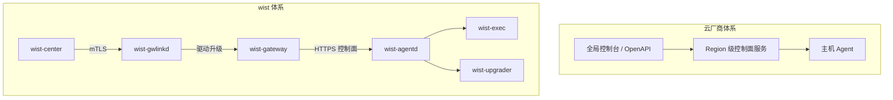

# wist 体系与其他 Agent 体系的差异

> 本文只覆盖平台四层中的「采集 / 控制 / 执行」层（Wist）。
> 平台级定位、四层能力（Wist / WarpParse / WarpFusion / 安全分析）与整体竞争格局见
> [`platform-positioning.md`](platform-positioning.md)。

相关设计文档：

- [`architecture.md`](architecture.md)：总体架构、数据面 / 控制面分层
- [`../center/collection-family-capability-contract.md`](../center/collection-family-capability-contract.md)：采集面与采集能力契约（本文「扩展能力」一节的主要依据）
- [`../center/agent-content-and-work-overview.md`](../center/agent-content-and-work-overview.md)：采集面 / 单元 / 包 / 模板 / 工作
- [`../../../../wist/wist-agentd/docs/design/agentd-architecture.md`](../../../../wist/wist-agentd/docs/design/agentd-architecture.md)：agentd 的模块边界与运行模式
- [`../../../../wist/wist-gateway/docs/design/gateway-access-security.md`](../../../../wist/wist-gateway/docs/design/gateway-access-security.md)：网关身份、域名 / 证书 / endpoint 不变式
- [`standalone-convergence-checklist.md`](standalone-convergence-checklist.md)：`standalone` 收敛的核对清单

## 1. 一句话结论

在 **Agent 层**，wist 与两类体系都能比，但差异落点不同：

| 对比对象 | 最大差异 | 其余差异的地位 |
|---|---|---|
| 云厂商主机 Agent（云助手 / SSM / TAT） | **采集权限归谁** | 扩展成本、离线能力都是它的结果 |
| 可观测厂商 Agent（Datadog / Elastic / Grafana / Splunk / Dynatrace） | **控制面与数据去向是否必须由客户自持** | 扩展优势仍在，但没有对云厂商那么绝对 |

两类体系的共同点：默认都是「厂商运营控制面、厂商定义能力、数据回到厂商」。
wist 的默认是「客户运营控制面、内容与授权由客户定、数据去向可配」。

> 本文只描述差异与边界，不做优劣判断。涉及各家产品的表述均指其典型形态，具体以各家公开文档为准。

---

## 2. 先对齐角色，再谈差异

按进程名一一对位会错位。云厂商的「控制面」通常是一组共享的 region 级服务；wist 把它拆成了三层，中间层可私有化部署。

| 云厂商体系 | wist 体系 | 对位说明 |
|---|---|---|
| 云助手 / SSM / TAT 的**服务端**（命令队列、状态聚合、结果存储、安装包分发） | `wist-gateway` | 私有化、单租户、可部署在客户内网；当前实现为单副本 + SQLite |
| 全局控制台 + OpenAPI + 跨 region 治理 | `wist-center` | 管理多个 gateway：发布、升级计划、客户绑定 |
| 主机 Agent | `wist-agentd` | 常驻主机侧，定位是**控制器** |
| 通常没有独立执行器 | `wist-exec` | 同 crate 独立 bin，文件协议 |
| 通常没有独立升级器 | `wist-upgrader` | 同 crate 独立 bin |
| 没有对应物 | `wist-gwlinkd` | gateway 宿主机上的常驻，独立于网关容器维持到 center 的链路 |

**结论**：`wist-agentd` ≈ 云助手 Agent；`wist-gateway` ≈ 云助手的服务端，而不是「Agent 的一个组件」。这是后续所有对比的前提。

---

## 3. 类别一：云厂商主机 Agent

### 3.1 差异一：扩展能力 —— 采集面是内容，不是代码

#### 3.1.1 分层：谁定义、谁装载、谁判定

| 层 | 负责 | 不负责 |
|---|---|---|
| **模型** `wist-design` | 定义采集面闭集与语义、类型结构 | 运行期装载、展示文案 |
| **知识库** `wist-knowledge` | 面词表（含平台与中英文文案）、采集单元、包、模板、用途规则、发现策略 | 执行采集、判断后端能力 |
| **网关** | 装载 / 校验知识包、展开工作 spec、授权预检、下发快照 | 真正采集；不替代 agentd 的执行判定 |
| **agentd** | 执行采集、判断来源是否真能采、回报 `unsupported` | 定义面闭集、决定授权 |
| **中心** | 知识包 / 升级计划编排、机队兼容性汇总 | 替代网关 / agentd 做本地判定 |
| **Web** | 渲染 API、提供操作入口 | 维护面 ID 闭集、硬编码展示文案 |

这条分工的关键是：**「要看见什么」和「从哪拿」被拆开**。面描述需求，属于内容；载体（路径、格式、轮转）也属于内容；只有「怎么采」才是 agentd 的能力。

#### 3.1.2 两条扩展轨道

判断入口只有一句：**新面能不能用现有的 `source_kind` + 现有 exporter 采到？**

**轨道 A：复用已有能力（目标态：1 个知识库 PR）**

1. 定语义：面 ID、含义、平台、典型来源；评审「只增不改名」；
2. 知识库 `[[families]]` 追加一条（含 `platforms` 与中英文文案）；
3. 加单元 / 包 / 模板，bump `catalog_version`；
4. 需要解析就补 `rule_ref` / rule / OML；
5. 跑 `wist-verify collect`，确认能力的每一维都有人满足；
6. 录入 → 激活（不重启，无需网关发版）；
7. 授权 → Agent 拉快照 → 确认无 `unsupported` 且数据到达预期面。

**轨道 B：需要新采集方式（能力项目）**

进入条件：现有 `source_kind` / exporter / 权限模型无法覆盖要看见的内容。此时先定义**能力 ID**，agentd 实现并上报，再按轨道 A 建面与内容；发布顺序为 agentd → 网关 → 知识包 → 激活。

**轨道 B 的产出是能力，面只是它的第一个用户。** 一次能力项目可以支撑多个面。

#### 3.1.3 可验收指标与当前进度

- 目标指标：**新增一个面 = 1 个知识库 PR + 一次词表评审**，网关 / Web / agentd 均不发版；
- 词表数据化（消掉网关发版）：已完成；
- 文案数据化（消掉 Web 发版）：已完成；
- 能力上报（消掉「网关猜能力」）：待做；
- 当前仍需同步模型侧词表（由测试与知识库钉住对齐），但**不涉及发版**。

回退：轨道 A 重新激活上一代知识包（`last_known_good`）；轨道 B 由 agentd 先保持向后兼容，**不得**先撤内容再撤能力。

#### 3.1.4 与云厂商的对照

| | 云厂商典型形态 | wist |
|---|---|---|
| 新增采集项的载体 | Agent / 插件版本 + 控制台配置 | 知识库（词表 + 单元 + 包 + 模板） |
| 新增一个「面」的成本 | 产品需求 → 研发 → 发版 → 灰度 → 客户升级 | 词表 + 内容 + 校验；目标态 1 个知识库 PR |
| 生效方式 | 升级 Agent / 等厂商推送 | 激活知识包，不重启 |
| 回退 | 回滚 Agent 版本 | 重新激活上一代知识包 |
| 新采集机制 | 必然发版 | 能力项目（agentd 发版），面只是第一个用户 |

#### 3.1.5 这条优势的边界

写进对外材料时要带上，否则会被追问：

- **新采集机制仍然要发版**：轨道 B 是 agentd 的能力项目，不是「什么都零成本」；
- **面 ID 只增不改名**：语义若改变历史数据的所指，必须出新面；
- **采集能力有最终判定权在 agentd**：网关只能预检，不能替 agentd 承诺「采得到」；
- **知识包本身有版本与激活语义**：不是改完即生效，需要录入 → 激活，回退也走知识包；
- **只在 `managed` 下生效**：`standalone`（无网关）不采集，扩展能力没有落点（见 §5）。

### 3.2 差异二：控制权 —— 客户在自己的边界内闭环

#### 3.2.1 先把「控制权」拆成五个落点

云厂商的客户并非没有控制权——控制台可以下命令、可以选采集项。差异在于**控制权的边界与可验证性**。

| 控制点 | 云厂商典型形态 | wist |
|---|---|---|
| **采什么** | 控制台勾选产品内置项；自定义靠脚本 | 按面授权（`StandingWork` / `OneShotWork`），且**必须由人落这一笔**（采集范围是合规边界） |
| **发给谁** | 厂商产品 endpoint | uplink 目标由部署级开关决定；也可 `output kind = "file"` 本地落盘 |
| **升不升、何时升** | 厂商推送节奏，客户通常只能接受 | 中心出灰度计划，网关执行；**批准与推进两处人工闸门**，逐台进度可见 |
| **谁运营控制面** | 厂商 | `gateway` 部署在客户侧，`center` 可选 |
| **能否验证** | 控制台状态（在线 / 离线 / 指标） | 授权视图 vs **本机工作视图**（agent 自报实际在采哪些文件、一次性工作做到哪一步） |
| **身份与信任** | 厂商统一签发 / 实例元数据 / AK | 一次性 enrollment token → 凭据；mTLS，**每客户一把 CA** |

#### 3.2.2 控制权不是「客户全权」：三条不可越过的边界

1. **授权只能由人落笔**：采集范围是合规边界，agentd 不自行扩大授权，网关也不能代替人做判定。
2. **agentd 保留最终执行判定**：网关说「可采」不算数，agentd 在 apply 时按本机能力判定，接不了就报 `unsupported`。
3. **中心仍然承担治理**：升级计划、发布、跨网关汇总在 center；客户控制的是「批不批、推到哪」，不是绕过治理。

#### 3.2.3 可验证性：控制权的另一半

只「能下指令」不够，还要能回答「我授权的东西，机器上到底执行了没有」。

wist 把这两件事分成两个并列视图，**不合并**：

- **网关侧**：授权了什么（`standing` / `one_shot`，带授权序号）；
- **本机侧**：agent 自报实际在采什么（`state/work.json` 子集），包括**本机手工加的输入**——这部分网关无从得知。

两者不一致时点明差异（例如授权序号不一致），这就是「控制权可验证」的落点。云厂商 Agent 通常只暴露在线状态与指标，看不到这层对照。

#### 3.2.4 这条优势的边界

- **控制面规模**：`wist-gateway` 当前是单副本 + SQLite 单写者，不跨主机共享；水平扩展需要换 Postgres。控制权下放的代价是每客户 / 每机群一套网关；
- **私有化运维成本**转移给了客户或交付方；
- **平台覆盖**：当前为 Linux + macOS，**没有 Windows**；云厂商 Agent 通常覆盖 Linux + Windows。

### 3.3 其余差异（次要，但常被问到）

| 维度 | 云厂商典型形态 | wist |
|---|---|---|
| 分层 | 云服务 → Agent 两层 | center → gateway → agentd 三层 |
| 进程模型 | 一个 Agent 多职责，常按产品拆多个 Agent | 一个 agentd 多域，执行 / 升级拆独立 bin |
| 边缘职责 | 服务端下命令，Agent 执行回传 | 边缘还有本地校验 / 准入（版本、目标、过期、签名与 attestation、capability、constraints、步骤图） |
| 离线能力 | 断网基本无产品价值 | `standalone` 只保留本地执行与状态机：**不采集、不缓冲、不上送**；断网时采集停止，不是离线采集器 |
| 规模模型 | region 级多租户、弹性扩展 | 每客户 / 每机群一个网关，center 聚合 |

---

## 4. 类别二：可观测厂商的 Agent（Datadog 等）

### 4.1 定位：这一类更像我们

Datadog 不像云助手（云厂商的运维末梢），它更像 wist：**在客户环境里跑一个常驻 Agent，向上连控制面，向下做采集**。

所以对比的落点会变：

- 与云助手比，最大差异是「采集权限归谁」；
- 与 Datadog 比，最大差异收窄为「**控制面与数据去向是否必须由客户自持**」。

### 4.2 对照

| 维度 | Datadog Agent | wist |
|---|---|---|
| 定位 | 可观测 SaaS 的边缘采集器 | 可观测 + 受控执行的边缘控制器 |
| 控制面 | Datadog SaaS（Fleet Automation 做远程配置 / 版本管理），客户不自持 | `wist-gateway` 可部署在客户边界内，`center` 可选 |
| 数据去向 | 主要进 Datadog intake（API key + site endpoint） | uplink 目标可配（WarpParse / 本地文件 / 客户数据面） |
| 采集扩展 | Integration 包（Python / Go check）+ 配置；新增集成本质是发版 | 采集面 = 知识库内容；轨道 A 不发版，新采集机制才发版（轨道 B） |
| 授权模型 | 配置即授权（YAML / Autodiscovery / 远程配置） | 显式 `WorkGrant` / `StandingWork`，人落笔、带序号、可撤回、可审计 |
| 远程执行 | 基本不做（安全姿态上刻意不做任意命令） | `ActionPlan` + `wist-exec`，本地校验（签名 / 能力 / 约束 / 步骤图） |
| 升级 | 包管理器 / 安装脚本 / Fleet Automation 触发 | 中心灰度计划 + 网关执行 + 两处人工闸门 + 判死回滚 |
| 规模模型 | SaaS 多租户、全球站点、弹性 | 每客户 / 每机群一个网关，单副本 SQLite，靠 center 聚合 |
| 观测深度 | APM / Profiling / RUM / 安全 / 网络，非常深 | 日志 / 指标 / 发现 / 安全审计源 + 执行闭环，深度还在补 |
| 开源 / 私有化 | Agent 开源，后端 SaaS | 全栈可私有化（agent + gateway + center + 知识库） |

### 4.3 四个真正的差异

**1. 控制面与数据去向是否必须由客户自持**

Datadog 的 Agent 可以在本地跑、可以用本地 YAML，但**决定「采什么、往哪发」的那层在 Datadog SaaS**，数据也基本必须进 Datadog。wist 的 gateway 可以进客户内网，uplink 可以指向客户自己的数据面，甚至 `file` 本地落盘。

但这条**不是 wist 独有**：Elastic Fleet Server、Splunk Deployment Server 也能自托管控制面（见 §4.5）。所以对外讲的时候，别把「可自托管」当成唯一卖点。

**2. 扩展模型：集成包 vs 内容 / 能力分离**

Datadog 的集成生态很成熟，但新增一类采集项，本质仍是**发一个 integration 包**；客户自定义 check 也要写代码、打包、分发。

wist 把「要看见什么」（采集面 / 单元，内容）和「怎么采」（能力，agentd 代码）拆开了：轨道 A 只改知识库，激活即生效；只有需要新采集机制时才走 agentd 发版。

**这条差异比跟云助手比时窄得多**——Datadog 的集成框架已经把这件做得不差，wist 的优势主要在「客户自己改内容、不依赖厂商发版」。

**3. 授权是不是一个独立对象**

Datadog 的「采什么」就是配置；配置改了就是授权改了，审计靠配置变更记录。

wist 把授权做成了独立对象：`WorkGrant` 带序号、由人落笔（采集范围是合规边界）、可撤回、可对照「授权了什么」与「本机实际在干什么」。这是 toB / 合规场景的差异，不是功能多少的差异。

**4. 职责边界：采集器 vs 控制器**

Datadog Agent 刻意不做任意远程命令执行，这是它的安全姿态；远程操作由 SaaS 侧的其他产品承担。

wist 的 `agentd` 明确是**控制器**：接收 `ActionPlan`、本地校验、排队、拉起 `wist-exec`，并负责升级编排。观测与受控执行在同一套体系里，代价是攻击面与治理复杂度更高（所以才有签名、attestation、审批、审计这些约束）。

### 4.4 Datadog 强在哪（写对比时别回避）

- **观测深度**：APM、Profiling、RUM、CSPM / CWS、网络监控，wist 目前不在同一量级；
- **开箱即用**：安装即有大盘、有集成目录、有告警生态；
- **规模与运维**：SaaS 多租户弹性，不用客户自己养网关；
- **OTel 兼容**：Agent 已支持 OTLP，且数据面在往 Rust / OTel 方向走（Datadog Agent Data Plane），方向上和 wist 的 `warp-parse` 是同一类思路。

### 4.5 其他可观测厂商（补注）

「客户自持控制面」并不是 wist 独有。下面几家在这个维度上更接近 wist：

| 产品 | 控制面 | 扩展模型 | 与 wist 的关系 |
|---|---|---|---|
| **Datadog Agent** | SaaS（Fleet Automation） | integration 包 + 配置 | 观测最深，客户控制最少 |
| **Grafana Alloy** | 可自托管（Grafana Cloud 可选） | OTel collector 管道配置 | 数据面最接近「客户自有」，但没有授权对象，也不做远程执行 |
| **Elastic Agent + Fleet Server** | Fleet Server 可自托管 | policy + integration 包 | 最接近「客户自持控制面」；policy 仍是配置，不是人签的授权 |
| **Splunk Universal Forwarder** | Deployment Server 可自托管 | app / 配置分发 | 传统日志转发，控制面自持成熟，但无统一授权与执行闭环 |
| **Dynatrace OneAgent** | SaaS 控制 | 自动注入 + 扩展 | 观测深、客户控制最少 |

所以 wist 的差异不是「能不能自托管」，而是把三件事放在了同一套体系里：

1. **人落笔、可撤回的授权对象**；
2. **内容驱动的扩展**（面 / 单元 / 包 / 模板）；
3. **受控执行与升级**（`ActionPlan` + `wist-exec` + `wist-upgrader`）。

---

## 5. 运行模式口径（已定：2026-10-18）

**决策：`standalone`（无网关）= 不采、不缓、不发。**

- `standalone` 只作为**本地执行器 + 状态机**常驻：保留本地执行状态机、本地触发执行（CLI / 手动动作）
  与受限的本地升级辅助；
- 采集、发现、标准化、缓冲、上送、自观测上报**只在 `managed` 下运行**；
- `standalone` 下即使配置里写了 `[telemetry.logs]` / `[discovery]` 也不生效，**不产生 spool**；
- 因此不存在「离线采集器」形态：要采集就必须接入网关。

理由：没有网关就没有授权、没有上送目标、没有数据消费方；继续采集只会产生无人消费的缓冲与磁盘占用。
用「本地落盘」兜底也不成立——它既不是完整数据面，又会把「装了没配」伪装成「在工作」。

被这条决策统一的三处：

| 文档 | 现在的表述 |
|---|---|
| [`architecture.md`](architecture.md) §4.3 | 数据面只在 `managed` 下运行；`standalone` 是本地执行器 |
| [`../../../../wist/wist-agentd/docs/design/agentd-architecture.md`](../../../../wist/wist-agentd/docs/design/agentd-architecture.md) §2.1 / §2.2 | 开关表 1–9 关、10–12 开（与上一条一致） |
| [`../../../../wist/wist-agentd/docs/design/agent-config-schema.md`](../../../../wist/wist-agentd/docs/design/agent-config-schema.md) §4 / §7 / §8 | `standalone` 下 telemetry / discovery 整段不生效 |

**对实现的影响**（不能只改文档）：

- 代码中 `standalone` 仍会跑 discovery / 本地 file 输出的部分要按表收敛——
  `agentd-architecture.md` §2.2 末尾的「实现对齐」注指的就是这一处；
- `diagnose` 要能区分「没有网关（standalone，不采）」与「已接入但上送不可用」；
- 数据面替代切片（M4）的验收前提改为 `managed`，实现顺序需相应重排。

逐项核对（判据 / 验收方式 / 现状）见 [`standalone-convergence-checklist.md`](standalone-convergence-checklist.md)；
跟踪 issue：`dayu-sec/wist-agentd#26`。

---

## 6. 两类体系的共同结论：最大的区别

- **云厂商卖的是「能力」**：你买的是它已经决定好的采集与运维能力；
- **可观测厂商卖的是「观测结果」**：你买的是仪表盘、告警与分析，控制面和数据都在它那里；
- **wist 卖的是「握住控制面和数据去向的那套机器」**：能力、内容、授权、数据去向都可以留在客户边界内。

一句话：

> 云厂商把能力卖给你；Datadog 把观测结果卖给你；wist 把决定权交给你。

这条成立的前提（必须写进对外材料）：

1. **gateway 真的在客户边界内**；
2. **授权真的由人落笔**；
3. **客户愿意承担控制面的运维成本**。

缺一条，wist 就退化成「另一个 agent 体系」。

---

## 7. 速查

- **对云厂商**：最大差异是采集权限归谁；扩展成本低与控制权是这条结构的收益。
- **对 Datadog**：最大差异是控制面与数据去向是否必须自持；扩展优势仍在，但没那么绝对。
- **对 Elastic / Grafana / Splunk**：自持控制面不独特；wist 的差异是「授权对象 + 内容扩展 + 受控执行」三者同体系。
- **不是离线采集器**：`standalone` 不采集；要采集必须接入网关（§5）。
- **不是替代关系**：对方胜在观测深度、开箱即用与规模；wist 胜在控制边界与扩展成本。

---

## 8. 证据索引

| 结论 | 出处 |
|---|---|
| 采集面是内容、1 个 PR 的可验收指标、轨道 A / B | `wist-design/doc/design/center/collection-family-capability-contract.md` §1、§3、§5.2、§13 |
| 词表 / 文案数据化已完成，能力上报待做 | 同上 §12.1 |
| 授权是合规边界、必须由人落笔 | `wist/wist-gateway/src/api/admin_ops.rs`（`GrantWorkRequest` 附近注释） |
| 授权视图 vs 本机工作视图 | 同上 `AgentWorkView`（`standing` 与 `local` 并列） |
| 上送目标由部署级开关决定 | 同上 `SetAgentUplinkRequest` |
| 升级两处人工闸门 | `wist/wist-center` 的 `rollout-plans/approve` 与 `advance`；`wist-gateway-web` 升级页 |
| 网关身份不变式、每客户 CA | `wist/wist-gateway/docs/design/gateway-access-security.md` §3 |
| agentd 是控制器、执行 / 升级拆独立 bin | `wist/wist-agentd/docs/design/agentd-architecture.md` §2、§4 |
| `standalone` = 不采、不缓、不发 | 本文 §5；`architecture.md` §4.3；`agentd-architecture.md` §2.1 / §2.2 |
| gateway 单副本 + SQLite | `wist/wist-gateway/README.md`（Storage 一节） |
| Datadog 的控制面 / 集成 / 数据面形态 | Datadog 公开文档（Agent、Fleet Automation、Agent Data Plane） |
| Elastic Fleet / Grafana Alloy / Splunk Deployment Server 可自托管 | 各家公开文档 |
